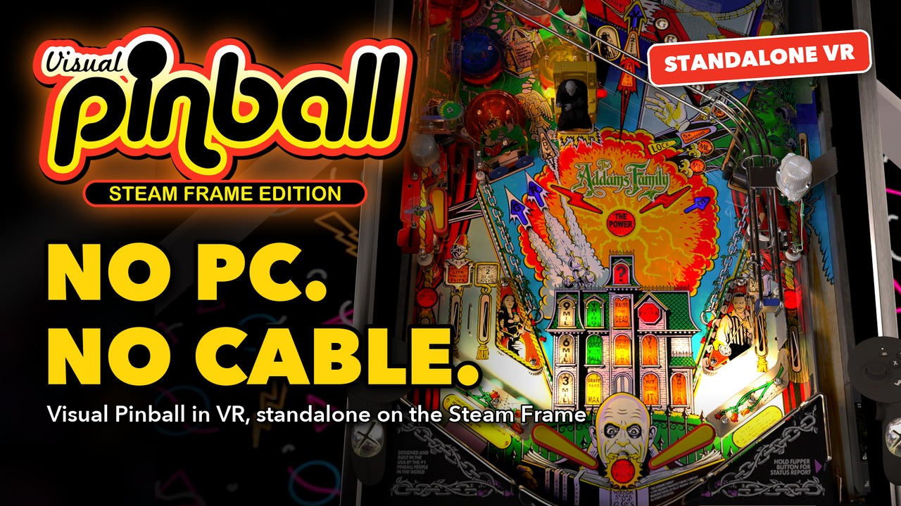
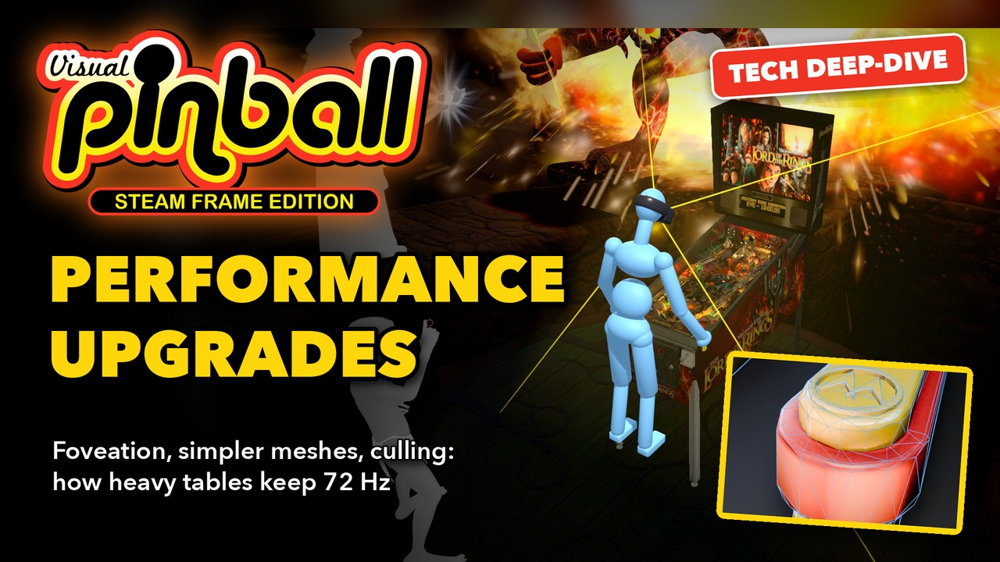

# Visual Pinball X: Steam Frame Edition

An independent fork of [Visual Pinball X](https://github.com/vpinball/vpinball) that runs as a standalone app on the Valve Steam Frame: natively on the headset (SteamOS on ARM64, OpenXR, Vulkan), with no PC and no cable. It adds a table launcher that works from inside the headset, a table library and picker, a lobby, uploading tables and ROMs from a browser, scores and leaderboards, automatic performance tuning for the Steam Frame (Foveated rendering, Mesh simplification, Object culling and Dynamic resolution), and a menu made for the VR controllers. It keeps following the upstream project and merges its work.

**Status: Working and tested as a standalone app on the Steam Frame.**

**No tables or ROMs are included in this package**: bring your own. To find tables to download, see the [Virtual Pinball Spreadsheet](https://virtualpinballspreadsheet.github.io/), and [VPForums](https://www.vpforums.org/), which is also the place to learn more about Visual Pinball; VR tables are in its [VR tables download section](https://www.vpforums.org/index.php?app=downloads&showcat=56).

> [!CAUTION]
> **This fork is not endorsed by, affiliated with, or supported by the Visual Pinball team or community.** It is developed with extensive AI-assisted coding, which is why it is kept apart from the official project. Please do **not** ask support questions about it in the Visual Pinball repositories, Discord servers or community forums: report problems and ask questions in [this fork's issues](https://github.com/SPD13/vpinball-steam-frame/issues). The official project is [vpinball/vpinball](https://github.com/vpinball/vpinball).
>
> **This fork applies and respects the licence terms of the upstream project** ([LICENSE](/LICENSE)): it is totally free and open source.

[](https://youtu.be/YvKycmiTYIY)

**▶ [Watch the trailer](https://youtu.be/YvKycmiTYIY)** (2:11): the VR version, with the VR menu and table search, Steam Frame tuning and eye-tracked foveated rendering, uploading tables over Wi-Fi, player profiles and online scores, the installer and one-click updates.

**▶ [Get help with the tutorials](/docs/tutorials/tutorials.md)**: step-by-step guides with screenshots and videos, starting with adding tables and ROMs.

**▶ [Getting started - Install on your Steam Frame](#how-to-install)**

## What the player gets

In the standalone builds (the Steam Frame app, and the standalone desktop builds):

- **Eye-tracked foveated rendering, exclusive to this fork and to the Steam Frame build**: full shading only around the point the eyes look at, following the headset's eye tracker, through a fragment shading rate image that the Frame's driver applies in its fast direct render path: 2–4 ms per frame on heavy tables at native 2160×2160 per eye, on by default (Medium), and since 2026-10-30 applied to the tone mapping and anti-aliasing passes too, about 1.7 ms more per frame; a "Foveated rendering" level (Off / Low / Medium / High), an "Eye-tracked" switch, a "Foveated tone mapping" switch, a "Foveated anti-aliasing" choice (Always Off, Always On, or Automatic: foveated only on the tables that cannot hold their full resolution without it), and status lines in the Steam Frame screen of the menu (the VR settings page in the classic menu). Not in upstream Visual Pinball, and inert on Windows and macOS, whose builds lack the Vulkan driver support and the bgfx patches ([full technical reference](/docs/Foveated%20Rendering%20on%20the%20Steam%20Frame.md)).
- **Dynamic resolution in the headset**: the rendering resolution follows the GPU time of the frames, between a minimum and the table's resolution, so heavy tables and a hot headset keep their frame rate instead of judder on head movements, and light tables keep the full sharpness; a switch, a target and a minimum in the Steam Frame screen of the menu (the VR settings page in the classic menu), with a status line.
- **Simplified meshes, exclusive to this fork**: the large 3D parts of heavy tables (tables built from scans or exports, like the Addams Family VR room) are drawn with fewer triangles wherever the difference cannot be seen from the player's eyes, and in full when the player leans in close. Measured on the Steam Frame: 1.3 ms less per frame on the Addams Family at the native 2160×2160 per eye, which then stays at the full resolution 95 % of the time instead of 45 %; 0.2 to 0.5 ms on other heavy tables, nothing to pay on light ones. Made while the table loads (about a second longer on the heaviest tables), without changing the table's file or its physics. On by default on the Steam Frame, off on the desktop builds; a switch, the allowed error in pixels and a status line in the Steam Frame screen of the menu, applied at once and saved for the table or for all tables; the performance panel shows the share of triangles left out ([details](/docs/Performance%20on%20the%20Steam%20Frame.md)).
- **Steam Frame screen in the menu**: the performance features of this fork in one place, behind their own icon on the menu's rail: dynamic resolution, foveated rendering, simplified meshes and the format of the scene buffer.
- **Scores and leaderboards**: the score of every game played on a library table is recorded automatically, for the player chosen in the lobby ("Player: <name>"), with a result screen (rank, personal best, table record) when the lobby comes back, a Scores tab with the leaderboard of each table, the 10 best scores in each table's page, and a Scores page in the browser to filter, reassign, delete or clear scores (with confirmation) and manage the players ([details](/docs/Table%20Scores%20and%20Leaderboards.md)).
- **Lobby rooms**: the lobby is a real room around the player, built in Blender with its lighting baked into its textures, so it costs almost nothing per frame on the Frame. Three rooms are shipped: the **Game room**, a lounge at night with arcade cabinets, a pinball machine, a neon sign and a city skyline through a big window (the default); the **Modern room**, with an oak slat wall, cove lighting and a sofa; and the **Sunlit studio**, with sunbeams from a garden through tall windows, dartboards and a desk. The previous lobby, a floor of tiles, is kept as the **Empty room**. All are made from CC0 assets and artwork drawn for them ([credits](/steamframe/lobby-room/CREDITS.md), and [how they are made](/steamframe/lobby-room/DESIGNING-ROOMS.md) to design more).
- **Lobby room selector**: "Choose a lobby room", in the Menu and lobby section at the top of the VR & Room screen (and in the System screen), shows a picture of each room; the room picked is used at once and kept for the next starts.
- **Use any VR table room as the lobby**: while playing a table that has a VR room, "Use this VR room in the lobby" in the menu makes the lobby load the room of that table (its walls, floor and scenery, without the table or its cabinet), so the tables are chosen in that room; "Use the default lobby room" brings back the lobby room chosen with the selector.
- **A cabinet and a room for every table, exclusive to this fork**: tables made for desktops and real cabinets, with no VR room or cabinet of their own, no longer show a playfield floating in the air. They stand in a pinball cabinet, a standard body with generic art and a plunger or a launch button to match the table, inside the lobby room you chose; the table's backglass shows on the backbox when its `.directb2s` file is next to the table ([see below](#tables-with-no-cabinet)).
- **Table picker** in the in-game menu ("Tables"), which is also the start screen in launcher mode: choose and switch tables without leaving the player.
- **Lists of tables** as tabs: All, Recent, Newly added, Most played, Favorites, plus a MENU tab for the library and application options. The tabs are large buttons, easy to hit with a mouse or a VR pointer.
- **Thumbnails**: a grid of table images, loaded in the background with a spinner on each tile meanwhile; a list view is also available. A table without an image gets a screenshot when it is closed, and "Replace table image" takes a new one.
- **Custom thumbnails**: give any table the picture you want in the table picker, such as the wheel image of a front-end setup, its backglass, a flyer or your own artwork. In the Tables page of the browser, "..." > **Upload thumbnail** on the table picks an image file on your computer; it is resized for the picker and replaces the table's image in the headset at once. Transparent images, like most wheels, keep their transparency.
- **Favorites**: a star on each thumbnail, or "Add to favorites" in the table's page; the Favorites tab lists them.
- **Search** as you type (a virtual keyboard in VR), a letter filter and A–Z / Z–A sort in the All tab, and play statistics (added, last played, times played) for the hovered table.
- **Table actions**: play, restart, rename, reset the table settings, delete, and use the table's VR room in the lobby.
- **Lobby** in launcher mode, from which tables are started and to which they return, in the room chosen with the lobby room selector.
- **Web upload**: add tables and ROMs from a browser on the local network, with a pairing code that can be switched off, missing ROMs listed, and a link to the ROM folder. It can be on for the session only or always on (started with the application), and stays on while switching between the lobby and the tables.
- **Tables page in the browser**, the home page of the web server: the library as a grid of thumbnails with the picker's tabs and search, a star to add or remove a favorite, and a "..." menu on each table to set its **display name** (the name the picker shows, the files are not renamed), **upload a thumbnail** from the computer, or **delete** it with all its files. With an empty library it links to the file manager, which stays one click away.
- **Full backup of tables, ROMs, settings and scores**: a Backup page in the browser, next to Files, downloads everything the Frame holds to your computer (tables with their backglasses and PuP packs, table images, ROMs, machine saves, favorites and names, settings, scores and players, ROM aliases), or only the items and tables you choose. Restore it after a fresh installation or onto another Frame, item by item and table by table: scores, players and favorites are merged with the ones already there ([how it works](#backup-and-restore)).
- **Missing ROM message** naming the files to add and where.
- **Tables that rename their game**: some tables, often mods, ask PinMAME for their game under another name (the Simpsons Treehouse of Horror mod asks for `simpprtyh` instead of `simpprty`) and tell you to add an alias to `VPMAlias.txt`. The game finds that alias by itself in the table's files (readme, script, ROM, colorization folders) and adds it, and a ROM shipped in a folder of its own (`MutedRom/`) is moved to the ROM folder. The aliases can be checked and edited in the browser, in the file manager's **⋮ > Advanced > PinMAME ROM aliases** (see [PinMAME ROM aliases](#pinmame-rom-aliases)).
- **Fixes for broken tables and ROMs**: some tables and games do not work as they are, because of a bug in their script or a setting of their ROM. The game ships fixes for the ones found so far, each with the record of what it changes and why. Tables you add get the fixes they need by themselves; the ones already on the Frame get them with **Patch table** in their menu, in the headset or in the browser. The table files themselves are never changed (see [How to patch a broken table?](#how-to-patch-a-broken-table)).
- **VR**: the menu on a panel standing in the room, in the table's direction, at an adjustable distance, used with the controllers' pointer; notifications above the menu.
- **Passthrough, exclusive to this fork**: play in your own room. The headset shows your real room around the cabinet instead of the virtual room of the table and of the lobby: the walls, floors and scenery of every table are left out, its cabinet and backglass stay. **Y** switches it on and off at any time, in a table or in the lobby, and the game starts again as you left it; also in **VR & Room > Passthrough**. The loading message between two tables floats in your room too. Tables without a cabinet model get the default cabinet, without its room ([see below](#passthrough)).
- **Cabinet positioning mode, exclusive to this fork**: stand the cabinet against a real piece of furniture. The headset shows your room, a bar joins the two controllers with the lockbar drawn on it, and the lockbar follows them as you hold them on a real edge, a desk or a shelf; a press fixes the cabinet there, for every table. The cabinet keeps its size, and it can't be fixed outside the play area set in SteamVR: the lockbar turns orange near its edge and red outside ([see below](#cabinet-position)).
- **No "controller detected" prompt for the VR controllers**: Steam Input also presents the Frame controllers as an Xbox gamepad; in VR, VPX no longer asks to set up a layout for it, since the controllers already work through OpenXR.
- **PinOne pinball controller**: by USB, or over Bluetooth in its Xbox mode, read directly with Steam Input on; **Set PinOne Mini mapping and DOF Config** in its page under **Controls** maps its flippers, magna-saves, buttons, plunger and nudge in one step. No pop-up offers a layout when a controller connects, so a mapping made by hand stays as it is ([PinOne pinball controller](#pinone-pinball-controller)).
- **Vibrations on the controller that started the game**: when several controllers are connected (the VR controllers and a pinball controller), only the one you pressed Start on vibrates (**Controls** > *Send vibrations to the controller used to start the game*, on by default).
- **DOF feedback on the PinOne**: the table drives the PinOne's outputs (solenoids, shaker, knocker, lights) through DOF, by USB, or over Bluetooth while the PinOne stays an Xbox controller; a DOF configuration for the PinOne Mini ships with the game (one button in the controller's page sets it up), or upload your own from the DOF Config Tool, and choose between the table's DOF and the game's vibrations ([DOF feedback](#dof-feedback), [DOF and Vibrations](#dof-and-vibrations)).
- **Steadier chrome, smoother edges**: specular anti-aliasing in the material shader stops the shiny parts from sparkling when the image is resampled every frame, on every platform; the headset builds also default to Standard FXAA, the only anti-aliasing within the Frame's budget at native resolution ([details](/docs/Image%20Quality%20on%20the%20Steam%20Frame.md)).
- **Updates from the headset**: when a newer version is published, a yellow badge above the menu says "New version available, Click here to install". Selecting it downloads the new version, checks it and installs it in place of the game, while the menu is replaced by the progress (the buttons do nothing meanwhile, so no table can be started); then the game exits, to be started again from the Steam library. Tables, settings, scores and play statistics are kept. The first install, and the versions before this feature, still go through the installer app.

## How to install

The game is not on the Steam store. It is installed on the Frame from a computer on the same network: the **installer app** finds the Frame, checks that it is ready, then downloads the latest version of the game and installs it, with its entry and artwork in the Steam library. The same app updates the game later. Nothing is installed on the computer itself.

**▶ [See the instruction in video](https://youtu.be/HmzkSPvwXjg)**

**▶ [See instructions](/docs/tutorials/Installing%20the%20Game.md)**

### What you need

- A Steam Frame and a computer on the **same network**.
- A computer with **Windows 10 or 11** (64-bit), **macOS 12 or later** (Apple silicon or Intel) or **Linux**. Nothing else is needed: the installer app brings everything it uses.
- An internet connection: the app downloads the game (about 170 MB) from this repository's releases.
- Your own tables (`.vpx`) and, for the tables that need them, their ROMs: none are included.

### 1. Turn on Developer Mode on the Frame

1. On the Frame, open **Settings > System** and turn on **Enable Developer Mode**.
2. In the **Developer** section that appears, choose **Set User Password** and pick a password. The installer asks for it.

Keep the headset on (or awake) while installing: it leaves the network when it goes to sleep.

### 2. Download the installer app

| Computer | Download |
| --- | --- |
| Windows 10, 11 | [VPX-Frame-Installer-Windows.exe](https://github.com/SPD13/vpinball-steam-frame/releases/latest/download/VPX-Frame-Installer-Windows.exe) |
| macOS 12 or later | [VPX-Frame-Installer-macOS.zip](https://github.com/SPD13/vpinball-steam-frame/releases/latest/download/VPX-Frame-Installer-macOS.zip) |
| Linux (PC, Steam Deck) | [VPX-Frame-Installer-Linux-x86_64.tar.gz](https://github.com/SPD13/vpinball-steam-frame/releases/latest/download/VPX-Frame-Installer-Linux-x86_64.tar.gz) |
| Linux (ARM64) | [VPX-Frame-Installer-Linux-arm64.tar.gz](https://github.com/SPD13/vpinball-steam-frame/releases/latest/download/VPX-Frame-Installer-Linux-arm64.tar.gz) |

The links always give the latest version; they are also on the [releases page](https://github.com/SPD13/vpinball-steam-frame/releases). The app does not need updating with each new version of the game: it always installs the latest one.

### 3. Run the installer app

The app is not signed with a paid certificate, so Windows and macOS warn the first time it is opened:

- **Windows:** double-click `VPX-Frame-Installer-Windows.exe`. If Windows says "Windows protected your PC", choose **More info**, then **Run anyway**. (If the browser warns that the file is not commonly downloaded, choose to keep it.)
- **macOS:** open the `.zip` (Safari may already have done it) and move **Visual Pinball X Installer** to your Applications folder if you like, then double-click it. If macOS says it cannot verify the app ("Not Opened"), choose **Done**, open **System Settings > Privacy & Security**, scroll down to **Security**, choose **Open Anyway** next to the app's name and confirm. When the app asks to **find devices on local networks**, choose **Allow**: it is how it reaches the Frame.
- **Linux:** unpack the download and run the app, for example in a terminal: `tar -xzf VPX-Frame-Installer-Linux-x86_64.tar.gz && ./VPX-Frame-Installer`. It opens in your web browser; it quits when the page is closed.

The app has two steps.

**Step 1, connect to the Frame.** The app looks for the Frame on the network and shows it as found (`frame`, with its address). Type **the password set in step 1** and choose **Connect**. Four checks turn green:

1. **Frame found on the network**
2. **Developer Mode is on**
3. **Signed in to the Frame**
4. **Frame ready for the game** (Steam running, enough free space)

If a check turns red, it says what is wrong and what to do, for example: wake the headset, turn Developer Mode on, use the right password, or type the Frame's IP address (shown on the Frame in **Settings > Network**) in **Frame address**. Fix it, then choose **Check again**.

**Step 2, install.** The app shows what is on the Frame and the latest version on GitHub. Choose **Install**: the game is downloaded and sent to the Frame (a progress bar shows), then each step of the installation is listed. It ends with **Installed! Put the headset on and play.**

### 4. Play

On the Frame, open **Library > Non-Steam > Visual Pinball X - Steam Frame Edition**. The library artwork appears after Steam restarts (restarting the headset does it). The first launch may wait while Steam downloads "Steam Linux Runtime 4.0 ARM64".

> [!NOTE]
> **The Steam dashboard opens when the game starts.** The game is already running behind it: select **Resume Game** with the controller's pointer to close the dashboard and reach the lobby. This happens every time the game is started: SteamVR shows its dashboard over the games added outside the Steam store ("Non-Steam" games) when they start. There is no workaround for the moment.

### 5. Add tables

**▶ [See this in video](https://youtu.be/4qvbUkFgUvI)**

**▶ [See instructions](/docs/tutorials/Adding%20Tables%20and%20ROMs.md)**

- **From a browser (easiest):** in the game, open the table picker. Under **Add tables from a browser**, turn **Wi-Fi upload** on, then open the address it shows from a phone or computer on the same network. Upload `.vpx` files, or a `.zip` of a table's folder to bring its backglass and other files along. A `.vpx` uploaded at the top of the tables folder gets a folder of its own, named after it, and a backglass uploaded there joins its table (see [The backglass](#the-backglass)). Missing ROMs are listed there, with a link to the ROM folder. Upload a table's download as it is: when its readme asks to add an alias to `VPMAlias.txt`, the game does it.
- **Over ssh:** copy the tables to `~/Documents/VPinballX/Tables` on the Frame and the ROMs to `~/Documents/VPinballX/Tables/pinmame/roms`, for example:
  `scp "My Table.vpx" steamos@frame.local:Documents/VPinballX/Tables/`

**▶ [Where to find tables, ROMs and artwork?](https://virtualpinballspreadsheet.github.io/)**

> [!NOTE]
> **Backglass files (`.directb2s`) are optional.** Tables made for VR carry their backglass in the `.vpx`, as parts of their cabinet that the script lights and animates: they need no `.directb2s`. A table made for a desktop or a real cabinet has no backglass in the headset of its own: put its `.directb2s` next to it and turn on **Add Backglass** (off by default; **Virtual Reality Settings** in the in-game menu, or **Room** in the new VR menu) to show it above the cabinet. Tables whose script talks to the backglass (B2S) play the same without the file, and their scores are still recorded. PinUP Player tables take their backglass videos from their PuP pack, not from a `.directb2s`. Uploading a table's download as it is keeps its `.directb2s` with it, ready if you turn the setting on.

### Updating

Open the installer app again and connect (step 1). When a newer version is out, step 2 shows **Update available** with a button **Update to &lt;version&gt;**: choose it. **Up to date** means there is nothing to do. Tables, settings, scores and play statistics are kept.

Or update from the headset: when a newer version is out, select the yellow **New version available, Click here to install** badge above the menu, wait for the download and the install, select **OK**, then start the game again from the Steam library.

### Uninstalling

In the installer app, after step 1: **Uninstall the game from the Frame...** at the bottom of step 2, then **Uninstall**. It removes the game, its library entry and artwork; tick **Also delete its settings, scores and play statistics** to remove those too. The tables and ROMs in `~/Documents/VPinballX/Tables` are never deleted. To keep everything for a new installation, make a [backup](#backup-and-restore) first.

### Troubleshooting

| Problem | What to do |
| --- | --- |
| The Frame is not found, or "No answer from" its address | Wake the headset (put it on). Check that the Frame and the computer are on the same network (a guest Wi-Fi often keeps devices apart) and that Developer Mode is on. Type the Frame's IP address in **Frame address**. |
| "The Frame does not accept connections" | Developer Mode is off: turn it on (step 1). |
| "The password was refused" | Type the password set in **Settings > Developer > Set User Password**, or set a new one there. |
| "The Frame's identity has changed" | Expected after the Frame was reset: choose **Trust the Frame's new key**. |
| "Steam is not running on the Frame" | Put the headset on so it is in its normal mode, then choose **Check again**. |
| macOS: the app "cannot be opened" or is "Not Opened" | **System Settings > Privacy & Security > Open Anyway** (see step 3). If it cannot find the Frame, allow it in **System Settings > Privacy & Security > Local Network**. |
| The game is missing from the library | Look under **Library > Non-Steam**. Restart Steam on the Frame if it is still missing. |
| The Steam dashboard stays open when the game starts | Expected: select **Resume Game** (see step 4). |
| A table does not start, and its log says "Game name not found" | The table asks PinMAME for a game name it does not know, usually a mod that renames its game. In the browser, open the file manager, **⋮ > Advanced > PinMAME ROM aliases**: the tables in this case are listed at the top. Add a line `name,game` with the game from the table's readme (for example `simpprtyh,simpprty`), save, and start the table again. Its ROM (`game.zip`) must be in the ROM folder. See [PinMAME ROM aliases](#pinmame-rom-aliases). |
| The game closes at once | Read its log on the Frame: `ssh steamos@frame.local cat .local/share/VPinballX/10.8/vpinball.log` |
| Something else | The installer app keeps a log of what it did: `installer.log` in `%LOCALAPPDATA%\vpx-frame-installer` (Windows), `~/Library/Caches/vpx-frame-installer` (macOS) or `~/.cache/vpx-frame-installer` (Linux). Attach it when you [report the problem](https://github.com/SPD13/vpinball-steam-frame/issues). |

Developer Mode stays on after the install: it is how the game is installed and updated. Whether the game keeps working with Developer Mode turned off again has not been checked.

### Installing with the scripts instead

Each release also has the game in an archive with installer scripts, for macOS 11 and earlier, for scripted installs, or to choose the name and id of the game in the library. The scripts need nothing extra either: on Windows, they use PowerShell and the `ssh` and `tar` commands that Windows includes; on macOS and Linux, a terminal. To update, download the new version and install it the same way; to uninstall, run `Uninstall on Windows.bat` or `./uninstall.sh` (`-Settings` / `--settings` also removes the settings, scores and statistics).

#### Scripts on Windows

Download `vpx-steam-frame-<version>.zip` from the [releases page](https://github.com/SPD13/vpinball-steam-frame/releases).

1. **Unpack the download:** right-click `vpx-steam-frame-<version>.zip` in your Downloads folder, choose **Extract All...**, then **Extract**. A folder of the same name opens.
2. **Double-click `Install on Windows.bat`** in that folder. If Windows warns that the file comes from the internet ("Windows protected your PC"), choose **More info**, then **Run anyway**.
3. A window opens and the installer starts. When asked, type **the password set in step 1** and press <kbd>Enter</kbd>: nothing shows while you type, this is normal. It is asked **twice**: once to send the game, once to install it.
4. The game is sent (about 165 MB, a progress line shows), then installed. The window ends with:

   ```text
   ==> Done
       On the Frame: Library > Non-Steam > "Visual Pinball X - Steam Frame Edition".
   ```

   Press a key to close the window.

- **If the Frame is not found** (`frame.local` is not found on the network), the installer asks for its IP address instead, shown in the Frame's network settings (for example `192.168.1.42`).
- **If something goes wrong**, the installer stops with a message saying what to check (see [Script messages](#script-messages)). Running it again is always safe.
- The Windows installer only uses what Windows includes: PowerShell, and its `ssh` and `tar` commands. Windows Subsystem for Linux (WSL) and Git Bash are not needed, but they can also run `install.sh`, as on macOS and Linux.

#### Scripts on macOS or Linux

Download `vpx-steam-frame-<version>.tar.gz` from the [releases page](https://github.com/SPD13/vpinball-steam-frame/releases).

The installer is `install.sh`, a script in the download that you run in a terminal.

**Open a terminal:**

- **macOS:** open **Terminal** (press <kbd>Cmd</kbd>+<kbd>Space</kbd>, type `Terminal`, press <kbd>Enter</kbd>).
- **Linux:** open your terminal application.

**Go to the folder of the download,** usually your Downloads folder:

```sh
cd ~/Downloads
```

**Unpack the download and enter its folder** (replace `<version>` with the version you downloaded; press <kbd>Tab</kbd> after typing `vpx-steam-frame-` to complete the name):

```sh
tar -xzf vpx-steam-frame-<version>.tar.gz
cd vpx-steam-frame-<version>
```

If your browser already unpacked the download into a folder (Safari can), skip `tar` and `cd` into that folder.

**Run the installer**, with the headset awake:

```sh
./install.sh
```

What happens next:

1. **The first time only**, ssh asks whether to trust the Frame: `Are you sure you want to continue connecting (yes/no/[fingerprint])?`. Type `yes` and press <kbd>Enter</kbd>.
2. ssh asks for **the password set in step 1** (`steamos@frame.local's password:`). Type it and press <kbd>Enter</kbd>: nothing shows while you type, this is normal.
3. The installer goes through its steps and prints each one. The first install sends about 400 MB, which takes a few minutes; updates only send what changed.

A successful install ends like this:

```text
==> Connecting to steamos@frame.local
    type the Frame's user password when asked (the one set in Developer Mode)
    Steam Frame found

==> Valve's devkit scripts

==> Game files
    -> /home/steamos/devkit-game/VisualPinball (this takes a while the first time)

==> Steam library
    registered as "Visual Pinball X - Steam Frame Edition"

==> Library artwork
    Visual Pinball X - Steam Frame Edition: artwork installed for appid ...

==> Done
    On the Frame: Library > Non-Steam > "Visual Pinball X - Steam Frame Edition".
```

If something goes wrong, the installer stops with a message saying what to check (see [Script messages](#script-messages)). Running it again is always safe.

- **If it cannot find the Frame** (`cannot connect to steamos@frame.local`), give the Frame's IP address instead, shown in the Frame's network settings: `./install.sh 192.168.1.42`.
- **If the terminal says `Permission denied`** when starting the installer, run it with `bash install.sh` instead.
- **To see the installer's options:** `./install.sh --help` (see also [Script options](#script-options)).

#### Script options

```sh
./install.sh [--name NAME] [--gameid ID] [--no-art] [user@]host                                  # macOS, Linux
powershell -ExecutionPolicy Bypass -File install.ps1 [-Name NAME] [-GameId ID] [-NoArt] [-Frame host]   # Windows
```

The options can also follow `Install on Windows.bat` when it is started from a terminal, for example `& '.\Install on Windows.bat' 192.168.1.42` in PowerShell.

- The host (`[user@]host`, `-Frame`) is the Frame's address: `frame.local` by default, or its IP address.
- `--name` / `-Name` changes the name of the game in the library. An empty name (`--name ''`, `-Name ''`) keeps the name Steam gives it, "Devkit Game: VisualPinball".
- `--gameid` / `-GameId` installs another copy beside the first one (letters, digits, `_` and `.` only). Pass the same id to the uninstaller.
- `--no-art` / `-NoArt` skips the library artwork.
- `--help` / `-Help` lists the options.
- An ssh key avoids typing the password at each install: run `ssh-copy-id steamos@frame.local` once (macOS, Linux).

#### Script messages

| Message | What to do |
| --- | --- |
| `cannot connect to steamos@frame.local`, `cannot send the game` | Wake the headset (put it on). Check that Developer Mode is on and that a password is set. Use the IP address instead of `frame.local`. |
| `ssh.exe is missing` (Windows) | In Windows **Settings > Apps > Optional features**, add **OpenSSH Client**, then install again. |
| `REMOTE HOST IDENTIFICATION HAS CHANGED` | The Frame was reset. Run `ssh-keygen -R frame.local` (or with the IP address) in a terminal (PowerShell on Windows), then install again. |
| `Steam did not register the game` | Steam is not running on the Frame: put the headset on so that it is in its normal mode, then install again. |

## Performance upgrades

The Frame renders the tables natively, on the headset's own GPU, at 2160 × 2160 pixels per eye and 72 frames per second. The heavy
Addams Family VR room needed 18.0 ms per frame at that resolution when this work started (36 fps); it now needs about 7.2 to 8.2 ms (72 fps),
and the reference tables run at 72 fps, at or close to the panel's full resolution.

[](https://youtu.be/Kwp0HPKuwCI)

**▶ [Watch the tech deep-dive](https://youtu.be/Kwp0HPKuwCI)**: foveation, simpler meshes, culling, light-map pruning, reflections, compact scene buffer, dynamic resolution: how heavy tables keep 72 Hz.

**▶ [Read the full article](/docs/steam-frame/Performance%20of%20the%20Steam%20Frame%20Edition.md)**: how each upgrade works, its measurements on the Frame, and every performance setting of the menu, with screenshots.

- **No hidden desktop render**: the desktop mirror nobody sees on the Frame is no longer rendered: 4.5–6.6 ms per frame on Addams.
- **No frame pacing stall**: the desktop window is no longer presented, which tied the headset to a 60 Hz window: 2 ms of render thread per frame back.
- **Direct rendering**: the GPU driver measures and picks the faster of its two rendering paths for each pass: 14.0 → 9.1 ms on Ghostbusters.
- **Visibility mask first**: the parts the lenses never show are masked before the table is drawn, which keeps the GPU's early depth rejection on.
- **Dynamic resolution** (Steam Frame screen): the resolution follows the GPU time of the frames; Addams stays at full resolution 88–91 % of the time.
- **Eye-tracked foveated rendering** (Steam Frame screen): full shading only where the eyes look: about 3 ms per frame on Addams.
- **Foveated tone mapping** (Steam Frame screen): the same pattern on the tone mapping pass: about 0.8 ms.
- **Foveated anti-aliasing, Automatic** (Steam Frame screen): the same pattern on the anti-aliasing pass, about 0.9 ms, turned on only for the tables that cannot hold their full resolution without it.
- **Culling**: parts entirely outside the view are not drawn: 0.6 ms on Lord of the Rings.
- **Simplified meshes** (Steam Frame screen): heavy 3D parts drawn with fewer triangles where the eye cannot see the difference: 1.29 ms on Addams.
- **Welded meshes and reflection culling**: meshes exported as separate triangles can be simplified, and parts that cannot show in the playfield reflection are not drawn in it: Albator78 from 20 to 11–12 ms, 36 → 72 fps.
- **Reflections** (Steam Frame screen): extra mirrors and the VR room left out of the reflections, On, Off or Automatic, Off by default: Robot Invasion from 22.7 to 9.4 ms and 2001 from 14.5 to 8.3 ms; Maverick from 16.4 to 11.1 ms and WildWest from 13.9 to 10.9 ms.
- **Compact scene buffer** (Steam Frame screen): the scene stored with 4 bytes per pixel instead of 8: 0.9 ms on Addams, 1.5 ms on Ghostbusters.
- **Faster FXAA**: the anti-aliasing reads the brightness the tone mapping already computed: the pass 23 % cheaper.
- **Memory and table switches**: about 430 MB less memory per table on Linux, a GPU memory budget that no longer evicts textures, and one VR session for all tables (switches 150–250 ms faster).
- **Performance panel** (Display & Performance screen): a panel beside the cabinet that rates each table every 30 seconds, with graphs of the frame rate, resolution, GPU and CPU.

## Backup and restore

A fresh installation of the Frame, or a new headset, starts with an empty library. Back up what you keep on the Frame to your computer, and restore it there later.

**▶ [See this in video](https://youtu.be/cOnA14bBJLU)**

**▶ [See instructions](/docs/tutorials/Backup%20and%20Restore.md)**

### What a backup holds

| Item | Content |
| --- | --- |
| Tables | The tables and the files along them: backglasses, music, PinUP Player packs |
| Table images | The images shown by the table picker |
| ROMs | PinMAME ROMs, with the colorizations and the sound packs of the games |
| Machine saves | High scores and settings saved by the games (PinMAME nvram, VPReg) |
| Library | Favorites, table names and play counts |
| Settings | Settings of the application and of the tables, the lobby room |
| Scores and players | Leaderboards and player profiles |
| ROM aliases | The PinMAME alias file |

### Making a backup

1. In the game, open the table picker. Under **Add tables from a browser**, turn **Wi-Fi upload** on, then open the address it shows from a computer on the same network.
2. Open **Backup**, next to Files. Tick the items to save; each one shows its size. Keep **All tables**, or pick **Choose tables** to select them one by one (a table's ROM, saves and settings follow it).
3. Select **Create backup**. The page checks the files, then the browser downloads `VPX-Backup-<date>.vpxbackup`.

The backup is made while it downloads, so it takes no space on the Frame, even for tens of gigabytes. A broken download can be resumed from the browser's downloads list. The file is a zip. It is named `.vpxbackup` so that browsers do not extract it. Restore the file as it was downloaded: a zip made again from its content is refused.

### Restoring a backup

1. On the **Backup** page, under **Restore a backup**, select **Choose a backup...** and pick the `.vpxbackup` file. The browser reads it, without uploading it whole, and shows its items and tables.
2. Tick what to bring back: all of it, some items, or only some tables.
3. Select **Restore**, then confirm. Only the selected files are uploaded.

What happens to what is already on the Frame:

- **Files** (tables, images, ROMs, saves) replace the ones with the same name. Files already there with the same size and date are skipped, so an interrupted restore can simply be started again.
- **Scores, players, favorites and table names** are merged with the Frame's. Tables are matched by their file, so scores find their table again after a reinstallation.
- **Settings** apply when the next table or the lobby loads. The Frame's own settings are kept: folders, displays, audio, controllers, the position of the table in the room, and the Wi-Fi upload settings.

The page refuses to back up or restore while a table is being played: close it first (the lobby is fine). Keep the headset awake during a backup or a restore, because it leaves the network when it sleeps. The game also asks the Frame not to sleep while a transfer runs. More details: [Steam Frame Branch](/docs/Steam%20Frame%20Branch.md), section 16.

## PinMAME ROM aliases

A table that emulates a real machine asks PinMAME for its game by the name written in its script (`cGameName`). Some tables use a name that is not PinMAME's own: an older or shorter name (`simp` for `simp_a27`), or, for many mods, a name of their own (the Simpsons Treehouse of Horror mod asks for `simpprtyh`, which is the game `simpprty`). An **alias** tells PinMAME which game to run for that name. Without one, the table loads but does not play: PinMAME stops with "Game name not found". Original tables, which do not use PinMAME, never need an alias.

**▶ [See this in video](https://youtu.be/LTy3QAzT5rQ)**

**▶ [See instructions](/docs/tutorials/ROM%20Aliases.md)**

### What the game does by itself

- **The standard aliases** of Visual PinMAME (about 120, such as `simp,simp_a27`) are installed with the alias file, the first time the game starts.
- **Aliases of mods**: when a table asks for a name PinMAME does not know, the game looks for its alias in the table's files: an `alias,game` line in the readme of the download (`.txt`, `.md`, `.nfo`, `.rtf`), a game the script names (`.Games("startrp2")`), a ROM archive or a colorization folder named after a game, or a game the name starts with. It adds the line it found to the alias file, with a comment saying where it came from. A ROM shipped in a folder of its own (`MutedRom/simpprty.zip`) is moved to the ROM folder.
- **When nothing is found**, the table is reported: a yellow warning on the **Tables** page of the browser names it, its tile gets an **Unknown game** badge, and starting it in the headset shows a message saying it needs an alias.

So upload a table's download as it is (the `.zip` with its readme), and let the game find the alias first.

### Where the aliases are

| File on the Frame | Used by |
| --- | --- |
| `~/Documents/VPinballX/Tables/pinmame/alias.txt` | All the tables |
| `pinmame/alias.txt` in a table's folder | That table only, when its folder has its own `pinmame/roms` folder (PinMAME then uses that folder instead of the shared one) |

The file has one alias per line, `name,game`: `name` is what the table asks for, `game` is the PinMAME game, whose ROM is `game.zip` in the ROM folder (`~/Documents/VPinballX/Tables/pinmame/roms`). Lines starting with `#` are comments. A line can not be longer than 127 characters.

### Setting an alias

1. **Find the game.** The table's readme or download page usually gives it ("add `simpprtyh,simpprty` to `VPMAlias.txt`"). Otherwise, the table's backglass file (`.directb2s`, a text file) often names it in `<GameName Value="...">`.
2. **Open the alias editor in a browser.** In the game, open the table picker and, under **Add tables from a browser**, turn **Wi-Fi upload** on, then open the address it shows. On the **Tables** page, click the yellow warning or a table's **Unknown game** badge. The editor is also in the file manager (**Files**), under **⋮ > Advanced > PinMAME ROM aliases**.
3. **Add the line.** The editor lists the tables asking for a game PinMAME does not know: **Add a line** next to one adds `name,` at the end of the file; type the game after the comma (for example `simpprtyh,simpprty`).
4. **Save.** A line PinMAME would misread (a single name, or more than 127 characters) is refused, with its line number. A saved alias applies the next time the table starts.
5. **Add the ROM** of the game (`game.zip`) if it is missing: upload it in the file manager's **ROMs** tab, or copy it to the ROM folder over ssh.

Over ssh, the file can also be edited directly, for example `ssh steamos@frame.local 'echo "simpprtyh,simpprty" >> Documents/VPinballX/Tables/pinmame/alias.txt'` (the file must end with a new line before you add one). More details: [PinMAME ROM aliases](/docs/PinMAME%20ROM%20Aliases.md).

## PinOne pinball controller

The PinOne pinball controller (Cleveland Software Design) works in the game by USB, and over Bluetooth in its **Xbox mode**, where it presents itself as an Xbox controller. The game reads it directly, with Steam Input left on. Technical details: [PinOne Integration](/docs/steam-frame/PinOne%20Integration.md).

> Bluetooth pairing with the Steam Frame needs a fix in the PinOne's firmware, proposed in [philipellisis/PinOne#9](https://github.com/philipellisis/PinOne/pull/9) and not in a published PinOne release yet (November 2026). Until then, connect it by USB.

### Setting its mapping

1. Open the menu, then **Controls**, and select the PinOne: **PinOne (XBox)** over Bluetooth, **PinOne Ultra** by USB. Over Bluetooth, the game tells the PinOne from a real Xbox controller with a firmware that identifies itself (proposed in [philipellisis/PinOne#11](https://github.com/philipellisis/PinOne/pull/11), not in a published PinOne release yet); with an older firmware it is listed as **Xbox Series X Controller** and its page has no PinOne items.
2. Select **Set PinOne Mini mapping and DOF Config**. It replaces every mapping of that controller with the layout below, turns DOF on and installs the game's DOF configuration for the PinOne Mini (see [DOF feedback](#dof-feedback)).

**Set default mapping**, on the same page, applies the game's generic gamepad layout instead (flippers on the triggers, magna-saves on the shoulder buttons), which does not suit the PinOne. The game no longer offers a layout in a pop-up when a controller connects, so a mapping you made by hand stays as it is. Mappings are the same for every table.

With the PinOne and the VR controllers both connected, only the controller you press Start on vibrates (in Xbox mode, the PinOne turns the vibrations into its solenoid outputs 1 and 2). To make every controller vibrate, turn off **Send vibrations to the controller used to start the game** in **Controls**.

### The PinOne mapping

| PinOne input | Over Bluetooth (Xbox control) | By USB (button) | In the game |
| --- | --- | --- | --- |
| 3, left flipper | LB | 3 | Left flipper (and upper left flipper) |
| 1, right flipper | RB | 1 | Right flipper (and upper right flipper) |
| 4, left magna-save | Left trigger | 4 | Left magna-save |
| 2, right magna-save | Right trigger | 2 | Right magna-save |
| 6, front button | A | 6 | Launch ball, Start |
| 8, front button | B | 8 | Start |
| 9, fire button | Start (Menu) | 9 | Start |
| 5, front button | Y | 5 | Insert coin |
| 7, front button | X | 7 | (free) |
| 29 | View | 29 | Menu |
| 25 to 28, front buttons with the shift button | D-pad left, right, up, down | 25 to 28 | Menu navigation; by USB also the operator menu buttons (left: Cancel, down: Down, up: Up, right: Enter) |
| Plunger | Right stick, up and down | Z axis | Plunger |
| Accelerometer | Left stick | X and Y axes | Nudge, at 200 % strength |

**Nudge strength.** A firm shake of a PinOne only moves its stick about a quarter of the way, and the game takes a full stick for a strong nudge, so at the usual 100 % its nudges were too weak to notice. The PinOne mapping sets the strength of its nudge sensor to 200 %, the most the setting allows (**Controls** > **Nudge**, then the PinOne's sensor). A mapping set before this version keeps 100 %: select **Set PinOne Mini mapping and DOF Config** again, or raise **Nudge Strength** in that page. If nudging is still too weak, make the PinOne's accelerometer more sensitive in its configuration tool: lower its maximum (*Max*), and its dead zone with it; if it becomes too strong, lower the strength in the game. **Operator menu buttons over Bluetooth.** Over Bluetooth, the PinOne mapping leaves the operator menu buttons (Cancel, Down, Up, Enter) off the D-pad, which only moves in the menus. The PinOne's tilt buttons, when on in its configuration tool, press on a hard nudge the inputs they are given, and with them on the D-pad inputs (25 to 28) a hard nudge changed the volume of a WPC game (its Up and Down buttons), and could open its test menu (Enter). To reach a table's operator menu, use the keys 7, 8, 9 and 0, or map the service buttons by hand in the controller's page. By USB, the D-pad keeps them: there, turn the PinOne's tilt buttons off or give them a free button. The game simulates the tilt from the nudges by itself, so the PinOne's tilt buttons are not needed.

The table follows the PinOne's default settings. If you changed which button sends what in the PinOne's configuration tool (its **Controller** screen for the Xbox mode), map the changed buttons by hand in the controller's page.

### DOF feedback

The table can drive the PinOne's outputs (solenoids, shaker, knocker, flashers, button lights) through DOF (DirectOutput), as on a cabinet: by USB, or over Bluetooth while the PinOne stays an Xbox controller. Over Bluetooth, the PinOne needs a firmware with its Bluetooth DOF channel and its identity (proposed in [philipellisis/PinOne#11](https://github.com/philipellisis/PinOne/pull/11), not in a published PinOne release yet); after updating the firmware, remove the PinOne from the Frame's Bluetooth devices and pair it again, as the Frame keeps the old description of its controls.

**DOF in the controller's page.** Open the menu, then **Controls**, and select the PinOne (**PinOne (XBox)** over Bluetooth, **PinOne Ultra** by USB). These items show only on a PinOne, never on a real Xbox controller:

- **Set PinOne Mini mapping and DOF Config** sets the PinOne mapping, turns DOF on, and installs the DOF configuration the game ships for the PinOne Mini. Select it again to go back to that configuration after uploading your own.
- **DOF Enable**, on a PinOne with a DOF channel (by USB, or over Bluetooth with the DOF firmware), turns DOF on or off, the same switch as **Plugins** > **DOF** > **DOF Enable**. While DOF is on, the controller's vibrations are off: the table drives its outputs (except on the tables missing from the DOF configuration, see [DOF and Vibrations](#dof-and-vibrations)).

**The PinOne Mini configuration shipped with the game** drives its two motors: port 1, the toy *Left Solenoid*, fires with the coils on the left of the table (left flipper and slingshot, ...), port 2, *Right Solenoid*, with the ones on the right (right flipper and slingshot, ball launch, ...). It covers every table of the DOF Config Tool's database, as of November 2026. To drive other toys or outputs (a shaker, a knocker, button lights, a PinOne with more outputs), or to get the tables added to the database since, make your own.

**Making your own DOF configuration**

1. Sign in on the [DOF Config Tool](https://configtool.vpuniverse.com) (create a free account if needed).
2. Under **My Account**, add the device **PinOne** (DOF numbers it LedWiz 11 for the first one).
3. In **Port Assignments**, select the PinOne and give each output you use the toy wired to it (for the PinOne Mini's two motors: *Left Solenoid* on port 1, *Right Solenoid* on port 2). Save. Without port assignments, the configuration lists the tables but fires nothing.
4. Select **Generate Config** and download the zip it makes (`directoutputconfig.zip`).
5. **Upload the zip** from a browser, like a table: in the game's table picker, turn **Wi-Fi upload** on and open the address it shows from a phone or computer on the same network, then upload the zip into any folder. The game recognizes it and moves its files to the `directoutputconfig` folder of its settings, where DOF reads them, replacing the previous ones (the shipped configuration included). The next table you start uses it. Backups include it, with the settings.

Generate and upload it again when you change your toys. **Set PinOne Mini mapping and DOF Config** replaces your configuration with the shipped one.

One configuration covers every table: there is no table to add. The DOF Config Tool writes the effects of all the tables in its community database (about 1,750) for the toys you assigned, and DOF finds a table by its ROM name (a revision of the ROM finds the same entry), or, for an original table without ROM, by the game name its script declares. There is no default for the others: a table missing from the database has no DOF effects, and the PinOne gets the game's vibrations on it instead (see below; ask for the table on the DOF Config Tool's forum).

If nothing fires, check that the PinOne's outputs have power before anything else: its motors and solenoids need their own supply plugged in, which the USB cable does not give.

### DOF and Vibrations

The PinOne's motors can follow two sources: the table's DOF, and the game's vibrations, which the PinOne turns into its outputs 1 (strong motor) and 2 (weak motor) in Xbox mode.

**DOF follows the machine.** It fires when the table's ROM or script fires a coil: flippers, slingshots, pop bumpers, kickers and saucers, the ball launch, the knocker on a replay, the shaker or a motor on some game events (the castle of Medieval Madness). The effects come from the DOF community's configuration: a coil on the left goes to the toy on the left (port 1 above), one on the right to port 2. Timing and length follow the ROM, at full strength. DOF knows the game (a free game knocks) but not the ball: a ball hitting a flipper hard gives nothing if no coil fires. It needs the table in the DOF database, and is only as good as that table's entry.

**Vibrations follow the ball.** The game's physics play them: a ball hitting a flipper (stronger the faster it goes), bumpers and slingshots firing, two balls colliding, the plunger striking the ball, a nudge, and a light pulse at each flipper press. They work on every table without configuration, and each has its own strength setting. They don't know the game's rules: no knocker, no shaker. By default the PinOne turns any vibration into its output fully on, so their strength is lost; its **PWM rumble** option (PinOne configuration tool) keeps it.

| | DOF | Vibrations |
|---|---|---|
| Feels like | The cabinet: coil kicks in the game's rhythm, on their side | The ball: impacts by their strength |
| Game events (knocker, shaker) | Yes | No |
| Ball impacts | Only when a coil fires | Yes |
| Tables | Those in the DOF database | All |
| Setup | DOF Config Tool configuration | None |

**Choosing.** On a table, the PinOne follows one or the other, never both, set by the **DOF Enable** switch of its page in **Controls** (the same as **Plugins** > **DOF** > **DOF Enable**):

| DOF Enable | The PinOne's motors follow |
|---|---|
| On (default) | The table's DOF on the tables of the DOF database (the game's vibrations are then not sent to the PinOne), the game's vibrations on the others |
| Off | The game's vibrations, on every table |

The setting takes effect right away, without restarting the game. It only concerns a PinOne: other controllers (the VR controllers) get the vibrations either way, following **Controls** > **Send vibrations to the controller used to start the game**. To feel the ball on every table, turn DOF off.

## How to patch a broken table?

Some tables do not work on the Frame as they are, even with their ROM: they close as soon as they start, or a game can not be started. Often the cause is not the game: a bug in the table script that recent versions of Visual Pinball refuse, or a ROM that needs to be set up from its service menu before it gives credits. For the ones found so far, the game ships a **fix**: a recipe that says which tables or ROMs it applies to, what it changes and why. New fixes come with the updates of the game.

**▶ [See this in video](https://youtu.be/OcG5zoDzA2M)**

**▶ [See instructions](/docs/tutorials/Table%20Fixes.md)**

The fixes shipped today:

| Table or ROM | Without the fix | What the fix does |
| --- | --- | --- |
| VR ROOM Back to the Future (Data East 1990) | The table closes as soon as it starts, back to the lobby, as if it crashed | Removes a second `vpmInit me` from its script, which made the table stop itself |
| Gottlieb System 3 games: Street Fighter II (`sfight2`), Stargate (`stargat5`), Super Mario Bros (`smb`), Super Mario Bros Mushroom World (`smbmush`) | Coins are accepted, but the display stays at CREDITS 0 | Loads the factory settings of the game from its service menu, as an operator would |

The full record of each fix (the cause, the exact change, how it was checked) is in [Table and ROM Fixes](/docs/Table%20and%20ROM%20Fixes.md).

### Tables you add

Nothing to do: a table added to the library, from the browser or by copying it over ssh, gets the fixes it needs as soon as the game finds it. Its tile on the **Tables** page of the browser then shows a green **Patched** badge.

### Tables already on the Frame

The tables that were on the Frame before a fix was released are not changed by themselves: you choose when to patch them. A table that has a fix available shows it:

- **In the headset**: open the table's page in the table picker. It shows **Patch table** (a wrench), and **Patched for compatibility: ...** once applied. Point at **Patch table** to read, in its tooltip, which fixes it applies and their state.
- **In the browser** (turn **Wi-Fi upload** on under **Add tables from a browser** in the table picker, then open the address it shows): on the **Tables** page, the table's tile shows a purple **Fix available** badge, and its **...** menu has **Patch table**.

To patch it:

1. Select **Patch table**, in the headset or in the browser. A message says what was applied.
2. Start the table (or restart it, if it was being played: a fix applies when the table starts).

That's all for a script fix. For a ROM fix (the Gottlieb System 3 games), the next start does the rest:

3. The table starts normally, then a notice says *"Patching this table for compatibility: its game loads its factory settings (one time only, about 40 seconds). Please don't press any button until the game restarts."* The game goes through its service menu by itself: the display shows its test and adjustment screens.
4. Don't press anything until the notice says *"Table patched for compatibility: the game restarts"*. The flippers and Start are not passed to the game meanwhile, so a press by mistake does not change a setting.
5. The game boots again, with its new settings: insert coins and play. If the table is closed before the end, the fix runs again at its next start.

A ROM fix keeps a copy of the machine's previous save (high scores, settings) as `<rom>.nv.bak-<date>` in `~/Documents/VPinballX/Tables/pinmame/nvram/`. A ROM without any save yet (a game never played on the Frame) gets its fix by itself, at its first start.

### Seeing every fix and its state

In the browser, the file manager (**Files**) has **⋮ > Advanced > Table and ROM fixes**. It lists:

- **Tables**: each table of the library that a fix applies to, with the state of each fix and a **Patch table** or **Re-patch table** button.
- **Available fixes**: every fix shipped with the game (and your own, below), with its symptom, its cause, what it changes, the tables or ROMs it applies to, and a link to its full record.

The state of a fix for a table:

| State | Meaning |
| --- | --- |
| Available | The fix applies to this table and is not applied yet: use **Patch table** |
| Applied | Applied, with the latest version of the fix |
| Update available | A newer version of the fix came with an update of the game: use **Re-patch table** |
| At the next start | A ROM fix waiting for the table to start |
| Not needed | The table looks like one the fix is for, but its script does not have the bug: often a newer version of the table, fixed by its author. Nothing is changed |

**Re-patch table** applies the fixes again. It is safe: a script fix is rebuilt from the table's original script, and a ROM fix loads the factory settings again (after keeping a copy of the save).

### What a fix changes on the Frame

- **A script fix** never changes the `.vpx` file. It writes the patched script next to the table as `<table name>.vbs`, a file that Visual Pinball always loads instead of the script inside the table. When the table came with its own `.vbs`, that one is kept as `<table name>.vbs.orig`, and the fix applies to it.
- **A table replaced by a new version** (uploaded again) is checked again: the patched script made for the old version is removed, so it never replaces the new script, and the fix is applied again only if the new version still needs it.
- **What was applied** is kept in `table-fixes.json`, in the game's settings folder (`~/.local/share/VPinballX/10.8/` on the Frame).
- **The log** (`~/.local/share/VPinballX/10.8/vpinball.log`) has a line for everything the fixes do, starting with `[Fixes]` or `ROM fix`.

To undo a script fix, delete the table's `.vbs` over ssh or in the file manager, and rename `.vbs.orig` back to `.vbs` if there is one. To undo a ROM fix, close the table and rename the `.nv.bak-<date>` file back to `<rom>.nv`.

### A table that is still broken

1. **Check the usual causes first**: a missing ROM (the game says so when the table starts, and the **ROMs** tab of the file manager lists the missing ones), or a game PinMAME does not know (an **Unknown game** badge, see [PinMAME ROM aliases](#pinmame-rom-aliases)).
2. **Read the end of the log** after the table failed: `ssh steamos@frame.local tail -200 .local/share/VPinballX/10.8/vpinball.log`, or the **Log Stream** of the file manager. A table that "crashes" at start is often a script that stops itself: look for a `MsgBox prompt=` line or a script error just before `Closing player`. The message a table shows on a computer only goes to the log on the Frame.
3. **Report it**, with the name and version of the table, where it comes from, and the end of the log: a fix found for one table is shipped to everyone with the next update.

### Writing your own fix

Fixes can also be added on your Frame, without waiting for an update: write them in `fixes.json` in the game's settings folder (`~/.local/share/VPinballX/10.8/fixes.json` on the Frame), then restart the game. A script fix replaces a text of the table script with another one:

```json
{
  "recipes": [
    {
      "id": "my-table-double-init",
      "version": 1,
      "title": "My table: vpmInit called twice",
      "symptom": "The table closes as soon as it starts",
      "cause": "Its init calls vpmInit twice, which core.vbs refuses",
      "change": "The second call is commented out",
      "match": { "files": ["my table"] },
      "script": [ { "find": "\tBackdrop_Init\n\n\tvpmInit me\n", "replace": "\tBackdrop_Init\n\n\t' vpmInit me\n" } ]
    }
  ],
  "disable": []
}
```

- `match.files`: a part of the table's file name, ignoring case (or `match.roms`, the PinMAME ROM names).
- `find` must be found exactly once in the script (or `count` times), otherwise nothing is changed and the fix shows as **Not needed**. Write line ends as `\n` and tabs as `\t`: they match the script whatever its line ends. To get the script of a table, run the table once on a computer with Visual Pinball (`-ExtractVBS <table.vpx>` writes it next to the table).
- A fix with the `id` of a shipped one replaces it, and `"disable": ["gts3-zero-settings"]` turns a shipped fix off.
- The file is saved by the **Backup** page, with the settings.

Your fixes show in **⋮ > Advanced > Table and ROM fixes**, marked **local**, and apply like the shipped ones: by themselves to the tables you add, with **Patch table** to the others. The format, including ROM fixes, is described in [Table and ROM Fixes](/docs/Table%20and%20ROM%20Fixes.md#how-it-works). A fix that works for you is worth sharing, so that it ships with the game.

## Controllers

The Steam Frame controllers work out of the box. Each button has a default role, shown below; the roles can be changed in the menu, under **Input Settings**.

**▶ [See this in video](https://youtu.be/ix_3tqUOZho)**

**▶ [See instructions](/docs/tutorials/Controller%20Buttons.md)**

![The Steam Frame controllers with the role of each control: on the left controller, the view button opens the menu, the d-pad navigates the menu, the thumbstick nudges and its click starts the cabinet positioning mode, the grip is the left magna-save; on the right controller, the menu button quits the table, B inserts a coin, A starts a game, Y switches the passthrough on and off, X is free, the thumbstick is the plunger, the grip is the right magna-save; the Steam buttons stay with SteamOS; underneath, the triggers are the flippers and the bumpers nudge](/docs/img/steam-frame-controllers.svg)

| Control | Controller | During a game | In the menu |
| --- | --- | --- | --- |
| Trigger | Left | Left flipper; pulled further, also the staged (upper) flipper of the tables that have one | Click the item the controller points at |
| Trigger | Right | Right flipper; pulled further, also the staged flipper | Click the item the controller points at |
| Bumper | Left / right | Nudge the table to the left / to the right | |
| Grip | Left / right | Left / right magna-save | |
| Thumbstick | Left | Tilt it to nudge the table (the further, the harder) | Up / down: move the selection |
| Thumbstick click | Left | Cabinet positioning mode: press to start, press again to fix the cabinet (see [Cabinet position](#cabinet-position)) | |
| Thumbstick | Right | Plunger: pull the stick down (towards you) and let go | Left / right: change a value |
| Thumbstick click | Right | Launch ball (tables with a launch button) | Settings pages: reset to the defaults |
| D-pad | Left | | Move the selection; left / right changes a value |
| View button | Left | Open the menu | |
| Menu button | Right | Quit the table, back to the lobby | |
| A | Right | Start a game | Settings pages: save the changes |
| B | Right | Insert a coin | Settings pages: undo the changes |
| Y | Right | Passthrough on / off: your own room around the cabinet (see [Passthrough](#passthrough)) | Also in the lobby |
| X | Right | Not used: free to map to another action | |
| Steam button | Left / right | Kept by SteamOS, not used by the game | |

## Passthrough

Press **Y** to see your own room around the cabinet: the headset shows the real room instead of the virtual room of the table, and of the lobby. The cabinet, its backglass and the table stay; the walls, floors and scenery of the table are left out. Press **Y** again to get the virtual room back. The same switch is in the menu, under **VR & Room > Passthrough**, with a line saying whether the headset shows your room. The choice is kept for every table and for the next starts of the game.

Good to know:

- Tables made with no cabinet stand in the default cabinet ([see below](#tables-with-no-cabinet)), without the room around it.
- If you had already given **Y** another action, Y keeps it and the passthrough has no button: give it one in **Controls**, "Toggle Passthrough".
- Combined with the cabinet positioning mode below, the cabinet can stand against a real desk or table of your room.

## Cabinet position

The cabinet can stand wherever suits the place where you play: a free spot of your room, or a real piece of furniture under your hands. The **cabinet positioning mode** puts its lockbar, the front rail of the cabinet where your hands rest, on a real edge that you show with the two controllers. The position belongs to your room, not to a table, so every table starts at the same place.

### Before you start

- **Set your play area in SteamVR** and stand in it, as for any VR game. The game checks that the cabinet stands inside it, so that you can walk around it.
- **Recenter with Steam** if needed, facing the way you want to play. The cabinet is placed relative to the play area: recentering after placing it may move it along.

### Place the cabinet

1. Open the menu, choose **VR & Room** (the cube icon in the rail), then **Cabinet positioning > Cabinet positioning mode**. Or simply press the **left thumbstick** (push it in until it clicks), during a table.
2. The menu closes and the headset shows your room, even when the passthrough was off. A thin white bar joins the two controllers, with the lockbar of the cabinet drawn on it at its real width, and a message: *Move the lockbar to the desired position and press a button*.
3. Hold the two controllers on the real edge where the lockbar should be, a desk, a table or a shelf, one at each end. The lockbar follows them: their middle, their height, and the direction of the line between them. The cabinet keeps its size: holding the controllers closer or further apart does not change it.
4. Watch the color of the lockbar, and the line under the message:
   - **green**: inside the play area;
   - **orange**: inside, but closer than 30 cm to its edge;
   - **red**: outside the play area. The cabinet can't be fixed there; move it back inside.
5. Press the **left thumbstick** again. The cabinet stands there, *Cabinet placed* is shown, and the passthrough goes back to what it was before: off if it was off.

To cancel, open the menu: the cabinet goes back to where it was.

The position is saved at once for every table: the next table starts at the same place, turned the same way, at the same height.

### Fine-tuning

- The **Position** and **Cabinet** sections of **VR & Room** show where the cabinet was placed: its orientation, its offsets, and the height of its lockbar. Change them there to move it by a few centimeters.
- **Fixed cabinet size when placing**, under **VR & Room > Cabinet positioning**, is on by default. Turn it off to let the distance between the controllers set the width of the lockbar, and so the size of the table: hold them about 70 cm apart for a real cabinet.
- **Lock Feet to Ground**, in the **Room** section (on by default), keeps the feet of the cabinet on the floor at any lockbar height. Turn it off to play a small table seated at a desk.
- When SteamVR has no play area, the check is skipped: the lockbar stays grey and the cabinet can be fixed anywhere.

**▶ [See this in video](https://youtu.be/Ms1pXTRikjE)**

**▶ [See instructions](/docs/tutorials/Cabinet%20Positioning%20Mode.md)**

The older video and instructions below were made before the cabinet positioning mode: the cabinet follows the controllers in the virtual room, and the distance between them sets its size, as with **Fixed cabinet size when placing** turned off. The menu settings they show are the same.

**▶ [See this in video](https://youtu.be/77ja0ALSwuw)**

**▶ [See instructions](/docs/tutorials/Cabinet%20Position.md)**

## Lobby rooms

The lobby is the room around you while you choose a table. The game ships four rooms: the **Game room** (the default), the **Modern room**, the **Sunlit studio** and the **Empty room**. To change it, open **VR & Room** in the menu and select **Choose a lobby room**: the lobby reloads at once, and your choice is kept for the next starts of the game. The VR room of a table can be the lobby too: while playing that table, select **Use this VR room in the lobby** in the menu.

**▶ [See this in video](https://youtu.be/ncKmyZOIl-E)**

**▶ [See instructions](/docs/tutorials/Lobby%20Rooms.md)**

## Tables with no cabinet

Many tables were made to be played on a computer screen or in a real cabinet, with three screens: they hold only the playfield, without the cabinet, the backbox or the room that a VR table brings. In a headset, such a table would be a playfield floating in the air. The game sees that the table has no VR room or cabinet of its own, and gives it a default cabinet and room instead:

- **The cabinet**: a standard pinball cabinet, modeled on the Williams machines of the 1990s, with generic art: legs, coin door, lockbar, flipper and start buttons, and a backbox with its backglass and speaker panel. It is fitted to the table: its width, length and slope follow the playfield, and it stands at the lockbar height of the table. It moves with the **Cabinet position** settings like any table ([see above](#cabinet-position)).
- **The ball launcher**: a spring plunger when the table has one, which you pull with the plunger control and whose rod and spring follow the table's plunger; a launch button on the front of the cabinet when the table only launches the ball by itself. The flipper, start and launch buttons move when you press them.
- **The displays**: the table's backglass shows in the window of the backbox, and its DMD or score displays in the window of the speaker panel. Without a backglass file, the backbox shows the generic art. When the table's PinUP Player pack is made for a large 16:9 DMD screen, the speaker panel holds one between its speakers. A table that draws its DMD beside the playfield for the desktop view, as JP Salas' desktop tables do, has it moved into the window of the speaker panel when nothing else shows there.
- **The room**: the lobby room you chose (**VR & Room > Choose a lobby room**) stands around the cabinet, the Game room by default. With the **Empty room**, the cabinet stands alone; with the passthrough on, it stands in your own room.

Tables that come with their own VR room or cabinet keep theirs: nothing is added to them. The table file is never changed: the cabinet and the room are added when the table starts, and leave with it.

### The backglass

The backglass of a table is a `.directb2s` file, often downloaded separately from the table, from the same pages. To show it on the cabinet:

- **Upload it into the same folder as the table**, with the browser (**Wi-Fi upload**, then the folder of the table in the file manager). A backglass in another folder is not found. Uploaded at the top of the tables folder, it goes into the folder of its table by itself when its name and the table's name share their words (all the words of the shorter name are in the other, in any order: `Medieval Madness (Williams 1997).directb2s` joins `Medieval_Madness.vpx`) and no other table without a backglass matches it too.
- **Each table in its own folder.** A `.vpx` uploaded at the top of the tables folder is moved into a folder of its own, with its files of the same name already there (image, `.ini`, `.vbs`, backglass). The tables already at the top of the folder stay where they are.
- **Music archives are unpacked.** A `.zip` (or `.rar`, `.7z`) holding only music, such as `Music - Aliens.zip`, uploaded into the folder of a table is unpacked into the table's `music` folder, where the table looks for its music, and the archive is deleted. Other archives in a table folder, such as ROMs, are left as they are.
- **Its name must match the table's**: the game looks for `<name of the table>.directb2s` (or the name of the table's folder), without regard to upper or lower case. Downloaded backglasses seldom have that name (`Led Zeppelin Pinball.directb2s` for `Led Zeppelin Pinball 2.5.vpx`), so the game renames it for you when it is uploaded: when the folder holds one table and one backglass, the backglass takes the name of the table, whichever of the two is uploaded first. With several tables or several backglasses in a folder, rename the file yourself with the file manager.

Some tables draw their DMD with a PinUP Player pack instead of a backglass file: that pack must be added too for the DMD to show.

## Names and thumbnails

The table picker shows each table under the name of its file, with a screenshot taken in the game or the image that came with the table. Both can be changed from a browser: turn on **Wi-Fi upload** in the menu, open its address, and use the **...** menu of a table on the **Tables** page. **Display name** gives the table a shorter name, without renaming its files. **Thumbnail from table directory** picks an image from the table's own folder, such as a wheel image, and **Upload thumbnail** picks one from your computer. The headset shows the changes without restarting the game.

**▶ [See this in video](https://youtu.be/wdBclu0nV1g)**

**▶ [See instructions](/docs/tutorials/Names%20and%20Thumbnails.md)**

## Players and scores

The score of every game played on a table of the library is recorded for the player who played it, and each table keeps a leaderboard. Create your profile under **Scores** in the menu, where **Who is playing?** also gives a profile to each of the players 1 to 6 of the games. Scores are saved when a game ends, and the lobby then shows your score and its rank. A game left while it runs is not saved. From a browser, the **Scores** page lists every score, gives a score to another player, manages the players and resets the scores of a table.

**▶ [See this in video](https://youtu.be/bmA_Hl-xeLc)**

**▶ [See instructions](/docs/tutorials/Players%20and%20Scores.md)**

## Candidates for merge upstream

Changes of the fork that are not specific to the Steam Frame and could be proposed to the upstream projects. Each document describes the change, how it was checked, and what a pull request could take.

Proposals to Visual Pinball follow its [policy on AI-assisted contributions](https://github.com/vpinball/vpinball/blob/master/CONTRIBUTING.md#ai-assisted-contributions): a fix made with AI is only sent for an identified issue, as a draft pull request that states the issue (with the bug report template) and that the fix is AI-generated, kept short. Performance changes and features are not sent that way. The same rules are applied to the other upstream projects (PinMAME, libspatialaudio) and to the PinOne controller's firmware.

- **Spatial audio crackle when turning the head** ([full document](https://github.com/SPD13/vpinball-steam-frame/blob/master/docs/Spatial%20Audio%20Crackle%20When%20Turning%20the%20Head.md)): a fix to the soundfield rotator of libspatialaudio, which skipped the fade of the coefficients that start at zero, so that the sound crackled in VR when the head turned on heavy tables. It would go to libspatialaudio first, then to Visual Pinball as a version bump (section 7). **Status:** reported to libspatialaudio with the suggested fix on 2026-11-14, issue [videolan/libspatialaudio#97](https://github.com/videolan/libspatialaudio/issues/97) (open); the fix and a test are ready as a pull request if the maintainers want one.
- **Culling parts outside the view** ([full document](https://github.com/SPD13/vpinball-steam-frame/blob/master/docs/Culling%20Parts%20Outside%20the%20View.md)): primitives entirely outside the view are no longer drawn, with every renderer and in every view and stereo mode. The commit applies to upstream `master` unchanged; section 7 has a draft of the pull request.
- **Specular anti-aliasing** ([full document](https://github.com/SPD13/vpinball-steam-frame/blob/master/docs/Image%20Quality%20on%20the%20Steam%20Frame.md)): the material shader widens the glossy highlights by the variation of the normal inside the pixel, which stops the chrome parts from sparkling, at a negligible cost, on every platform (section 6). Section 8 describes dynamic resolution, which suits any VR headset.
- **PinUP Player plugin fixes** ([full document](https://github.com/SPD13/vpinball-steam-frame/blob/master/docs/PinUP%20Player%20on%20the%20Steam%20Frame.md)): six fixes to upstream's PUP plugin, listed in section 9: the root folder the scripts add the pack to, hardware video decoding with a software fallback, recovery from a blocked hardware decoder, backgrounds that replace a looping media, a screen positioned on the backglass no longer drawn in the score view as well, and the label draw order below (label images relative to the pack, the seventh, are upstream's since 7af667b7b). **Status:** proposed upstream on 2026-11-14 as draft pull requests, one per fix: the screen drawn in a second window (Aladdin's doubled score), [vpinball/vpinball#4437](https://github.com/vpinball/vpinball/pull/4437) (open, branch `upstream-pr/pup-double-draw`); `GetRoot` without its trailing separator (Darkest Dungeon's script stops), [vpinball/vpinball#4438](https://github.com/vpinball/vpinball/pull/4438), merged on 2026-11-15 (upstream commit `a8e485916`; the fork's commit is dropped at the next sync); a background of a higher priority replacing a looping media (Austin Powers' intro, Darkest Dungeon's side modes), [vpinball/vpinball#4439](https://github.com/vpinball/vpinball/pull/4439) (open, branch `upstream-pr/pup-bg-replaces-loop`; reworked on 2026-11-15 after review to PinUP's full `SetBG` priority rule); the label draw order, #4435 (entry below). Not proposed: hardware decoding and its stall recovery, features rather than fixes.
- **PinUP Player label draw order** ([full document](https://github.com/SPD13/vpinball-steam-frame/blob/master/docs/PinUP%20Player%20Label%20Draw%20Order.md)): the labels of a screen positioned on another one were drawn under that screen's labels when it is topmost, so a pack that shows its backglass frame as the overlay of a `ForceOn` screen 2 and its scores on a DMD screen positioned on it lost every score (City Hunter). Only the label passes are reordered; the commit applies to upstream `master` unchanged, and the document explains the rule, the alternatives and has a draft of the pull request. **Status:** proposed upstream on 2026-11-14, draft pull request [vpinball/vpinball#4435](https://github.com/vpinball/vpinball/pull/4435) (open), branch `upstream-pr/pup-label-draw-order` of the fork. Tomb Raider (Tombg) is affected too: its credit and player counts are hidden under its frame.
- **PinMAME memory maps on 4-bit memory** ([full document](https://github.com/SPD13/vpinball-steam-frame/blob/master/docs/PinMAME%20Memory%20Maps%20on%204-bit%20Memory.md)): libpinmame applies the mask of a memory map field to the whole byte, where the format takes the nibble of a 4-bit memory first, so the game over lamps of the Bally AS-2518-17/-35 and Stern MPU-100 maps (43 maps, 169 ROMs) read "in game" forever and their games never end. A change of a few lines in libpinmame, checked against the format's reference parser and in VPX with Evel Knievel; the document has a draft of the pull request. Until it is merged, the fork carries the change as a patch of libpinmame (`steamframe/patches/pinmame/`). **Status:** proposed upstream on 2026-11-14, draft pull request [vpinball/pinmame#838](https://github.com/vpinball/pinmame/pull/838) (open), branch `memmap-nibble-before-mask` of [SPD13/pinmame](https://github.com/SPD13/pinmame); it touches the lines next to #833, so whichever is merged second needs a small rebase.
- **PinMAME memory maps on banked memory** ([full document](https://github.com/SPD13/vpinball-steam-frame/blob/master/docs/PinMAME%20Memory%20Maps%20on%20Banked%20Memory.md)): `memory_get_read_ptr` gives no pointer for a bank on an 8-bit CPU and the memory map reader ignores banks, so the Williams System 7 games (3 maps, 18 ROMs), which run their first page of memory on a bank, read scores and game state that nothing ever writes. A change of a few lines in PinMAME; the document has a draft of the pull request. Until it is merged, the fork carries the change as a patch of libpinmame (`steamframe/patches/pinmame/`). **Status:** the same fix was proposed upstream by another contributor on 2026-11-14, draft pull request [vpinball/pinmame#833](https://github.com/vpinball/pinmame/pull/833) (open), so ours is not sent; once it is merged, the fork's `02-memmap-follow-banks.patch` is dropped at a sync.
- **Eye-tracked foveated rendering** ([full document](https://github.com/SPD13/vpinball-steam-frame/blob/master/docs/Foveated%20Rendering%20on%20the%20Steam%20Frame.md)): the bgfx patch works with any Vulkan driver that has fragment density maps, and the OpenXR part with any runtime that has the Meta foveation extensions (Quest). It would go to bgfx first; until then it stays in the Linux ARM64 build (section 9).
- **Refraction copies limited to their area** ([full document](https://github.com/SPD13/vpinball-steam-frame/blob/master/docs/steam-frame/Refraction%20Copies%20Limited%20to%20Their%20Area.md)): a screen space transparency probe copied the whole render target, color and depth, for parts covering a few percent of the view; it now copies their area of interest with a margin: the same image, 2.8 ms less GPU per frame on Medieval Madness at 2160² on the Frame (three probes). The renderer only, bgfx path, not guarded. The commit applies to upstream `master` after a change of one line (the fork's dynamic resolution); the document has a draft of the pull request (section 7).
- **FXAA with the luma in the alpha channel** ([full document](https://github.com/SPD13/vpinball-steam-frame/blob/master/docs/Performance%20on%20the%20Steam%20Frame.md#85-fxaa-with-the-luma-in-the-alpha-channel-2026-10-31)): the tonemap writes the luma of its output in the alpha channel and FXAA gathers it (4 fetches instead of 9 for the neighbourhood): the same image, the FXAA pass 23 % cheaper on the Frame. Two upstream shaders and the renderer, not guarded.
- **B2S plugin crash on a backglass that does not load**: when a `.directb2s` file cannot be read (for example an old executable backglass of 2012 renamed `.directb2s`, which is not XML), `B2SServer::AcquireB2STable` used the empty result of the load and crashed reading `m_dmdDisplays` as soon as the table started (JP's Spiderman v600 on the cabinet, 2026-11-08). The table now plays without a backglass. A check of three lines, not guarded; it applies to upstream `master` unchanged. **Status:** merged upstream on 2026-11-14, pull request [vpinball/vpinball#4431](https://github.com/vpinball/vpinball/pull/4431) (upstream commit `38e25bd64`); the fork's commit becomes empty at the next sync and is dropped.
- **B2S backglass lights on the wrong GI string**: a `.directb2s` numbers the GI strings from 1 (the B2S server adds 1 to VPinMAME's number), PinMAME from 0, and the B2S plugin compared them without converting, so every backglass light or animation driven by a GI string followed the next string, and the last one never lit. Metallica's lit backglass (GI 1, on a SAM machine with a single string) stayed dark. A change of two lines in `B2SRenderer::ResolveRomPropUpdater`, not guarded; it applies to upstream `master` unchanged. Checked in the headset with Metallica, and on Addams Family (WPC, 5 strings) with a test backglass for GI 1; the numbering is the same on every system (libpinmame and VPinMAME read the same GI table). **Status:** proposed upstream on 2026-11-15, draft pull request [vpinball/vpinball#4449](https://github.com/vpinball/vpinball/pull/4449) (open), branch `upstream-pr/b2s-gi-string-ids` of the fork.
- **PinOne controller over Bluetooth on Linux** (PinOne firmware, not Visual Pinball): paired with the Steam Frame, the PinOne in its Bluetooth Xbox mode never showed up as a gamepad, then connected and disconnected in a loop. Right after pairing, BlueZ writes the GATT Client Supported Features; NimBLE (NimBLE-Arduino 2.3.7 to 2.5.2) fails that write when it has no stored entry for the host and returns "Insufficient Authentication", so BlueZ retries pairing with MITM protection, which the PinOne cannot do, and NimBLE-Arduino deletes the bond on the way. The fix, in the PinOne's `BleController.cpp`, creates that entry once the bond exists, with NimBLE's own address type for hosts that connect from a private address (Linux with privacy on). Checked on the Frame: pairing, reconnection after a power cycle, buttons in the game. The bug is NimBLE's and is gone from NimBLE-Arduino's master branch; the workaround is harmless once the PinOne uses a fixed release. **Status:** proposed on 2026-11-17, pull request [philipellisis/PinOne#9](https://github.com/philipellisis/PinOne/pull/9) (open), branch `fix/ble-client-features` of [SPD13/PinOne](https://github.com/SPD13/PinOne). Not checked yet: Windows, USB, the accelerometer over Bluetooth (the plunger: next entry).
- **PinOne plunger over Bluetooth** (PinOne firmware, not Visual Pinball): over Bluetooth the PinOne sent its plunger's raw reading instead of the value its USB axis gets, so the plunger never settled at rest (on the Frame it wandered between -33 % and -6 % of the axis, with noise up to 9 %) and the quick release did not apply: the table's plunger kept twitching. The fix sends the USB axis value over Bluetooth, and a full report as soon as the host subscribes: with the plunger exactly at rest, the PinOne otherwise sent no first report and the host read the sticks as fully deflected. Checked on the Frame: after connecting, the controller reports with every stick centered, and the plunger at rest stays exactly at the axis center. **Status:** proposed on 2026-11-19, pull request [philipellisis/PinOne#10](https://github.com/philipellisis/PinOne/pull/10) (open), branch `fix/ble-plunger-rest` of [SPD13/PinOne](https://github.com/SPD13/PinOne), independent of #9. Not checked yet: the return to rest after a release, a game, the quick release over Bluetooth, Windows.
- **PinOne DOF and identity over Bluetooth** (PinOne firmware, not Visual Pinball): in its Bluetooth Xbox mode the PinOne had no channel for DOF (only the Xbox rumble) and could not be told from a real Xbox pad (same name, ids and version). The firmware adds a vendor collection after the stock Xbox one, with the USB vendor channel's output report 6 for DOF frames and a read-only identity report 7 (`PinOne`, a format byte, capabilities, the firmware version); the Xbox gamepad report is unchanged. libdof finds the PinOne by that collection (fork patch `steamframe/patches/libdof`, not proposed to libdof yet). The game reads the identity report and lists the PinOne as *PinOne (XBox)*, so only a PinOne gets the PinOne layout and DOF instead of vibrations. Checked on the Frame: the table's DOF fires the PinOne's outputs over Bluetooth, the identity report answers (`PinOne`, firmware 3.3.0) and the game lists the PinOne by it. **Status:** proposed on 2026-11-19, pull request [philipellisis/PinOne#11](https://github.com/philipellisis/PinOne/pull/11) (open), branch `feature/ble-xbox-dof-identity` of [SPD13/PinOne](https://github.com/SPD13/PinOne), independent of #9; hosts pair the PinOne again after the update. Not checked yet: Windows with the extra collection, a real Xbox controller connected beside the PinOne.
- **Crash while a table loads with no video sync** (dropped, not reproduced): one access violation in `IndexBuffer::~IndexBuffer` when Spider-Man Classic VPW Mod started from the cabinet launcher with "No Sync" (2026-11-08). A lock of the shared vertex and index blocks (fed8fa56a) was added for it, on an unproven diagnosis (a two-frame stack). On 2026-11-14, 16 launches on the same path without it did not crash, so it was removed (it took two locks per draw call). If VPX crashes again, the cabinet keeps a minidump in `C:\vpx\dumps` with the stacks of every thread.

## More details

What the fork changes, file by file, which builds contain what, and how far each part has been tested: [Steam Frame Edition, the technical documentation](/docs/Steam%20Frame%20Branch.md).

Every performance improvement of the Steam Frame Edition, with its measurements on the Frame and the performance settings of the menu, with screenshots: [Performance of the Steam Frame Edition](/docs/steam-frame/Performance%20of%20the%20Steam%20Frame%20Edition.md).

## Credits

- **Visual Pinball X**, by the Visual Pinball team and its contributors: [vpinball/vpinball](https://github.com/vpinball/vpinball), the upstream project this fork is built on and keeps merging.
- Created with [Claude Code](https://claude.com/claude-code).

The rest of this file is the upstream README.

# Visual Pinball

*An open source pinball table editor and simulator.*

This project was started by Randy Davis, open sourced in 2010 and continued by the Visual Pinball development team. This is the official repository.

## Features

- Simulates pinball table physics and renders the table with DirectX, OpenGL or [bgfx](https://bkaradzic.github.io/bgfx/overview.html)
- Simple editor to (re-)create any kind of pinball table
- Live editing of most content within the rendered viewport
- Table logic (and game rules) can be controlled via Visual Basic Script
- Over 1050 real/unique pinball machines from ~100 manufacturers, plus over 550 original creations were rebuilt/designed using the Visual Pinball X editor (over 3000 if one counts all released tables, incl. MODs and different variants), and even more when including its predecessor versions (Visual Pinball 9.X)
- Emulation of real pinball machines via [PinMAME](https://github.com/vpinball/pinmame) is possible via Visual Basic Script (Visual PinMAME), or via the libPinMAME-API/plugin
- Supports configurable camera views (e.g. to allow for correct display in virtual pinball cabinets)
- Support for Tablet/Touch input, Joypads, or specialized pinball controllers
- Support for Stereo3D output
- Support for Head tracking via BAM
- Support for VR/XR HMD rendering (including [PUP](https://www.nailbuster.com/wikipinup), [B2S](https://github.com/vpinball/b2s-backglass) backglass and DMD output support)
- Support for WCG/HDR rendering (for now only via the BGFX (D3D11/12) build)
- Support for Windows (x86), Linux (x86/Arm, incl. RaspberryPi and RK3588), macOS, iOS/tvOS, Android (the latter builds are also available via the respective app stores for free)
- Plugin system to drive/fuel all kinds of displays (DMD, backglass, etc), add custom/dynamically-changed content (PUP, Serum, etc), direct output framework (DOF), sensors, and much more (WIP)

## Download

All releases are available on the [releases page](https://github.com/vpinball/vpinball/releases).

## Documentation

Documentation is currently sparse. Check the [docs](/docs) directory for various guides and references.

An [unofficial wiki](https://github.com/dekay/vpinball-wiki) is currently being developed. Community contributions, suggestions, and help are welcome to improve the resource for all users.

## How to build

Build instructions are available in the [make directory README](/make/README.md).

## Participate

Read through our [contribution](/CONTRIBUTING.md) rules carefully before opening PRs, please.
