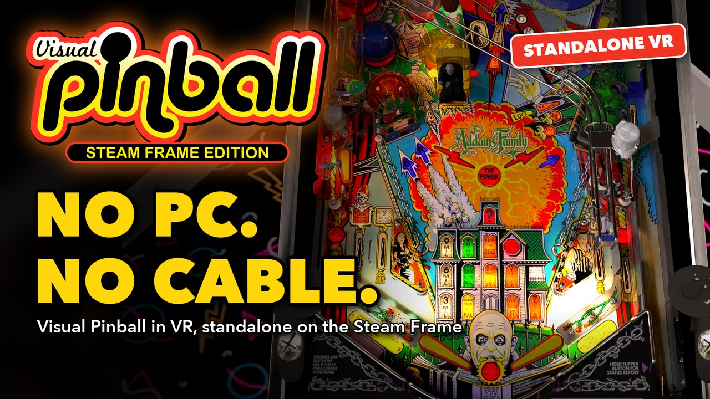

# The `steam-frame` branch

This branch of the fork `SPD13/vpinball-steam-frame` prepares Visual Pinball's standalone player for the Valve Steam Frame (SteamOS on ARM64, SteamVR's OpenXR runtime, Vulkan), and adds a table launcher that works from inside the headset. It starts from upstream commit `fd5e18d` (10.8.1 beta).

[](https://youtu.be/YvKycmiTYIY)

**▶ [Watch the trailer](https://youtu.be/YvKycmiTYIY)** (2:11): the VR version, with the VR menu and table search, Steam Frame tuning and eye-tracked foveated rendering, uploading tables over Wi-Fi, player profiles and online scores, the installer and one-click updates.

This document lists everything the branch changes, where, and how far each part has been checked.

Since 2026-10-18, the code of the fork lives in its own files (`src/steamframe/`, `steamframe/`), with small hooks guarded by `VPX_STEAM_FRAME` in upstream's files, so that upstream's changes can be taken every week: see [`steamframe/README.md`](../steamframe/README.md). The sections below describe each feature as it was built; their file lists give the current locations.

## What the player gets

Changes a player sees, in the standalone builds (details in the numbered sections):

- **Table picker** in the in-game menu ("Tables"), which is also the start screen in launcher mode: choose and switch tables without leaving the player (section 3).
- **Lists of tables** as tabs: All, Recent, Newly added, Most played, Favorites, plus a MENU tab for the library and application options. The tabs are large buttons, easy to hit with a mouse or a VR pointer.
- **Thumbnails**: a grid of table images, loaded in the background with a spinner on each tile meanwhile; a list view is also available. A table without an image gets a screenshot when it is closed, and "Replace table image" takes a new one (sections 4 and 8).
- **Custom thumbnails**: give any table the picture you want in the table picker, such as the wheel image of a front-end setup, its backglass, a flyer or your own artwork. In the Tables page of the browser, "..." > **Upload thumbnail** on the table picks an image file on your computer; it is resized for the picker and replaces the table's image in the headset at once. Transparent images, like most wheels, keep their transparency (section 5).
- **Favorites**: a star on each thumbnail, or "Add to favorites" in the table's page; the Favorites tab lists them.
- **One list** of all the tables, without pages: only the tables on screen are drawn and only their images are loaded, so libraries of thousands of tables stay fast.
- **Search** as you type (a virtual keyboard in VR), a letter filter and A–Z / Z–A sort in the All tab, and play statistics (added, last played, times played) for the hovered table.
- **Table actions**: play, restart, rename, reset the table settings, delete, and use the table's VR room in the lobby.
- **Lobby** in launcher mode, from which tables are started and to which they return, in a room chosen in the menu: a modern room, a game room at night with arcade cabinets, a pinball machine and a city view, or a sunlit studio, all made in Blender with their lighting baked (section 4).
- **Web upload**: add tables and ROMs from a browser on the local network, with a pairing code that can be switched off, missing ROMs listed, and Tables and ROMs tabs to switch between the two folders. It can be on for the session only or always on (started with the application), and stays on while switching between the lobby and the tables (sections 5 and 8).
- **Tables page in the browser**, the home page of the web server: the library as a grid of thumbnails with the picker's tabs and search, a star to add or remove a favorite, and a "..." menu on each table to set its **display name** (the name the picker shows, the files are not renamed), **upload a thumbnail** from the computer, or **delete** it with all its files. With an empty library it links to the file manager, which stays one click away (section 5).
- **Missing ROM message** naming the files to add and where (section 8).
- **Game aliases of mods found automatically**: a table asking PinMAME for a game it does not know (a mod renaming its game, `simpprtyh` for `simpprty`) gets the alias it needs, found in its readme, script or files, and the ROM it ships outside of a `roms` folder is moved where PinMAME looks. The alias file can be edited from the browser, under an Advanced menu, with the lines PinMAME would misread refused (section 6).
- **VR**: the menu on a panel standing in the room, in the table's direction, at an adjustable distance, used with the controllers' pointer; notifications above the menu (sections 7 and 8).
- **No "controller detected" prompt for the VR controllers**: Steam Input also presents the Frame controllers as an Xbox gamepad; in VR, VPX no longer asks to set up a layout for it, since the controllers already work through OpenXR (section 7).
- **Eye-tracked foveated rendering, exclusive to this branch and to the Steam Frame build**: full shading only around the point the eyes look at, following the headset's eye tracker, through a fragment shading rate image that the Frame's driver applies in its fast direct render path: 2–4 ms per frame on heavy tables at native 2160×2160 per eye, on by default (Medium); a "Foveated rendering" level (Off / Low / Medium / High), an "Eye-tracked" switch and a status line in the VR settings page. Not in upstream Visual Pinball, and inert on Windows and macOS, whose builds lack the Vulkan driver support and the bgfx patches (section 9, and `Doc/foveated-rendering.md` for the full technical reference).
- **Steadier chrome, smoother edges**: specular anti-aliasing in the material shader stops the shiny parts from sparkling when the image is resampled every frame, on every platform; the headset builds also default to Standard FXAA, the only anti-aliasing within the Frame's budget at native resolution (section 12, `docs/Image Quality on the Steam Frame.md`).
- **Scores and leaderboards**: the score of every game played on a library table is recorded automatically, for the player chosen in the lobby ("Player: <name>"), with a result screen (rank, personal best, table record) when the lobby comes back, a Scores tab with the leaderboard of each table, the 10 best scores in each table's page, and a Scores page in the browser to filter, reassign, delete or clear scores (with confirmation) and manage the players (section 14, `docs/Table Scores and Leaderboards.md`).
- **PuP Support (Alpha)**: tables made for PinUP Player show their videos, overlays and labels in the headset, on screens placed on the cabinet (backglass, full DMD in front of the table's DMD, topper). Packs are uploaded from the browser, the tables that have theirs get a "PuP" badge in the table picker, and a pack's VR layout is set up when it is uploaded (section 15, technical notes in `docs/PinUP Player on the Steam Frame.md`).
- **Dynamic resolution in the headset**: the rendering resolution follows the GPU time of the frames, between a minimum and the table's resolution, so heavy tables and a hot headset keep their frame rate instead of judder on head movements, and light tables keep the full sharpness; a switch, a target and a minimum in the VR settings page, with a status line (section 13).
- **No hidden desktop render**: the desktop window nobody sees on the Frame no longer gets its own render of the scene (the *Desktop display* setting is forced off and hidden in the Frame build), which takes Addams Family from 18.0 to 11.6 ms per frame at the native 2160×2160: heavy tables now hold 72 fps at the panel resolution (section 13, `docs/Performance on the Steam Frame.md`). Nothing is drawn into that window at all: presenting it into gamescope's 60 Hz Xwayland along the 72 Hz headset frames locked most table starts into a frame pacing stall (the render thread waiting 12 ms per frame, the runtime reporting a full frame of GPU time) and cost 2 ms of render thread per frame otherwise.

## Status

| Part | State |
|---|---|
| Table library, table picker, launcher mode, web upload, shared ROM folder | Built and run on macOS arm64. Checked through automated tests, scripted runs with frame captures of the real application, and `curl` for the web server. On Windows, the table picker was tested by hand (tabs, thumbnail grid, favorite stars, pager arrows, search box); other parts are not yet driven by a person for every feature (see each section). On the Steam Frame (2026-10-01), the lobby, the Wi-Fi upload and uploaded tables were used in the headset. The tables page of the web server (2026-10-03) was run on macOS, its routes checked with `curl` and the page driven in Chrome; it is deployed on the Frame but not yet used there. |
| OpenXR, Valve Frame controller profile, Vulkan extension filter, VR menu panel and pointer | **Run in VR on Windows with a PSVR2** (SteamVR 2.17), in the `windows-mingw` build with `ENABLE_XR=ON` (2026-09-27), which is standalone + OpenXR + Vulkan like the Frame build. Linux ARM64: rebuilt with everything on 2026-09-28 and **run in the headset on the Steam Frame on 2026-10-01** after the driver workaround of section 7: OpenXR runtime found, Frame controller profile accepted with its 32 bindings, lobby and tables displayed (details in `Doc/steam-frame-port-plan.md`, section 6). Not yet checked there: launch from the Steam library, pointer and buttons, performance. |
| Eye-tracked foveated rendering (Steam Frame only) | **Works in the headset on the Steam Frame (2026-10-01)**: the sharp zone follows the eyes on both axes, confirmed with the head moving while the eyes stay on an object. With a density map the gain was ≈ 0.5 ms per frame at High, because on Turnip a density map forces the tiled render path, where the scene pass is geometry-bound (geometry re-processed per bin); rendering the scene pass directly instead takes the frame from 14.0 to 9.1 ms at native 2160×2160 (`TU_AUTOTUNE_ALGO=profiled`). **Since 2026-10-03 the scene is foveated through a fragment shading rate image that follows the gaze ray, which the driver applies in the direct path: Addams Family 14.3 → 11.2 ms at High, 11.3 at Medium (the default); Ghostbusters 11.3 → 9.2 with a fixed image**, measurements and mechanism in `Doc/foveated-rendering.md`, sections 7 and 10. |
| Scores and leaderboards (branch `leaderboards`, 2026-10-03/04) | Built and run on macOS arm64: capture checked with a test table simulating each source and with a ROM table, lobby pages from captures of the application, web page and routes with `curl` and Chrome. A coverage run over the whole library is in progress. Not yet run on the Steam Frame. |
| PuP support (2026-10-23/24, in `master` since 2026-10-24, Alpha) | Built and run on macOS arm64 with a test pack (surfaces forced on the desktop with `VPX_CABINET_DISPLAYS=1`, uploads, badge, pack options), the web pages driven in Chrome, and the import covered by the table library tests. On the Steam Frame (2026-10-24), **Darkest Dungeon, Austin Powers and The Matrix played in the headset**, Darkest Dungeon with its VR layout applied on upload; Darkest Dungeon measured unworn (section 15); The Matrix after the layout and hardware decoder fixes, its screens shown and the table closing normally. Not yet played in the headset: the other packs on the Frame and the tables without their pack (`docs/PinUP Player on the Steam Frame.md`, section 11). |
| Windows | `windows-mingw` (with or without `ENABLE_XR`): built and used with GCC 16 (MSYS2 UCRT64), Debug. Visual Studio build: built and run in VR in Debug with Vulkan, without the launcher (see "Build variants"). |
| iOS / Android library builds | Not compiled. Shared files they use were changed (`WebServer`, `InGameUIPage`, `VPApp`, `player`); see "Effects on existing builds". |

## Build variants: what contains what

The launcher lives in the in-game menu and is compiled only in *standalone* builds (`__STANDALONE__`).

| Build | Table picker and launcher | Web upload | OpenXR | Foveated rendering |
|---|---|---|---|---|
| macOS | yes | yes | no (no macOS branch in `VRDevice`) | no |
| Linux x64 / aarch64 | yes | yes (RAR/7z when `external.sh` built libarchive) | yes, with `-DENABLE_XR=ON` (new) | **aarch64 only** (Steam Frame: bgfx patch applied by `platforms/linux-aarch64/external.sh`, Turnip driver) |
| windows-mingw | yes | yes | yes, with `-DENABLE_XR=ON` (new, Vulkan only) | no (compiled out: unpatched bgfx; the OpenXR part is inert without the FB/META extensions) |
| Windows, Visual Studio | no | no | yes (as upstream) | no |
| iOS / Android library | hidden (they have a native launcher) | yes (as upstream) | Android as upstream | no |

## 1. Table library

New files: `src/steamframe/TableLibrary.h`, `src/steamframe/TableLibrary.cpp`, `tests/test-table-library.cpp`. Built by `steamframe/steamframe.cmake`.

A C++ port of the Android `TableManager.kt` / iOS `TableManager.swift`, keeping `tables.json` in sync with a tables folder. It depends only on the standard library and the bundled `nlohmann/json`; zip, unzip and logging are passed in by the caller, so it can be tested without the application.

- `tables.json` keeps the mobile format exactly: `{"tableCount":N,"tables":[{uuid,name,path,image,createdAt,modifiedAt}]}`, same key order, paths relative to the tables folder. It is written to a temporary file and renamed.
- On load, old absolute paths are converted; entries with a duplicate uuid or path, a missing file, or a path leaving the tables folder are dropped.
- `Rescan`: registers new `.vpx` files (recursively), drops entries whose file is gone, picks up `<table>.png|.jpg`, and imports `.zip`/`.vpxz` bundles found **at the root** of the tables folder, then deletes them, as well as `.rar` (RAR4 and RAR5) and `.7z` ones in the builds that include libarchive (windows-mingw and Linux, when `external.sh` built it; CMake defines `VPX_ARCHIVE_SUPPORT` then). Archives deeper in the tree are never touched, so PinMAME ROM zips stay zipped. A root bundle without a table is left in place and not extracted again during the run. Hidden files, `._*` and `__MACOSX` are ignored. An optional settle time skips files still being copied.
- Bundles are extracted into a hidden `.import` folder inside the tables folder and moved into place, so a large table is never on disk twice. Several tables in one bundle folder are moved once and all registered.
- `Import`, `Delete`, `Rename`, `SetImage`, `ReloadImage`, `ResetIni`, `Export`. `Rename` sets the display name (the `name` of `tables.json`, files untouched); an empty or blank name gives back the default one, `GetDefaultName`: the file name without extension, underscores replaced by spaces, as given to a new table. Deleting a table that is alone in its folder removes the folder; otherwise it removes the `.vpx` and its same-name `.ini`, `.vbs`, `.directb2s`, `.png`, `.jpg`.
- `RescanAsync` runs scans on a worker thread and never misses a request. The list read by the UI is locked only for the final swap, never during file work. `GetRevision` lets a UI poll for changes.
- Player statistics: `playCount`, `lastPlayedAt`, `favorite`, with `RecordPlay` and `SetFavorite`. They are stored in a separate **`table-stats.json`**, keyed by uuid, because the mobile launchers reject unknown fields in `tables.json`.
- `FuzzyScore`: each word of the query must be found in the text with its letters in order (not necessarily adjacent); words may be in any order; the best alignment is scored, with bonuses for consecutive letters, word starts and the start of the text.

Tests: doctest, 12 cases, 157 assertions. They pass with AddressSanitizer, UBSan and ThreadSanitizer on macOS, and with GCC 14 on Linux ARM64. They are POSIX-only (they call `zip`/`unzip`) and are not wired into `make/vpx-test.vcxproj`. doctest itself is not in the repository.

## 2. In-game menu framework

Files: `src/ui/live/ingameui/InGameUIItem.h`, `InGameUIPage.h/.cpp`, `InGameUI.h`.

- **Tile layout.** An item with `m_tileImage` (a callback returning an ImGui texture) is drawn as a thumbnail with its label underneath. Consecutive tiles flow into 1 to 6 columns depending on the window width. Navigation remains the menu's linear previous/next, so existing inputs work unchanged. Rendering is in `InGameUIPage::RenderTile`.
- **Tile toggle.** Optional icon in the corner of a tile (`m_tileToggleState`, `m_tileToggleAction`, `m_tileToggleIconOn/Off`), hit-tested separately from the tile. Pointer only.
- `InGameUIPage::GetSelectedItem()`; `InGameUI::GetActivePage()` made public; `InGameUI::UsePointerNav()`.
- Custom-rendered items (`InGameUIItem::Type::CustomRender`), which upstream defines but no page used, are now used by the picker.

## 3. Table picker

New files: `src/steamframe/TablePickerPage.h/.cpp`. Registered as `tables/picker` in `InGameUI.cpp`; "Tables" entry added at the top of `HomePage.cpp` for standalone builds other than the mobile library.

- **Tabs:** All, Recent (by last played), Newly added (by date added), Most played, Favorites, and MENU at the right end (the library and application options, section 8). They are drawn as padded buttons (`RenderTabs`); only the hovered button is highlighted, not the whole row (new `InGameUIItem::m_customHighlight`), and with buttons the current tab turns green when the row has the focus.
- **Search box** filtering as you type, on every tab. In All, results are ordered by score.
- **All the tables in one list**, without pages: every table gets a menu item and a sub-page, but only the tiles and rows on screen are drawn. Thumbnails are loaded when their tile is displayed (and, in the new VR menu, when it is less than a screen below the view); beyond 120 thumbnails, the ones displayed the longest time ago are released. With 3000 tables on macOS, the Tables screen draws in about 0.1 ms per frame, and rebuilding the list (opening it, typing in the search, changing a favorite) takes 7 to 17 ms once.
- **Grid view** with thumbnails (decoded when visible on worker threads, two at a time, with a spinner on the tile meanwhile, uploaded to the GPU at most one per frame, downscaled to 512 px) and a **favorite star** on each thumbnail, or **list view**.
- In the All tab: letter filter (from 9 tables up) and A–Z / Z–A sort.
- Hovering or selecting a table shows when it was added, when it was last played and how many times.
- Per-table page: Play / Restart, Add to / Remove from favorites, Rename, Reset table settings (if an `.ini` exists), Delete with confirmation. Reset and Delete are not offered for the running table. Actions fire once per press (the stock menu repeats an action every frame while a button is held).
- `TextEntryPage`: text entry with four buttons (left/right pick a character, then "Add"), used for rename and for search when there is no keyboard.
- Library section: view mode, sort, rescan, tables folder, ROM folder hint, and in launcher mode "Settings" (opens the menu's home page) and "Quit Visual Pinball".
- New VR menu: the tab row ends with three icon buttons, rescan the tables folder (for tables copied while the list is shown; greyed during a scan), grid or list view, and sort order. With buttons, left/right on the row go through the tabs then these icon buttons, and OK uses the focused one.
- Inputs: with a mouse or pointer, tabs, stars and the search box are clicked directly. With buttons, left/right on the tab row or the letter filter changes them, activating the search row opens the text entry page, and favorites are toggled from the table's page.

New settings (`src/core/Settings_properties.inl`): `Standalone/TablesPath` (empty = `VPinballX/Tables` in the user's documents folder), `Standalone/TablePickerGridView`, `Standalone/TablePickerSortAscending`. The current tab, search text and page are kept for the session only.

The library is owned by `Launcher::GetTableLibrary()` (`src/steamframe/Launcher.h/.cpp`). It uses a dedicated sub folder because upstream's default tables location on desktop is the whole documents folder, which must not be scanned, served by the web server, or have its zips consumed.

Tested by hand on Windows (2026-09-28) and working: the tabs, the grid with its thumbnails, clicking a star, the pager arrows and the search box.

## 4. Launcher mode and lobby

Files: `src/steamframe/Launcher.h/.cpp` (lobby, `LauncherCommand`), `src/core/AppCommands.h/.cpp`, `src/core/main.cpp`, `src/core/VPApp.h/.cpp`, `src/core/player.h/.cpp`, `src/input/InputManager.cpp`.

- New command line option **`-Launcher`** (`LauncherCommand`). The application starts on a lobby with the picker opened; selecting a table closes the lobby and plays it **in the same process**; leaving a table returns to the lobby; quitting from the lobby or with "Quit Visual Pinball" ends the application.
- `-Play <table>` is unchanged, plus: the picker can switch table from the menu (`VPApp::m_nextTableFilename`, loop in `PlayTableCommand::Execute`).
- A play is recorded in the library when a library table starts (`PlayTableCommand::Play`).
- **Lobby rooms** (2026-10-22): `src/assets/lobby.vpx` (modern room), `src/assets/lobby-gameroom.vpx` (game room) and `src/assets/lobby-studio.vpx` (sunlit studio: a long, bright room, sunbeams from a garden through two windows almost as high as the room, dartboards, telescopes, a desk with a computer and a mesh office chair, a reading corner and a bookcase, about 260k triangles; its sunlight is stored at a quarter and the table's exposure is 4), tables holding only a room, built in Blender from CC0 Poly Haven assets and procedural models and artwork, with their lighting baked into one texture per group of parts and shown unlit (about 65k and 90k triangles, five and eight 2048 or 4096 textures, compressed to BC7 by VPX on first load). The scenes, the bake and the export with vpxtool are in `steamframe/lobby-room/` (README and credits). `Standalone.LobbyRoom` chooses the room (the game room by default), with the empty room (the blank table with a tiled floor, the lobby of before): "Choose a lobby room" (in the Menu and lobby section at the top of VR & Room, in System and in the MENU tab) opens a page of tiles with an image of each room (`LobbyRoomsPage`, page `lobby/rooms`; images in `src/assets/lobby-rooms/`, screenshots of the lobby without the menu, see `steamframe/lobby-room/README.md`), and the room chosen is saved at once, stops the use of a table's room and reloads the lobby. `Launcher::GetLobbyTablePath()` returns it (the blank table for the empty room, or when the file is missing), and `BuildLobby()` keeps its parts, clears its script and sets a level camera for the desktop view (FOV 60°, at the height of the playfield).
- **Lobby without a room file.** `BuildLobby()` loads upstream's `src/assets/blankTable.vpx` and, in memory, replaces the script with an empty one, removes every part, adds an invisible `playfield_mesh`, sets a title and description, switches the views to camera mode, and adds a 12 × 12 m floor made of 36 tiles in two shades. The floor is in a part group using the room space (`SR_ROOM`). It is made of tiles because, outside VR, the near clipping plane is derived from the bounding-box corners of each part, which clips a single large quad away entirely. A table file authored in the editor can replace this by changing `VPApp::GetLobbyTablePath()` and removing the `BuildLobby()` call.
- **Table image on close.** When a library table without an image is closed, a screenshot of the playfield window is saved as `<table>.jpg` (`Player::CaptureTableImageBeforeClosing`, triggered by `CS_CLOSE_CAPTURE_SCREENSHOT`, which the quit action now uses in launcher mode). This mirrors what the mobile library does. If the in-game menu is open (quitting from it, or from the missing ROM message), the capture waits for it to slide out; while closing, `LiveUI::RenderUI` keeps rendering the menu until it is gone but no other overlay, so none ends up in the image. There is no timeout: if a capture never completed, the table would not close.

## 5. Web upload on desktop

Files: `lib/src/WebServer.h/.cpp`, `src/assets/web/app.js`, `src/assets/web/vpx.html`, `src/assets/web/tables.html`, `src/assets/web/tables.js`, `src/assets/web/styles.css`, `make/CMakeLists_sources.txt`, `make/CMakeLists_app.txt`.

The web server and its page are upstream's. Changes:

- `WebServer`, `ZipUtils` and mongoose compiled into the macOS, Linux and windows-mingw executables by `steamframe/steamframe.cmake` (`VPX_TABLE_WEBSERVER` compile definition, `zip` linked, `libzip.so*` copied on Linux). `Launcher::GetWebServer()` owns the instance. The routes of the tables and scores pages are in `src/steamframe/WebServerLibrary.cpp`.
- No longer depends on the mobile library: events go through two functions that raise the mobile events or, on desktop, ask the table library to rescan.
- On desktop it only exposes the table library folder, and any change made from the browser triggers a rescan.
- **Pairing code** (desktop): API routes answer 401 until the browser has posted the 6-digit code shown in the picker to `/pair`; it then holds a random session token in an HttpOnly cookie. Five wrong codes replace the code. Codes and tokens are dropped when the server stops. `SetPairingRequired()` controls it; the mobile builds keep it off. The page asks for the code when it receives a 401, so with pairing off it opens directly.
- **Pairing switch** (2026-10-02): in the picker's MENU tab, the "Pairing code: 123456" line has a switch on its right ("Required" / "Off"), hit with the pointer or flipped with Left/Right on the selected row (`TablePickerPage::RenderPairing`, `PAIRING_ITEM`). It applies at once to the running server (`m_pairingRequired` is now atomic, as the server thread reads it) and is saved immediately to `Standalone.WebServerPairing` (default on), which `VPApp::GetWebServer()` applies when it creates the server, so a disabled code stays disabled at the next launch. With it off, the line reads "Pairing code: disabled" and any device on the local network can add, change or delete tables (said in the tooltip).
- **Three modes** (2026-10-02): the picker's item cycles "Wi-Fi upload: Off" → "On (ask every time)" → "On (always on)" → "Off", and shows the address and the code while on. "Ask every time" is the earlier behavior: on until the application is closed. "Always on" is saved to `Standalone.WebServerAlwaysOn` (default off, saved immediately) and starts the server with the application in play and launcher modes (`VPApp::StartWebServerIfAlwaysOn()`, called from `main.cpp` after `InitInstance`). "Off" stops it and clears the setting. If the server fails to start, the item shows "Off".
- **Kept across table switches** (2026-10-02): the server is no longer stopped when a table is launched from the picker. `VPApp` owns it and the application process stays up between the lobby and the tables (section 10), so once on it stays on until it is turned off or the application exits. Consequence: tables can be uploaded, renamed or deleted from a browser while one is played, including the running table, and a large upload or extraction may cause stutters during play.
- **Staged uploads** (all builds): chunks are written in a hidden `.upload` folder and the file is moved into place when complete. Empty files are created directly.
- **"Upload Folder"** entry in the page's menu (`uploadFolder()`), using the browser's folder picker; skips hidden files. Dropping a folder on the page already worked.
- Uploading `VPinballX.ini` to switch the settings file is limited to the mobile builds.

### Tables page (2026-10-03)

A second page, `tables.html` with `tables.js`, shows the table library the way the picker does, for desktop builds (the mobile launchers own their library, see below).

- **Home page.** `/`, and any unknown path, now serve `tables.html`; the file manager moves to `/vpx.html` (same page, its links are relative or hashes, so folder browsing and the Back button work unchanged). Both pages have a "Tables | Files" switch at the top right of the header. The file manager hides it only when `/info` reports `tableLibrary: false`, so a page cached from an older server still offers the link.
- **Tiles** like the picker's grid: the table image in a 16:10 frame (the table's initial when it has none), the display name, the file name underneath, statistics in the tooltip, and a "Playing" badge on the running table. Images load lazily, through `/table-image?uuid=&v=<modifiedAt>`, so browsers cache them until the image changes.
- **Tabs and search** as in the picker: All, Recent, Newly added, Most played, Favorites (kept in the URL hash), and the same in-order letter matching for the search. "Upload tables and ROMs here", with "here" linking to the file manager, is shown whenever the library is empty.
- **Star** on each tile: adds or removes the favorite at once, saved in `table-stats.json` like the picker's star.
- **"..." menu** on each tile:
  - **Display name**: a dialog with the current name, and the name derived from the file as a hint; "Use file name" goes back to it. Names are trimmed, kept on one line, limited to 128 characters in the page. The picker shows the new name at once (same library).
  - **Upload thumbnail** (2026-10-25): picks an image file on the computer; the page scales it down to fit in 1024 x 1024 (never up) and uploads it as JPEG, or as PNG when it has transparent pixels (wheel images; made smaller if the PNG goes over 2.5 MB, the requests of the web server being limited to 3 MB), which replaces the table image (`TableLibrary::SetImage`: `<table>.jpg` or `<table>.png`, the previous image is removed). The picker and the tile reload it, the modification date always moving forward. A table with an image gets no screenshot when closed, so the uploaded one is kept.
  - **Delete**: a confirmation dialog with the table's path, then `TableLibrary::Delete`: the whole folder when the table is alone in it, otherwise the table and its same-name companion files. Disabled for the running table, which the server also refuses.
  - The dialogs close only with their buttons, not with Escape nor a click outside their fields.
- **Live list**: the page polls `/tables` every 3 s while it is visible, and renders again only when the answer changed, so favorites set in the headset, tables added by uploads or a rescan, and the running table appear without reloading. Tiles are reused between renders, so images are not reloaded.
- **Routes** (behind pairing like the other API routes; desktop only, 404 in the mobile builds):

  | Route | Method | Parameters | Answer |
  |---|---|---|---|
  | `/tables` | GET | | `{revision, scanning, tables:[{uuid, name, defaultName, path, hasImage, createdAt, modifiedAt, lastPlayedAt, playCount, favorite, playing}]}` |
  | `/table-image` | GET | `uuid` | the image, cacheable for a day; 404 without image |
  | `/table-image` | POST | `uuid`, body: a JPEG or PNG image | 200; 400 when the body is neither a JPEG nor a PNG, 404 unknown table, 500 when it could not be saved |
  | `/table-favorite` | POST | `uuid`, `favorite` (1 or 0) | 200; 400 without `favorite`, 404 unknown table |
  | `/table-name` | POST | `uuid`, `name` (empty: default name) | 200; 400 when `name` is missing or too long, 404 unknown table |
  | `/table-delete` | POST | `uuid` | 200; 409 for the running table, 404 unknown table, 500 when the files could not be removed |

  `/info` also reports `tableLibrary` (true on desktop), which the pages use to tell a desktop server from a mobile one and from a server built before this page. A deletion notifies the file manager like the other file changes; a favorite or a name does not, as no file of the tables folder changes.

Known gaps: plain HTTP; the static pages and `/assets/*` are served without pairing. The tables page serves the table images at full size (a few MB for a screenshot), which a large library may feel over Wi-Fi; a resized thumbnail route would fix it. Not verified on the tables page: refusing to delete the running table (the routes and the page were otherwise checked on macOS), and any use in the headset's network conditions. Not verified: the pairing prompt and the Upload Folder entry in a real browser. The pairing switch, the three modes and the server staying on across tables (2026-10-02) are compiled on macOS but not yet run, on the desktop or in the headset.

## 6. Shared ROM folder

`Launcher::SetupSharedPinMAMEFolder()` (`src/steamframe/Launcher.cpp`), called before each table loads because the PinMAME plugin reads its setting when it is loaded.

The plugin looks for ROMs in `pinmame/roms` next to the table, then in its `PinMAMEPath` setting, then in `~/.pinmame`. When the setting is empty (or equal to the default below) and `~/.pinmame/roms` does not exist, the setting is pointed at `<tables folder>/pinmame` and `pinmame/roms` is created, so ROMs can be uploaded from the browser. The value is reset when the application closes, but it can still be written to `VPinballX.ini` if a settings page saves while it is applied. Desktop standalone builds only.

### Game aliases (branch `pup`, 2026-10-24)

A table script asks PinMAME for a game by name (`cGameName`). Mods often give their game a name of their own and tell the user to map it to the real game in VPinMAME's `VPMAlias.txt`: Simpsons Treehouse of Horror MOD v2023.3 asks for `simpprtyh` ("set an alias ... to `simpprtyh,simpprty`" in its readme), Aliens PuP asks for `alienspupver` (`alienspupver,sorcr_l1` in its installation instructions). The PinMAME plugin resolves aliases through libpinmame, which reads `alias.txt` in the PinMAME folder (`CheckGameAlias` in `libpinmame.cpp`), so on the Frame these tables stopped with "Game name not found" and a cascade of script errors (the script aborts its init, then its timers use objects it never created). The library now handles it (`TableLibrary::ResolveGameAliases`, `src/steamframe/RomAliases.cpp`):

- **The game names PinMAME knows** come from the driver catalog shipped with the plugin (`plugins/pinmame/gamedefs/catalog/pinmame.json`, 2955 drivers). Without it, nothing is done.
- **Alias file**: `alias.txt` beside the ROM folder (`Tables/pinmame/alias.txt`), or in the table's own `pinmame` folder when it has `pinmame/roms`, which PinMAME then uses instead. When the shared file does not exist, it is created from VPinMAME's built-in aliases (`src/assets/pinmame/VPMAlias.txt`, a copy of PinMAME's `release/VPMAlias.txt`): unlike VPinMAME, libpinmame knows no alias by itself.
- **Finding the game** of a table whose `cGameName` is neither a game nor an alias, in this order: an `alias,game` pair naming it in the text files (`.txt`, `.md`, `.nfo`, `.rtf`) of the uploaded bundle, read before the table folders are moved out of it as instructions are often at its root, or of the table folder; the games the script quotes (`Controller.Games("sorcr_l1")`, `cGameName` values of other, commented, lines); the files and folders of the table folder named after a game (ROM archive, NVRAM, `altcolor/<game>`, `pupvideos/<game>`) that the name starts with, or the only one there is; the longest game the name starts with, if it is at least half of it (`simpprty` for `simpprtyh`). The game must be in the catalog. The alias is appended after a comment telling where it was found (`# From readme.txt of the uploaded bundle, for <table>`), and the log says the same. A table without any clue is logged, and listed in the web page (below).
- **The ROM**: when the game has no ROM in the ROM folder and its archive is somewhere in the table folder (`MutedRom/simpprty.zip`), it is moved to the ROM folder. An installed ROM is never replaced: the Treehouse of Horror bundle ships a muted ROM, which must not overwrite the user's original. (Imports already move the archives of `roms` folders and those next to the table, see section 15.)
- **When**: at each library scan, after the scripts of new tables are read, for the tables not looked at yet in this session (their date, ROM and the alias file's revision are part of the check), so tables imported before this change are fixed at the next start.
- **The script's ROM** is now its first `cGameName` that is not commented out (`'Const cGameName = "..."` lines of other versions came first in some scripts), and only for the scripts that load PinMAME (`LoadVPM`, `VPinMAME.Controller`, `LoadController("VPM")`): original tables set `cGameName` too, for their PuP pack or their backglass, and were listed as unknown games (21 of the 22 on the Frame on Oct 25, Top Gun being the real one). What is read from a script is cached with a version (`scanVersion` in `table-stats.json`, `SCRIPT_SCAN_VERSION`): tables read by an older version are read again at the next start. StarCraft had kept `startrp2` from a scan made before the commented lines were skipped, instead of `startrp2sc`, so it was never listed.
- **Editing the aliases from the browser**: the file manager's actions menu (⋮) has an **Advanced** item which unfolds **PinMAME ROM aliases**: a dialog with the alias file in a text area, the path of the file, and the tables asking for a game PinMAME does not know with an **Add a line** button (it adds `name,` for the user to type the game). **Save** checks the file first (`RomAliases::Normalize`): libpinmame reads lines of up to 127 characters and dereferences the second name without checking that there is one, so a longer line or a line with a single name is refused, with the line numbers (clicking one selects the line). Unknown games, names given twice and aliases replacing a game are warnings, only for the lines the user added or changed (VPinMAME's own list has a few). Lines are trimmed and the file ends with a new line. Route: `/pinmame-aliases` (GET: path, content, unknown games; POST: the body is the new content), behind the pairing like the other routes. A save rescans the library, which moves the ROMs of the new aliases.
- **Tables that can not start for want of an alias**: a table asking for a game PinMAME does not know never reaches the missing ROM list, since its ROM is not known until an alias names its game (the PinMAME plugin fails on `GameName`, before `Run`). The Tables page of the web server shows them instead: a warning above the tables naming them, and an **Unknown game** badge on their tile (`unknownGame` in `/tables`); both open the alias editor (`vpx.html?aliases`). In the game, the PinMAME plugin shows a message the player must acknowledge (`VPXPluginAPI::ShowMessage`): PinMAME doesn't know the game, it needs an alias, with the path of the alias file.

Tests: `tests/test-table-library.cpp` (the alias file as libpinmame reads it, the clues in order, Treehouse of Horror and Aliens bundles, a table without clue, an installed ROM kept, the web save). Checked on macOS with the real Treehouse of Horror bundle dropped in a scratch library (alias from its readme, muted ROM moved) and the dialog in Chrome. Not checked yet: the table started on the Frame with the alias.

## 7. OpenXR

Files: `CMakeLists.txt`, `make/CMakeLists_app.txt`, `platforms/linux-x64/external.sh`, `platforms/linux-aarch64/external.sh`, `src/renderer/VRDevice.h/.cpp`, `src/renderer/XRVulkanBackend.h`, `src/input/XRInputHandler.h`, `src/ui/live/LiveUI.h/.cpp`.

- **Linux.** `ENABLE_XR` is offered for `PLATFORM=linux` (BGFX renderer only); the Linux dependency scripts build the Khronos OpenXR loader and install its headers; `VRDevice` selects the Vulkan renderer on Linux and shares Android's timespec timing code. As on Android, the Wine headers make bgfx report the Windows platform, which is corrected for Linux too. `XRVulkanBackend` loads `libvulkan.so.1` at run time.
- **Vulkan instance extensions.** The backend now requests only the extensions the driver reports. Upstream always requests `VK_EXT_debug_utils` and `VK_EXT_debug_report`, which fails instance creation on drivers without them. This applies to all platforms.
- **Valve Frame controller.** `XR_VALVE_frame_controller_interaction` is enabled when available and bindings are suggested for `/interaction_profiles/valve/frame_controller_valve`. New inputs appended to the handler's list (indices 32 to 42, existing indices unchanged): right X/Y, left d-pad, left view, both bumpers, both aim poses. Added to the default mapping: view = open menu, right menu = quit table, d-pad = menu navigation, bumpers = nudge. Users with an existing VR mapping will be offered the new layout once.
- **VR menu panel.** The in-game menu is drawn on a panel fixed in the room (`VRDevice::UpdateUIPanel`), placed in front of the player, 10 cm below the eyes, when the menu opens. It faces the table's forward direction (the scene orientation set by centering the table), not where the head looks, so the player turns to the table, or moves, to read it. It is 2.8 m wide, so a closer panel looks bigger.
- **Menu distance.** New setting `Standalone/VRMenuDistance`: distance between the player and the panel, 0.3 m to 3 m, default 1.5 m. In VR, the MENU tab of the picker shows "Menu distance" with − and + buttons that move the panel by 10 cm and place it again at once. The buttons are used with the pointer; flipper-button navigation does not change them.
- **VR pointer.** `VRDevice::UpdateUIPanel` intersects a controller's aim ray with the panel; `LiveUI::NewFrame` feeds the hit point to ImGui as the mouse position, with the trigger as the left button (press at 0.7, release at 0.4), draws the ray (a translucent ribbon, most opaque at the controller and fading towards the tip, with soft edges, like the pointer of SteamVR) and a dot, and scrolls with the thumbstick. The right hand is preferred.
- **Windows standalone.** `ENABLE_XR` is also offered for `PLATFORM=windows-mingw`; standalone builds only use the Vulkan OpenXR backend.
- **VR by default on standalone OpenXR builds.** `PlayerVR/AskToTurnOn` defaults to "Autodetect" when `__STANDALONE__` and `ENABLE_XR` are both defined (Steam Frame, windows-mingw with `ENABLE_XR`); it stays "Enabled" on Android and "Disabled" elsewhere. Without it the Frame ran the launcher in a flat window.
- **No layout prompt for the virtual gamepad (2026-10-01, not yet run in the headset).** Steam Input also exposes the VR controllers as a virtual Xbox gamepad, so every table started with the "new controller detected" dialog, which had to be dismissed although the controllers were already mapped through OpenXR. `SDLInputHandler::OnJoystickAdded` now flags a joystick as a virtual gamepad of the VR controllers (`InputManager::SetDeviceIsVRVirtualGamepad`) when its vendor is Valve (`0x28de`) or its name contains "Steam" or "X-Box 360 pad" (the name of Steam's uinput pad on Linux), and logs every joystick's vendor and product ids. In VR (`STEREO_VR`), `InputManager` skips the layout proposal for flagged devices ("Skipping layout proposal for … virtual gamepad" in the log); outside VR they are still proposed. Side effect: a real wired Xbox 360 pad on Linux has the same name, so in VR it is not proposed either (it can still be mapped by hand in the input settings). To check on the device: that the dialog is gone, and the ids logged for the virtual pad, to match it exactly if needed.
- **Steam Frame Vulkan driver workaround (Linux ARM64 only).** `steamframe/patches/bgfx/01-turnip-descriptor-pool.patch`, applied to bgfx by `platforms/linux-aarch64/external.sh`, creates bgfx's descriptor pools without `VK_DESCRIPTOR_POOL_CREATE_FREE_DESCRIPTOR_SET_BIT` (bgfx never frees single sets, it resets whole pools every frame, so the flag was unused). With the flag, Turnip (Mesa 26.3.0-devel on the Frame, 2026-09-30) allocates sets from a free-list heap and places them partly outside the pool's memory: the first `vkUpdateDescriptorSets` of every run crashed inside the driver, and once that was padded around, every sampled texture read as black (the GPU was reading descriptors from unmapped memory), which showed as an empty black view in the headset and a black desktop window. Found with bgfx's own examples on the device: geometry and gradients rendered, every texture did not. The dependency script's cache key carries a `-turnip2` suffix so existing dependency builds rebuild bgfx. The change is harmless on other drivers and could go to bgfx upstream.
- Left as upstream: the desktop preview window created in VR.

## 8. Added on Windows with a PSVR2 (2026-09-26 to 28)

Used in the headset in the `windows-mingw` build with `ENABLE_XR`. Not compiled for Linux yet.

- **Upstream VR fixes:** the eye resolution was 0x0 (`SetupHMD` read the bgfx caps before bgfx was initialized); no bgfx backend fallback with a device created by OpenXR (it crashed); computing the environment irradiance on the GPU and uploading the textures of a table's texture cache submitted frames before the headset requested one (assertions in Debug). The in-game UI ignores the scale of the desktop preview window, which squeezed it to a few pixels.
- **Menu panel and pointer** (section 7): `Standalone/VRMenuDistance`; the ImGui vertex shader has per eye matrices (`vs_imgui.sc`, `bgfx_imgui.h` regenerated).
- **Table picker:** MENU tab (the options formerly below the table list); virtual keyboard for the search field in VR; the menu distance buttons.
- **Table images:** "Replace table image" in the table's menu (`Player::ReplaceTableImage`). Captures wait for the menu to be closed. In VR, `VRDevice::SetTableCaptureView` replaces the eye poses for the capture frames with the view chosen by `Standalone/TableImageFocus`: Backglass (default; framed on the bounding vertices of the parts named, or primitives textured with an image named, "backglass", otherwise on an estimate), Table (playfield from above) or Cabinet. The target is centred for each eye's asymmetric field of view.
- **Missing ROMs:** plugin API `ShowMessage` (a message page the player acknowledges, `MessagePage`, lines starting with `!` shown in red) and `ReportMissingFile`, used by the PinMAME plugin when a ROM cannot start. The library records them in `missing-roms.json` (preferences folder); the web page shows them, grouped by table, when browsing `pinmame/roms`, with a Clear button; an upload of a file with the same name removes the entry (`/missing-roms` route). "Back to the table picker" on the message used to hang when the table had no image (the capture waited for a menu that was no longer rendered, see section 4); fixed.
- **Tables and ROMs tabs** on the web page, at the top of the Files page: "Tables" opens the tables folder, "ROMs" the shared `pinmame/roms` folder, which gets lost in a long list of tables. In a `pinmame/roms` folder a help text explains that a table must be played first so that its missing ROM is registered, then listed on this page.
- **Version in the header** of the web pages: "Steam Frame Edition v<release> - vpinball v<version> Beta" (`/info` route, `WebServer::GetVersionLabel`), the release read from the `VERSION` file next to the executable (written by `make-release.sh`), "(development build)" without it.
- **RAR and 7z** imports and web extraction through libarchive (`ZipUtils::Extract`, `IsExtractable`, `GetExtractableExtensions`), see section 1.
- **Lobby room from a table:** "Use this VR room in the lobby" in a table's menu (`Launcher::UseTableRoomInLobby`, `lobby-room.json`): the lobby is loaded from that table and keeps only the visible parts of its room (room space part groups, layers named after a room, collections named `VR…` that are not the cabinet). "Use the default lobby room" in the MENU tab. The lobby does not use the image or texture cache of that table, and the table itself still shows Play.
- **Notifications** in VR are stacked just above the menu window (`NotificationOverlay`).
- **Web server on Windows** (network address through `GetAdaptersAddresses`, `std::filesystem` listing on all platforms, UTF-8 paths), and an upload progress banner on the web page.

## 9. Eye-tracked foveated rendering (branch `foveated-rendering`, 2026-10-01)

Files: `src/core/Settings_properties.inl`, `src/core/main.cpp`, `src/renderer/VRDevice.h/.cpp`, `src/renderer/XRVulkanBackend.h`, `src/renderer/XRGraphicBackend.h`, `src/renderer/RenderTarget.h/.cpp`, `src/renderer/Renderer.h/.cpp`, `src/renderer/RenderPass.cpp`, `src/renderer/RenderDevice.h/.cpp`, `src/ui/live/ingameui/VRSettingsPage.cpp`, `steamframe/patches/bgfx/02-fragment-density-map.patch`, `steamframe/patches/bgfx/03-fragment-shading-rate.patch`, `platforms/linux-aarch64/external.sh`.

Full shading only around the point the eyes look at, through a Vulkan fragment density map on the scene buffer. **Exclusive to this branch, and only built for the Steam Frame** (Linux aarch64 package: the bgfx patch is applied there alone, and the rest is under `#ifdef` on its macros, so Windows and macOS builds compile it out). Evaluation and plan in `Doc/foveated-rendering-plan.md`, full technical reference (mechanism, every layer of the implementation, verification, measurements, open performance analysis) in `Doc/foveated-rendering.md`; everything below was built and checked on the Steam Frame.

- **Settings** (`PlayerVR`): `Foveation` (Off / Low / Medium / High, default Medium on standalone OpenXR builds, Off elsewhere), `FoveationEyeTracked` (default on), and the sign conventions of the gaze offsets `FoveationFlipX` (off) / `FoveationFlipY` (on), which were settled on the device. The VR settings page has the first two and a status line ("Eye-tracked", "Fixed: eye tracking not active (enable it in the headset settings)", "Not supported by the runtime", …). Changes apply live.
- **Runtime side** (`VRDevice`): the color swapchain is created with `XrSwapchainCreateInfoFoveationFB`, a profile (`XrFoveationLevelProfileCreateInfoFB` + `XrFoveationEyeTrackedProfileCreateInfoMETA`) is applied with `xrUpdateSwapchainFB`, the eye-tracked state and gaze come from `xrGetFoveationEyeTrackedStateMETA`. On the Frame this is what turns the eye tracking on (SteamVR/OpenXR 2.17.10; the user must have calibrated eye tracking in the headset settings). The runtime also hands density maps for its swapchain images (`XrSwapchainImageFoveationVulkanFB`, 68×68, one layer per eye), wrapped as bgfx textures by `XRVulkanBackend::CreateFoveationTextures`; they are kept as a fallback only, see below.
- **Why the app builds its own map**: the gaze is applied through fragment density map *offsets* (`VK_EXT_fragment_density_map_offset`, passed at the end of the render pass), and Turnip only honors offsets on density map images created with `VK_IMAGE_CREATE_FRAGMENT_DENSITY_MAP_OFFSET_BIT` (`tu_enable_fdm_offset` in `tu_cmd_buffer.cc`), which the runtime's maps are not. So `VRDevice::CreateOwnFoveationMap` makes a 68×68 (eye size / 32, the driver's minimum texel), two-layer RG8 map, filled by `FillOwnFoveationMap` with flat rings per level (full density radius 0.45 / 0.30 / 0.20 of the half width, half density up to 0.80 / 0.55 / 0.38, quarter beyond), and every frame the gaze (normalized, y up) becomes pixel offsets (`x · W/2`, `−y · H/2`) for both eyes.
- **Vulkan device** (`XRVulkanBackend.h`): enables `VK_EXT_fragment_density_map` (+ feature), `VK_VALVE_fragment_density_map_layered` (one map layer per eye on our layered scene buffer, Valve's extension, in upstream Mesa), `VK_EXT_fragment_density_map_offset` and `VK_KHR_create_renderpass2`, all when the driver has them; logs "Fragment density maps: supported, one layer per eye, with offsets".
- **bgfx patch** `02-fragment-density-map.patch` (Linux only, applied after the descriptor pool one, cache tag `-turnip4` with the shading rate patch): `BGFX_RESOLVE_FRAGMENT_DENSITY_MAP` tags a frame buffer attachment as the density map (kept out of the color/depth lists, `VkRenderPassFragmentDensityMapCreateInfoEXT` on the v1 render pass, extra attachment in the `VkFramebuffer`, layout barriers); `BGFX_TEXTURE_FRAGMENT_DENSITY_MAP` for textures that are maps (usage, offset-capable, kept in the density map layout; external images are taken as is); `VkPipelineFragmentDensityMapLayeredCreateInfoVALVE` on pipelines rendering into a layered map; render targets created offset-capable; `bgfx::setFragmentDensityMapOffsets(frameBuffer, offsetsXY, layers)` stored per frame and applied with `vkCmdEndRenderPass2KHR` (offsets rounded to the device granularity); `BGFX_CAPS_FRAGMENT_DENSITY_MAP`. Unpatched bgfx does not define these macros, so all the VPX code is under `#ifdef` and inert on Windows and macOS.
- **Scene buffer** (`RenderTarget::SetFragmentDensityMap/Offsets`, `Renderer::SetFragmentDensityMap/Offsets`): `BackBuffer1` and `BackBuffer2` get a cached frame buffer variant carrying the map; `VRDevice::RenderFrame` selects it right after acquiring the swapchain image and sets the offsets of the frame. Post passes sample the resolved full-resolution image unchanged (non-subsampled image), so bloom, AA, tonemap and the preview need nothing.
- **Measurement**: the runtime's counter `/perfmetrics_meta/app/gpu_frametime` (`XR_META_performance_metrics`), enabled with `VPX_XR_METRICS=1` in the environment, and, with `VPX_GPU_PROFILE=1`, that counter plus bgfx's per-view GPU timings grouped by render target (`VRDevice::LogRuntimeStatus`, every 5 s, needs the view names, which release builds now set when profiling — `RenderDevice::m_nameViews`). The counters are off otherwise, and always disabled before a session is destroyed: SteamVR 2.17.10 keeps their enabled state with the OpenXR instance but destroys the timestamp query pools it created for them with the session, then reads those pools again from the next session's `xrEndFrame` — a crash in the Vulkan driver when a table was started after the lobby on the Frame (found with the Vulkan API dump layer: no `vkCreateQueryPool` from `vrclient` for the second session, while its `vkGetQueryPoolResults` followed the begin/wait pattern of every frame).
- **Shading rate image (2026-10-03), the path used on the Frame**: the driver only applies density maps in its tiled render path (next bullet), but programs a fragment shading rate attachment (`VK_KHR_fragment_shading_rate`) in both paths, so the scene pass stays direct. A third bgfx patch (`bgfx-fragment-shading-rate.patch`: `BGFX_TEXTURE_FRAGMENT_SHADING_RATE`, `BGFX_RESOLVE_FRAGMENT_SHADING_RATE`, render pass 2 with the rate attachment, pipeline combiner so the attachment's rate wins) lets `RenderTarget::SetFragmentDensityMap(map, shadingRate = true)` attach a single layer R8U image of one rate code per 8×8 block (270×270 at 2160²) to the scene buffer. `VRDevice::UpdateShadingRateMap` rewrites it whenever the gaze moves by half a texel: full rate in a disc around each eye's gaze (one image for both eyes: the union, hence tighter rings than the fixed profiles), 2×2 in a ring, 4×4 beyond, with the radii of the level; without a valid gaze the wide Low profile at the center. The gaze comes from `XR_EXT_eye_gaze_interaction` as a ray located at its sample time and projected with the frame's views (`LocateGaze`: a fixated object stays sharp while the head turns, which the runtime's per image foveation center could not do), smoothed over 35 ms; `VPX_FOVEATION_DEBUG=1|2|3` shrinks the sharp area to a spot, makes the rest very coarse and circles each spot in magenta, to check the tracking in the headset (`FoveationFlipY` default fixed to false that way): the procedure, what to look for and how to read the status line are in **`docs/Foveated Rendering on the Steam Frame.md`, section 8**, the technical reference of the whole feature (mechanisms, measurements, challenges met; the same document as `Doc/foveated-rendering.md`). Preferred over the density map wherever the driver has it; the status line says which ("Eye-tracked (shading rate image)"). Measured at native 2160×2160, dynamic resolution off, medians of 9 samples over 40 s, eye-tracked with the gaze ray (2026-10-03, headset at 67–71 °C): Addams Family Off 14.3 ms → **High 11.2, Medium 11.3, Low 11.5** (Off again at the end: 14.8), i.e. ≈ 3 ms or 22 % per frame, against an upper bound of 11.0 with 4×4 shading everywhere; with fixed images beforehand, Ghostbusters went 11.3 → 9.2. **`Foveation` defaults to Medium again on standalone OpenXR builds.**
- **What the density map measurements showed (2026-10-02)**, on the heavy Ghostbusters VR-room table at native 2160×2160: foveation High saves ≈ 0.5 ms of a 14 ms frame. Turnip only applies density maps in its tiled render path and forces any pass with a map into it, and in that path the scene pass is geometry-bound (the geometry is reprocessed per tile: 48 tiles, ≈ 6.5 ms of per-tile draws against 4.7 ms for the whole pass rendered directly). Rendering the scene pass directly takes the frame from 14.0 to 9.1 ms. Hence three changes: **`src/core/main.cpp` sets `TU_AUTOTUNE_ALGO=profiled`** in the environment of the Linux standalone build before the Vulkan driver loads (the driver then measures tiled against direct per render pass and keeps the faster; a value set by the user wins), **foveation defaulted to Off** (until the shading rate image of the previous bullet), and the **VR visibility mask is drawn with `Z_LESSEQUAL`** instead of `Z_ALWAYS` (same result, its shader writes the near plane; an always-pass depth write made the driver disable LRZ, its hierarchical depth rejection, for the rest of the pass) **and first**: it was submitted with a sort key that put it after every opaque part (z = 200000 instead of a depth bias of +200000, the key being `depthBias − z`), so it had never masked anything before the opaque draws; a depth-only draw placed first also keeps LRZ writes enabled on Turnip. Full account in `docs/Foveated Rendering on the Steam Frame.md` (the technical reference of the whole feature, a copy of `Doc/foveated-rendering.md`): sections 6 and 7 for the density map and the driver's trace, 8 for the debug mode, 11 for the shading rate image and the challenges met.

## 10. One game session across table switches (2026-10-01/02)

Files: `src/core/VPApp.h/.cpp`, `src/core/player.h/.cpp`, `src/renderer/Window.h/.cpp`, `src/renderer/VRDevice.h/.cpp`, `src/ui/live/LiveUI.h/.cpp`, `src/steamframe/TablePickerPage.cpp`, `lib/src/WebServer.cpp`, `src/core/AppCommands.cpp` (details in `Doc/steam-frame-port-plan.md`, section 6).

In launcher and play mode, `VPApp` keeps the OS windows (playfield, VR preview) from one table to the next (`AcquireWindow` / `ReleaseWindow`, matched on the settings they were created with), shows a "Loading <table>..." screen with a spinner while switching (`LiveUI::SetLoadingText`, `Player::RenderLoadingFrame`), and can keep the VR device, i.e. the OpenXR instance, so the runtime does not see the application quit and start again (`AcquireVRDevice` / `ReleaseVRDevice`, `VRDevice::ApplyTableSettings` for the per-table settings, `EndSession` / `ReleaseSession` for a clean session stop, `EXITING` and `LOSS_PENDING` handled).

**On the Steam Frame the VR device is not kept** (`VPApp::m_keepVRDeviceBetweenTables = false`): SteamVR 2.17.10 crashed the second table 0.6 s in, in the Vulkan driver called by `vrclient` from `xrEndFrame`. The Vulkan API dump layer showed that `vrclient` creates its timestamp query pools once per OpenXR instance, destroys them with the first session and reads them again from the second; a new Vulkan device under the same instance made it call the destroyed `VkInstance` (abort in the loader). One instance, one device, one session on this runtime, so a new VR device is created for each table, as before; windows and loading screen are kept.

**Loading screen in the headset (2026-10-02):** it appeared doubled, drifting and ghosting while a table loaded. The loading threads push each texture upload to the render thread as a frame with nothing to present (`RenderDevice::SubmitRenderFrame` from another thread sets `m_frameNoPresent`); the desktop render loop processes such a frame without presenting, but the OpenXR loop (`BGFXOpenXRRenderLoop`) ran it inside an acquired headset frame and gave the swapchain image back to the runtime without having drawn into it, so the headset showed the image's stale content: a loading screen from three frames back, rendered for the head pose of that time. The OpenXR loop now processes upload-only frames in place (bgfx flush, the image stays acquired) and releases the image only once a frame has drawn into it.

## 11. Controller models (2026-10-01, not yet run in the headset)

Files: `src/renderer/VRControllerModels.h/.cpp` (new), `third-party/include/cgltf/cgltf.h` (new, cgltf 1.15, MIT, copied from bgfx's `3rdparty`; `third-party/` is ignored by git, so it needs `git add -f`), `src/renderer/VRDevice.h/.cpp`, `src/renderer/Renderer.h/.cpp`, `src/core/Settings_properties.inl`, `src/ui/live/ingameui/VRSettingsPage.cpp`, `make/CMakeLists_sources.txt`, `make/vpx-core.vcxitems(.filters)`.

The controllers the player holds are drawn in the scene as the headset system shows them, with their buttons, triggers and thumbsticks moving, so the button layout can be seen in VR. The meshes come from the runtime, not from files of ours (Valve's recommendation for the Steam Frame), so any headset whose runtime has the extensions gets its own controllers.

- **Runtime side** (`VRDevice`): enables `XR_EXT_render_model`, `XR_EXT_interaction_render_model` and `XR_EXT_uuid` (needed as the instance asks for OpenXR 1.0) when the runtime has them; the log says "OpenXR controller models: supported by the runtime". `UpdateControllerModels` asks for the models of the devices held (`xrEnumerateInteractionRenderModelIdsEXT`, again on `XR_TYPE_EVENT_DATA_INTERACTION_RENDER_MODELS_CHANGED_EXT`, on interaction profile changes, and every 2 s while the list is empty or an asset was unavailable), creates each model, its space and its asset, and keeps the glTF binary and the names of its animatable nodes ("OpenXR controller model N loaded: … KB, … animatable nodes"). Only `KHR_mesh_quantization` is declared as a supported glTF extension. Every frame, `LocateControllerModels` locates each model space in the reference space and reads the node poses (`xrGetRenderModelStateEXT`) at the predicted display time. Both run on the render thread before the frame is requested, like the menu panel; the logic thread reads the result while preparing the frame.
- **Drawing** (`VRControllerModels`, owned by `Renderer`, called at the end of `RenderDynamics` in VR, outside reflection passes): the asset is parsed with cgltf once per model (triangle meshes, base color factor and texture, alpha mask and blend, node hierarchy; PNG/JPEG images through `BaseTexture::CreateFromData`), then each node is drawn with the basic shader in the room space reference: reference space to room VPU is `VRDevice::GetReferenceToRoom()`. An animated node takes the pose given by the runtime as its local transform (relative to its parent), keeping its own scale. Materials: metallic-roughness factors to a VPX material (the metallic-roughness texture is ignored, a mesh which has one is shaded as a non metal), half lit / half unlit (`controllerUnlitPart`) so the controllers stay readable on dark tables, both sides drawn (the room space is mirrored compared to glTF).
- **Found on the Frame** (SteamVR/OpenXR 2.17.10): both controllers are listed and located, but `xrGetRenderModelStateEXT` returns every node hidden with an identity pose, so no part moves; when no node at all is visible the visibility is ignored, and a pose without a unit rotation keeps the node's own transform.
- **Front sticker**: the `status` node is where SteamVR shows the running application's logo when it draws the controllers itself (`visibility.default = false` in `/opt/steamvr/drivers/frame_controller/resources/rendermodels/*/frame_controller_*.json`). The asset maps it on the shared color texture although its texture coordinates span a whole image of its own, which showed a squeezed copy of that texture. No OpenXR function to get or set that logo was found, so the node is drawn with `src/assets/controller-sticker.png` (the ball of the dark iOS app icon, cut out with a round mask on a transparent background, at the 3.8 × 4.1 cm aspect of the sticker, 474 × 512), alpha blended over the body with a white base color.
- **Setting** `PlayerVR/ShowControllers` (default on), in the VR settings page, applied live. The models are also hidden during the table image capture.
- **To check on the device**: that SteamVR lists the Frame controllers once they are bound, their placement against the real controllers, the direction of the texture coordinates, that the animated parts move the right way (the pose is taken as relative to the parent node), and the cost.

## 12. Image quality on the Steam Frame (2026-10-02)

Files: `src/shaders/bgfx/material.sh`, `src/shaders/bgfx/fs_ball.sc`, `src/shaders/bgfx_basic.h`, `src/shaders/bgfx_ball.h` (regenerated), `src/core/Settings_properties.inl`; the analysis and the measurements in `docs/Image Quality on the Steam Frame.md`.

Compared with a PSVR2 on a PC, the Frame showed stair-stepped diagonals and chrome parts that seemed to move while the head was still. No setting or feature is missing on the Frame (all defaults, no platform reduction, anisotropic filtering and mipmaps active): the PC image is supersampled by SteamVR's recommended resolution and downsampled by the compositor, while the Frame renders 1:1 with the panel and no anti-aliasing. Measured at 2160×2160 on a heavy table (9.7 ms baseline, 13.9 ms budget at 72 Hz): Standard FXAA +1.6–2.5 ms, MSAA 4× +11.3 ms (the scene pass runs in direct mode, so the samples go through memory), 1.3× supersampling +5.4 ms. The device heats up over back-to-back runs (GPU 60 °C at rest, 90 °C in a run; a hot run of the same configuration measured 3 ms more), so measurements need a rest between launches. With both changes the table runs at ≈ 11 ms; the specular anti-aliasing itself costs nothing measurable.

- **Standard FXAA by default** in the headset builds (`__STANDALONE__ && ENABLE_XR`), the only option within the budget; it fixes the edges, not the sparkle.
- **Specular anti-aliasing** in the material shader (Kaplanyan 2016, Tokuyoshi & Kaplanyan 2019): the variance of the normal over the pixel, from its screen-space derivatives, widens the glossy lobe (point lights and glossy environment lookup, through the Blinn-Phong exponent ↔ alpha² = 2 / (n + 2) conversion), and the mirror lookup of the specular layer reads the environment map at the mip matching the footprint of the reflection instead of mip 0. Flat surfaces are unchanged. This applies to every backend; the shader headers were regenerated on macOS for SPIR-V, Metal, GLSL and GLSL ES, **the DirectX 11/12 blobs are the previous ones** (bgfx's shaderc needs the Windows HLSL compiler): run `src/shaders/bgfx/shaders.sh` on Windows before relying on it with the Direct3D backends.

## 13. Dynamic resolution in the headset (2026-10-02)

Files: `src/renderer/RenderTarget.h/.cpp`, `RenderPass.h/.cpp`, `RenderFrame.h/.cpp`, `RenderDevice.h/.cpp`, `Renderer.cpp`, `RenderProbe.cpp`, `Sampler.cpp`, `VRDevice.h/.cpp`, `src/core/Settings_properties.inl`, `src/ui/live/ingameui/VRSettingsPage.cpp`, `src/shaders/bgfx/fs_basic.sc`, `fs_ball.sc` (headers regenerated); the design, the controller and the runs in `docs/Image Quality on the Steam Frame.md`, section 8.

Addams Family at 2160×2160 costs 13.5–17 ms on the Frame, over the 13.9 ms period of 72 Hz, and judders on head movements (the compositor reprojects a quarter of the frames). Instead of per-table resolution settings found by trial, the resolution follows the measured GPU time: each frame renders into the top left part of the existing scene buffers at a scale (`RenderDevice::BeginScaledRendering`; the view rect of the flagged targets, the texture coordinates of the full-screen passes and the two clip-space lookups of the shaders follow it), and the runtime is told which part of the swapchain image was drawn (`imageRect`). Nothing is reallocated, so the scale changes every frame without a hitch. The VR device reads the runtime's `gpu_frametime` counter (`XR_META_performance_metrics`) each frame and moves the scale against a target fraction of the display's frame period: down at once when over, up slowly when well under, between a minimum and the table's `ResFactor` size. A reading at the frame period while every frame is on time is a frame pacing stall, not GPU work (the render thread waits for the GPU in submission and the counter reads the whole period): the scale is kept, and after a second of it one frame is let miss its display, which ends the stall (2026-10-20, section 7.5 of `docs/Performance on the Steam Frame.md`; on the Frame the stall came from the desktop window, no longer drawn, section 7.6). Settings in the VR page, applied live: `DynamicResolution` (on by default in the headset builds), `DynamicResolutionTarget` (85 %), `DynamicResolutionMinScale` (70 %), plus a status line (size, scale, GPU time against the budget), also logged every 5 s. Where the frame time goes on the Frame, CPU and GPU, and the opportunities that remain: `docs/Performance on the Steam Frame.md` (2026-10-19), which also led to the desktop mirror being forced off in the Frame build (`VPX_STEAM_FRAME_HEADSET`) (the desktop window rendered the scene a third time: 4.5–6.6 ms per frame on Addams). The ceiling itself, `PlayerVR/ResFactor` (a factor of the headset's recommended size since the upstream sync of 2026-10-18; 125 % is the Frame's native 2160²), is set in the same page since 2026-10-19: "Render resolution", 50 % to 200 % in 5 % steps, used by the next table played (the swapchains are created with the session), with a status line giving the current size and the next one (`VRDevice::GetResolutionStatus`).

Found on the first run: the runtime's recommended size (80 %) is not a low enough floor for Addams on a hot GPU (hence the minimum setting), and SteamVR doubles the predicted display period when it throttles the application to half rate after missed frames, which must not be taken as the budget (the shortest period of the session is).

## 14. Scores and leaderboards (branch `leaderboards`, 2026-10-03/04)

Files: `src/steamframe/ScoreTracker.h/.cpp`, `src/steamframe/ScoreStore.h/.cpp`, `src/steamframe/ScoresPage.h/.cpp` (new), `plugins/plugins/ScoreboardPlugin.h` (new), `src/assets/scores/score-rules.json` (new), `src/assets/pinmame/memmaps/` (new), `src/assets/web/scores.html/.js` (new), `src/core/player.h/.cpp`, `src/core/ScriptGlobalTable.cpp`, `src/core/VPApp.h/.cpp`, `src/core/AppCommands.cpp`, `src/steamframe/TableLibrary.h/.cpp`, `lib/src/WebServer.h/.cpp`, `plugins/flexdmd/FlexDMD.h/.cpp`, `plugins/flexdmd/UltraDMD.cpp`, `plugins/pinmame/PinMAMEPlugin.cpp`, `src/ui/live/ingameui/InGameUI.cpp`, `TablePickerPage.h/.cpp`, `src/assets/web/tables.html/.js`, `vpx.html`, `styles.css`, `make/CMakeLists_sources.txt`. The full description, from the capture to the routes, is in **`docs/Table Scores and Leaderboards.md`**.

- **Capture** (`ScoreTracker`, one per table of the library played, not for the lobby nor files outside the library): every 250 ms it reads several sources and uses the most reliable one that shows a score: the RAM of the emulated machine through the `game_state` memory map of its ROM (`pinmame`), the scores the script sends to the B2S server (`b2s`, works without a `.directb2s`), the UltraDMD scoreboard (`ultradmd`, through a new `"Scores","OnScoreboard:1"` plugin message broadcast by FlexDMD), global variables of the script with the usual names (`script`), and, when nothing else showed a score, the high scores the script saves with `SaveValue` (`highscore`). A game ends on the machine's game over flag (or its player count back to 0, or, with a rule, its 'game on' flipper solenoid: Stern SAM), a game in play variable or the backglass game over light (each trusted only once it said a game runs, and debounced), or, without signal, when the script saves a score or the next game resets the scores. A game is recorded only if its scores were seen at zero near its start (NVRAM and scripts restore the last game's scores at boot); a game left in progress is discarded. Each player (1 to 6) gets the profile given to it in the lobby, the scores of unassigned players are stored without profile. One `[Scores]` line per session in the log tells what was found, or why nothing was.
- **Rules** for the tables the heuristics miss: `score-rules.json` in `assets/scores` (bundled: 4 rules from the library coverage run) and in the preferences folder, matched on the table file name or the ROM: `disable`, the `source` to use, the names of the script variables (`scores`, `scoreBase`, `players`, `inGame`, `gameOver`), or the `gameOnSolenoid` of the ROM.
- **Memory maps**: the [Pinball Memory Maps](https://github.com/tomlogic/pinmame-nvram-maps) are bundled in `assets/pinmame/memmaps` (ODbL / DbCL, licenses and attribution in the folder; 395 maps, 383 with `game_state`, 1534 ROM names, of which 4 maps and 2 platforms added locally for Iron Man, Pirates of the Caribbean, Star Wars (Sonic) and Faeton/Ulysse 31) and used by the PinMAME plugin when no map is found along the table or in the PinMAME folder.
- **Storage** (`ScoreStore`, thread safe, revision counter for polling): `profiles.json` (profiles, and the profile of each of the 6 players, player 1 being the active one) and `scores.json` (one entry per player and game: table uuid, path, name, ROM, profile, slot, players, score, date, duration, source) in the preferences folder, written to a temporary file then renamed. One leaderboard per table file; equal scores ordered by date. Deleting a player keeps their scores, unassigned.
- **Lobby**: "Player: <name>" at the top of the picker opens "Who is playing?", players 1 to 6 of the games: each one is given a profile (the same profile may go to several players), or made unassigned by selecting its profile again; profiles are added with the keyboard (none is asked for: without a profile, the scores stay unassigned); a **Scores** tab between Favorites and MENU (tab names shortened to fit on one line in VR) lists the tables with scores and opens their leaderboard (all scores or best per player, up to 50 rows, Play); a table's page shows its 10 best scores; back from a table, a **result page** shows each game's score, rank and place among the players, "New personal best!" or "New record of the table!", and the leaderboard around it, with "Save under a new profile..." when player 1 had none. The VR keyboard of the search is now a reusable function, also shown by `TextEntryPage` for names.
- **Web**: a **Scores** page (header link on every page, "Show scores" in each table's menu) with table and player filters, All scores / Best per player views, give a score to another player, delete one, **clear the scores of a table or all of them** (confirmation dialog, typing `DELETE` for all), and the players panel (add, rename, delete, set as player 1, which players each profile is); it polls every 3 s. Routes `/scores`, `/score-delete`, `/score-assign`, `/scores-clear` (`uuid` or `all=1`, never an empty uuid), `/profile-add`, `/profile-rename`, `/profile-delete`, `/profile-active`, behind pairing, 404 in the mobile builds; `/info` reports `scores`.
- **Library coverage** (macOS, the Frame's 46 tables with its ROMs and NVRAMs, played unattended): 44 record their games unattended (29 `pinmame`, 14 `script`, 1 `b2s`); James Bond 007 and Street Fighter 2, which the autoplay could not play to the end, were confirmed by hand on the Frame: all 46 tables record. The harness, the probing techniques (probe memory maps, NVRAM files, game state bytes, game on solenoid) and what was learned are in section 12 and appendix A of the scores document.
- **To check on the Steam Frame**: B2S tables without backglass file, the name entry with the VR keyboard, the result page in the headset, and the score of Ulysse 31 against its display (scale of 10 inferred).

## 15. PinUP Player (PuP) support (2026-10-23/24, in `master` since 2026-10-24, Alpha)

Files: `src/steamframe/CabinetDisplays.h/.cpp`, `src/steamframe/PupPacks.h/.cpp`, `src/steamframe/PupPackOptions.h/.cpp` (new), `src/steamframe/Launcher.h/.cpp`, `src/steamframe/TableLibrary.h/.cpp`, `src/steamframe/TablePickerPage.cpp`, `src/steamframe/WebServerLibrary.cpp`, `src/steamframe/vrui/PageAdapter.cpp`, `src/steamframe/vrui/LegacyTiles.cpp`, `src/ui/live/ingameui/InGameUIItem.h`, `src/core/player.h/.cpp`, `src/parts/flasher.h/.cpp`, `lib/src/WebServer.h/.cpp`, `plugins/pup/` (`PUPPinDisplay.cpp`, `PUPLabel.cpp`, `PUPMediaPlayer.h/.cpp`, `PUPPlugin.cpp`, `LibAv.h`), `steamframe/steamframe.cmake`, `src/assets/web/vpx.html`, `app.js`, `tables.js`, `styles.css`, `tests/test-table-library.cpp`, `docs/PinUP Player on the Steam Frame.md` (how it works, the code file by file, diagnosis, state of the packs and next steps).

Many recent tables use PinUP Player (PuP) for the videos, sounds, images and score labels of their backglass, DMD and topper. PinUP Player itself is a Windows program, whose windows would not show in a headset anyway: the player uses the PUP plugin of upstream Visual Pinball instead, a rewrite of PinUP Player that the table scripts drive as if it were the real one (`PinUpPlayer.PinDisplay`). The branch adds what the headset needs around it: screens on the cabinet, a place for the packs and a way to upload them, a badge for the tables that are ready, the configuration of the packs, and hardware video decoding. It is an alpha, and the PuP packs tab of the web page says so: three tables were played in the headset so far (Darkest Dungeon, Austin Powers, The Matrix), the screen placements may not suit every VR room, and a pack using parts of PinUP Player that the plugin does not emulate yet may show incomplete content.

**Uploading the packs.** A PuP table needs its pack (videos, images, fonts and the `.pup` files that tell PinUP Player what to play), which is distributed apart from the table. Packs are added from a browser, in "Add tables from a browser": the file manager has a **PuP packs** tab, next to Tables and ROMs, which opens `Tables/pinupsystem/pupvideos`, the folder where every table looks for its pack (the player points the plugin's PinUP Player folder there, unless one is defined). The zip file of a pack is uploaded as it was downloaded: it is extracted into a folder of its own, named after the pack's folder in the archive (or after the archive when the files are at its root), and replaces a pack of the same name, whatever its case. A bundle uploaded in the Tables tab with a table and its pack works as well: the pack goes to the shared folder, or stays with the table when it is in the table's `pupvideos` folder (`<table>/pupvideos/<pack>`, where the plugin looks first); a pack elsewhere in the table's folder goes to the shared folder too. The ROMs of a bundle go where PinMAME looks for them: those in a `roms` folder (a `roms` folder beside the table, the `VPinMAME/roms` of a Windows install) and those next to the table move to the PinMAME ROM folder (`Tables/pinmame/roms`), or to the table's own `pinmame/roms` folder when it has one. A ROM uploaded on its own in the Tables tab instead of the ROMs tab moves to the ROM folder as soon as a table of the library names it (its `cGameName`) or reported it missing; any other archive holding neither a table nor a pack is left untouched, and is not extracted again at the next start. Packs of several gigabytes are fine: uploads go up to 64 GB, after a check of the free space. In that tab, **Missing PinUP Player packs** lists the tables whose script uses PinUP Player and whose pack is not installed, with the folder name each pack must have.

**The badge.** When a table is added or changed, the library reads its script (the `.vbs` next to it when there is one) to know whether it uses PinUP Player and which pack it asks for (`PuPlayer.Init`, `cPuPPack`, or the ROM name `cGameName`), and looks for that pack, ignoring case, along the table and in the shared folder. The tables whose pack is installed get a **PuP** badge at the bottom left of their thumbnail in the VR table picker (both VR menus), `[PuP]` after their name in the list view, and a PuP tag on the tables page in the browser. The badge appears as soon as a pack is uploaded, without restarting. A table's page in the picker says "PinUP Player pack installed", or names the missing pack and where to add it.

**Automatic configuration.** A pack usually offers several screen layouts, chosen on Windows by running one of its batch files ("3 Screen - VR.bat", "1 - Desktop.bat"...), which copy a set of `.pup` files in place and write the chosen layout to a file the script reads. As uploaded, the pack is often not set up for any of them. Batch files cannot run on the Frame, and are never run: the player reads them and only does what they say among a few safe commands (`copy` and `xcopy`, `echo` into a file, `del`), inside the pack's folder. **When an uploaded pack has a single VR layout** (a batch file whose name says VR) **and none was applied yet, the player applies it**, so the table plays in the headset right away; uploading the pack again replaces it and sets it up again. A pack without a VR layout gets the one that suits the VR cabinet best: the cabinet has a backglass, a DMD and a topper of its own, so the layout whose `screens.pup` shows its screens on the most of them is preferred (the Aliens pack's "Topper BG with a FULLDMD Video - All Seperate"), then, between layouts using as many, the one using the topper and the backglass rather than the full DMD (The Matrix's "4 Screen - Topper DMD Separate" over its "3 Screen - FullDMD", which plays the backglass videos on the DMD), then the one whose name keeps the screens apart ("BG Topper Separate") over those putting the DMD or the topper on the backglass, dropping a screen, or made for a desktop. A pack with several VR layouts, or with no layout clearly better than the others, is left as uploaded. Some packs have no `.pup` file at their root, only in the folders their layouts copy from (the Austin Powers pack: `austin/PuP-Pack_Options/Option 3 - BG Topper Separate/screens.pup`): the pack is the folder of the batch files, not each of those folders, and since it plays nothing as uploaded, it always gets a layout, the first of the best ones when several are as good. Either way, the **Pack options** panel, shown when the pack's folder is open in the file manager, lists its layouts, marks the VR ones, applies another one, and restores the pack as uploaded (the files a layout replaced are kept in the pack's `.options-backup` folder). Packs copied without an upload (file by file, or over ssh) are not set up automatically: their layout is applied from that panel.

**In the headset.** What PuP draws appears on the cabinet, each screen shown only while PuP draws on it: on the table's backglass, or, when the table has no backglass screen, on the glass of its VR cabinet (`PinCab_Backglass`, following its tilt) or else where VPX puts its own VR backglass; on a full DMD placed in front of the table's DMD (its `DMD` flasher or `PinCab_DMD`), in 16:9 when PuP draws its full DMD screen there, including through the screens a pack positions on it while the screen itself is off; and on a topper above the backglass, on top of the backbox (`PinCab_Backbox`) when there is one. The positions are computed from the table's parts when it starts. The table's own DMD is hidden while PuP shows its DMD, and comes back about a second after PuP stops. The in-game menu of a PuP table has a **PuP displays** page to show or hide each screen and set its position, size, tilt and aspect, saved for the table. Videos are decoded by the headset's hardware decoder (H.264, HEVC and VP9; a new `HardwareDecoding` setting of the plugin, on in this fork); a decoder that stops answering for 2 seconds is stopped and its video goes on in software, and stopping a video never waits for a blocked decoder, which kept VPX from closing The Matrix (after two such decoders, the rest of the table is decoded in software). Videos are drawn on a canvas of 960 pixels, about the size of a backglass in each eye. On Darkest Dungeon (1080p videos, two or three playing at once), the decoding threads use about a third of a CPU core and PuP less than 1 ms of GPU per frame: the dynamic resolution stays where the table alone puts it.

## Effects on existing builds

- `-Play`, the editor and the Visual Studio build behave as before, except for the OpenXR changes that apply everywhere: the Vulkan extension filter, the extra controller inputs and default mappings, the menu panel and pointer, and the upstream VR fixes of section 8.
- The dynamic resolution plumbing (render scale on passes and targets) is inert outside VR: the scale stays 1 and every view rect and texture coordinate is what it was.
- Every build with the bgfx renderer gets the specular anti-aliasing of the material shader (section 12), except through Direct3D 11/12 until the shader headers are regenerated on Windows.
- Standalone desktop builds record the scores of the library tables they play (`profiles.json`, `scores.json` in the preferences folder) and their PinMAME plugin falls back to the bundled memory maps (section 14); the table picker gets a Scores tab and a player item.
- Standalone desktop builds get a "Tables" entry at the top of the in-game menu. When a table starts they create `VPinballX/Tables/pinmame/roms` in the documents folder, unless a PinMAME folder is already defined or `~/.pinmame/roms` exists (section 6).
- iOS/Android library builds: uploads are staged in `.upload`; `InGameUIPage` has the tile code; the home page of the web server stays the file manager, the tables routes answer 404 and `/info` reports `tableLibrary: false`, so the file manager hides its link to the tables page; no other intended change.
- The Visual Studio project files (`make/*.vcxproj`) were not updated. None of the new files is needed by a non-standalone build; the CMake build lists them.

## Files

New:

```
.github/README.md                       README of the fork (the root README.md stays upstream's)
steamframe/README.md                    how the fork is organized, and how to sync with upstream
steamframe/steamframe.cmake             build of the fork (sources, VPX_STEAM_FRAME, libraries)
steamframe/deps/libarchive.sh           xz + libarchive, run by platforms/*/external.sh
steamframe/deps/libzip.sh               libzip (web server), run by platforms/*/external.sh (upstream builds it for Android only)
steamframe/patches/bgfx/                bgfx patches (see below)
steamframe/tools/                       sync-upstream.sh, regen-shaders.sh, shaderc-dx-from-ref.sh
src/steamframe/Launcher.h
src/steamframe/Launcher.cpp             table library, scores, web server, lobby and launcher mode (g_launcher, owned by VPApp)
src/steamframe/PlayerTableImage.cpp     Player members for the table images
src/steamframe/WebServerLibrary.cpp     WebServer routes of the tables and scores pages
src/steamframe/TableLibrary.h
src/steamframe/TableLibrary.cpp
src/steamframe/RomAliases.h
src/steamframe/RomAliases.cpp           game aliases of the tables (section 6)
src/steamframe/ScoreStore.h
src/steamframe/ScoreStore.cpp
src/steamframe/ScoreTracker.h
src/steamframe/ScoreTracker.cpp
plugins/plugins/ScoreboardPlugin.h
src/steamframe/ScoresPage.h
src/steamframe/ScoresPage.cpp
src/assets/scores/score-rules.json
src/assets/pinmame/memmaps/
src/assets/pinmame/VPMAlias.txt         VPinMAME's built-in aliases, the default alias file (section 6)
src/assets/web/scores.html
src/assets/web/scores.js
src/assets/web/tables.html
src/assets/web/tables.js
src/steamframe/TablePickerPage.h
src/steamframe/TablePickerPage.cpp
src/ui/live/ingameui/MessagePage.h
src/ui/live/ingameui/MessagePage.cpp
tests/test-table-library.cpp
src/renderer/VRControllerModels.h
src/renderer/VRControllerModels.cpp
third-party/include/cgltf/cgltf.h
docs/Steam Frame Branch.md
docs/Foveated Rendering on the Steam Frame.md
docs/Image Quality on the Steam Frame.md
docs/Table Scores and Leaderboards.md
```

Modified:

```
CMakeLists.txt                          ENABLE_XR option for Linux and windows-mingw, include of steamframe/steamframe.cmake
make/CMakeLists_sources.txt             VRControllerModels, MessagePage
make/vpx-core.vcxitems, .filters        VRControllerModels, MessagePage
platforms/linux-aarch64/external.sh     bgfx patches of steamframe/patches/bgfx, steamframe/deps scripts
platforms/macos-*/external.sh           steamframe/deps/libzip.sh
steamframe/patches/bgfx/01-turnip-descriptor-pool.patch   descriptor pools without the free-set flag (section 7)
steamframe/patches/bgfx/02-fragment-density-map.patch     fragment density map attachments and offsets (section 9)
steamframe/patches/bgfx/03-fragment-shading-rate.patch   fragment shading rate attachments, the foveation path used on the Frame (section 9)
platforms/linux-x64/external.sh         steamframe/deps scripts
platforms/windows-mingw-x64/external.sh steamframe/deps scripts
lib/src/WebServer.h, WebServer.cpp      desktop use, pairing, staged uploads, tables page as home page, dispatch to the routes of WebServerLibrary.cpp
src/assets/web/app.js, vpx.html         pairing prompt, Upload Folder, missing ROMs, ROM folder link, Tables | Scores | Files switch, Advanced menu and PinMAME ROM aliases
src/assets/web/tables.html, tables.js   Scores link, "Show scores" in the table menu
src/assets/web/styles.css               missing ROMs, ROM folder link, upload banner, tables page, scores page, aliases dialog
src/core/ScriptGlobalTable.cpp          SaveValue forwarded to the score tracker
plugins/flexdmd/FlexDMD.h, .cpp, UltraDMD.cpp   UltraDMD scoreboard broadcast for the scores
plugins/pinmame/PinMAMEPlugin.cpp       bundled memory maps as last resort
src/core/AppCommands.h, AppCommands.cpp -Launcher option, launcher hooks in PlayTableCommand::Play, tables played one after the other
src/core/main.cpp                       launcher counts as play mode, web server started with the application when always on
src/core/VPApp.h, VPApp.cpp             windows (and VR device) kept between tables, owns the Launcher
src/core/Settings_properties.inl        Standalone settings (including WebServerPairing, WebServerAlwaysOn), VR autodetect and Standard FXAA defaults on standalone OpenXR builds
src/shaders/bgfx/material.sh, fs_ball.sc   specular anti-aliasing (section 12)
src/shaders/bgfx/fs_basic.sc, fs_ball.sc   clip-space lookups scaled for the dynamic resolution (section 13)
src/shaders/bgfx_basic.h, bgfx_ball.h   regenerated (DirectX blobs carried over)
src/renderer/RenderTarget.h, .cpp       dynamic resolution flag and scaled view rect
src/renderer/RenderPass.h, .cpp         render scale per pass, scaled scissor
src/renderer/RenderFrame.h, .cpp        scale of the frame for the presentation
src/renderer/RenderDevice.h, .cpp       Begin/EndScaledRendering, scaled full-screen quad
src/renderer/Renderer.cpp               scaled frame, flagged targets, scale uniforms, depth copy
src/renderer/RenderProbe.cpp, Sampler.cpp   flagged probe targets, re-activation with the scale
src/ui/live/ingameui/VRSettingsPage.cpp foveation and dynamic resolution items
src/input/XRInputHandler.h              eye gaze pose action and interaction profile (foveated rendering)
src/core/player.h, player.cpp           table image on close, score tracker
src/input/InputManager.h, .cpp          quit action captures the image in launcher mode, no layout prompt for the VR virtual gamepad
src/input/SDLInputHandler.h             VR virtual gamepad detection, joystick vendor/product ids logged
src/input/XRInputHandler.h              Frame controller, aim poses, analog read
src/renderer/VRDevice.h, VRDevice.cpp   Linux, Frame extension, pointer, controller models
src/renderer/Renderer.h, Renderer.cpp   controller models drawn in VR
src/renderer/XRVulkanBackend.h          run-time libvulkan on Linux, extension filter
src/ui/live/LiveUI.h, LiveUI.cpp        pointer fed to ImGui, menu rendered while closing for the table image
src/ui/live/ingameui/HomePage.cpp       "Tables" entry
src/ui/live/ingameui/InGameUI.h, .cpp   page registration (profiles, scores/result), accessors
src/steamframe/TablePickerPage.h, .cpp   player item, Scores tab, top scores, reusable VR keyboard
src/ui/live/ingameui/InGameUIItem.h     tile image and toggle
src/ui/live/ingameui/InGameUIPage.h, .cpp  tile layout
```

## Working on this branch

- The repository mixes LF and CRLF files and has no `.gitattributes`. On Windows, set `git config --global core.autocrlf false` before cloning, and use editors and tools that preserve line endings.
- User data is never part of the repository: tables, ROMs, `VPinballX.ini`, `tables.json`, `table-stats.json`, `profiles.json` and `scores.json` live in the user's documents and preferences folders. Keep it that way: check `git status` before committing, and never add `.vpx` tables other than upstream's own assets, `.directb2s`, ROM zips or `.ini` files.
