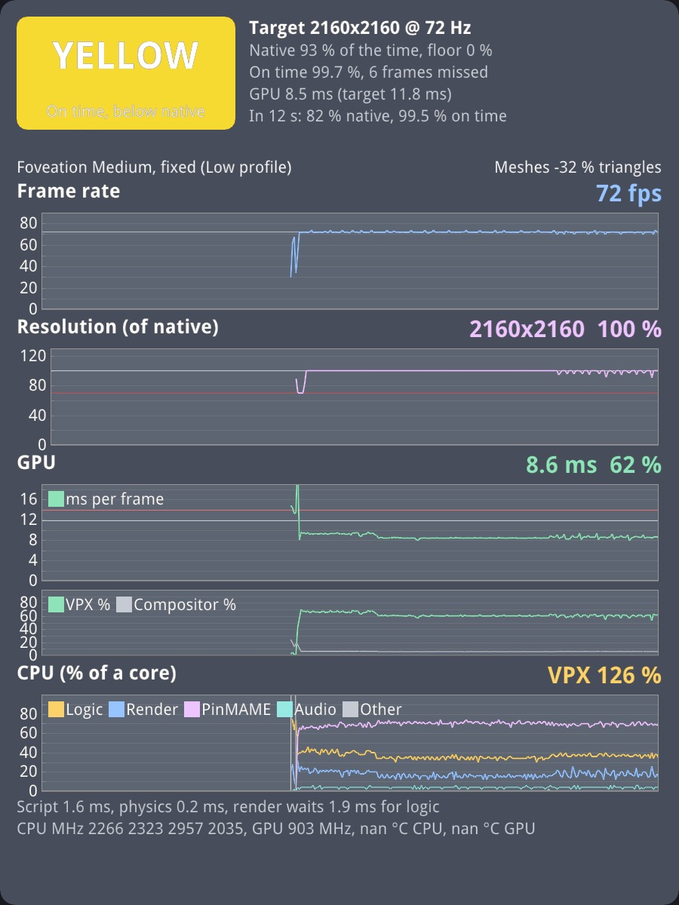
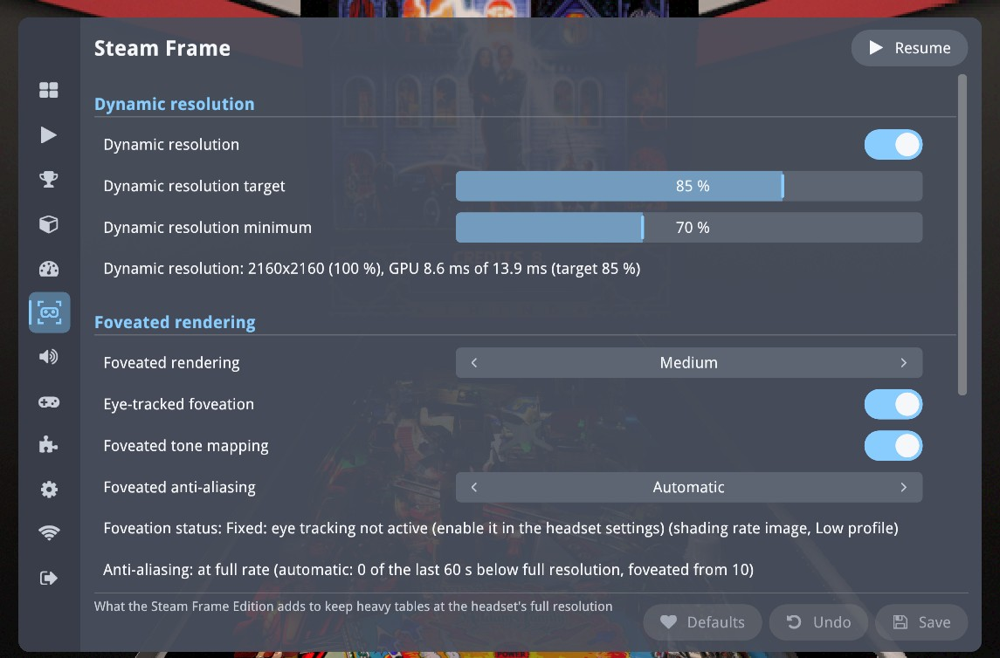
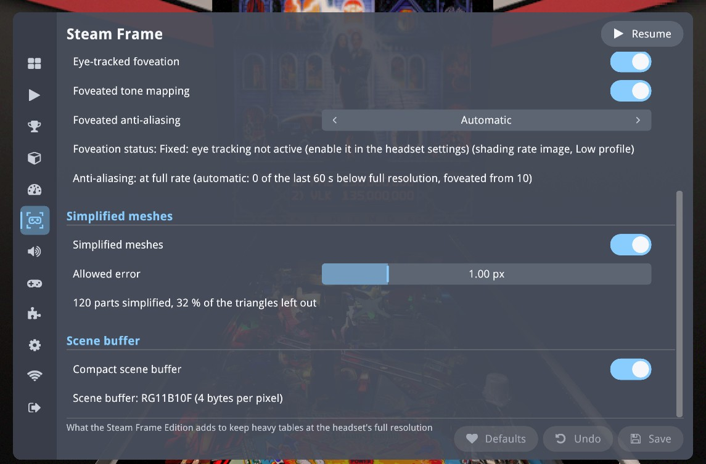
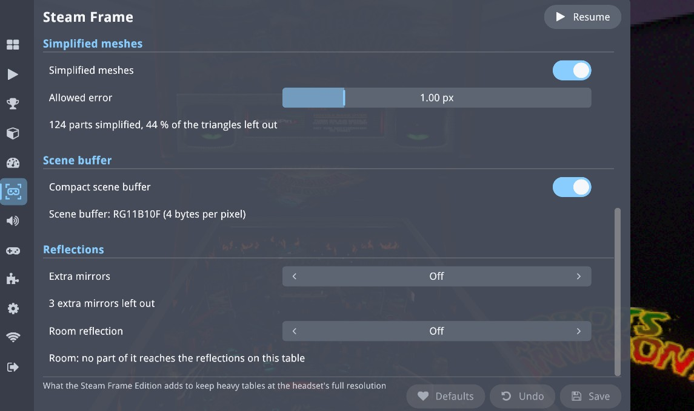
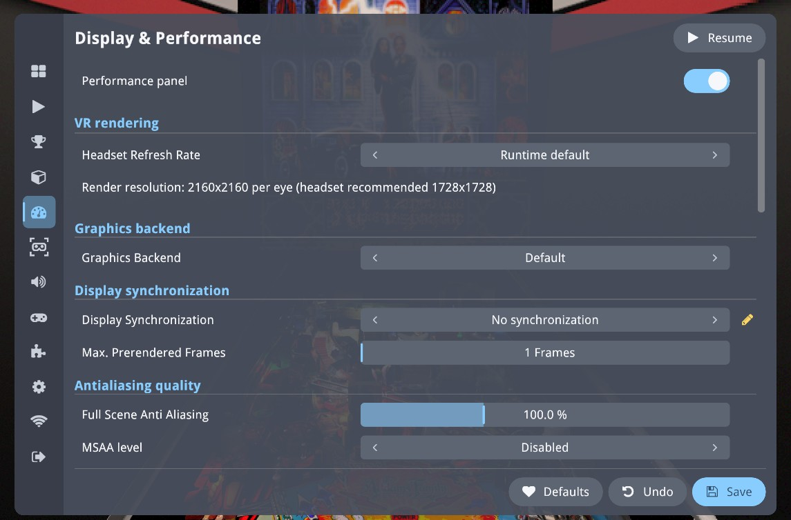
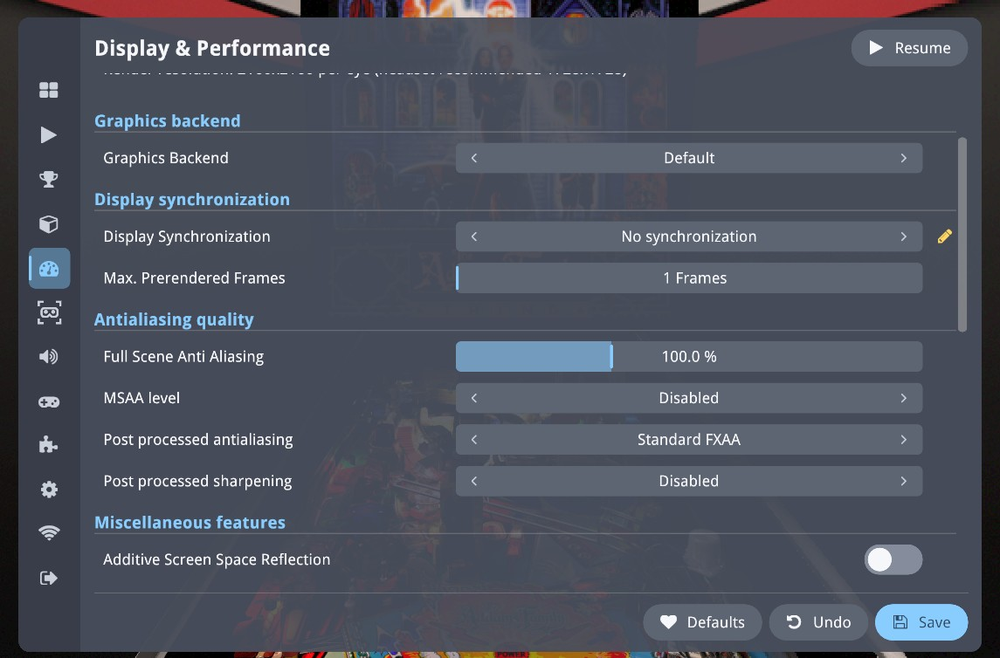
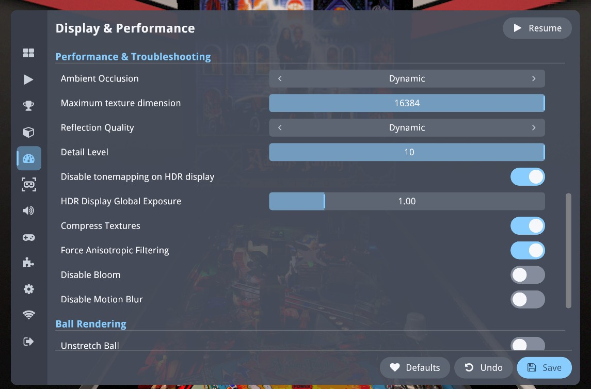
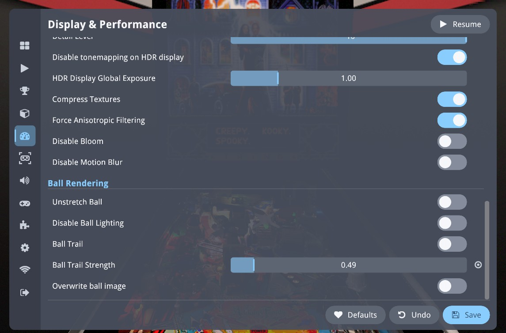

# Performance of the Steam Frame Edition

2026-11-01

This article describes every performance improvement of the Steam Frame Edition of Visual Pinball X: what each one does, how it works,
what it was measured to save on the Frame, and how to adjust it when it can be adjusted. The last part is a reference of the
performance settings of the menu, with screenshots taken on the Frame.

**▶ [Watch the tech deep-dive](https://youtu.be/WXHtyRk26lo)**: the video of the foveation, the simpler meshes and the culling, and how
heavy tables keep 72 Hz.

The Steam Frame renders the table natively, on its Adreno 750 GPU, at 2160 × 2160 pixels per eye and 72 frames per second: a frame
has 13.9 ms. When the October 2026 work started, a heavy table such as Addams Family needed **18.0 ms per frame** at that resolution
and ran at 36 fps. With everything described below, the same table renders in **about 7.2 to 8.2 ms** at the same resolution, and the tables
of the reference set run at 72 fps, at or close to the panel's full resolution:

| Table, headless, fixed 2160 × 2160 per eye | 2026-10-19 (start) | 2026-10-31 | |
|---|---|---|---|
| Addams Family (heavy: 1.9 million triangles per frame) | 18.0 ms, 36 fps | 7.20–7.23 ms, 72 fps | −60 % |
| Ghostbusters (light, pixel-bound) | 17.0 ms, 40 fps | 6.32 ms, 72 fps | −63 % |
| Albator78 (exported meshes, 2.6 million triangles) | 19.8–20.3 ms, 36 fps (2026-10-30) | 11.1–12.1 ms, 72 fps | −42 % |
| Lord of the Rings | 18.02 ms at fixed 2160², 36 fps (2026-10-25) | 11.9–12.8 ms at fixed 2160², 72 fps (2026-11-01); with dynamic resolution 2154–2158² on 2026-10-31, 2029² in a run of 2026-11-01, at 90–93 °C | −31 % |

Tables with extra mirrors or a large VR room, measured on 2026-11-01 with the [reflection settings](#75-what-the-reflections-leave-out) On, then Off, their default:

| Table, headless, fixed 2160 × 2160 per eye | On | Off | |
|---|---|---|---|
| Robot Invasion | 22.7 ms, 36 fps | 9.4 ms, 72 fps | −59 % |
| 2001 | 14.5 ms, 67 fps | 8.3 ms, 72 fps | −43 % |
| Maverick | 16.4 ms, 36 fps | 11.1 ms, 72 fps | −32 % |
| WildWest | 13.9 ms | 10.9 ms | −22 % |

The two columns are runs of different days and builds; each improvement below gives its own before and after, measured back to
back. The October 31 runs of Addams and Ghostbusters had the anti-aliasing foveated; with its default, *Automatic*, a table that
holds its full resolution keeps a full-rate anti-aliasing pass, which costs a little more (Addams 8.1–8.2 ms on 2026-11-01). Some tables
are still below their full resolution: [section 13](#13-what-was-measured-and-not-done) says which, and what limits them.

The heat matters as much as the milliseconds, since a hot Frame slows its GPU down: the foveated post-processing and the compact scene
buffer alone made the GPU run 12 °C cooler on the same table (Addams 92 → 80 °C, Ghostbusters 86–88 → 76 °C).

Contents:

1. [How the performance is measured](#1-how-the-performance-is-measured)
2. [Nothing rendered that nobody sees](#2-nothing-rendered-that-nobody-sees): the desktop mirror, the desktop window
3. [Getting the most from the driver](#3-getting-the-most-from-the-driver): direct rendering, the visibility mask
4. [Dynamic resolution](#4-dynamic-resolution)
5. [Foveated rendering](#5-foveated-rendering): the scene
6. [Foveated post-processing](#6-foveated-post-processing): tone mapping, anti-aliasing (Automatic)
7. [Fewer triangles](#7-fewer-triangles): culling, simplified meshes, welded meshes, reflection culling, what the reflections leave out
8. [Fewer bytes](#8-fewer-bytes): compact scene buffer, FXAA luma in alpha
9. [Anti-aliasing and image quality](#9-anti-aliasing-and-image-quality)
10. [Memory, threads, loading and table switches](#10-memory-threads-loading-and-table-switches)
11. [The performance panel](#11-the-performance-panel)
12. [Settings reference](#12-settings-reference): the Steam Frame screen, Display & Performance
13. [What was measured and not done](#13-what-was-measured-and-not-done)
14. [Further reading](#14-further-reading)

## 1. How the performance is measured

**The counter.** The GPU time of a frame is read from the runtime: SteamVR exposes the application's GPU time per frame as
`/perfmetrics_meta/app/gpu_frametime` (OpenXR extension `XR_META_performance_metrics`). It counts everything the frame renders and follows
the GPU clock. The same counter drives the dynamic resolution and the performance panel. With `VPX_GPU_PROFILE=1`, the log adds bgfx's
GPU time per render target (scene, reflection probe, tone mapping, FXAA, bloom...), which is how the cost of each pass is known.

**The budget.** At 72 Hz a frame has 13.9 ms. The dynamic resolution aims at 85 % of it, **11.8 ms**, to keep a margin for the
compositor and for heavier moments.

**Headless runs.** Most measurements are made with nobody in the headset: test builds pin both eyes at a player's place in front of the
table (25 cm behind and 50 cm above the front of the playfield, 64 mm apart) and keep rendering although SteamVR does not display the
frames, and a script plays the table. A run lasts two minutes and is measured after its first 40 seconds. The method was checked
against a worn run on Ghostbusters: 1548² at 10.5 ms worn, 1568² at 11.3 ms headless, the difference being the fixed foveation of a
headless run (no gaze). When two builds are compared, their runs alternate, to share the heat of the device.

**The reference tables.** Addams Family VR room (heavy: 1.44 million triangles in the scene and 0.45 million in the reflection probe, a
PinMAME game), Ghostbusters VR room (light geometry, many pixels: a large room and sky), and, for specific cases, Lord of the Rings,
Iron Man, Attack from Mars and Albator78. The study of the tables still below their full resolution (2026-11-01) added Darkest Dungeon,
Robot Invasion, WildWest, World Joker Tour, Maverick and 2001. Headless runs can differ from play: see [section 13](#13-what-was-measured-and-not-done).

The test hooks and series scripts are in the documentation repository (`Doc/test-hooks`: `perf-hooks.py`, `gpu-series.sh`,
`perf-report.py`); they are never part of a release build.

## 2. Nothing rendered that nobody sees

### 2.1 The desktop mirror is not rendered on the Frame

Visual Pinball in VR also draws the table on the desktop window. Its default "Playfield and other displays" mode rendered the whole
scene a third time, with its own playfield reflection, for a 1080p window that, on the Frame, nobody ever sees.

**What changed.** In the Frame build the renderer ignores the *Desktop display* setting (`PlayerVR/DesktopDisplay`): the mirror is
never rendered, the setting is not offered in the menu, and the key that cycles the desktop display modes does nothing in VR. Table
images (the thumbnails of the library) are still captured, from the headset view. Other builds keep upstream's behaviour.

**Measured** (headless, 2026-10-19):

| Addams Family | Mirror on | Mirror off | Saved |
|---|---|---|---|
| 1296² | 11.7 ms | 7.2 ms | 4.5 ms |
| 1728² | 15.7 ms, 53 fps | 9.1 ms, 72 fps | 6.6 ms |
| 2160² | 18.0 ms, 36 fps | 11.6 ms, 72 fps | 6.4 ms |
| Dynamic resolution | 1512² (the 70 % floor), 12.1 ms | 2023² (94 %), 10.7 ms | |

| Ghostbusters | Mirror on | Mirror off | Saved |
|---|---|---|---|
| 1296² | 9.3 ms | 4.9 ms | 4.4 ms |
| 1728² | 11.7 ms | 7.2 ms | 4.5 ms |
| 2160² | 17.0 ms, 40 fps | 10.1 ms, 72 fps | 6.9 ms |
| Dynamic resolution | 1568², 11.3 ms | 2158², 10.1 ms | |

The saving is larger than the mirror's own pass (2.1 ms on Ghostbusters, 3.5 ms on Addams at 2160²) because the mirror's scene render
had its own reflection probe: the reflection's GPU time fell from 1.9–3.8 ms to 1.1–1.3 ms on Addams. The render thread also went
from 25 % to 15 % of a core on Addams, and from 56 % to 34 % on Ghostbusters.

**Setting:** none; it is how the Frame build works.

### 2.2 The desktop window is not drawn: the end of the frame pacing stall

At fixed 2160², Ghostbusters started most runs in a strange state: the runtime reported 13.9 ms of GPU time per frame, a full frame
period, while the GPU passes still took 9.2–9.5 ms and the table still ran at 72 fps. The render thread spent 11.7–12.0 ms in submission
instead of 5.5–6.8 ms. The state lasted 70 to 120 seconds and ended with one long frame. Since the dynamic resolution reads the same
counter, it would have dropped to its floor within a fraction of a second.

**The cause.** On Linux the desktop window is bgfx's main swapchain, and even with the mirror off, the renderer still cleared and
presented it every frame. That window lives in gamescope's Xwayland at 59.86 Hz: the 72 Hz headset frame was tied to a 60 Hz
presentation engine, the image acquire blocked, and the submission waited for it. With the window drawn, 4 runs of 4 stalled; without
it, none.

**What changed.** The Frame build no longer draws into the desktop window at all. The render thread's submission went from 6.2 to
4.1 ms per frame on Ghostbusters (11.9 ms when stalled) and from 3.3 to 1.7 ms on Addams; 7 runs out of 7 without a stall.

**And a guard.** The dynamic resolution keeps a safety net for other setups: a GPU reading within 5 % of the frame period while no frame
missed its display is not GPU work but a stall, and the resolution is held; when nearly every reading of a second is held, the render
thread skips one frame on purpose (at most three times per table), which puts the pipeline back in step.

**Setting:** none.

## 3. Getting the most from the driver

These two changes came from studying the GPU trace of the Frame's Vulkan driver (Mesa's Turnip) while foveated rendering was being
developed.

### 3.1 Direct rendering where it is faster (`TU_AUTOTUNE_ALGO=profiled`)

A tiled GPU like the Adreno can render a pass in tiles (binning, through on-chip memory) or directly to memory. The binning path
processes the geometry once per tile: for a scene with many triangles and a large target, that is expensive (on Ghostbusters at 2160²,
48 tiles and about 6.5 ms of per-tile drawing, against 4.7 ms for the whole pass rendered directly). The application now starts the
driver with `TU_AUTOTUNE_ALGO=profiled` (set in `src/core/main.cpp` before the driver loads; a value set by the user wins): the driver
measures both paths for each render pass and keeps the faster.

**Measured:** Ghostbusters VR room at native 2160², foveation off: **14.0 → 9.1 ms** per frame (13.7–14.1 → 8.97–9.18 ms in the
verification build).

**Setting:** none.

### 3.2 The visibility mask, drawn first

The VR visibility mask hides the parts of the image the lenses never show. It was drawn with an "always pass" depth test, which made
the driver turn off its hierarchical depth rejection (LRZ) for the rest of the pass, and with a sort key that put it after every opaque
part, so it never masked anything. It is now drawn first, with a "less or equal" test (the same result): every opaque draw benefits from
it and from LRZ.

**Setting:** none.

## 4. Dynamic resolution

The cost of a table changes with the table, the view and the heat of the device. Instead of a fixed resolution that must fit the worst
case, the Frame build adjusts the resolution every frame.

**How it works.** The scene is rendered into the top left part of its buffers, at a scale of the full size; the runtime is told which
part of the image was drawn, and scales it to the panel. Nothing is reallocated, so the scale can change every frame. On the render
thread, after each frame, `VRDevice::UpdateDynamicResolution` reads the GPU time of the runtime:

- **Down** as soon as the GPU time, averaged over about five frames, is over the target (85 % of the frame period: 11.8 ms at 72 Hz), by
  2 % per frame or more when far over; at once for a frame over the whole period.
- **Up** when the time expected at the next step stays under 97 % of the target, a quarter of a second after the last step down, by 0.3 %
  to 1 % per frame depending on the room left.
- Between the **minimum** (70 % of the full size by default) and the **full size**, which is the render resolution of the table (125 % of
  the size the runtime recommends, that is the panel's 2160² on the Frame).
- The frame budget is the display's refresh rate (`XR_FB_display_refresh_rate`), not the period the runtime predicts for each frame: a
  table opened from the lobby predicted 11.1 ms for its first frame, which had lowered the budget, and the resolution, for the whole table.

**Measured.** The climbing rule of 2026-10-28 took Addams (3-minute headless runs) from 2092² on average, at full size 27–33 % of the
time, to **2150² on average, at full size 88–91 % of the time**, for a few frames missed per 3 minutes (1 in 2000 to 4000). A 15-minute
run from a cool device held 72.0 fps without throttling, the GPU levelling at 85–86 °C. Early runs at fixed 2160² had 24 % of their
frames reprojected by the compositor; with dynamic resolution, 4 %.

**Settings** (Steam Frame screen, section *Dynamic resolution*; live, per table or for all): the switch (on), the target (85 %) and the
minimum (70 %), with a status line. The full size is the *Render resolution* slider of the VR & Room screen, section *More* (applies
to the next table started); the Display & Performance screen shows it. See [section 12](#12-settings-reference).

## 5. Foveated rendering

The eye sees sharply only a few degrees around the point it looks at. The Frame has eye tracking: the scene is shaded at full rate
only around the gaze, and more coarsely further out, where the eye cannot see the difference.

**How it works on the Frame.** The scene pass gets a *fragment shading rate image* (`VK_KHR_fragment_shading_rate`, through a bgfx patch
of the fork): one byte per 8 × 8 block of the image (270 × 270 at 2160²), a single image for both eyes, telling the GPU to run the pixel
shader once per pixel, once per 2 × 2 block or once per 4 × 4 block. `VRDevice::UpdateShadingRateImage` writes full rate in a disc around
each eye's gaze, 2 × 2 in a ring around it and 4 × 4 beyond, and rewrites the image only when a disc moves by more than half a block. The
driver applies this image in its direct rendering path (section 3.1), which a *fragment density map*, the first approach tried, could
not do: the density map forced the slower tiled path.

**The gaze** comes from `XR_EXT_eye_gaze_interaction`: a gaze ray located at its sample time, its fixation point projected with each
frame's views and smoothed over 35 ms, so the point looked at stays sharp while the head moves. Without a valid gaze (eye tracking off or
not calibrated), a wide fixed disc at the center of each eye's view is used (the *Low* profile), whatever the level.

**The levels** set the radii of the rings (full rate / 2 × 2, as a share of the half width of the view): High 0.15 / 0.28, Medium 0.20 /
0.38, Low 0.30 / 0.55 with eye tracking.

**Measured** at native 2160², dynamic resolution off, eye-tracked (Addams, 2026-10-03): **Off 14.3 ms, High 11.2, Medium 11.3, Low
11.5** (Off again: 14.8): about 3 ms, 22 % of the frame, at every level. With fixed images, Ghostbusters went from 11.3 to 9.2 ms
(High). The 4 × 4 floor (everything coarse, about 9 ms on Ghostbusters and 11 ms on Addams then) is the cost that shading does not
explain: geometry, post-processing, transfers.

**Settings** (Steam Frame screen, section *Foveated rendering*; live): *Foveated rendering* Off / Low / **Medium** / High, *Eye-tracked
foveation* (on), and a status line saying what the runtime does ("Eye-tracked (shading rate image)"). Eye tracking must be enabled and
calibrated in the headset's own settings.

## 6. Foveated post-processing

After the scene, two full-screen passes still ran at full rate everywhere: the **tone mapping** (exposure, bloom, tone curve, color
grading, dithering) and the **anti-aliasing** (FXAA). At 2160² they took about 1.6 ms each, a third of the Addams frame then.

**How it works.** The shading rate image works on any render target in the driver's direct path, so the same pattern is attached to the
post-processing targets: `PostProcess1` (the tone mapping's output) and `PostProcess2/3` (the anti-aliasing and the passes after it), and
to the headset image the last pass writes. One image is kept per target size, since the scene, the post-processing targets and the
headset image can have different sizes (supersampling, render resolution). Only with the shading rate image.

**Measured** (headless, fixed 2160², 2026-10-30): **Addams 10.07 → 8.41 ms (−1.67 ms), Ghostbusters 9.45 → 7.66 ms (−1.79 ms)**;
tone mapping 1.56 → 0.78 ms, FXAA 1.57 → 0.69 ms; the GPU 9–11 °C cooler. With the scene at 75 % (two shading rate images): −0.99 ms.
With dynamic resolution, Addams stays at 2160² and goes from 9.98 to 8.37 ms.

**The visual cost.** In the periphery, edges become as blocky as the shading already is there: the tone mapping writes each coarse block
with one color, and the FXAA works on blocks. The anti-aliasing is the one that shows most, since its edges are the last step before
the headset. Hence two separate settings:

- **Foveated tone mapping** (on by default).
- **Foveated anti-aliasing**: *Always Off*, *Always On* or **Automatic** (the default). Automatic keeps the anti-aliasing at full rate
  while the table holds its full resolution, and foveates it for the rest of the table once the table was below its full resolution for
  most frames of 10 of the last 60 seconds of play (the dynamic resolution scale under 100 %, or at a fixed resolution the GPU time over
  the target). The first minute of each table is not counted: tables start below their full resolution for up to half a minute while
  they warm up. Once on, it stays on for that table, since the time it saves (about 0.9 ms at 2160²) is what lets the table climb back to
  full resolution. Each table starts with it off.

Both are in the Steam Frame screen, section *Foveated rendering* (live, saved for the table or for all tables).

**Checked** (headless, dynamic resolution as played, 2026-10-31): Addams and Lord of the Rings keep it off (Lord of the Rings at
2154–2158² on average, 11.0 ms against the 11.8 ms target); Lord of the Rings with the dynamic resolution target lowered to 70 %, which
holds it below its full resolution on purpose, turns it on 72 seconds after the start. The first version, which counted the start of the
table, had turned it on for Lord of the Rings after 12 seconds; with it *Always Off*, the table was back at 2160² after 35 seconds.

A status line under the choice says the state and why (for example "at full rate (automatic: 3 of the last 60 s below full resolution,
foveated from 10)"), and the performance panel's foveation line ends with "+ AA (auto)" when the automatic mode has turned it on.

## 7. Fewer triangles

The scene pass of the Frame costs about **2.2–2.4 ms per million triangles** per frame, measured on five tables (a fit of 7.5 ms plus
2.2 ms per million triangles at 2160²). Addams draws 1.9 million triangles per frame (1.44 million in the scene, 0.45 million in its
reflection probe). Tables built from scans or exported from modelling tools carry far more triangles than the headset can show.

### 7.1 Parts outside the view are not drawn

`ModelViewProj::IsBoxVisible` transforms the eight corners of a part's bounding box with each eye's projection; a part is skipped when,
for both eyes, all its corners are beyond the same side of the view or behind the eye. The test is conservative (no near or far plane,
boxes across a corner of the view are kept) and also applies in the mirrored view of the reflection probe. Animated meshes and grouped
parts are excluded. It is generic: all renderers and modes, a candidate for upstream.

**Measured** (A/B alternated, fixed 2160²): **Lord of the Rings 18.02 → 17.43 ms (−0.6 ms)**, 1.58 → 1.34 million triangles (16 % of its
triangles are outside both eyes' view from the player's place); Addams, Iron Man and Ghostbusters unchanged (their parts are all in
view). No visual change.

**Setting:** none.

### 7.2 Simplified meshes

**How it works.** While the table loads, on the threads that load the textures, every primitive of at least 500 triangles gets a few
simplified versions of its mesh (meshoptimizer 1.2): from 0.5 to 16 VP units of error, normals and texture coordinates weighted so that
printed artwork and thin parts keep their shape, a version being kept only if it removes at least 10 % of the triangles. A version is an
index list over the part's own vertices: positions, normals and texture coordinates are exact, and the physics, the editor and the
table's file keep the original mesh. Each frame, each part draws the coarsest version whose error, seen from the closest eye, stays
under the **allowed error** in pixels of the view at its full render resolution; the reflection probe allows twice the error. A part
becomes finer at once and coarser only well within the limit, so that the switches are not visible. Leaning in brings back the full
mesh. Not simplified: animated meshes, grouped parts, the playfield, additive parts and light maps (unless they coincide with a
simplified part), small meshes. Meshes that coincide (a part and its "off" layer) share their versions, so stacked layers stay exactly
on top of each other.

**Measured** (headless, fixed 2160², 2026-10-29):

| Table | Off | On (1 px) | Saved | Triangles per frame |
|---|---|---|---|---|
| Addams Family | 11.94, 11.77 ms | 10.58, 10.56 ms | **−1.29 ms** | 1.90 → 1.36 million |
| Iron Man | 10.23 ms | 9.73 ms | −0.50 ms | 0.50 → 0.29 million |
| Attack from Mars | 9.86 ms | 9.66 ms | −0.20 ms | 0.72 → 0.56 million |
| Lord of the Rings | 17.32 ms | 17.08 ms | −0.24 ms | 1.34 → 1.22 million |

With dynamic resolution, Addams went from 45 % of the time at full size (11.49 ms) to **95 %** (10.48 ms, every reading after its first
30 seconds). On a Mac, close-ups changed 0.02 % of the pixels of the upper playfield. Loading takes longer while the versions are made:
about 0.9 s more on Addams.

### 7.3 Meshes exported as separate triangles

Some tables carry meshes exported with every triangle on its own three vertices (flat shading): the simplifier cannot reduce them,
since every corner is a seam. Albator78 has eight such meshes holding 1.30 of its 1.78 million candidate triangles; only 9 % could be
removed. Such meshes (at least 1.5 vertices per triangle) are now **welded** first: vertices merged by position, texture coordinates and
normals within 30°, degenerate triangles dropped; the simplified versions still index the original vertices.

### 7.4 Parts that cannot appear in the reflection are not drawn in it

The playfield's reflection probe renders the table a second time, mirrored. `RenderProbe::IsBoxReflected` skips a part when the lines
from the mirrored eye through the corners of its box all cross the reflecting plane beyond the area of the parts that show the probe,
or when the part is entirely under the plane. Generic, a candidate for upstream.

**Measured together** (welding and reflection culling, Albator78, headless, fixed 2160², 2026-10-30): **19.84 and 20.27 ms → 11.14 and
12.06 ms, 36 → 72 fps**, 2.64 → 0.57 million triangles per frame (scene 9.27 → 4.66 ms, reflection 5.61 → 1.47 ms), frames missed per
5 s 180 → 0–2; with dynamic resolution 2022² instead of 1526². The table takes 4.5 s more to load (8.4 → 12.9 s). Faceted parts come
out smoothly shaded. Addams also gained 0.2 ms (10.61 → 10.39 ms).

**Settings** (Steam Frame screen, section *Simplified meshes*; per table or for all): *Simplified meshes* (on in the Frame build; switched
live, but turning it on applies to the next table started if it was off when the table loaded), *Allowed error* (1.00 px, from 0.25 to
4), and a status line with the number of parts simplified and the share of triangles left out. Culling and reflection culling have no
setting.

### 7.5 What the reflections leave out

A reflection draws the scene again every frame, in a mirrored view, with its own draw calls. On the tables where it is expensive, what it costs is the parts it draws, on the GPU and on
the render thread, far more than its size: on Darkest Dungeon its pass only goes from 1.39 to 1.79 ms between 1296² and 2160², and a reflection at half size saves about 0.5 to 0.8 ms ([section 13](#13-what-was-measured-and-not-done)). So
two settings leave parts out rather than lower the quality of the rest. The playfield's reflection itself stays, with the table, the cabinet, the balls and a topper in it.

**Extra mirrors.** A table can have planar reflections of its own besides the playfield's, usually on the walls of a cabinet, and each one is a whole further render of the scene. Robot Invasion has three, for three surfaces of a few triangles,
two of them shown at only 5 % and 50 %: they draw 2,330 draws per frame instead of 990, and keep the render thread busy for 15 ms per frame instead of 7. With the setting off, a planar reflection other than the playfield's is not rendered, and
the surfaces that showed it stay in place without a reflection. A horizontal one is kept, as it is the reflection of another playfield (the upper playfield of Game of Thrones). Few tables have such mirrors: 4 of the 94 surveyed. On one of them, Last
Action Hero, they cost little, so leaving them out gains nothing there.

**Room reflection.** With a large VR room, most of what the playfield reflects can be the room: 570,000 of the triangles of WildWest's room are in its reflection. The [culling of the reflection](#74-parts-that-cannot-appear-in-the-reflection-are-not-drawn-in-it) cannot
leave out a mesh as large as the room, as its box reaches the playfield. With the setting off, a part is left out of the reflections when its box, as placed in the table, reaches more than 300 units beside the playfield, 600 behind it or 700 in front of it (about 16, 32 and
38 cm): further than the side rails, the backbox and the lockbar. Height is not looked at, which keeps a topper or a tall backbox. These parts stay in the room around you. Parts merged by a group (drawn from one buffer) and animated meshes are not looked at, as for the culling.

**Off, On or Automatic.** Both settings are **Off** in the Frame build, the fast choice, whether a table needs the time or not. **On** gives the reflections back. **Automatic** leaves a table as it is while it holds its full resolution. Once it was below it for 10 of the last 60 seconds, the first minute of
the table not counted, the extra mirrors go; after 10 more such seconds, the room; for the rest of the table, and it decides again at the next play. Only what the table has counts, so a table with neither loses no time. The foveated anti-aliasing, set to Automatic too, waits for these, as it shows more.

**Measured** (headless, 2026-11-01; On at 2160²; Off at 2160² and with dynamic resolution as the player has it):

| Table | On | Off | Reflection passes, On → Off | Size with dynamic resolution, Off | Left out |
|---|---|---|---|---|---|
| Robot Invasion | 22.7 ms, 36 fps | **9.4 ms, 72 fps** | 6.5 → 1.3 ms | 2155² (1559² before) | 3 mirrors |
| 2001 | 14.5 ms, 67 fps | **8.3 ms, 72 fps** | 5.2 → 1.9 ms | 2160² | 2 mirrors |
| Maverick | 16.4 ms, 36 fps | **11.1 ms, 72 fps** | 5.3 → 1.1 ms | 2141² | 80 parts of the room |
| WildWest | 13.9 ms | **10.9 ms** | 4.6 → 1.5 ms | 2146² (2031² before) | 18 parts of the room |

The saving can exceed the passes, as the runtime's counter also falls on tables whose render thread was overloaded ([section 13](#13-what-was-measured-and-not-done)). In the headset, with the same parts left out by a script patch on 2026-11-01, Robot Invasion went from 1 % to 100 % of the
time at full resolution and WildWest from 0 % to 98.5 % (plays of 47 and 53 s), and the owner confirmed the setting itself works in the headset.

In Automatic mode, Robot Invasion stayed at the 1512² floor until the mirrors went, then held 2160² at 9.5 ms; WildWest about 2000², then 2160² at 10.8 ms.

Most tables have nothing to leave out, and do not change: on Addams, Darkest Dungeon and World Joker Tour no part is left out, and on Game of Thrones its upper playfield keeps its reflection. Masters of the Universe and Ace of Speed, measured with the same parts removed by script, gained 0.2 ms or less.

**What it changes on screen.** The wall surfaces of a table with extra mirrors look flatter, as they no longer reflect the table. A glossy playfield no longer shows the room, which may be noticed in a bright room. If a table looks better with them, set them to *On* or *Automatic* for that table: **Save** in this section stores them for the table being played or for all.

**Settings** (Steam Frame screen, section *Reflections*; live, per table or for all): *Extra mirrors* and *Room reflection*, On / Off / Automatic, each with a status line that says what this table has and what was done with it.

## 8. Fewer bytes

The scene pass renders directly to memory (section 3.1), so every pixel written or blended, and every pixel read again by the following
passes, costs memory bandwidth.

### 8.1 Compact scene buffer

Visual Pinball renders the scene into floating-point targets that bgfx creates as RGBA16F, 8 bytes per pixel. RG11B10F holds the same
range in **4 bytes**. With the *Compact scene buffer* setting, every target asked as RGB16F becomes RG11B10F where the GPU can render to
it: the scene buffers, bloom, screen-space reflection and motion blur buffers, the static prerender and the reflection and refraction
probes. The code was checked before: no pass reads the alpha of these targets, and nothing negative is stored (the lights and additive
flashers write a negative color into a reverse subtract blend, whose result stays positive). The precision is lower: 6 bits of mantissa
for red and green, 5 for blue, against 10, a step of 1.6 % and 3.1 %, about one step of the 8-bit output in mid-tones, under the tone
mapping's dither. Switching it rebuilds the targets at the start of the next frame (one frame of about 12 ms).

**Measured** (headless, fixed 2160², foveated post-processing on, 2026-10-31):

| Table | Off | On | Saved | Per pass |
|---|---|---|---|---|
| Addams | 8.82 ms | 7.94 ms | **−0.88 ms** | scene 5.19 → 4.60, post-processing 0.86 → 0.65 |
| Ghostbusters | 8.23 ms | 6.71 ms | **−1.52 ms** | scene 3.72 → 2.90, bloom 0.87 → 0.55, post-processing 0.85 → 0.62 |

Together with the foveated post-processing, the GPU ran 12 °C cooler (Addams 92 → 80 °C) and 15–20 points less busy. What may show:
faint banding in smooth blue gradients, and where many additive layers stack. Checked in the headset on 2026-10-31 and turned on by
default.

**Setting** (Steam Frame screen, section *Scene buffer*; live, per table or for all): *Compact scene buffer* (on in the Frame build, off
in the desktop builds), with a status line giving the format in use.

### 8.2 FXAA reads the luma from the alpha channel

FXAA works on the brightness (luma) of the pixels, and computed it from 9 color reads around each pixel, and again for every read of its
edge search. The tone mapping now writes the luma of its output in the alpha channel of `PostProcess1` (which nothing else read) when an
FXAA pass follows, and the FXAA gathers it: two `textureGather` of the alpha channel and two reads give the 3 × 3 neighbourhood, 4 fetches
instead of 9. A per-pixel comparison on a Mac found no pixel where the two ways differ by more than 0.003.

**Measured** (fixed 2160², foveated post-processing and compact scene buffer on): FXAA pass 0.67 → 0.51 ms on Addams (−23 %) and 0.64 → 0.49 ms on Ghostbusters;
frame −0.12 and −0.09 ms. Generic, a candidate for upstream.

**Setting:** none; it applies with any of the FXAA modes.

## 9. Anti-aliasing and image quality

The Frame renders 1:1 with its panel, without the supersampling a PC gives a PC headset; without anti-aliasing, diagonals are
stair-stepped. The Frame build uses **Standard FXAA** by default (`Player/FXAA`), the only option within the frame budget of heavy
tables:

| Ghostbusters at 2160², measured 2026-10-02 | GPU per frame | Cost |
|---|---|---|
| No anti-aliasing | 9.7 ms | |
| Standard FXAA | 12.2 ms | +2.5 ms (+1.6–2.0 ms on a cool device) |
| Quality FAAA | 12.8 ms | +3.0 ms |
| MSAA 4× | 21.1 ms | +11.3 ms |
| 1.3× supersampling (AAFactor) | 16.3 ms | +6.5 ms |

Since then, the FXAA pass came down from about 1.6 ms to 0.5 ms when it is foveated (foveated post-processing, then the luma in
alpha). At full rate, as the Automatic mode keeps it on a table that holds its full resolution, it took 1.57 ms before the luma change,
which removes a part of that (not measured at full rate). Fast FXAA is not cheaper on the Frame: +0.13 to +0.19 ms against Standard.

The material shader also has **specular anti-aliasing** (the glossy lobe widened by the normal's variation over the pixel, and the
reflection map read at the matching level of detail), which removes the sparkle of glossy edges at no measurable cost. It has no setting.

The anti-aliasing mode, the supersampling factor and the other graphics options are in the Display & Performance screen.

## 10. Memory, threads, loading and table switches

**Threads on chosen cores.** The cores of the Frame are not alike: two small ones, five fast ones and a fastest one. Steam gives a game cores 3 to 7 and leaves it to the system to move its threads between them, among others that may run there. While a table is played, this edition runs the render thread on core 7, the logic thread on cores 5 and 6, and the rest (PinMAME, sound, PuP) on cores 2 to 4. In the headset, Darkest Dungeon spends 62 % of its time at full resolution with this placement (two plays), against 1.9 to 19.4 % without it (three plays). Addams Family and Ace of Speed stay at 93 to 100 %, and the owner heard no problem with the sound. Headless with Steam's cores, on six tables, it does no harm and gains little: the render thread submits about 0.5 ms faster. Loading is not affected. No menu entry: `ThreadPlacement = 0` in the `[Player]` section of the settings turns it off.

- **Memory between tables.** On Linux, the process grew by about 10 MB at each switch between the lobby and a table (Addams 964 →
  1207 MB after 15 switches), memory kept by glibc's allocator rather than leaked. The build sets the allocator's mmap threshold to
  1 MB at start: **about 430 MB less at the table and 460 MB less in the lobby**, flat from switch to switch, for tables loading 3 to 5 %
  slower.
- **GPU memory budget.** The driver of the Frame reported a memory budget under 2 GB on some tables, so textures were evicted and drawn
  magenta, with a spurious "GPU memory limit reached" message. The budget is now what VPX holds plus 90 % of the available memory.
- **One VR session for all tables.** The OpenXR session is kept from table to table, and a thread shows the "Loading" message in the
  headset meanwhile: switches take 150 to 250 ms less, with at most 28 to 42 ms without a frame.

No settings.

## 11. The performance panel

The performance panel is a tool to tune the tables: a panel standing left of the cabinet, facing the player, on a layer of its own
that the headset composes (it costs the scene nothing). It shows the target (2160 × 2160 per eye at 72 Hz on the Frame), the frame rate,
the resolution and the GPU time against the target and the frame budget, the GPU and CPU load, clocks and temperatures, as graphs over
the last three minutes, and a line with the state of the foveation and of the simplified meshes.

*The panel on Addams Family, with nobody in the headset: 2160 × 2160 at 72 fps for 8.6 ms of GPU time, and a yellow rating, because
the table spent its first seconds below full resolution (93 % of the time at native over the rated period).*

Every 30 seconds of play it rates the table: **green** when at least 98 % of the display periods got a new frame and 95 % of the frames
were at full resolution, **yellow** when on time but below full resolution, **red** when frames were missed (then "GPU bound" or "CPU
bound"). The first 10 seconds of a table are not rated. The last rating of each table is kept and shown as a badge on the table's page
in the library, even with the panel off.

**Setting:** *Performance panel* at the top of the Display & Performance screen (off by default, saved at once for all tables).

## 12. Settings reference

The performance settings are in two screens of the menu (rail icons on the left): **Steam Frame**, with the features of this edition,
and **Display & Performance**. Changes apply at once ("live"), except where noted; the buttons at the bottom of a screen save them for
the table being played or for all tables, undo them or reset them to their defaults. The dynamic resolution and foveation settings are
also on the VR settings page of the classic menu; the simplified meshes and the scene buffer are only in this menu.

The screenshots were taken on the Frame, on Addams Family, with nobody in the headset (eye tracking is then reported inactive, and the
foveation is fixed).

### 12.1 The Steam Frame screen

The screen of this edition's performance features, behind the Steam Frame icon of the rail. Its five sections:

| Section | Option | Values | Default (Frame) | What it does |
|---|---|---|---|---|
| Dynamic resolution | **Dynamic resolution** | on / off | on | Adjusts the rendering resolution every frame to the GPU time ([section 4](#4-dynamic-resolution)). Off, the table renders at its full resolution whatever it costs. |
| | **Dynamic resolution target** | 50–100 % | 85 % | The GPU time aimed at, as a share of the frame period (85 % of 13.9 ms is 11.8 ms). Lower keeps more margin for heavy moments and for a hot device; higher gives more resolution to tables that sit just under their full size. |
| | **Dynamic resolution minimum** | 50–100 % | 70 % | The lowest resolution allowed, as a share of the full size per axis (70 % of 2160 is 1512 pixels, half the pixels). The headset's recommended resolution is 80 %. Raise it to keep a table sharper at the price of missed frames. |
| | *Status line* | | | The resolution of the last frame, the GPU time against the frame period and the target, and "held" when a frame pacing stall was detected ([section 2.2](#22-the-desktop-window-is-not-drawn-the-end-of-the-frame-pacing-stall)). |
| Foveated rendering | **Foveated rendering** | Off / Low / Medium / High | Medium | How small the full-rate area around the gaze is ([section 5](#5-foveated-rendering)). On Addams the three levels cost about the same (11.2–11.5 ms against 14.3 ms off). |
| | **Eye-tracked foveation** | on / off | on | Follows the eyes. Off, or when eye tracking is not active in the headset settings, the full-rate area is a wide disc fixed at the center of the view. |
| | **Foveated tone mapping** | on / off | on | Shades the tone mapping pass with the same pattern ([section 6](#6-foveated-post-processing)): about 0.8 ms. |
| | **Foveated anti-aliasing** | Always Off / Always On / Automatic | Automatic | Shades the anti-aliasing pass with the same pattern: about 0.9 ms, the most visible of the foveations. Automatic turns it on only for a table that cannot hold its full resolution without it. |
| | *Foveation status* | | | What the runtime does: "Eye-tracked (shading rate image)", or why it is fixed. |
| | *Anti-aliasing status* | | | Whether the anti-aliasing pass is foveated, and in Automatic mode why: "decided after the first minute of the table", "3 of the last 60 s below full resolution, foveated from 10", or "the table went below its full resolution". |
| Simplified meshes | **Simplified meshes** | on / off | on | Draws heavy parts with fewer triangles where the difference cannot be seen ([section 7.2](#72-simplified-meshes)). Turning it off applies at once; turning it on applies to the next table started if it was off when the table loaded. |
| | **Allowed error** | 0.25–4.00 px | 1.00 px | How far a simplified part may deviate from its mesh, in pixels of the view at full resolution. Higher saves more triangles; at 1.5 px Addams saved 1.54 ms instead of 1.29 ms. |
| | *Status line* | | | The parts simplified when the table loaded, and the share of the triangles left out over the last second (32 % on Addams in the screenshot). |
| Scene buffer | **Compact scene buffer** | on / off | on | Renders the scene with 4 bytes per pixel instead of 8 ([section 8.1](#81-compact-scene-buffer)): 0.9 to 1.5 ms. Turn it off if banding shows in a table's smooth gradients. |
| | *Status line* | | | The format in use: "RG11B10F (4 bytes per pixel)", "RGBA16F (8 bytes per pixel)", or "Not supported by the GPU". |
| Reflections | **Extra mirrors** | On / Off / Automatic | Off | The mirrors other than the playfield's, which each draw the scene again ([section 7.5](#75-what-the-reflections-leave-out)): 6 to 13 ms on the tables that have heavy ones. |
| | *Status line* | | | How many this table shows and whether they are drawn, and in Automatic mode why. |
| | **Room reflection** | On / Off / Automatic | Off | The parts of the VR room in the reflections: 3 to 5 ms on tables with a large room. They stay in the room around you. |
| | *Status line* | | | Whether the room is left out, or that no part of it reaches the reflections on this table. |

All of them apply at once. **Save** stores them for the table being played or for all tables: a table with its own values keeps
them, so a demanding table can have, for example, a lower minimum resolution or its anti-aliasing always foveated. **Defaults** puts
back the values above; **Undo** the stored ones.

### 12.2 The Display & Performance screen

The general rendering settings of Visual Pinball, with the headset's own ones at the top. The Frame build hides the *Desktop mirror*
section of upstream's version of this screen, since the mirror is never rendered ([section 2.1](#21-the-desktop-mirror-is-not-rendered-on-the-frame)).
The screenshots show the settings of the test setup: some differ from the defaults.

The settings that matter for performance on the Frame:

| Option | Values | Default (Frame) | Performance on the Frame |
|---|---|---|---|
| **Performance panel** | on / off | off | Shows the panel of [section 11](#11-the-performance-panel). Costs nothing to the scene. Saved at once, for all tables. |
| **Headset Refresh Rate** | Runtime default, 72, 80, 90, 120 Hz | Runtime default (72 Hz on the Frame) | A higher rate leaves less time per frame (11.1 ms at 90 Hz instead of 13.9 ms): the dynamic resolution then lowers the resolution further. All the measurements of this article are at 72 Hz. |
| *Render resolution* (status) | | | The full size of the rendering per eye, and the headset's recommended size. The size itself is the *Render resolution* slider of the VR & Room screen, section *More* (50–200 % of the recommended size, 125 % by default, which is the Frame's native 2160²); it applies to the next table started. |
| **Full Scene Anti Aliasing** | 50–200 % | 100 % | Supersampling: renders more pixels and scales them down. Very costly on the Frame (1.3× cost 6.5 ms on Ghostbusters). Below 100 %, renders fewer pixels and upscales them; dynamic resolution does that better. |
| **MSAA level** | Disabled, 4, 6, 8 samples | Disabled | 4 samples cost 11.3 ms on Ghostbusters at 2160²: not usable on the Frame. |
| **Post processed antialiasing** | Disabled, Fast FXAA, Standard FXAA, Quality FXAA, Fast NFAA, Standard DLAA, Quality SMAA, Quality FAAA | Standard FXAA | The anti-aliasing of the Frame ([section 9](#9-anti-aliasing-and-image-quality)): about 0.5 ms when foveated, more at full rate. The three FXAA modes read the luma from the alpha channel ([section 8.2](#82-fxaa-reads-the-luma-from-the-alpha-channel)); Fast FXAA is not faster on the Frame. |
| **Post processed sharpening** | Disabled, CAS, Bilateral CAS | Disabled | An extra full-screen pass. |
| **Additive Screen Space Reflection** | on / off | off | An extra full-screen pass. |
| **Ambient Occlusion** | Disabled, Static, Dynamic | Dynamic | Dynamic computes the occlusion every frame, with full-screen passes of its own (not measured separately on the Frame). |
| **Reflection Quality** | Disable Reflections, Balls Only, Static Only, Static & Balls, Static & Unsynced Dynamic, Dynamic | Dynamic | The playfield reflection costs about 1.1 ms on Addams and 1.3 ms on Ghostbusters; *Balls Only* or *Disable Reflections* saves all of it. In VR, *Static & Balls* does not save it (static parts are not prerendered in VR). A per-table choice for the heaviest tables. |
| **Maximum texture dimension** | 512–16384 | 16384 | Scales big images down when the table loads: less memory, rarely faster. |
| **Detail Level** | 1–10 | 10 | Tessellation of balls and ramps. |
| **Compress Textures** | on / off | on | GPU-compressed textures: less memory and bandwidth (slow on first load, cached afterwards). |
| **Force Anisotropic Filtering** | on / off | on | Sharper textures at grazing angles, for a small cost. |
| **Disable Bloom** | on / off | off | Removes the bloom pass: 0.2 ms on Addams, 0.5–0.9 ms on Ghostbusters (whose lights bloom a lot). |
| **Disable Motion Blur** | on / off | off | The ball motion blur is not used in VR anyway. |

### 12.3 Settings without a menu entry

*Thread placement* (`ThreadPlacement`, section `[Player]`, on) has no menu entry. Everything else described in this article works without a setting: the desktop mirror and the desktop window are never drawn on the
Frame, the driver chooses direct rendering (`TU_AUTOTUNE_ALGO=profiled`, which a value set in the environment overrides), parts outside
the view and parts that cannot appear in the reflection are skipped, meshes exported as separate triangles are welded before they are
simplified, FXAA reads the luma from the alpha channel, specular anti-aliasing is always on, and the memory and session changes of
section 10 always apply.

## 13. What was measured and not done

### 13.1 The series of 2026-10-30

A series of 2026-10-30 measured, with temporary test code, the opportunities left after the work above (Addams / Ghostbusters, fixed
2160², base 10.56 / 9.94 ms):

| Variant | Saved | Outcome |
|---|---|---|
| Foveated tone mapping and FXAA | −1.35 / −1.53 ms | Implemented (section 6) |
| Scene buffer in RG11B10F | −0.66 / −1.28 ms | Implemented (section 8.1) |
| FXAA off (the most a cheaper FXAA could save) | −1.52 / −1.56 ms | First step implemented (section 8.2); fusing FXAA into the tone mapping is bounded by the 0.5 ms left |
| Fast FXAA | +0.19 / +0.13 ms | Slower than Standard: not used |
| One eye drawn (the most hardware multiview could save) | −4.16 / −3.06 ms | Too loose a bound to decide: multiview keeps the second eye's pixels, and bgfx has no multiview |
| Reflection probe with coarser meshes (4× / 8× the error) | −0.09 / −0.20 ms (Addams) | Not worth it |
| Small parts left out of the probe (16 / 64 px) | 0 / 0 (Addams), −0.14 (Ghostbusters, 64 px) | Not worth it |
| Reflection probe at 75 % / 50 % of its size | −0.17 / −0.19 (Addams), −0.15 / −0.48 (Ghostbusters) | Not worth it |
| Reflections "Balls Only" / off | −1.13 / −1.11 (Addams), −1.29 / −1.34 (Ghostbusters) | A per-table option already (*Reflection quality*) |
| Dynamic resolution target 88 % / 90 % | Both tables already at full size | Not measurable on these tables |

Also studied and set aside: forcing the tiled or the direct path (the driver's own choice is better), the density map (section 5),
vertex cache reordering (2 % at most), a cheaper VR room on pixel-bound tables (the room costs about 2 ms on Ghostbusters; three options
dropped, three open).

### 13.2 The tables still below their full resolution (2026-11-01)

The ratings saved on the Frame from plays of 2026-10-31 gave 12 yellow tables of 27 rated. Those studied, headless, fixed 2160², foveated tone mapping and anti-aliasing and compact scene buffer on, without the reflection settings of section 7.5 (ms per frame):

| Table | Time at full resolution when played | Runtime GPU | Scene | Reflections | With dynamic resolution | What limits it |
|---|---|---|---|---|---|---|
| Robot Invasion | 1 % | 21 | 4.7 | 6.2 | 1559² | Three wall mirrors: section 7.5 |
| WildWest | 0 % | 13.5 | 6.5 | 3.6 | 2031² | The room, 5.7 ms against its Minimal room: section 7.5 for its reflection |
| World Joker Tour | 6 % | 10.6 | 5.8 | 1.7 | 2133² | Not settled: fits headless, 1984² when played |
| Darkest Dungeon | 30 % (15 s played) | 12.1 | 6.8 | 1.8 | 1805² | The statues of the table, and dynamic resolution (below) |
| Lord of the Rings | 41 % | 12.4 | 7.4 | 0.7 | 2029² | Its scene pass, not split further |
| Blade Runner 2049 | 51 % | 8.9 | 3.5 | 2.0 | not run | Not settled: fits headless |
| CyberRace | 72 % | 11.2 | 6.5 | 0.6 | not run | Its scene pass, not split further |

Repeated runs of the same table vary by 0.5 to 1.2 ms. The sizes with dynamic resolution above came from runs that allowed all eight cores, while Steam gives a game cores 3 to 7: with Steam's cores, Darkest Dungeon holds 2130² headless, World Joker Tour and Lord of the Rings 2160². The GPU times at fixed size are not concerned.

**Dynamic resolution stays low on some tables.** In those runs Darkest Dungeon, only 0.3 ms over the target at 2160², sawed between 1666² and 2026², about 2 ms under the target. A frame over the frame period lowers the size at once, and the slow readings are not slow on the GPU: bgfx's GPU time stays about 8.7 ms when the counter reads 16 ms. In the headset with Steam's cores it was much worse, at the 1512² floor: see *Threads on chosen cores*, [section 10](#10-memory-threads-loading-and-table-switches).

**The render thread is now a limit.** On these tables its wait for the frame preparation plus its submission takes up to 15 ms per frame (Addams 2.6, WildWest 5.5, Darkest Dungeon 9.7, Robot Invasion 12–15). Over about 10 ms, frames are missed whatever the size, and the runtime's counter reads 2 to
6 ms above the GPU's real busy time, while it matches on the other tables. Dynamic resolution steers by that counter: Robot Invasion was lowered with the GPU 42 % busy. Why it reads high is not established. Overlapping the frame preparation with the submission (3–6 ms of wait on these tables), or
cutting the 9,600–65,000 shader parameter changes per frame, would address it, and leaving reflections out already does a large part of it.

**Headless and played differ on some tables.** World Joker Tour holds 2133² headless and 1984² when played, Blade Runner fits at fixed 2160² and rates 51 %. Part of this may be a heavier state, not explained, seen in 18 of 275 headless runs since October, with the compositor at 12 to 24 % of the GPU
instead of 5 to 6 % and some passes up to 25 % slower (Darkest Dungeon 14.9 against 12.1 ms). No played run yet has the measurements that would tell.

Other ways of lightening the reflection, tried and set aside, on Darkest Dungeon and World Joker Tour (reflection pass, base 1.78 and 1.68 ms; lower quality measured on an older test build, base 2.75 and 1.72 ms):

| Variant | Darkest Dungeon | World Joker Tour | Outcome |
|---|---|---|---|
| Small parts out (under 60 units) | 1.82 ms | 1.65 ms | Nothing |
| Parts over 100 units above the playfield out | 1.65 ms | 1.66 ms | Nothing to speak of |
| Heavy parts out (over 10,000 triangles) | 1.30 ms, the statues gone | 1.67 ms | Not worth it |
| Coarser meshes (8 times the error) | 1.91 ms | 1.62 ms | Depends on the table |
| Half size | 2.04 ms | 1.24 ms | 0.5–0.8 ms of GPU, softer reflections, nothing on the render thread: a possible further step |

The "group elements" of a table's collections were also suspected, as 47 tables of 95 use them and these parts escape the simplified meshes: clearing the flag gave WildWest 0.6 ms, with no gain in resolution, and nothing on Addams or Lord of the Rings.

## 14. Further reading

The engineering notes behind this article, with every run:

- [Performance on the Steam Frame](../Performance%20on%20the%20Steam%20Frame.md): the measurement method, the desktop mirror, the frame pacing
  stall, the CPU, the opportunities, the series of 2026-10-30 and 31, the tables below their full resolution and the reflection settings (2026-11-01).
- [Foveated Rendering on the Steam Frame](../Foveated%20Rendering%20on%20the%20Steam%20Frame.md): the density map and the shading rate image,
  the gaze, the driver traces, the foveated post-processing.
- [Table Geometry on the Steam Frame](../Table%20Geometry%20on%20the%20Steam%20Frame.md) and [Culling Parts Outside the View](../Culling%20Parts%20Outside%20the%20View.md):
  the cost of triangles, the simplification study, the culling.
- [Image Quality on the Steam Frame](../Image%20Quality%20on%20the%20Steam%20Frame.md): anti-aliasing, specular anti-aliasing, dynamic resolution.
- [Steam Frame Branch](../Steam%20Frame%20Branch.md): all the features of the fork, with their files.
