# Adding tables and ROMs

From a fresh install to your first game on the Steam Frame: turn on Wi-Fi upload in the headset, upload a table from a browser, play it once to
find out which ROM it needs, upload that ROM, and let the game set itself up on its first start.

The example is *VR ROOM Addams Family (Bally 1992) v2.0*, whose ROM is `taf_l7.zip`. Tables and ROMs are not included with Visual Pinball:
use your own.

You need:

- Visual Pinball X: Steam Frame Edition installed on the Frame (see the installer's instructions).
- A computer, tablet or phone on the same Wi-Fi network as the Frame, with a web browser.
- The table's `.vpx` file and the ROM zip it needs.

## 1. Turn on Wi-Fi upload in the headset

After a new installation the library is empty: the Tables screen of the menu says *No table yet*.

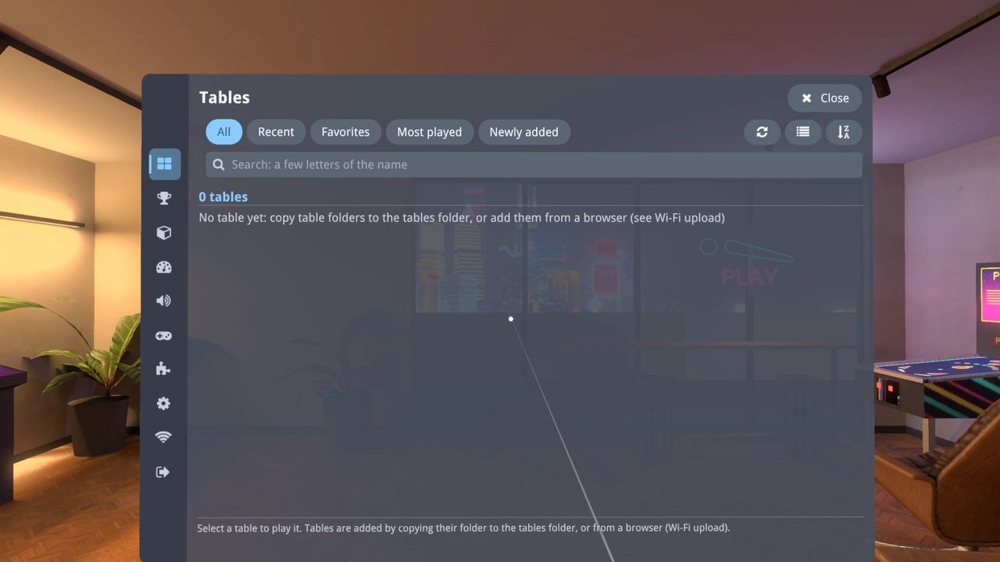

Open **Wi-Fi upload**, the Wi-Fi icon near the bottom of the menu's left rail. It starts as *Wi-Fi upload: Off*.

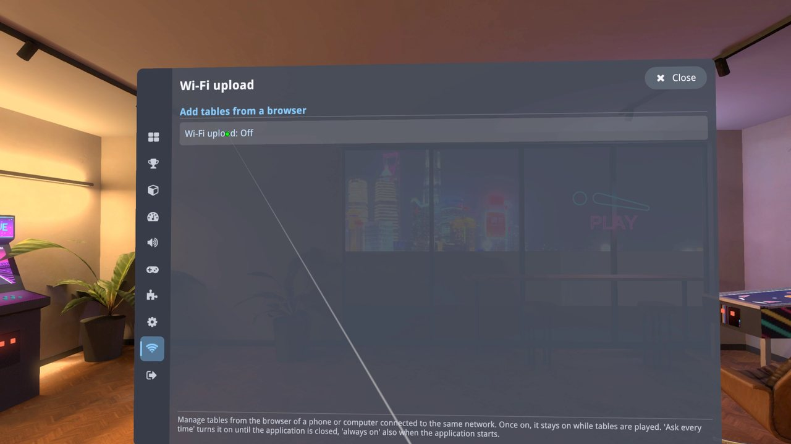

Point at *Wi-Fi upload: Off* and pull the trigger. Each press moves it to the next choice:

- **On (ask every time)**: on until you quit Visual Pinball. It stays on while you go from the lobby to the tables and back.
- **On (always on)**: also turned on each time Visual Pinball starts.
- **Off**.

While it is on, the screen shows the address to open in your browser (here `http://192.168.4.171:2112`) and the **pairing code**.

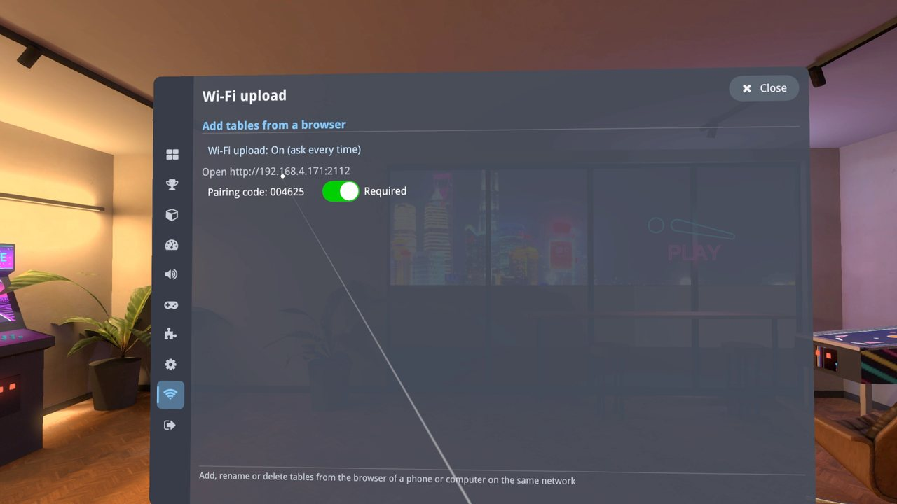

The pairing code keeps other devices on your network out: when your browser opens the page, it asks for the 6-digit code
shown here (again after Visual Pinball restarts, which gives a new code). The switch next to it turns the code off, as done in this tutorial to keep it short. Then any device on your network can add, change
or delete tables, so leave it on at home.

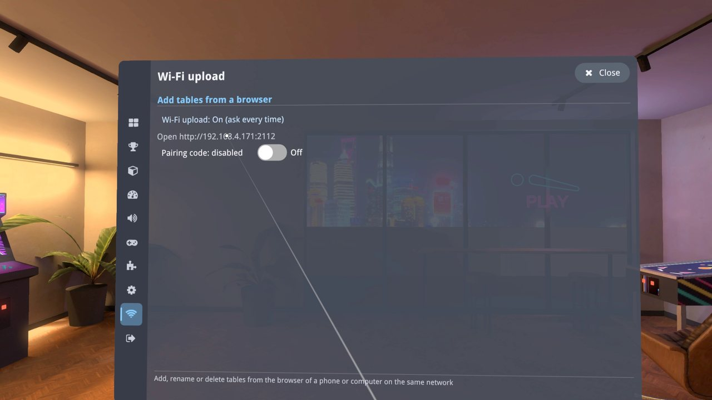

## 2. Upload a table from a browser

On your computer or phone, open the address shown in the headset. The **Tables** page shows the library, empty for now. Click **Add table**
(or the *here* link).

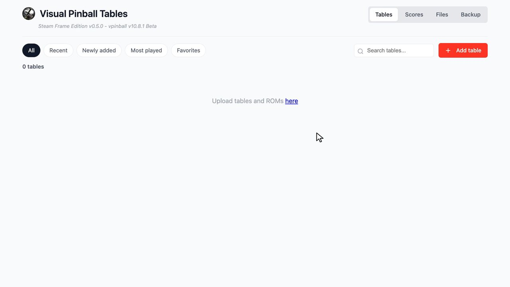

This opens the **Files** page on the tables folder. Click **Upload File** and pick the table's `.vpx` file. A bar shows the progress, then
*1 file uploaded*.

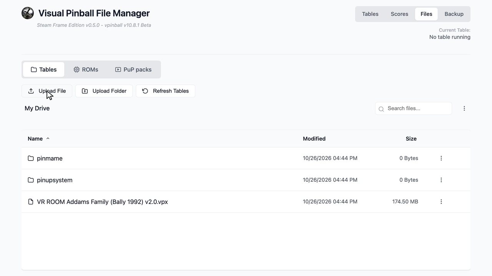

Other ways to add tables:

- A `.zip` of a table folder (the `.vpx` with its `.directb2s`, its own ROM, a readme...) is unpacked into the library after the upload.
- **Upload Folder** sends a whole folder from your computer. You can also drag files or folders onto the page.

Back on the **Tables** page, the table is in the library. It has no picture yet: one is taken the first time the table is closed, or you can
upload your own with **...** › **Upload thumbnail**.

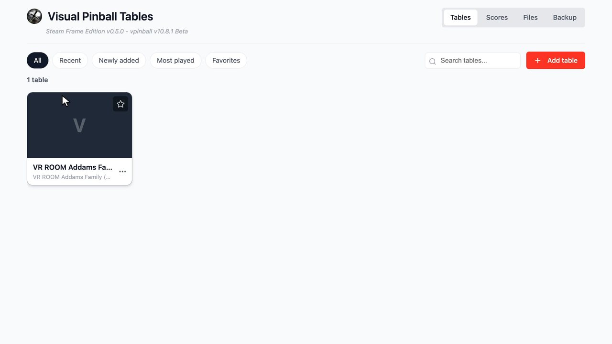

## 3. Play it in the headset

Back in the headset, open **Tables** in the rail: the new table is there, in *All* and in *Newly added*.

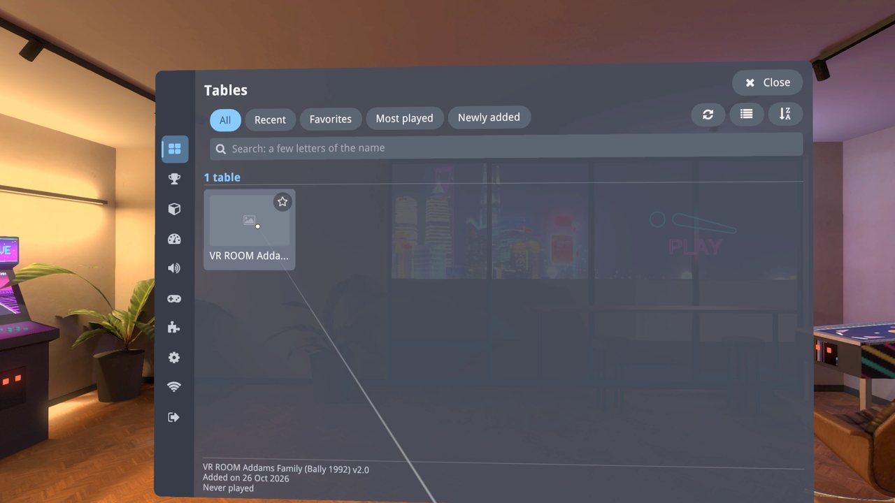

Select it, then **Play**.

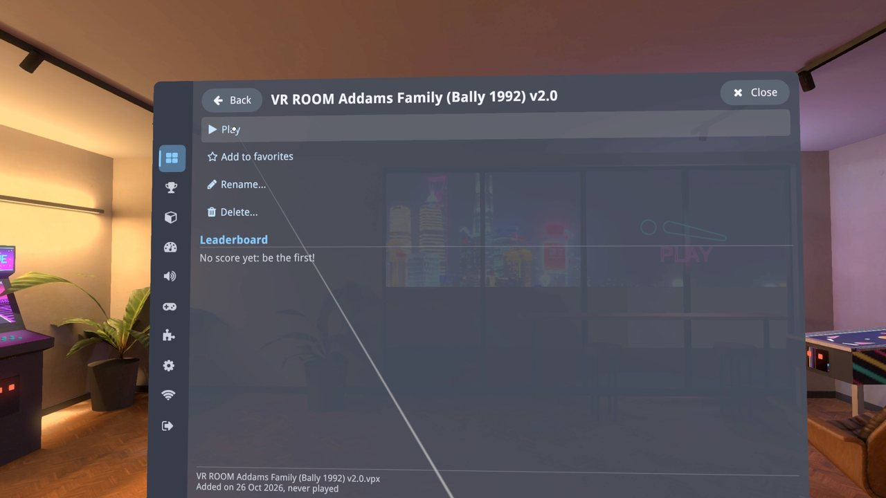

Tables of solid-state machines (from the late 1970s on) run the program of the original game through PinMAME, which needs that
game's ROM. Without it, the table cannot start, and a
message says which ROM file is missing (`taf_l7.zip`) and where ROMs go: zipped, in the `pinmame/roms` folder of the tables folder
(`/home/steamos/Documents/VPinballX/Tables/pinmame/roms` on the Frame).

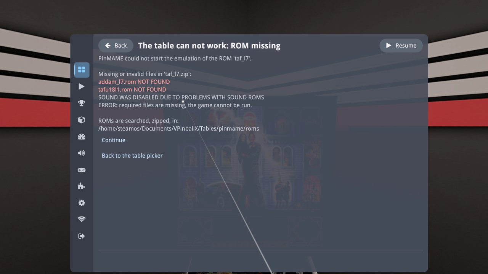

Choose **Back to the table picker** to return to the lobby.

## 4. Upload the missing ROM

In the browser, open **Files**, then the **ROMs** tab. The tables that could not start are listed under **Missing ROMs**, with the zip file
each one needs and the folder to upload it to. The list only fills once you have tried to play the table.

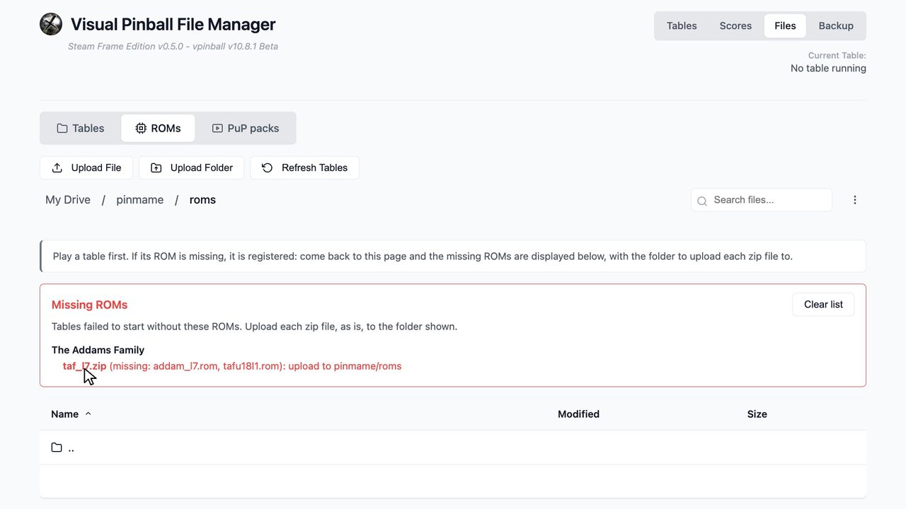

Click **Upload File** and pick the ROM zip. Upload the zip as it is: do not unzip it, and do not rename it. The missing ROM disappears
from the list, and the zip is in `pinmame/roms`.

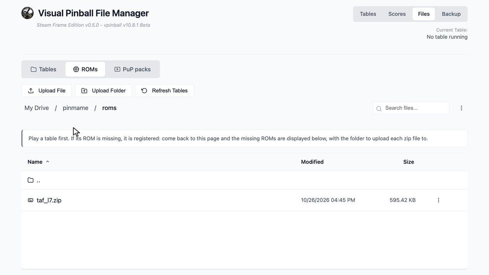

If a table asks for a game that PinMAME does not know (often a mod that renamed its game), the Tables page shows an *Unknown game* badge
instead: see [PinMAME ROM Aliases](../PinMAME%20ROM%20Aliases.md).

## 5. First start: let the game set itself up

In the headset, play the table again. With the ROM in place, it starts, but many games have to set up their memory the first time they run,
as a new machine does when it is switched on for the first time. A notice says so in the middle of the view: *First launch. The table is
initializing, you may need to restart the table after the initialization is complete*.

Wait until the game's display says it is done. Addams Family shows *BOOKKEEPING TOTALS CLEARED* and *FACTORY SETTINGS RESTORED* in turn, and
stays on these messages until it is restarted.

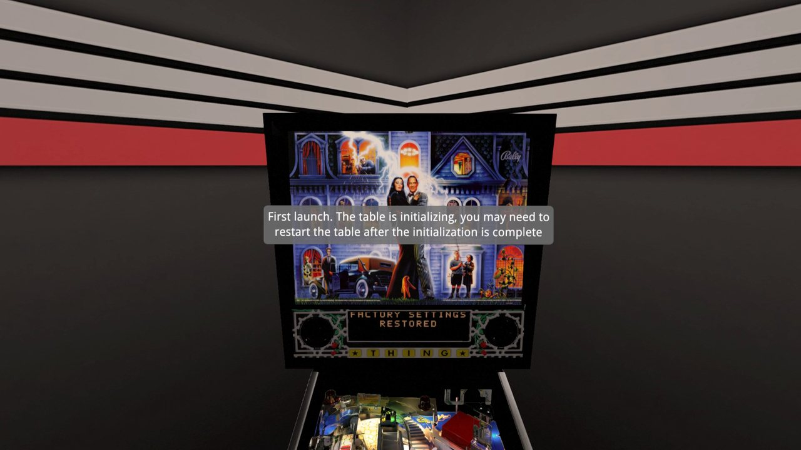

Then restart the table: press the menu button of a controller, choose **Quit** in the rail, then **Return to Lobby**.

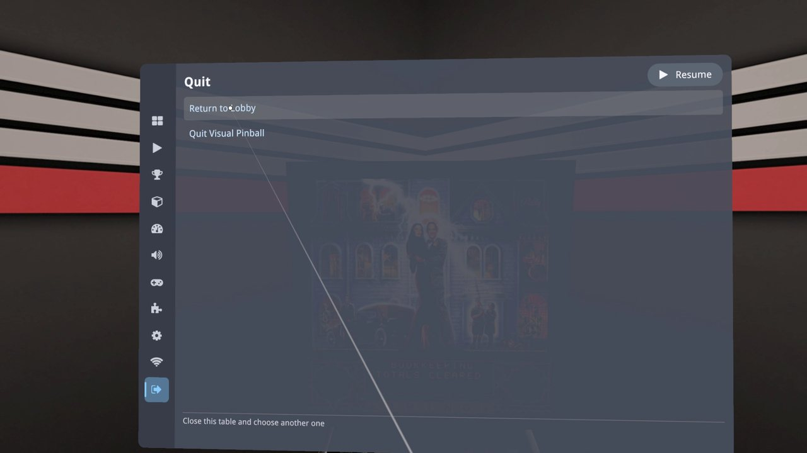

The game's settings are now saved: this only happens once per ROM.

## 6. Restart and play

From the lobby, start the table again. This time the game starts normally: its self-test, then its attract mode. Insert coins, press Start
and play. Addams Family wants two coins per credit with its factory settings.

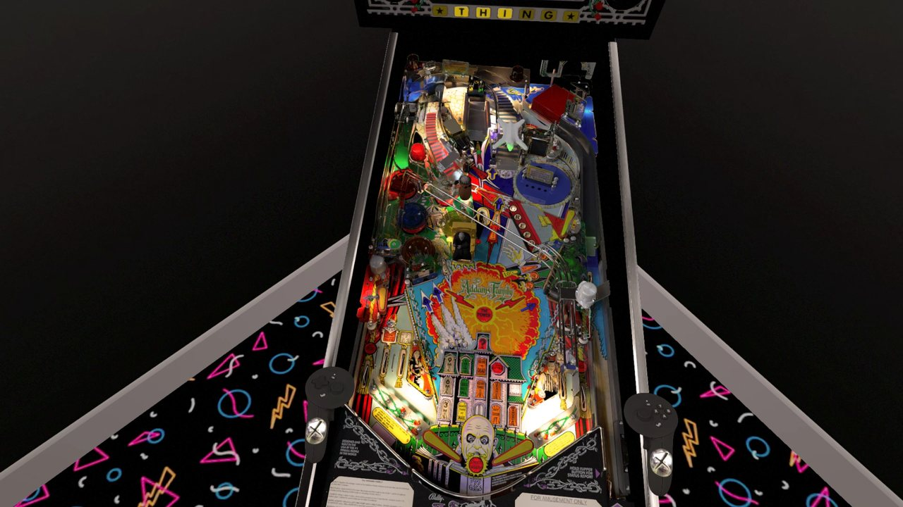

## If something goes wrong

- **The browser cannot open the address**: check that the device is on the same Wi-Fi network as the Frame, that Wi-Fi upload is still on
  (it turns off when Visual Pinball quits, unless it is *always on*), and type the address with its `:2112`.
- **The ROM is still reported missing**: the zip must be in `pinmame/roms`, with the name the message shows. A zip of another version of
  the game (for example `taf_l5.zip` for a table that asks for `taf_l7`) is not the same ROM.
- **The game stays on its setup message or a black display after a restart**: play it once more. Some games, for example Verne's World
  (Spinball), only work from their second start.
- **Coins give no credits**: some games need settings that the application applies by itself on their first start (the Gottlieb System 3
  games), or a fix for their table: see [Table and ROM Fixes](../Table%20and%20ROM%20Fixes.md).
