# Backup and restore

A fresh installation of the Frame, or a new headset, starts with an empty library. A backup keeps what you have on the Frame in one file on
your computer: the tables and their ROMs, the saves of the games, the players and their scores, the settings. This tutorial shows what a
backup holds, makes a full backup and smaller ones, then restores everything on a new installation, and only some items or some tables.

[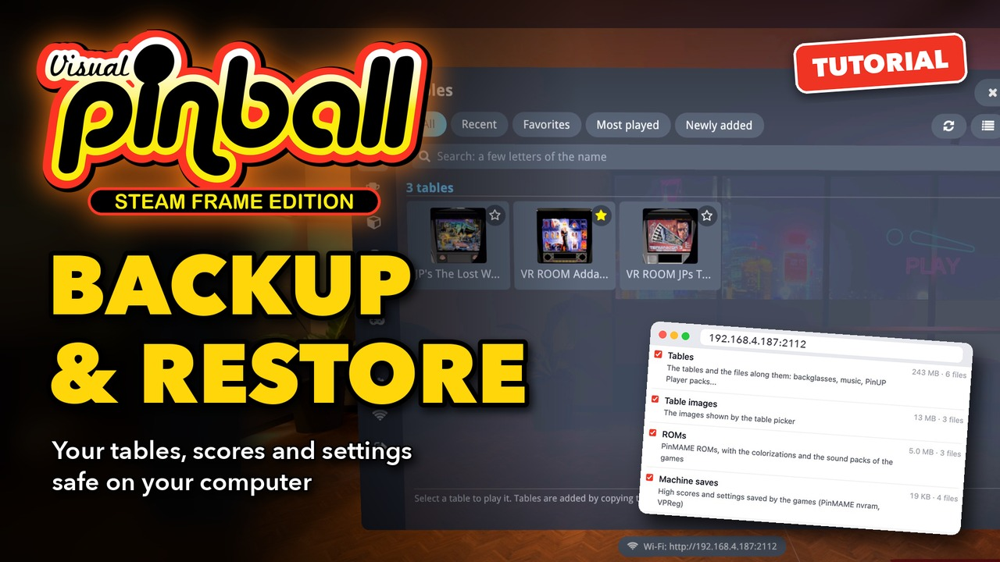](https://youtu.be/cOnA14bBJLU)

**▶ [Watch the video](https://youtu.be/cOnA14bBJLU)** (3:20): the same steps in the headset and in the browser. The text below follows it,
with more details.

The example Frame has three tables (*VR ROOM Addams Family (Bally 1992)*, *The Lost World Jurassic Park (Sega 1997)* and *VR ROOM Terminator
3 (Stern 2003)*) with their ROMs, two players, Alex and Sam, and their scores.

You need a computer on the same network as the Frame, with enough free space for the backup: about the size of your tables.

## 1. Turn on Wi-Fi upload

Backups are made and restored from a browser. In the lobby, open **Wi-Fi upload** in the rail (the Wi-Fi icon) and turn it on if it says
*Off*. Open the address it shows, for example `http://192.168.4.187:2112`, in a browser of your computer. With the pairing code on, the
browser asks for it the first time: see [Adding tables and ROMs](Adding%20Tables%20and%20ROMs.md), step 1.

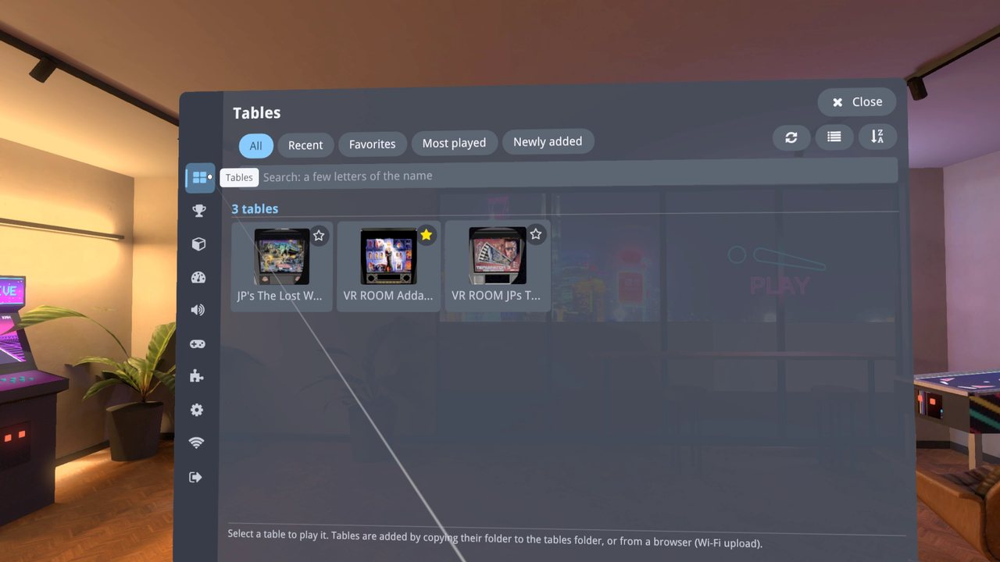

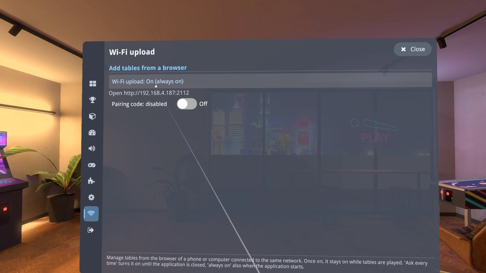

Backups and restores are refused while a table is being played: quit it first. The lobby is fine.

## 2. What a backup holds, and a full backup

Open **Backup**, next to Files, at the top of the page. **Create a backup** lists the items of the Frame, each with its size:

| Item | What it holds |
| --- | --- |
| Tables | The tables and the files along them: backglasses, music, PinUP Player packs |
| Table images | The images shown by the table picker |
| ROMs | PinMAME ROMs, with the colorizations and the sound packs of the games |
| Machine saves | High scores and settings saved by the games (PinMAME nvram, VPReg) |
| Library | Favorites, table names and play counts |
| Settings | Settings of the application and of the tables, room of the lobby |
| Scores and players | Leaderboards and player profiles |
| ROM aliases | The PinMAME alias file (see [ROM aliases](ROM%20Aliases.md)) |

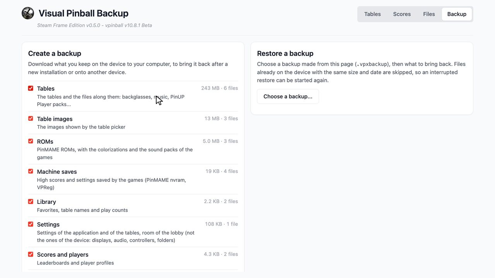

Not saved: the files that the application makes again by itself (texture caches, logs), uploads in progress, and the settings of the
device itself, which a restore keeps anyway (see step 4).

For a full backup, keep all the items ticked and **All tables**, then choose **Create backup** at the bottom. The page checks the files, then
the browser downloads `VPX-Backup-<date>.vpxbackup`.

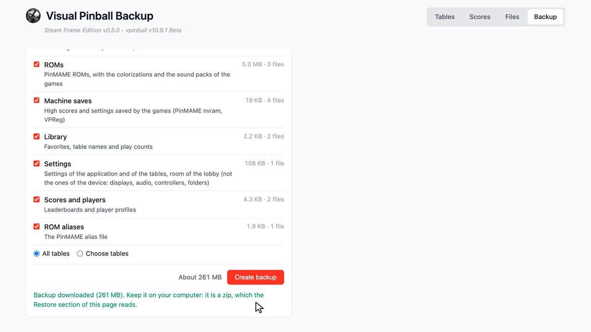

- The backup is made while it downloads: it takes no space on the Frame, even for tens of gigabytes.
- Keep the headset awake until the download is over: the Frame leaves the network when it sleeps. A broken download can be resumed from the
  downloads list of the browser.
- The file is a zip, named `.vpxbackup` so that browsers do not open it. Keep it as it was downloaded: a zip made again from its content is
  refused by the restore.

## 3. Back up only some items or tables

### Some items

Untick the items you do not want: the size at the bottom follows the selection. Without **Tables**, **Table images** and **ROMs**, the backup
holds everything you can not download again (saves, library, settings, scores, aliases) in a few hundred kilobytes: a quick backup to make
often.

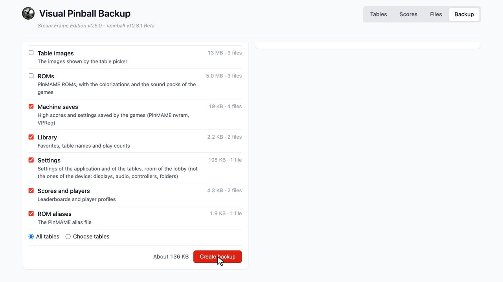

### Some tables

Choose **Choose tables** below the items: the list of the tables opens, with their sizes. **None** unticks them all, **All** ticks them all,
and the search field finds a table by its name. Tick the tables to keep, then **Create backup**.

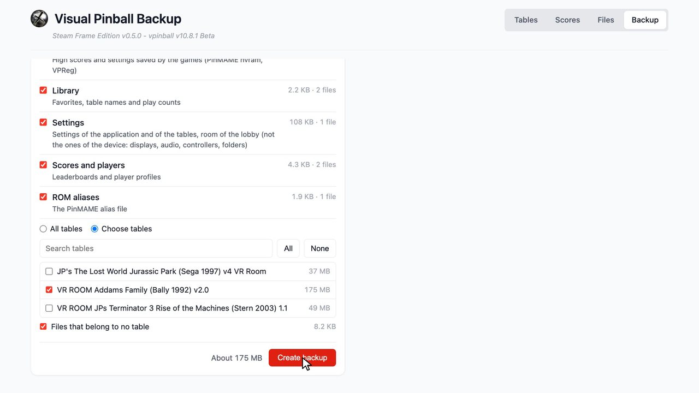

A table brings the files that belong to it: its table file, image and settings, its ROM, the saves and the colorization of its game, and
the PinUP Player pack it uses. The library, the settings, the scores and the alias file are kept whichever tables you choose, as long as
their item is ticked. **Files that belong to no table** keeps the other files of the tables folder, which no table uses; untick it to leave
them out.

## 4. Restore everything on a new installation

After a new installation, the table picker is empty: *0 tables*. Turn on Wi-Fi upload again (step 1) and open its address.

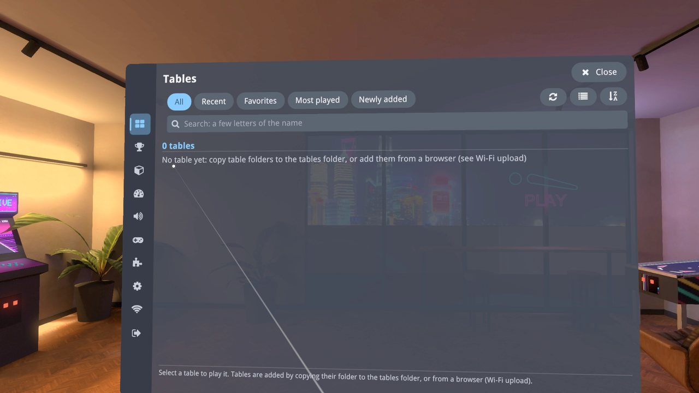

On the **Backup** page, under **Restore a backup**, choose **Choose a backup...** and pick the `.vpxbackup` file. The browser reads it
without sending it, and shows when and on which device it was made, then its items and its tables, with their sizes.

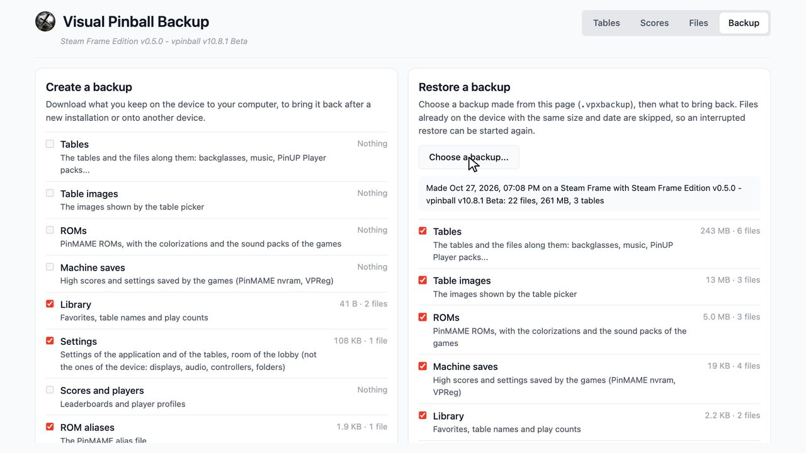

Keep all the items and **All tables**, choose **Restore** at the bottom, then **Restore** again in the window that asks to confirm.

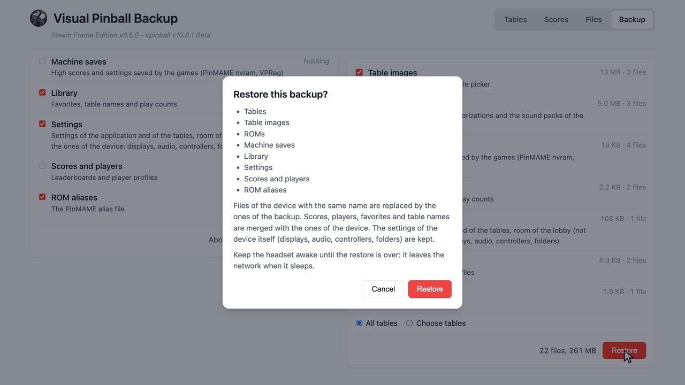

Only the selected files are sent to the Frame. The page shows the progress, then *Backup restored* and what was done.

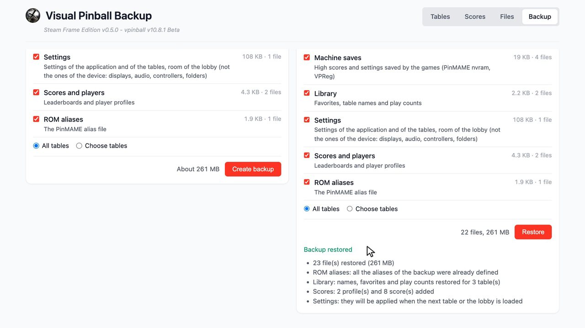

In the headset, the tables appear in the table picker, with their images, favorites and play counts, and **Scores** shows the players and
their leaderboards.

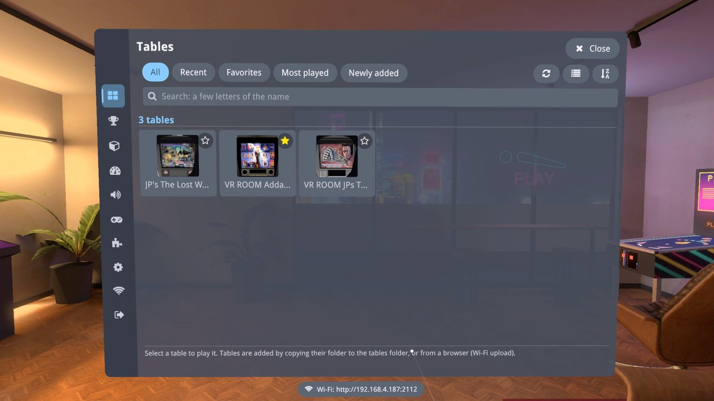

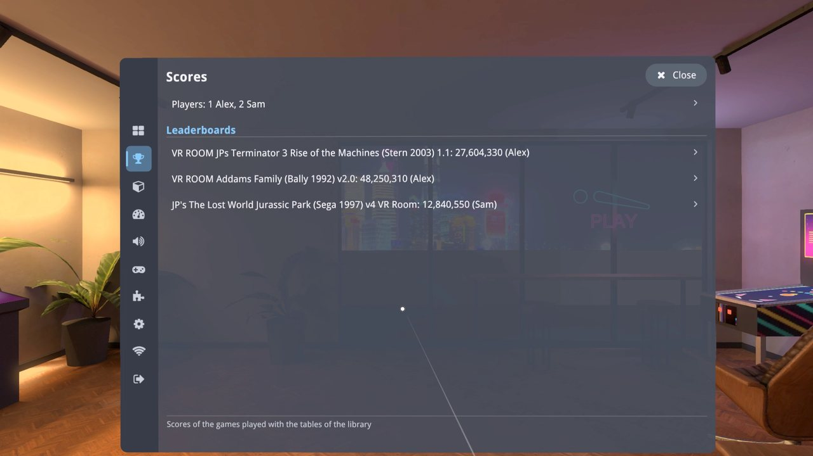

How a restore treats what is already on the Frame:

- Files of the Frame with the same name are replaced by the ones of the backup. Files already there with the same size and date are skipped,
  so an interrupted restore can be started again: it goes on where it stopped.
- Scores, players, favorites and table names are **merged** with the ones of the Frame: nothing is lost, nothing is counted twice.
- The settings of the device itself are kept: displays, audio, controllers, folders, and the Wi-Fi upload settings. The other settings are
  applied when the next table or the lobby is loaded.

## 5. Restore only some items or tables

The same backup can bring back only a part of what it holds.

### Some items

Say the scores of Addams Family were cleared by mistake. Choose the backup, untick all the items but **Scores and players**, then
**Restore**: only that file is sent. The scores missing on the Frame are added back; the ones it has are kept.

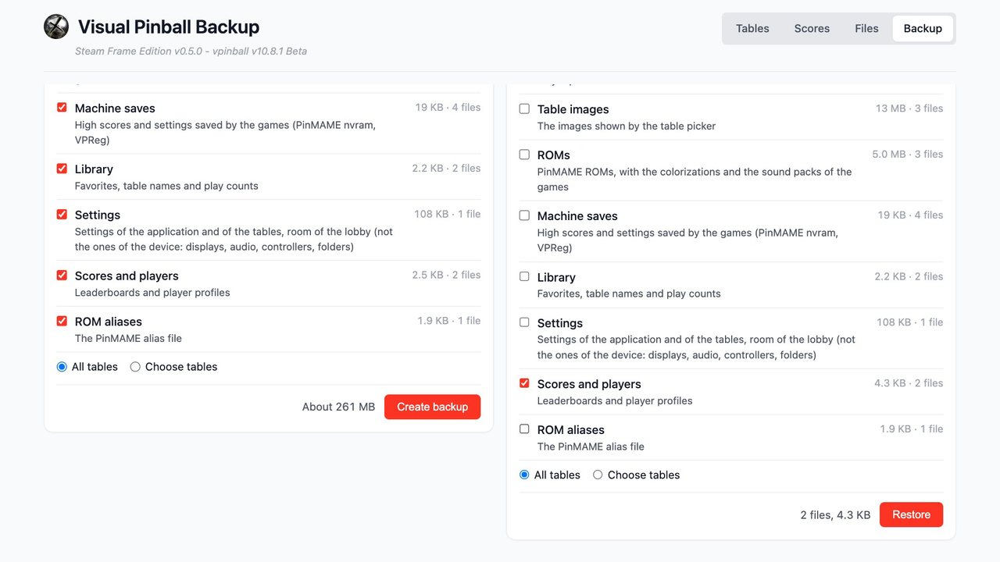

### Some tables

Say Terminator 3 was deleted by mistake. Choose the backup, then **Choose tables**, **None**, and tick *Terminator 3*. Keep the items: they
bring its table, image, ROM, saves and settings. Then **Restore**.

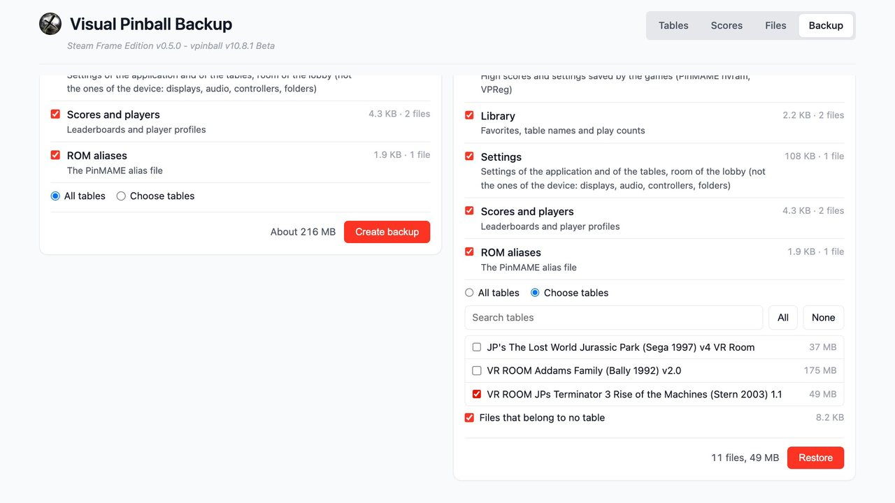

The table is back in the library, with its scores.

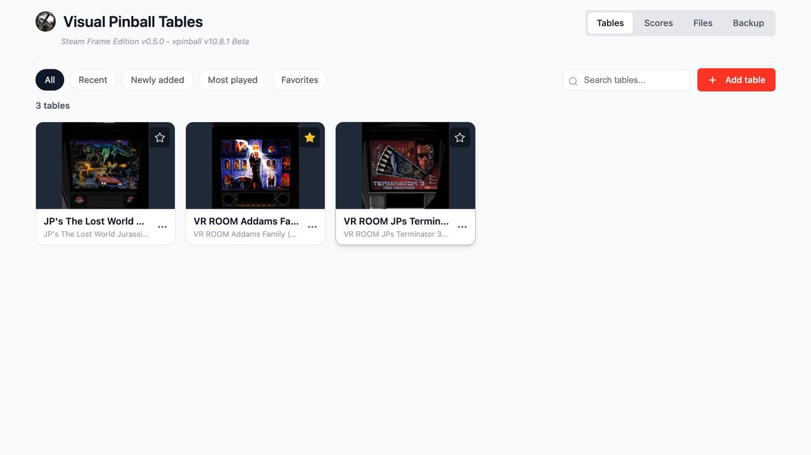

## If something goes wrong

- **"A table is being played: close it in the headset..."**: quit the table, then try again from the lobby.
- **The download or the restore stops**: the Frame may have gone to sleep. Wake it, then resume the download from the browser's downloads
  list, or start the restore again: the files already restored are skipped.
- **"This backup was compressed again after it was made"**: the file was extracted and zipped again. Use the `.vpxbackup` file as it was
  downloaded.
- **"Not enough free space on the device"**: the restore checks the free space of the Frame first. Restore fewer tables, or make room on
  the Frame.
