# Cabinet position

In the headset, each table stands in a cabinet in front of you. Where that cabinet stands, how it is turned and how high its lockbar is
can be set to match the place where you play: a free spot of your room, or a real table under your hands. This tutorial moves the cabinet
with the two controllers, then changes its height in the menu, and saves both for every table.

[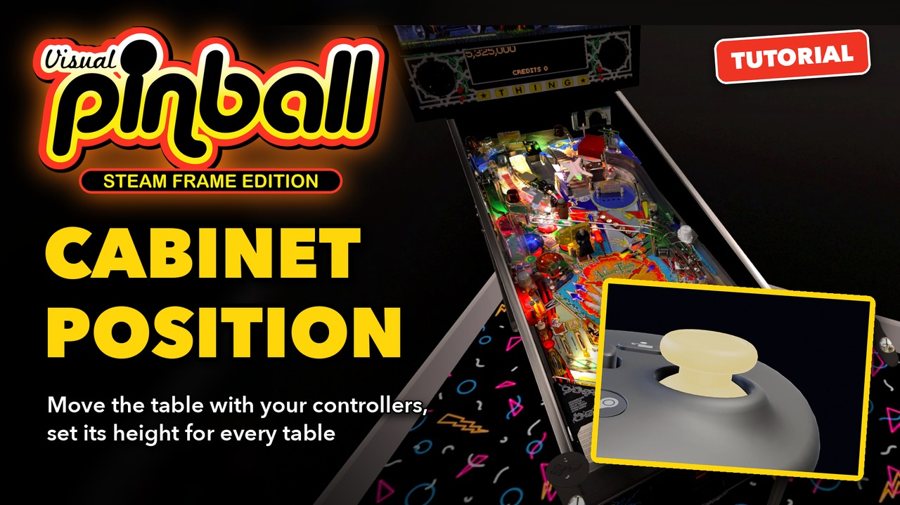](https://youtu.be/77ja0ALSwuw)

**▶ [Watch the video](https://youtu.be/77ja0ALSwuw)** (1:23): the same steps in the headset. The text below follows it, with more details.

The examples are *VR ROOM Addams Family (Bally 1992) v2.0* and *Ready Player One*. Everything happens in the headset: no browser is
needed.

## 1. Move the cabinet with the controllers

Here the table starts with its cabinet too far to the left, and turned: its lockbar, the front rail of the cabinet, is out of reach.

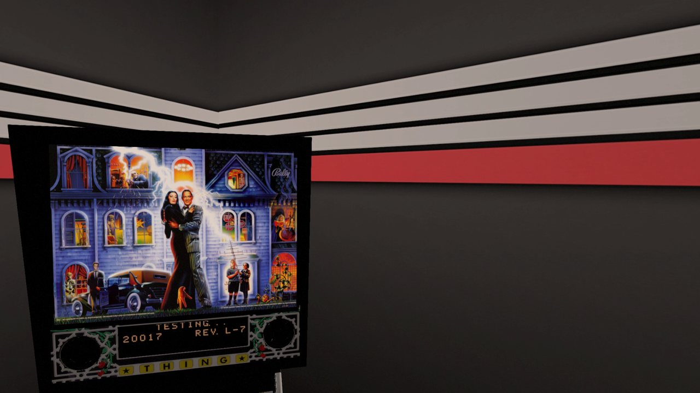

Hold the two controllers where the two ends of the lockbar should be, at the height you want it.

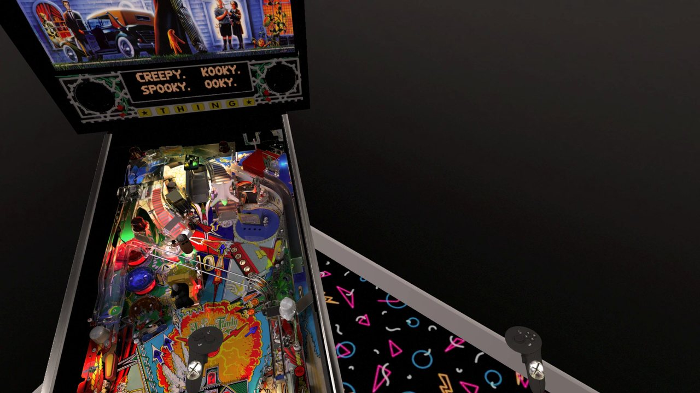

Press the **left thumbstick** (push it in until it clicks). This is the **Align VR view using controllers** action, which a click turns on
and the next one turns off.

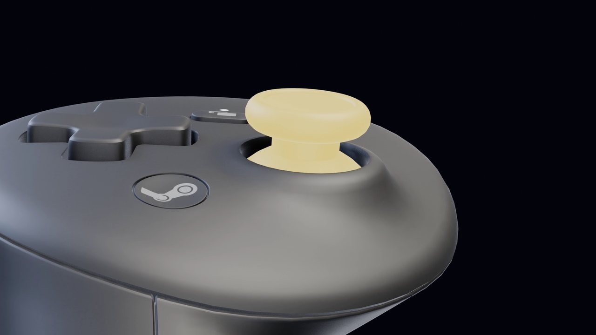

The cabinet jumps to the controllers: the middle of its lockbar between them, at their height.

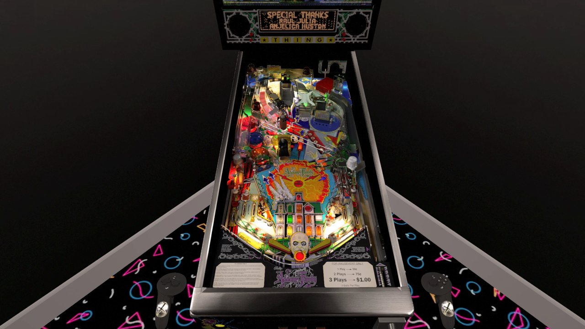

While it is on, the cabinet follows the controllers as they move: their middle, their height, and the angle of the line between them. Move
or turn them together to bring the cabinet where you want to play.

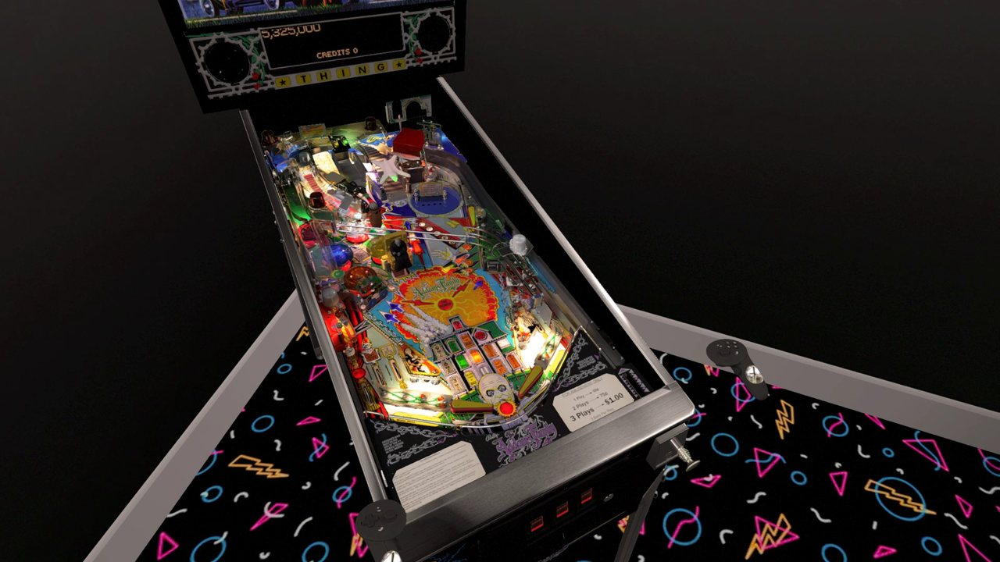

The distance between the controllers also counts: it sets the width of the lockbar, and so the size of the table. Hold them at the real
width of a lockbar, about 70 cm apart, unless you want a smaller or larger table.

Press the left thumbstick again: the cabinet stays where it is, and the controllers are free again.

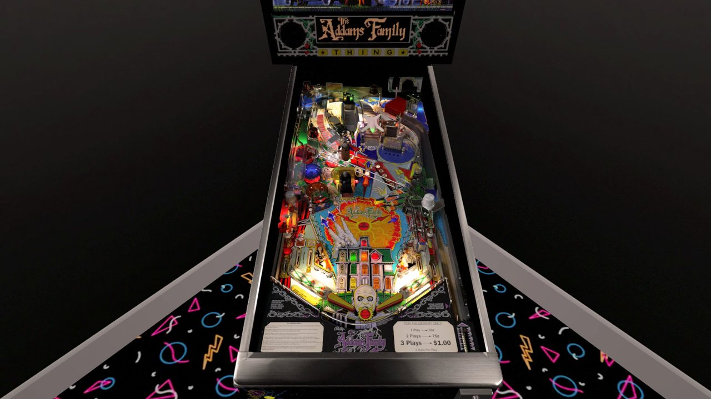

## 2. The height of the cabinet

Open the menu and choose **VR & Room** (the cube icon in the rail). Its **Position** and **Cabinet** sections show where the controllers
placed the cabinet: a pencil marks the values changed since the last save.

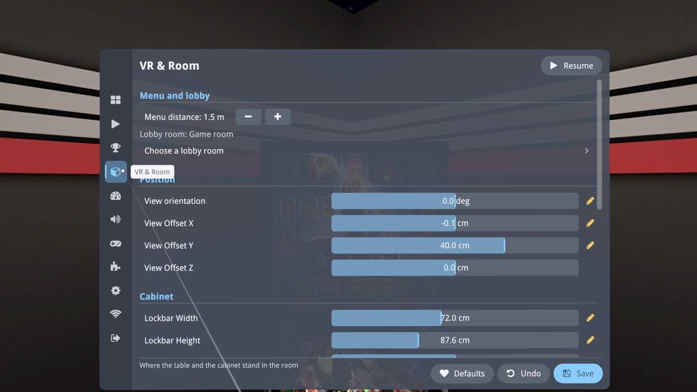

| Setting | What it does |
| --- | --- |
| View orientation | How the cabinet is turned, in degrees |
| View Offset X, Y, Z | Where the cabinet stands: to the side, forward or back, up or down, in centimeters |
| Lockbar Width | The width of the lockbar, which sets the size of the table |
| Lockbar Height | The height of the cabinet: from the floor to the top of the lockbar, in centimeters |

To change a value, point at its bar, hold the trigger and slide. Here **Lockbar Height** goes from 88 to 100 cm.

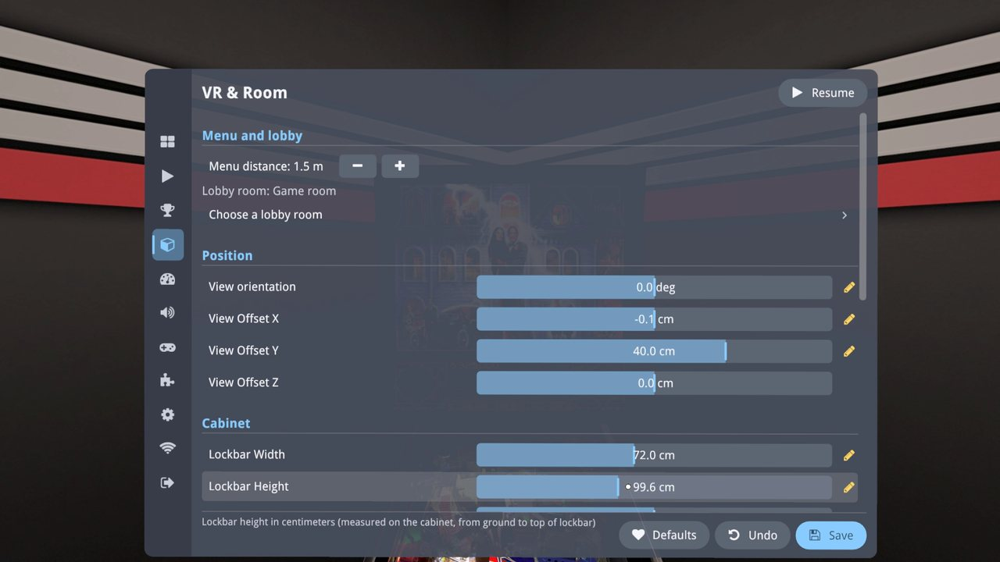

The cabinet changes at once. Measuring the height of the real table or desk you lean on, and entering it here, puts the virtual lockbar
right at your hands.

## 3. Save it

Choose **Save** at the bottom of the page. It asks *Save globally or as a table override ?*:

- **Save Globally**: the changes become the new default of all tables.
- **Save as Table Override**: the changes are kept for this table only.

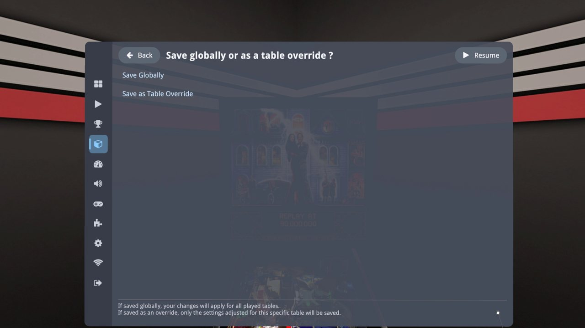

The position of the cabinet (orientation, offsets) and its lockbar width and height always apply to **all tables**, whichever you choose:
they belong to your room, not to a table. **Save as Table Override** only keeps the other settings of the page that you changed (the
backglass, the spatial audio, for example) for this table.

Here: **Save Globally**. Choose **Resume**: the cabinet is 12 cm higher than before.

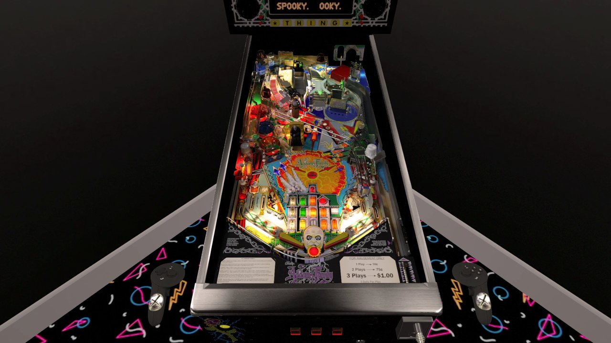

The position is also kept when you close a table, even without **Save**: the next table starts where you left the cabinet.

## 4. The same on every table

Play another table, here *Ready Player One*: its cabinet stands at the same place, turned the same way, at the same height. The controllers
held where the lockbar was set meet its lockbar.

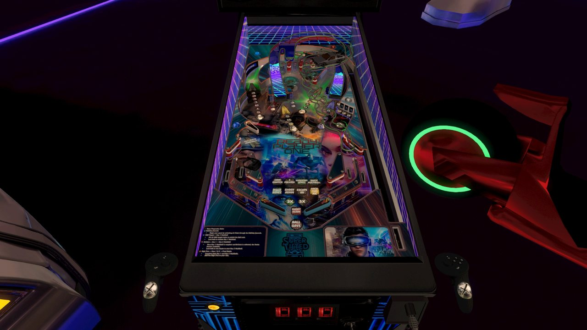

## Good to know

- **The button**: **Align VR view using controllers** is at the bottom of **VR & Room**, in **Cabinet positioning using controllers**,
  with its button (*VR Controller - Left thumbstick click*). Select it to give it other buttons, as in **Controls** (see
  [Controller buttons](Controller%20Buttons.md)).
- **Lockbar size ratio** and **Cabinet Y Offset**, in the same section, adjust what the controllers do: the first multiplies the distance
  between them (above 100 %, the table is larger than the space between your hands), the second moves the cabinet forward or back from
  where they put it. They are saved as soon as they are changed.
- **Lock Feet to Ground**, in the **Room** section (on by default), keeps the feet of the cabinet on the floor. Turn it off to play a
  small table seated at a desk.
- **Undo**, at the bottom of the page, brings back the values of the last save.
- A restore (see [Backup and restore](Backup%20and%20Restore.md)) does not change the position of the cabinet: it belongs to the room of
  the device, which keeps its own.
