# Cabinet positioning mode

The cabinet can stand against a real piece of furniture of your room: a desk, a table, a shelf. The **cabinet positioning mode** shows
your room through the cameras of the headset and puts the lockbar of the cabinet, the front rail where your hands rest, on a real edge
that you show with the two controllers. Once it is fixed there, your hands rest on the real desk while you play, on every table.

[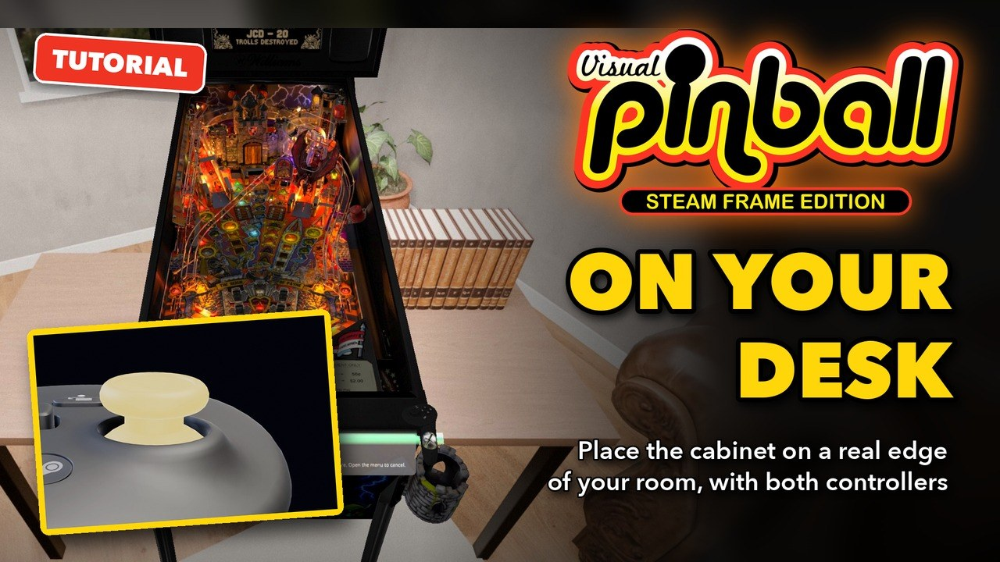](https://youtu.be/Ms1pXTRikjE)

**▶ [Watch the video](https://youtu.be/Ms1pXTRikjE)** (1:28): the same steps in the headset. The text below follows it, with more details.

The example is *Medieval Madness*. Everything happens in the headset: no browser is needed.

Before you start, set your **play area** in SteamVR and stand in it, as for any VR game: the cabinet must stand inside it.

## 1. Start the positioning mode

Medieval Madness starts with its cabinet in its own room. Hold the two controllers in front of you, a little apart.

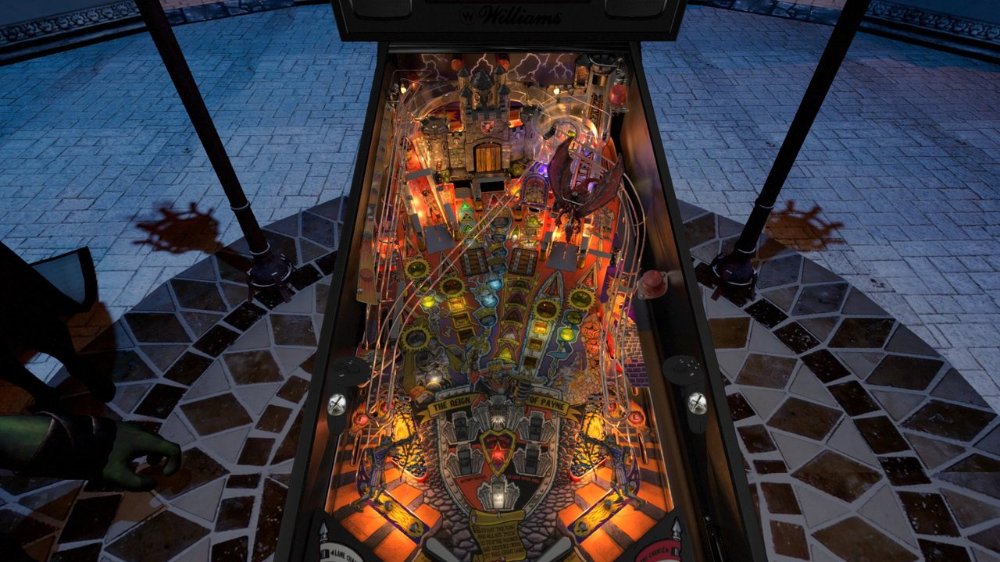

Press the **left thumbstick** (push it in until it clicks). The same mode starts from the menu: **VR & Room**, then
**Cabinet positioning mode** in the **Cabinet positioning** section (step 6).

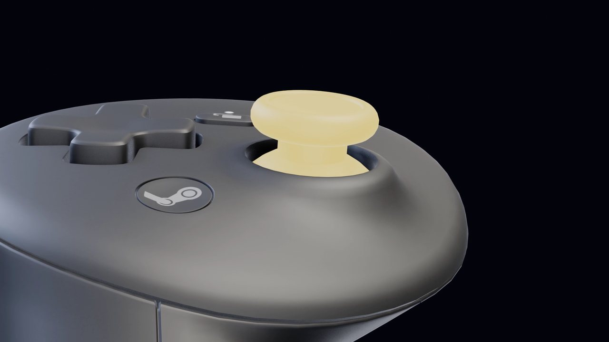

Your room appears, even if the passthrough was off, and the cabinet jumps to the controllers.

## 2. The lockbar follows both controllers

A thin bar joins the two controllers, with the lockbar drawn on it at its real width. A message, standing in front of the table as the loading message
does and staying there while you move, says what to do, where the lockbar stands (green: inside your play area) and which button fixes the cabinet.

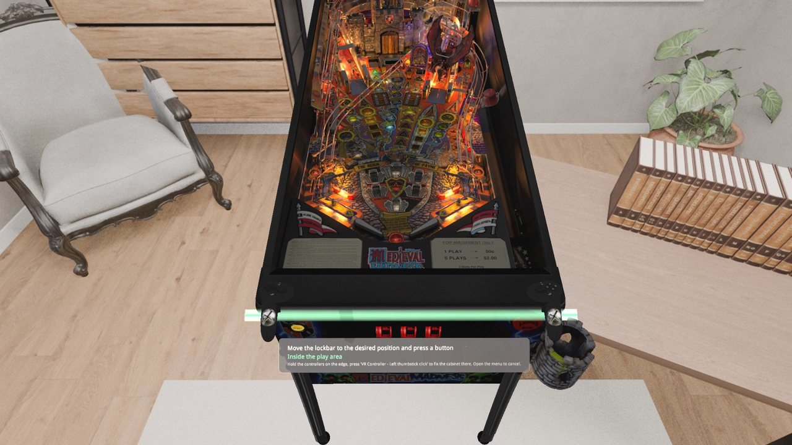

The lockbar follows the controllers: their middle, their height, and the direction of the line between them. Move one controller and the
lockbar turns; move the other and it follows both of them; lower or raise them and the cabinet goes down or up. The cabinet keeps its size:
holding the controllers closer together or further apart does not change it (see *Fixed cabinet size when placing*, step 6).

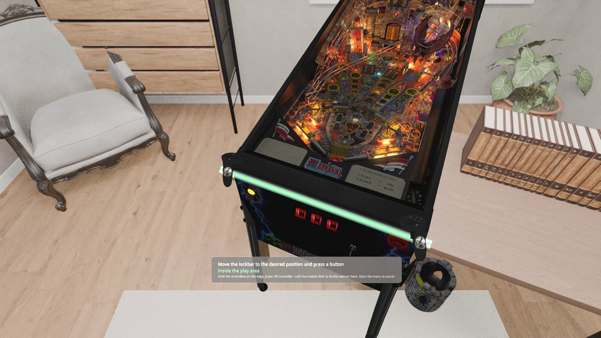

## 3. Stay inside your play area

The cabinet must stand inside the play area set in SteamVR, so that you can walk around it. The game checks both ends of the lockbar:

- **green**: inside the play area;
- **orange**: inside, but closer than 30 cm to its edge;
- **red**: outside the play area.

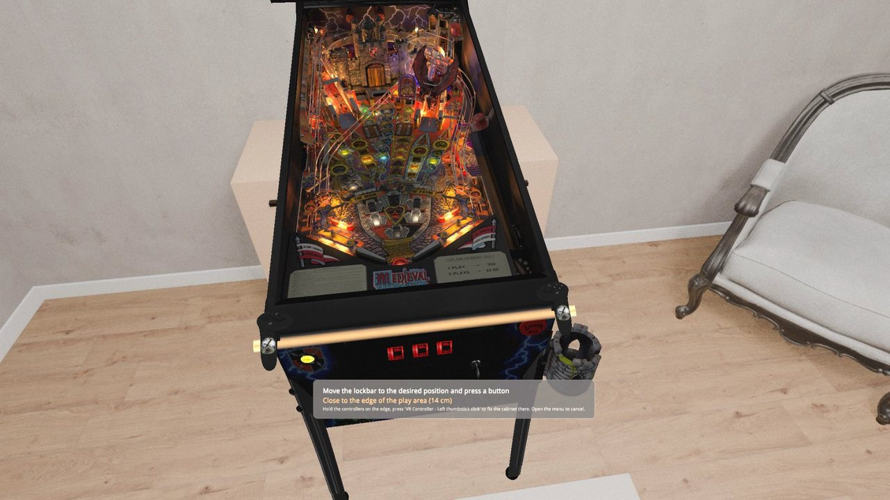

Here the sideboard against the wall is outside the play area: the lockbar is red, and the message says how far inside it must go. Pressing
the left thumbstick there does not fix the cabinet: a notification says why, and the mode goes on.

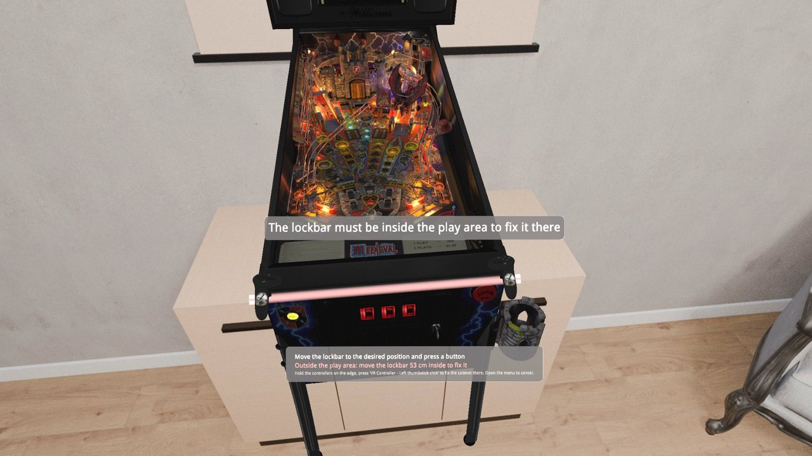

When SteamVR has no play area, nothing is checked: the lockbar stays grey and the cabinet can be fixed anywhere.

## 4. Fix it on your desk

Hold the two controllers on the front edge of your desk, one at each end. The lockbar lies on the edge, green.

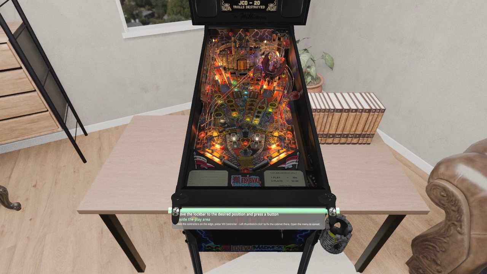

Press the **left thumbstick** again. *Cabinet placed* is shown: the place is saved at once, for every table. The passthrough goes back to
what it was before (off here): the cabinet stands where your desk is, in the room of the table.

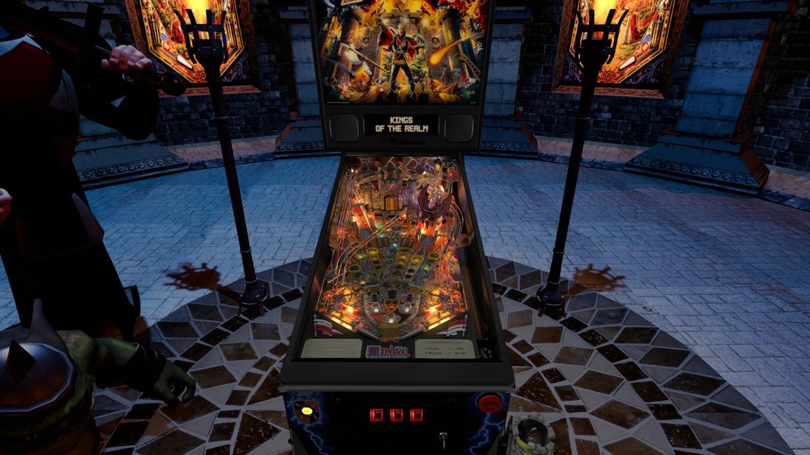

To cancel instead, open the menu: the cabinet goes back to where it was.

## 5. See it in your room

Press **Y** on the right controller: the passthrough shows your room around the cabinet, at any time. Press it again to go back to the
room of the table.

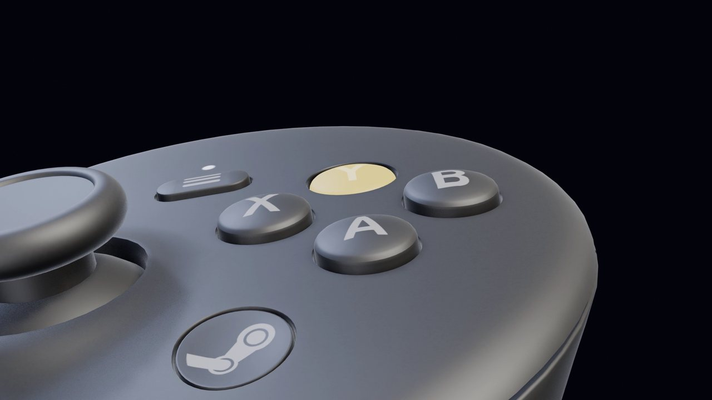

The cabinet stands on the desk: your hands rest on the real edge while you play.

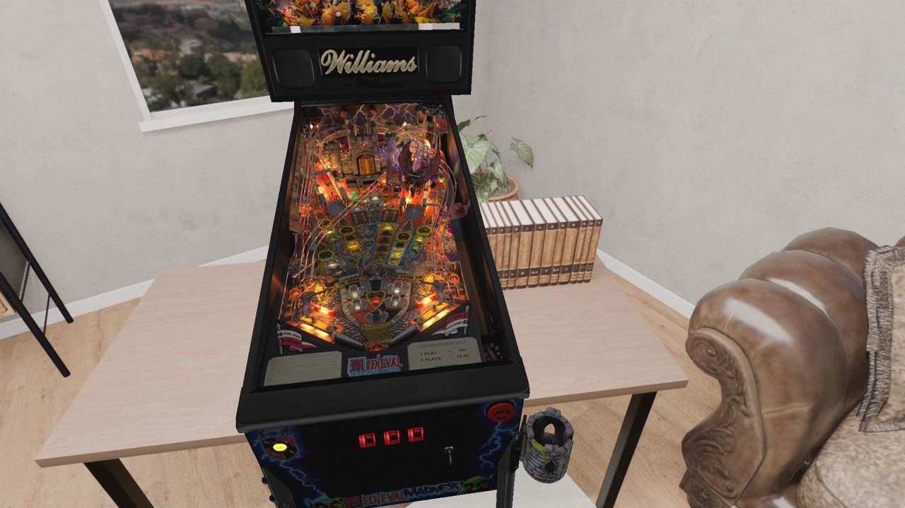

## 6. In the menu

Open the menu, then **VR & Room** (the cube icon in the rail). Its **Cabinet positioning** section has:

- **Cabinet positioning mode**: starts the same mode as the left thumbstick (it closes the menu).
- **Fixed cabinet size when placing**, on by default: the controllers set the place, the height and the direction of the cabinet, not its
  size. Turn it off to let the distance between the controllers set the width of the lockbar, and so the size of the table: hold them about
  70 cm apart for a real cabinet.

Below it, the **Position** and **Cabinet** sections show where the cabinet was placed (its orientation, its offsets, the height of its
lockbar): change them there to move it by a few centimeters.

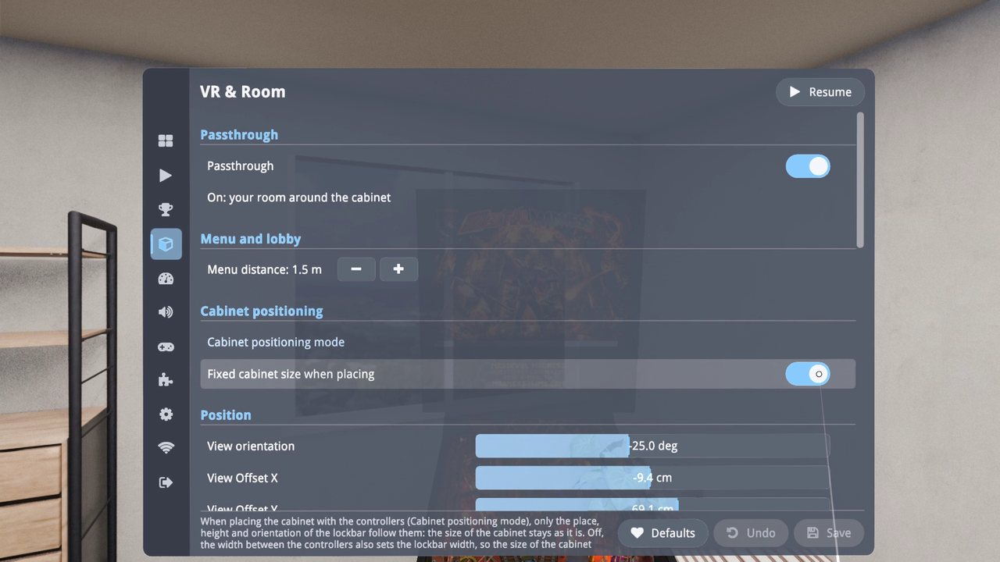

## Good to know

- **Recenter with Steam first**, facing the way you want to play: the cabinet is placed relative to the play area, so recentering after
  placing it may move it along.
- **Lock Feet to Ground** (VR & Room, on by default) keeps the feet of the cabinet on the floor at any lockbar height; turn it off to play a
  small table seated at a desk.
- The place is the same for every table, and a table closed while placing keeps the previous one.
- The other way to place the cabinet, with the menu settings only, is in the [Cabinet position](Cabinet%20Position.md) tutorial, made before
  this mode.

*The footage is the VR version, captured on a Mac with a simulated headset; the room seen through the passthrough is a 3D model rendered for
the video.*
