# Controller buttons

What each button of the Steam Frame controllers does in Visual Pinball, and how to give a button another action. The roles are the same
in every table.

[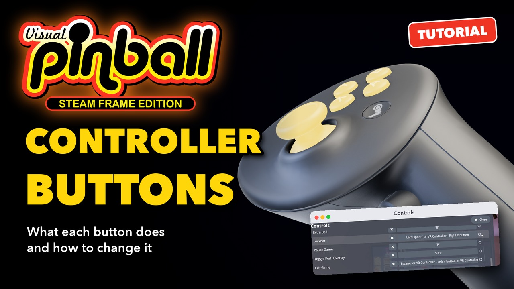](https://youtu.be/ix_3tqUOZho)

**▶ [Watch the video](https://youtu.be/ix_3tqUOZho)** (2:28): each button on the controller, its effect in a game, and how to remap one.
The text below follows it, with more details.

The controllers in the pictures are the Steam Frame's own models; the games are *VR ROOM Addams Family (Bally 1992)* and *The Lost World
Jurassic Park (Sega 1997)*.

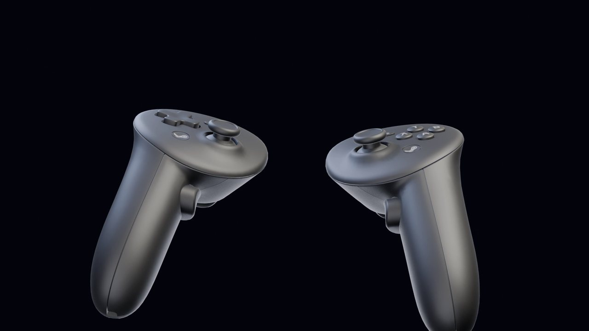

## 1. What each button does

### The buttons at a glance

| Control | Controller | During a game | In the menu |
| --- | --- | --- | --- |
| Trigger | Left / right | Left / right flipper; pulled further, also the upper flipper of the tables that have one | Click what the controller points at |
| Grip | Left / right | Left / right magna-save | |
| Bumper | Left / right | Nudge the table to the left / to the right | |
| Thumbstick | Left | Nudge the table: the further it is tilted, the harder | Up / down: move the selection |
| Thumbstick click | Left | Align the view using the controllers (on / off) | |
| Thumbstick | Right | Plunger: pull it towards you, then let go | Left / right: change a value |
| Thumbstick click | Right | Launch button, on the tables that have one instead of a plunger | Settings pages: back to the defaults |
| D-pad | Left | | Move the selection; left / right changes a value |
| View button | Left | Open the menu | |
| Menu button | Right | Quit the table, back to the lobby | |
| A | Right | Start a game | Settings pages: save the changes |
| B | Right | Insert a coin | Settings pages: undo the changes |
| X, Y | Right | Not used: free for the action you want | |
| Steam button | Left / right | Kept by SteamOS, not used by the game | |

### Triggers: the flippers

The left trigger moves the left flipper, the right trigger the right one. Pulled further, a trigger also moves the upper flipper of the
tables that have one. In the headset, the controller models at the lockbar pull their triggers with yours.

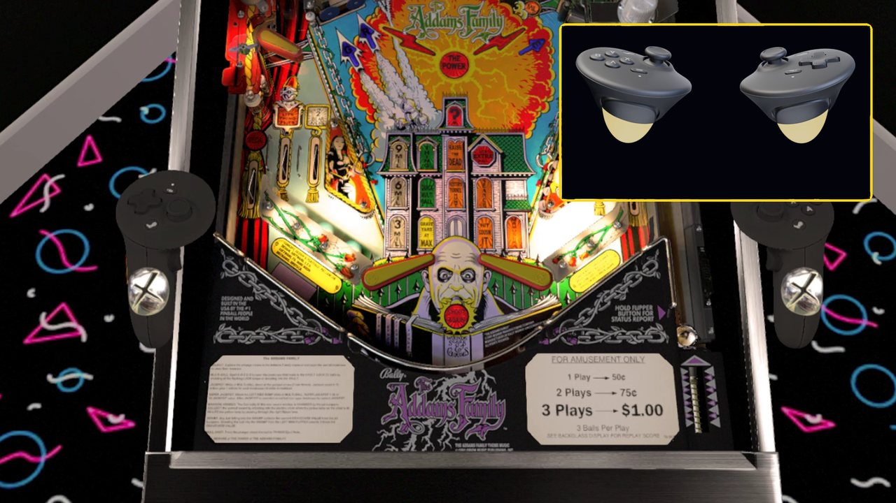

### Grips: the magna-saves

The grips are the magna-save buttons of the tables that have them (a magnet that holds the ball before it drains), left grip on the left,
right grip on the right.

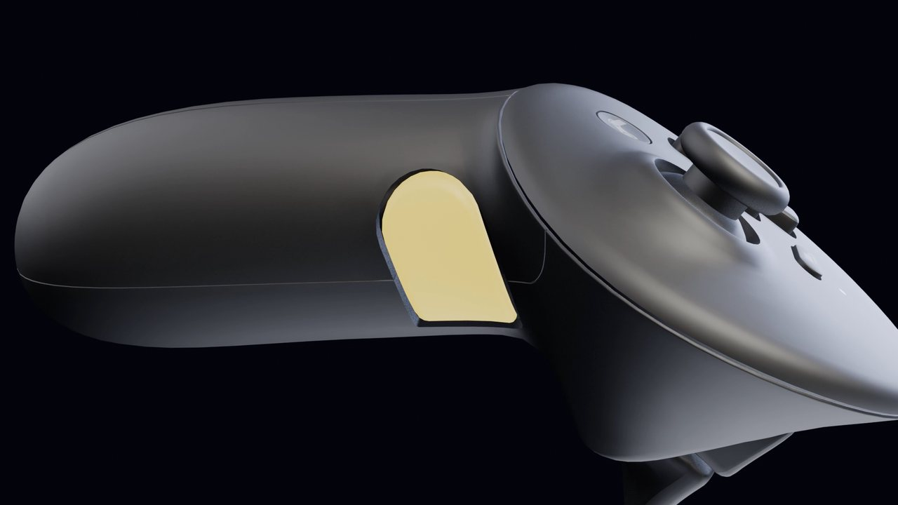

### Bumpers and left thumbstick: nudge

A nudge is a push on the cabinet: the table shakes, and the ball gets the push. The left bumper nudges to the left, the right bumper to
the right. The left thumbstick nudges in the direction it is tilted, harder the further it goes.

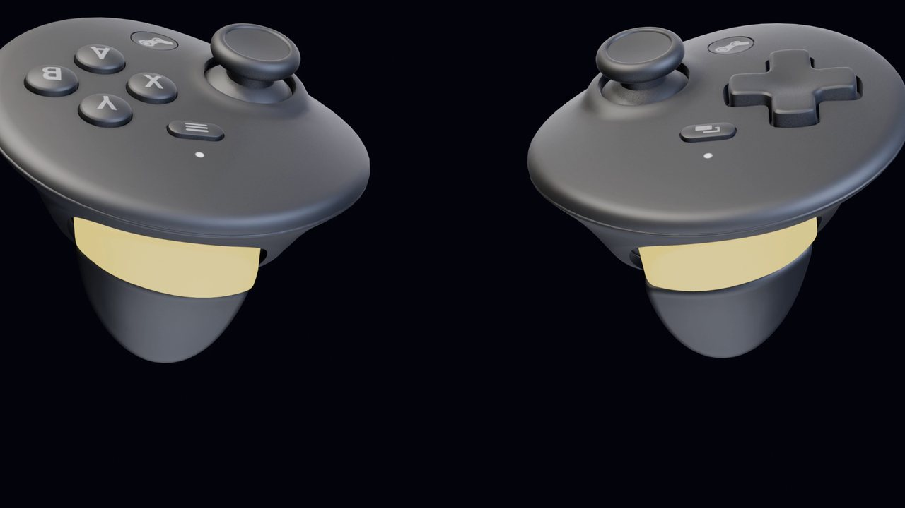

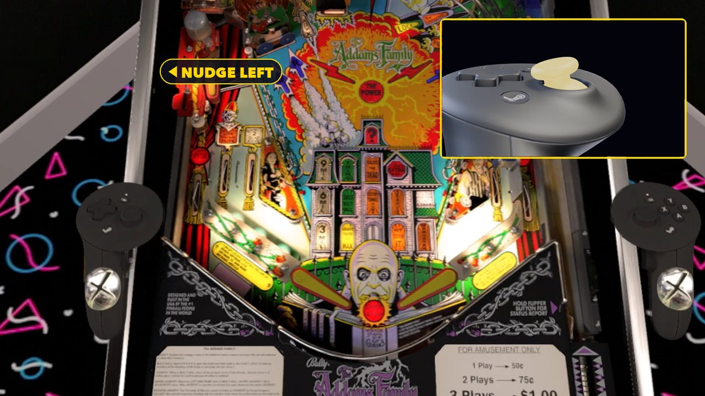

The shake of the table is small by default, about what a real cabinet moves. It is set by **Visual Nudge Strength**: in the menu,
**Controls › Nudge & Tilt Settings**, up to 200 % (the video shows it at 200 %). Nudge too hard or too often, and the game tilts, as a
real machine does.

### D-pad and view button

The d-pad moves in the menu; left and right change a value. The view button, the small button next to the d-pad, opens the menu, during
a game and in the lobby.

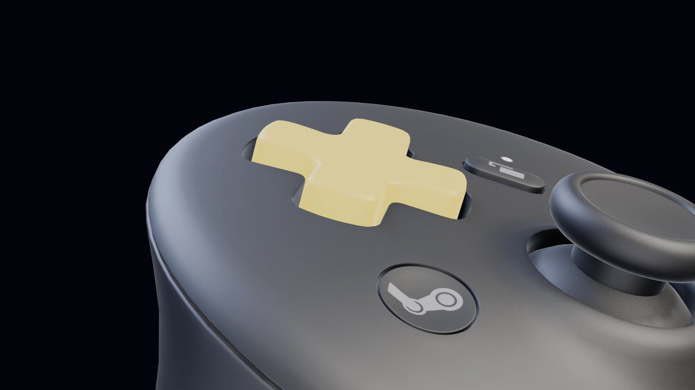

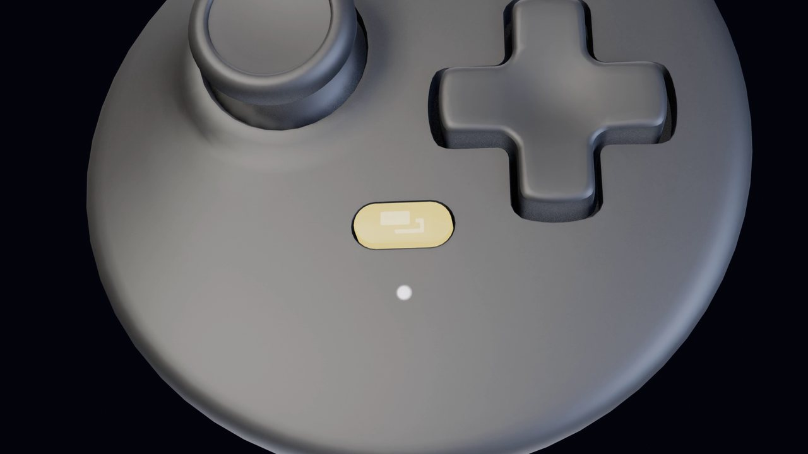

### Right thumbstick: the plunger and the launch button

Most tables have a plunger: pull the right thumbstick towards you, the plunger pulls back with it, then let go to launch the ball. The
further you pull, the stronger the launch.

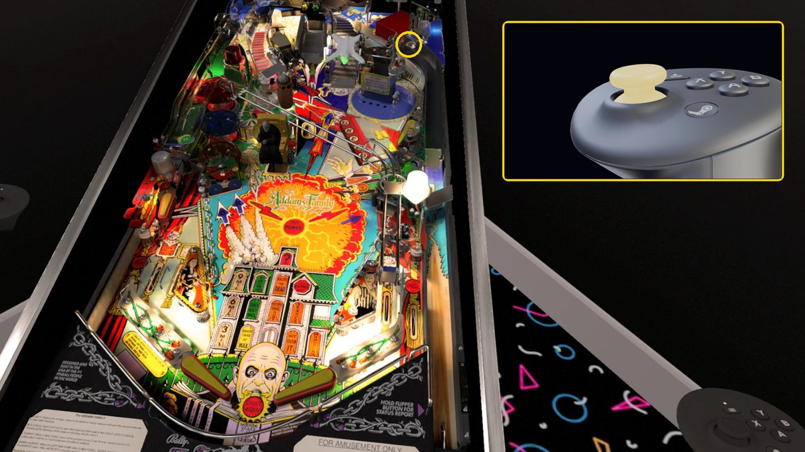

Some tables have a launch button instead of a plunger, like The Lost World Jurassic Park or Terminator 3. On those, click the right
thumbstick: the ball is launched.

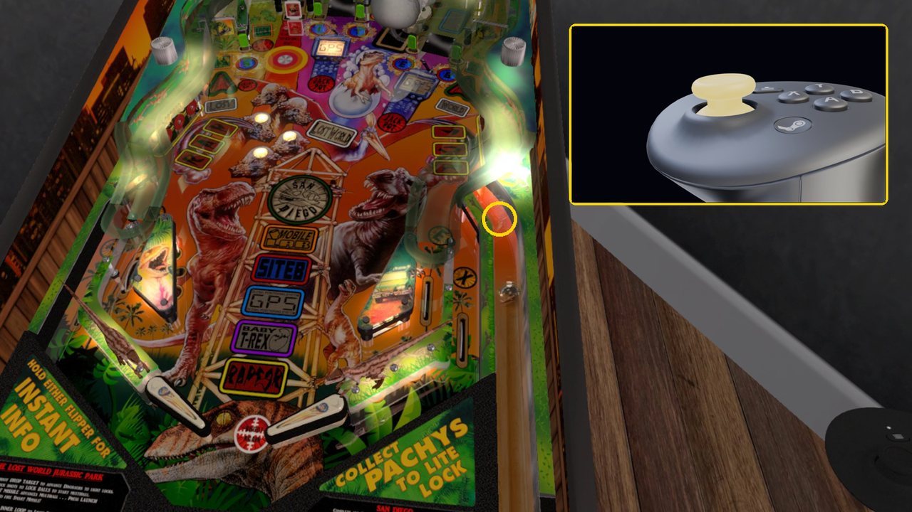

### B, A and the menu button

B inserts a coin, A starts a game. Some games want more than one coin per credit: Addams Family takes two with its factory settings.

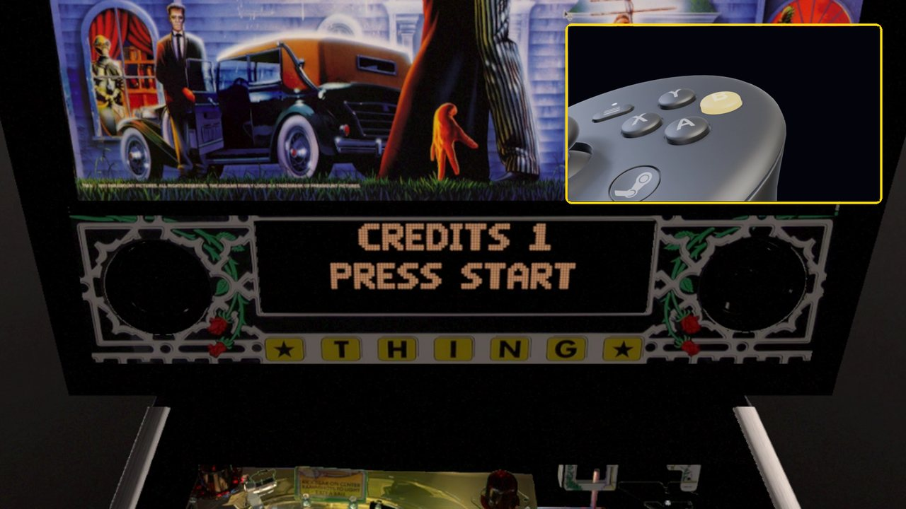

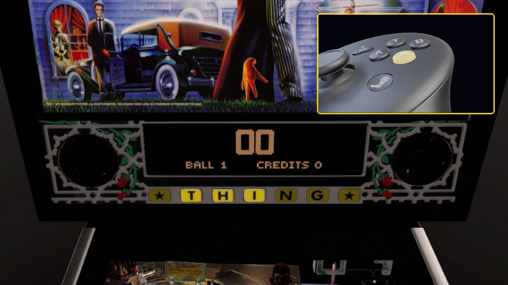

The menu button, the small button below Y on the right controller, quits the table and goes back to the lobby.

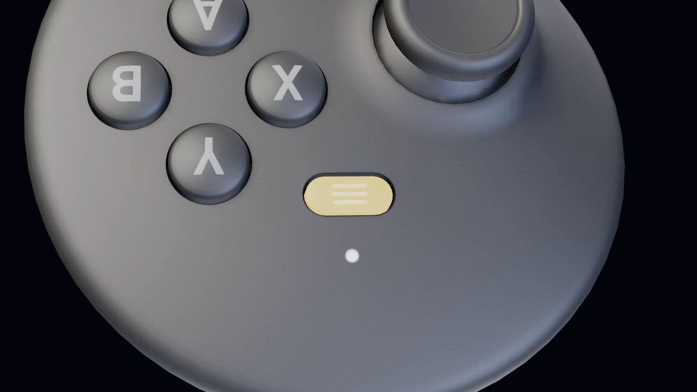

### Steam buttons, X and Y

The Steam buttons are kept by SteamOS: the game does not use them. X and Y do nothing by default: give them the action you want (step 2).

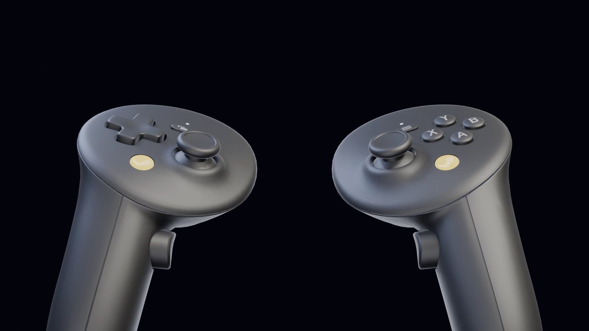

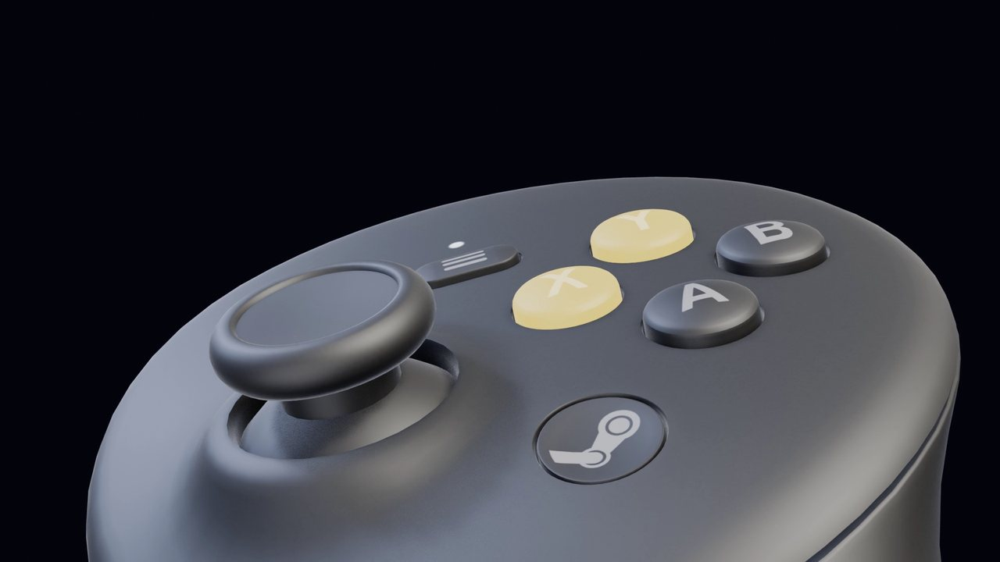

## 2. Give a button another action

Open **Controls** in the menu (the gamepad icon in the rail). Each action is listed with the buttons that do it: *Left Flipper*, *VR
Controller - Left trigger*. Keyboard keys are listed too, for the players who use a keyboard. Point at the list and scroll it with the
right thumbstick.

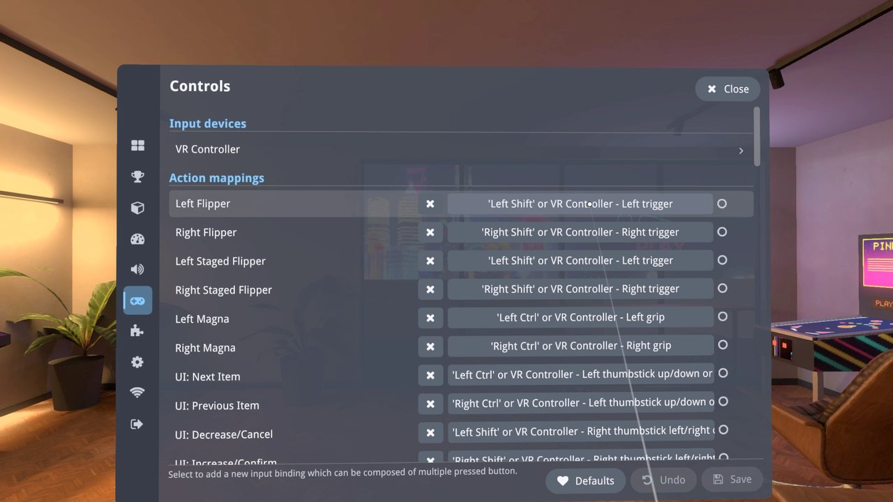

### Example: X as the fire button

Some tables have a fire button on the lockbar, the front rail of the cabinet, in front of the player. In Visual Pinball it is the
**Lockbar** action, which no controller button does by default. To give it the free X button:

1. Scroll to **Lockbar** and select its buttons.
2. A window asks for the new button: press **X** on the right controller. A combination of buttons works too. The window shows
   *New mapping: VR Controller - Right X button*, then closes.

   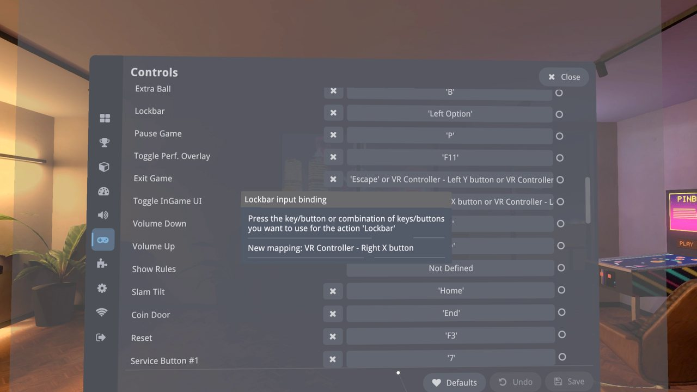

3. Lockbar now answers to the X button too (its keyboard key stays). Choose **Save** at the bottom of the screen.

The circle at the end of a row lights when a button of the action is pressed: an easy way to check.

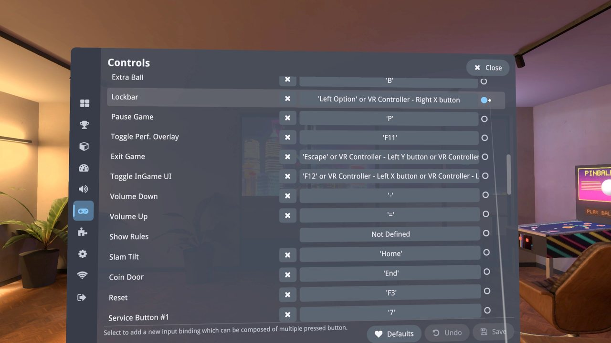

At the bottom of the screen and on each row:

- **✕** on a row removes all the buttons of that action. The actions that move in the menu cannot stay without a button: the window asks
  for a new one at once.
- **Undo** goes back to the last saved buttons.
- **Defaults** goes back to the original buttons of this page.

## If something goes wrong

- **A button does nothing in a table:** not every table uses every action. Magna-saves and the lockbar fire button only work on the
  tables that have them, and a table with a launch button ignores the plunger, and the reverse.
- **The menu does not answer to the buttons any more:** open **Controls** with the controller's pointer and choose **Defaults**, then
  **Save**.
- **The table tilts:** the nudges were too hard or too frequent. Nudge less, or tilt the thumbstick less far.
