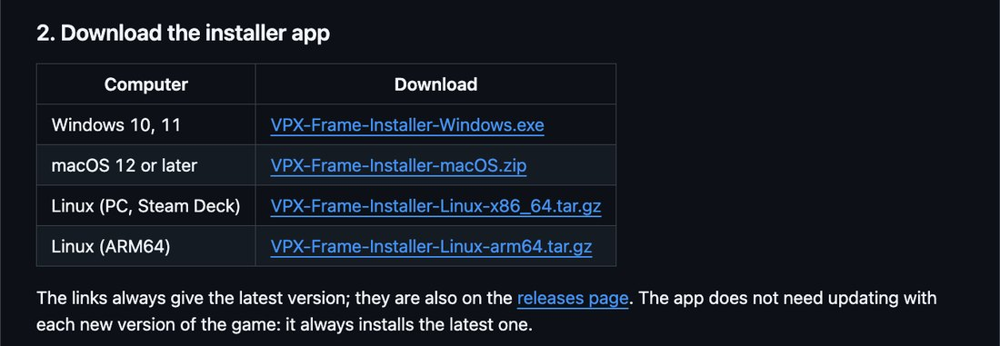
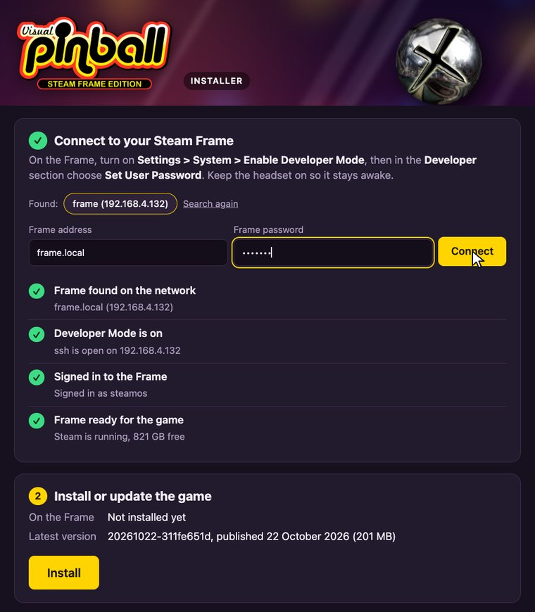
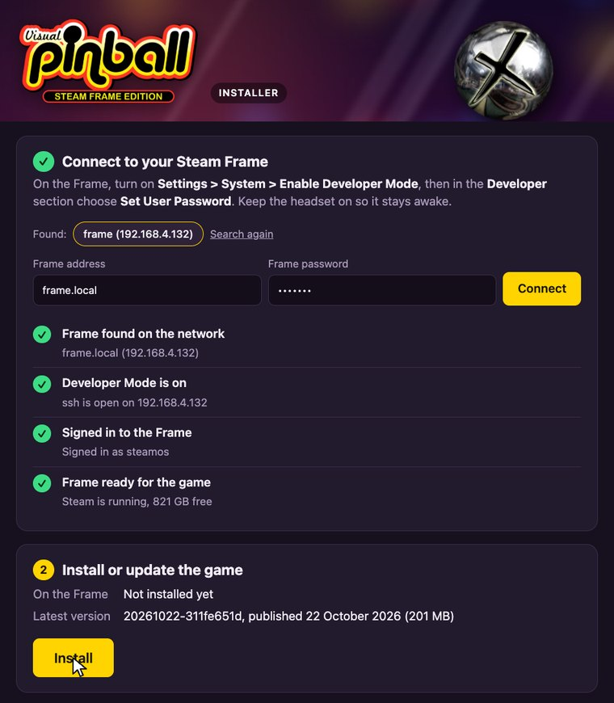
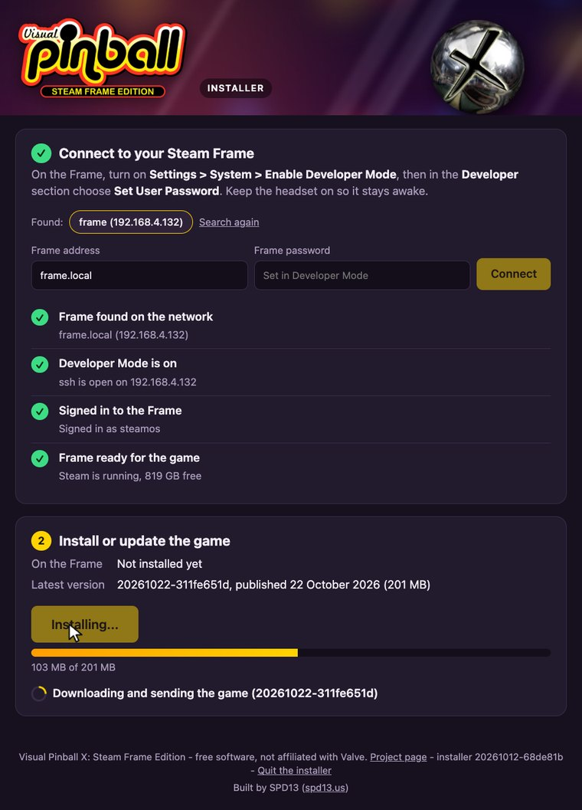
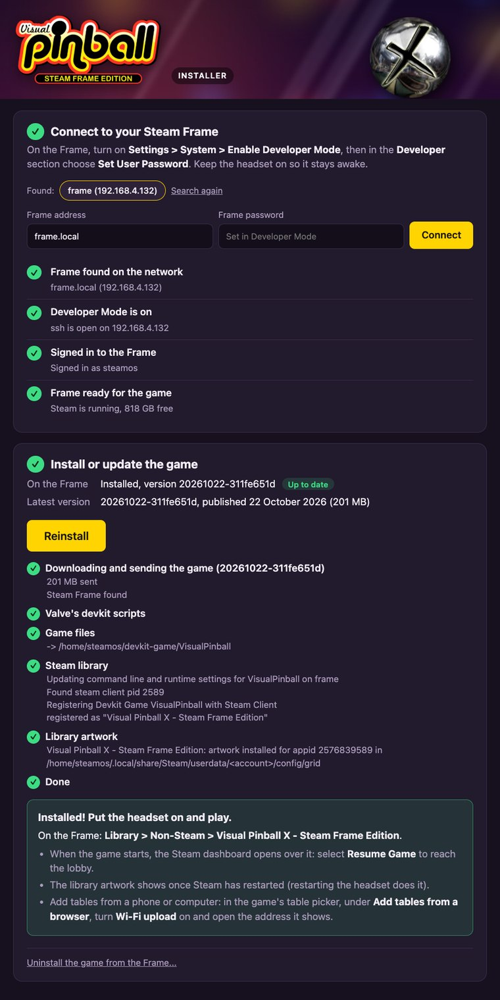
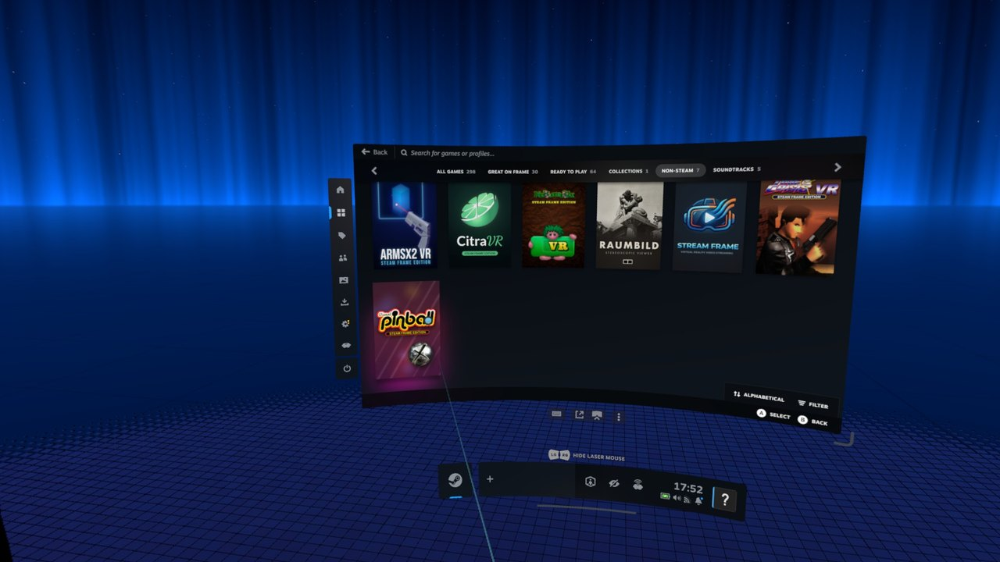
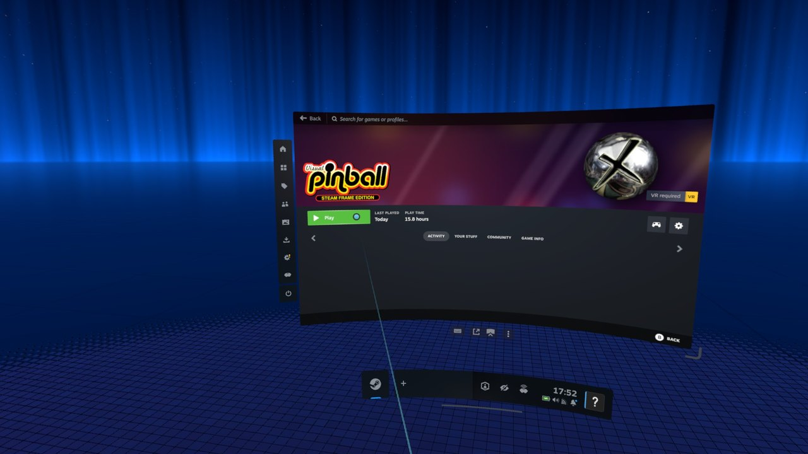

# Installing the game

Visual Pinball X: Steam Frame Edition is not on the Steam store. It is installed on the Frame from a computer on the same network, with
the **installer app**: it finds the Frame, checks that it is ready, then downloads the latest version of the game and installs it, with its
entry and artwork in the Steam library. Nothing is installed on the computer itself.

You need:

- A Steam Frame and a computer on the **same network**.
- A computer with **Windows 10 or 11** (64-bit), **macOS 12 or later** (Apple silicon or Intel) or **Linux**.
- An internet connection: the app downloads the game (about 200 MB) from the project's releases on GitHub.

## 1. Turn on Developer Mode on the Frame

The installer reaches the Frame the way developers do, so the Frame must be in Developer Mode, with a password for its `steamos` user.
Valve describes both steps, with screenshots, in its
[Steam Frame setup guide](https://partner.steamgames.com/doc/steamhardware/steamframe/setup):

1. Open **Steam Settings > System** and turn on **Enable Developer Mode**.
2. On the left, scroll down to the new **Developer** section. Near the bottom of that page, choose **Set User Password** and pick a
   password. The installer asks for it.

*Source: Valve, [Steamworks Documentation, Steam Frame setup](https://partner.steamgames.com/doc/steamhardware/steamframe/setup),
section "Developer Mode".*

Keep the headset on (or awake) while installing: it leaves the network when it goes to sleep.

## 2. Download the installer app

On the project's page on GitHub, [How to install](https://github.com/SPD13/vpinball-steam-frame#how-to-install), download the installer
for your computer:

| Computer | Download |
| --- | --- |
| Windows 10, 11 | [VPX-Frame-Installer-Windows.exe](https://github.com/SPD13/vpinball-steam-frame/releases/latest/download/VPX-Frame-Installer-Windows.exe) |
| macOS 12 or later | [VPX-Frame-Installer-macOS.zip](https://github.com/SPD13/vpinball-steam-frame/releases/latest/download/VPX-Frame-Installer-macOS.zip) |
| Linux (PC, Steam Deck) | [VPX-Frame-Installer-Linux-x86_64.tar.gz](https://github.com/SPD13/vpinball-steam-frame/releases/latest/download/VPX-Frame-Installer-Linux-x86_64.tar.gz) |
| Linux (ARM64) | [VPX-Frame-Installer-Linux-arm64.tar.gz](https://github.com/SPD13/vpinball-steam-frame/releases/latest/download/VPX-Frame-Installer-Linux-arm64.tar.gz) |

The links always give the latest version. The app does not need updating with each new version of the game: it always installs the
latest one.

## 3. Open the installer app

The app is not signed with a paid certificate, so Windows and macOS warn the first time it is opened:

- **Windows:** double-click `VPX-Frame-Installer-Windows.exe`. If Windows says "Windows protected your PC", choose **More info**, then
  **Run anyway**. If the browser warns that the file is not commonly downloaded, choose to keep it.
- **macOS:** open the `.zip` (Safari may already have done it), move **Visual Pinball X Installer** to your Applications folder if you
  like, then double-click it. If macOS says it cannot verify the app ("Not Opened"), choose **Done**, open **System Settings > Privacy &
  Security**, scroll down to **Security**, choose **Open Anyway** next to the app's name and confirm. When the app asks to **find devices
  on local networks**, choose **Allow**: it is how it reaches the Frame.
- **Linux:** unpack the download and run the app, for example in a terminal:
  `tar -xzf VPX-Frame-Installer-Linux-x86_64.tar.gz && ./VPX-Frame-Installer`. It opens in your web browser and quits when the page is
  closed.

## 4. Connect to the Frame

The app looks for the Frame on the network and shows it as found: `frame`, with its address. Type the password set in step 1 and choose
**Connect**. Four checks turn green:

1. **Frame found on the network**
2. **Developer Mode is on**
3. **Signed in to the Frame**
4. **Frame ready for the game** (Steam running, enough free space)

If a check turns red, it says what is wrong and what to do: wake the headset, turn Developer Mode on, use the right password, or type the
Frame's IP address (shown on the Frame in **Settings > Network**) in **Frame address**. Fix it, then choose **Check again**.

## 5. Install

Step 2 shows what is on the Frame (*Not installed yet*) and the latest version on GitHub. Choose **Install**.

The game is downloaded and sent to the Frame, with a progress bar.

Then each step of the installation is listed: Valve's devkit scripts, the game files, the Steam library entry and its artwork. It ends
with **Installed! Put the headset on and play.**

## 6. Start the game from the Steam library

On the Frame, open the **Library** and its **Non-Steam** tab: the games installed outside the Steam store are there, with
**Visual Pinball X - Steam Frame Edition**. Its artwork appears once Steam has restarted (restarting the headset does it).

Select it, then **Play**. The first launch may wait while Steam downloads *Steam Linux Runtime 4.0 ARM64*, which the game runs on.

When the game starts, the Steam dashboard opens over it: the game is already running behind it. Select **Resume Game** with the
controller's pointer to close the dashboard and reach the lobby. SteamVR does this each time a game added outside the Steam store
starts.

The library is empty at first: see [Adding tables and ROMs](Adding%20Tables%20and%20ROMs.md).

## Updating and uninstalling

- **From the headset:** when a newer version is published, a yellow badge above the menu says *New version available, Click here to
  install*. Select it, wait for the download and the install, select **OK**, then start the game again from the library.
- **From the installer app:** open it again and connect. When a newer version is out, step 2 shows **Update to &lt;version&gt;**;
  **Up to date** means there is nothing to do.
- **Uninstalling:** in the app, after step 1, choose **Uninstall the game from the Frame...** at the bottom of step 2, then **Uninstall**.
  It removes the game, its library entry and artwork. Tick **Also delete its settings, scores and play statistics** to remove those too.
  The tables and ROMs are never deleted.

Updates and uninstalling keep the tables, settings, scores and play statistics. Developer Mode stays on after the install: it is how the
game is installed and updated.

## If something goes wrong

| Problem | What to do |
| --- | --- |
| The Frame is not found, or "No answer from" its address | Wake the headset (put it on). Check that the Frame and the computer are on the same network (a guest Wi-Fi often keeps devices apart) and that Developer Mode is on. Type the Frame's IP address in **Frame address**. |
| "The Frame does not accept connections" | Developer Mode is off: turn it on (step 1). |
| "The password was refused" | Type the password set in **Settings > Developer > Set User Password**, or set a new one there. |
| "Steam is not running on the Frame" | Put the headset on so it is in its normal mode, then choose **Check again**. |
| macOS: the app cannot find the Frame | Allow it in **System Settings > Privacy & Security > Local Network**. |
| The game is missing from the library | Look in the **Non-Steam** tab. Restart Steam on the Frame if it is still missing. |
| Something else | The installer keeps a log, `installer.log`, in `%LOCALAPPDATA%\vpx-frame-installer` (Windows), `~/Library/Caches/vpx-frame-installer` (macOS) or `~/.cache/vpx-frame-installer` (Linux). Attach it when you [report the problem](https://github.com/SPD13/vpinball-steam-frame/issues). |
