# Lobby rooms

The lobby is the room around you while you choose a table. The game ships four lobby rooms, and the VR room of a table can be used as the
lobby too. This tutorial picks rooms from the menu in the headset, then uses the room of *Ready Player One* as the lobby, and goes back to
the default lobby room.

[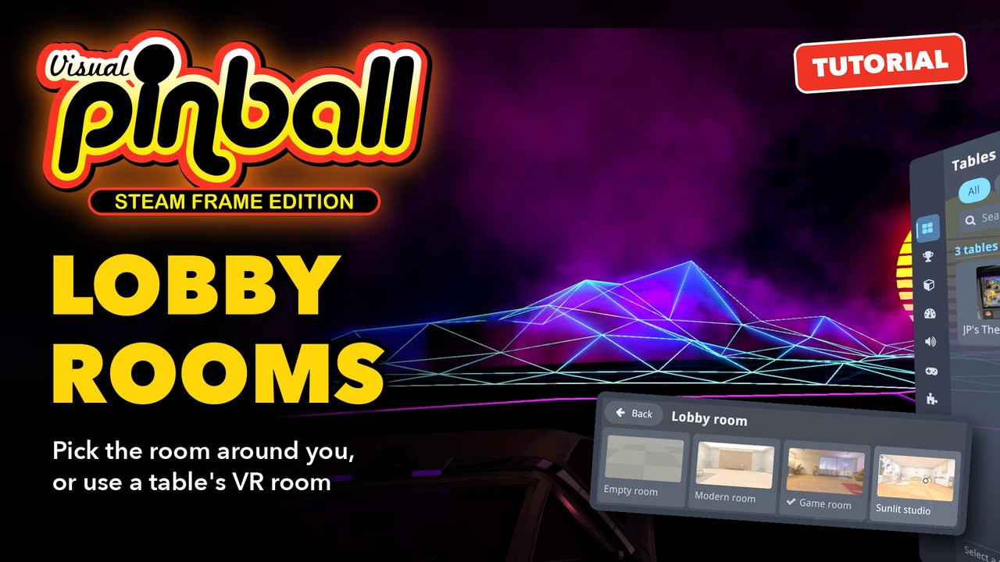](https://youtu.be/ncKmyZOIl-E)

**▶ [Watch the video](https://youtu.be/ncKmyZOIl-E)** (2:00): the same steps in the headset. The text below follows it, with more details.

Everything happens in the headset: no browser is needed.

## The rooms of the game

| Room | What it is |
| --- | --- |
| Game room | A lounge at night with arcade cabinets, a pinball machine, a neon sign and a city skyline through a big window. The default room |
| Modern room | An oak slat wall, cove lighting and a sofa |
| Sunlit studio | Sunbeams from a garden through tall windows, dartboards and a desk |
| Empty room | A floor of tiles, the lobby of the first versions |

Their lighting is baked into their textures, so they cost almost nothing to show on the Frame.

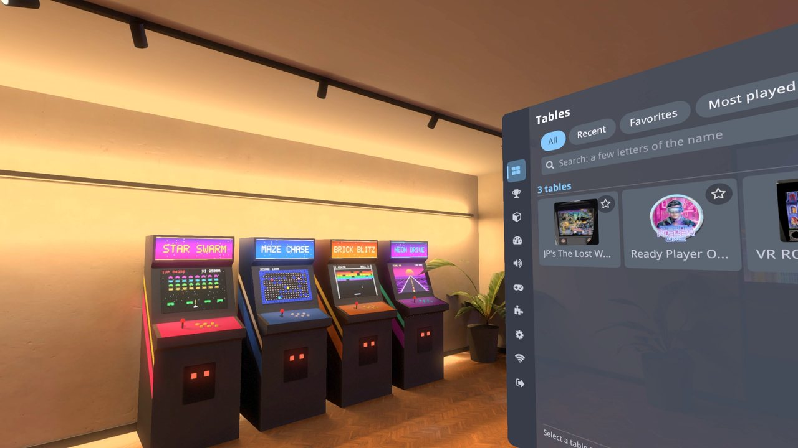

## 1. Choose a lobby room

In the lobby, open **VR & Room** in the rail of the menu (the cube icon). Its first section, **Menu and lobby**, says which room the lobby
uses (*Lobby room: Game room*) and has **Choose a lobby room**. The same two lines are in **System** (the gear icon).

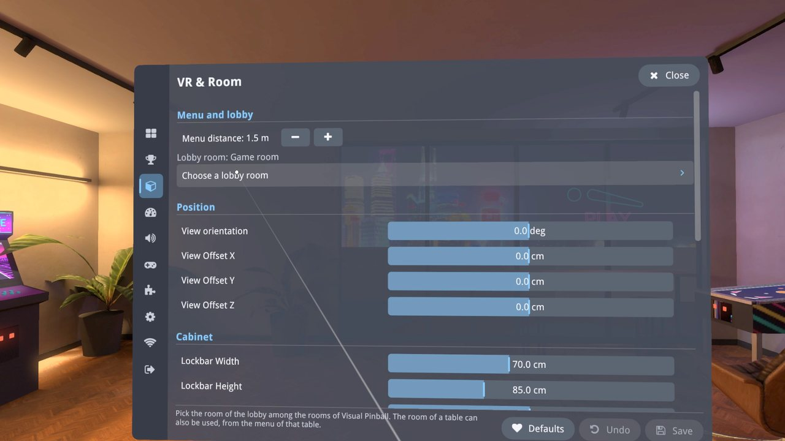

**Choose a lobby room** shows a tile for each room, with a picture of it. The check mark shows the room of the lobby.

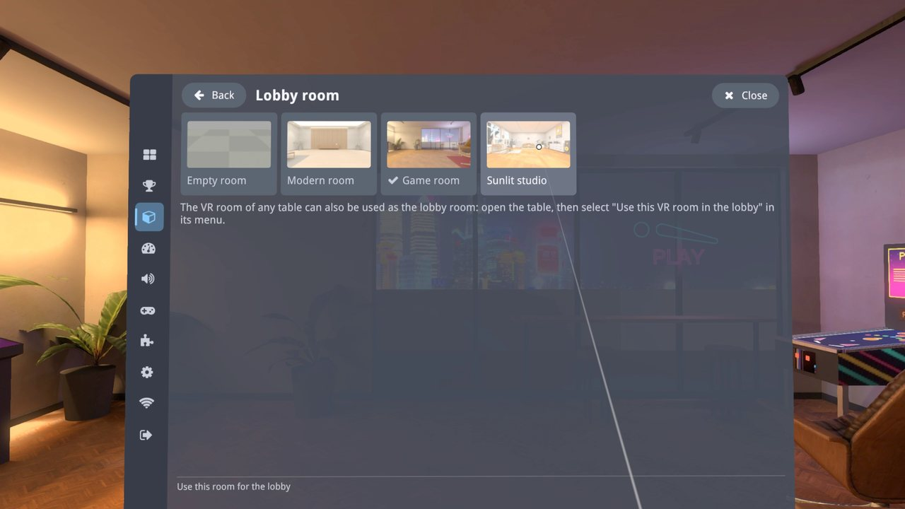

Select a tile: the lobby reloads at once in that room. Here the **Sunlit studio**, then the **Modern room**.

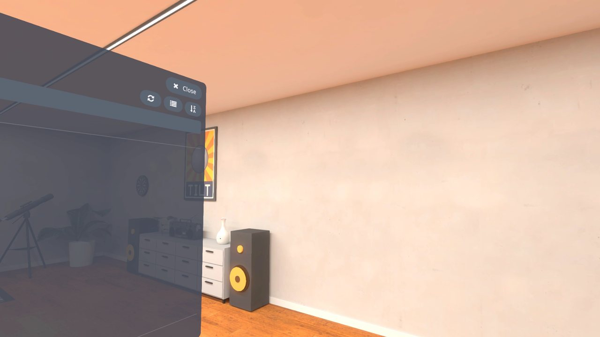

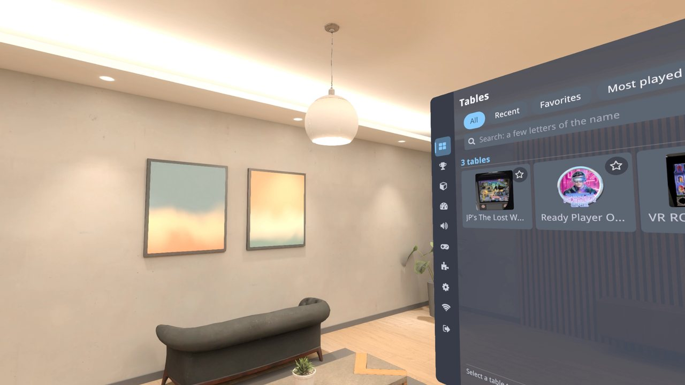

The room you choose is saved: the lobby opens in it at the next starts of the game.

## 2. Use the VR room of a table

Many VR tables come with a room of their own around the cabinet: walls, a floor, scenery. That room can become the lobby.

Play the table, here *Ready Player One*, and look around: its room is a synthwave landscape with a setting sun and neon mountains.

Open the menu: it opens on **This table**. Select **Use this VR room in the lobby**.

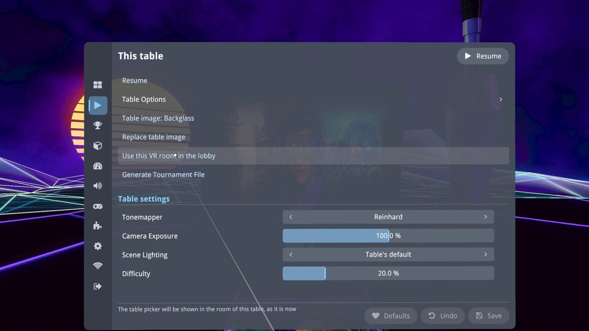

A notice says *The lobby will use the room of this table*.

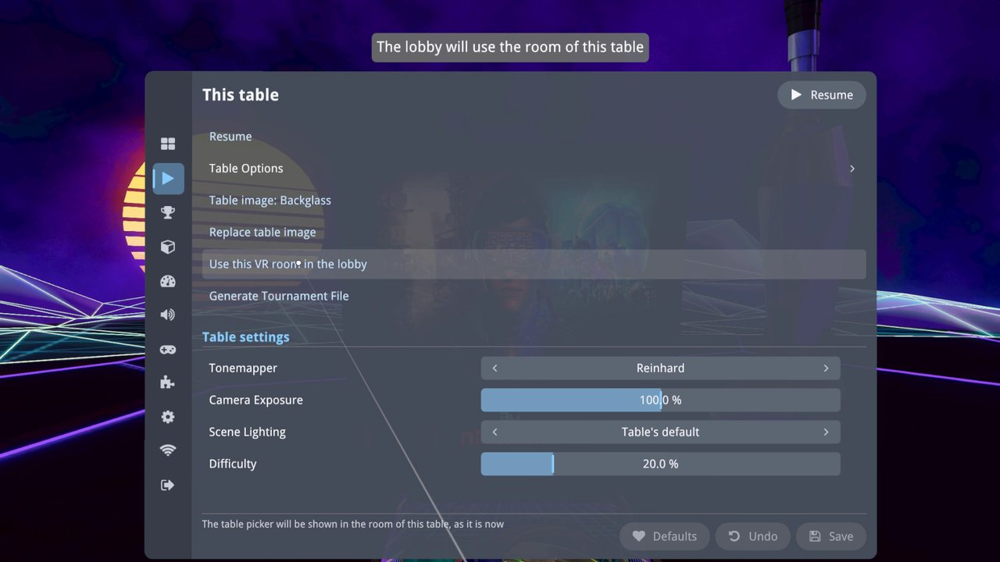

Go back to the lobby: **Quit** in the rail, then **Return to Lobby**. The lobby is now the room of that table, without the table and its
cabinet, and the table picker is shown in it.

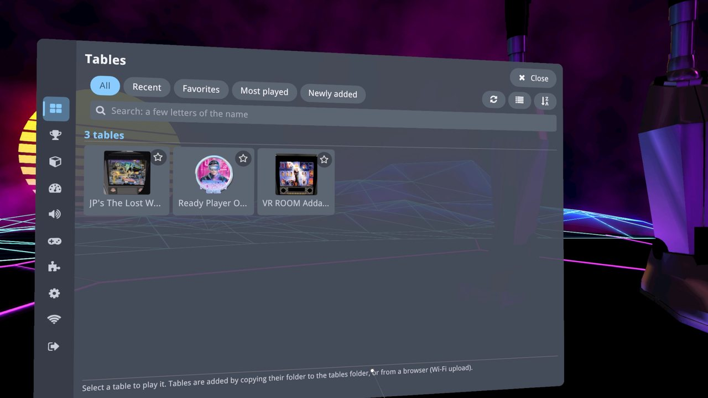

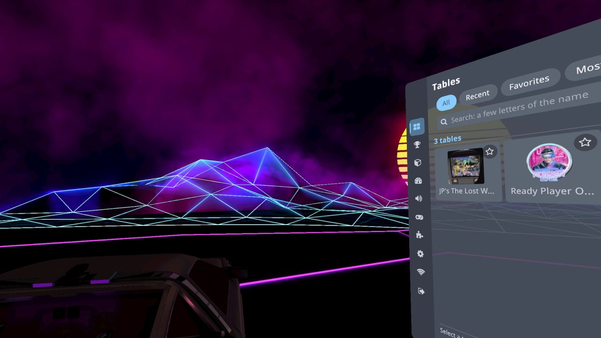

The table itself does not change: it plays as before. **Use this VR room in the lobby** is only shown for tables that have a VR room; a
table made for desktops and cabinets has none.

## 3. Back to the default lobby room

In the lobby, open **VR & Room** again: it now says *Lobby room: the room of Ready Player One*, with a new line, **Use the default lobby
room**.

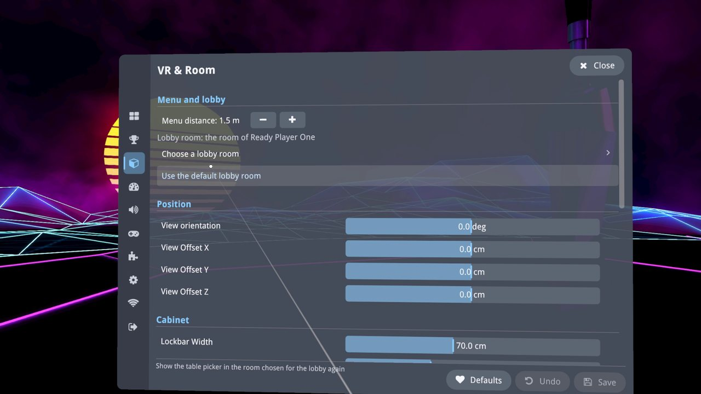

Select it: the lobby reloads in the room chosen with **Choose a lobby room**, here the Modern room, not the Game room. Choosing a room in
the picker also stops the use of the table's room.

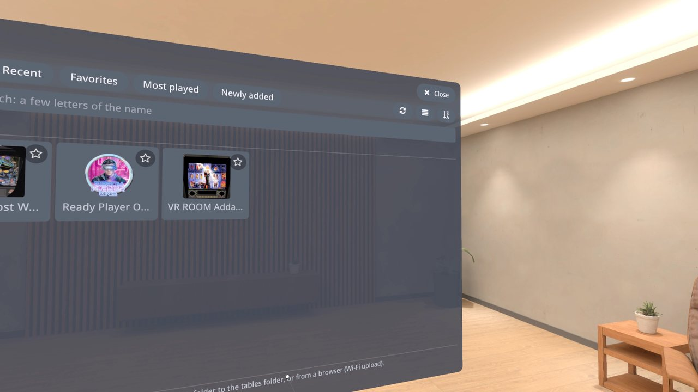

## Good to know

- The lobby room is part of the **Settings** of a backup (see [Backup and restore](Backup%20and%20Restore.md)): a restore brings it back,
  the room of a table included when that table is in the tables folder.
- **Menu distance**, in the same **Menu and lobby** section, sets how far the menu panel stands in front of you.
- Designing more rooms: [how the lobby rooms are made](../../steamframe/lobby-room/DESIGNING-ROOMS.md).
