# Names and thumbnails

The table picker shows each table under the name of its file, and with an image: a screenshot taken in the game, or the one that came with
the table. Both can be changed from a browser. This tutorial gives two tables a shorter name, then gives *Mass Effect* one of the wheel
images that came with it.

[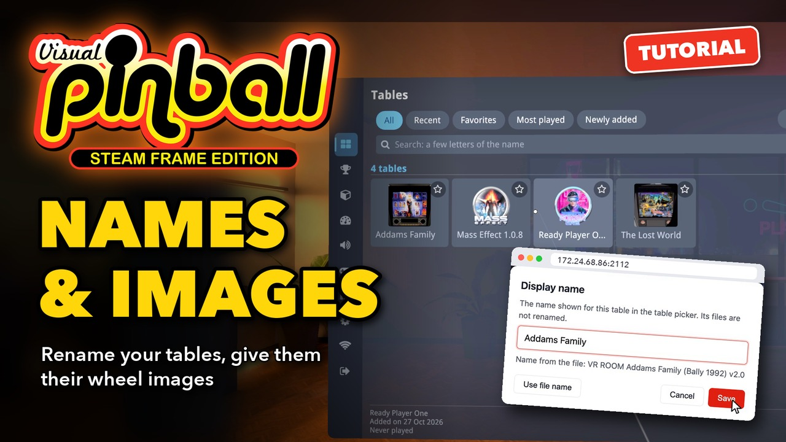](https://youtu.be/wdBclu0nV1g)

**▶ [Watch the video](https://youtu.be/wdBclu0nV1g)** (1:43): the same steps in the headset and in the browser. The text below follows it,
with more details.

The examples are *VR ROOM Addams Family (Bally 1992) v2.0*, *JP's The Lost World Jurassic Park*, and *Mass Effect 1.0.8*, whose package
has a folder of wheel images.

## 1. The names and images of the files

In the lobby, open **Tables**. Each tile shows the name of the table's file, often too long to fit, and its image.

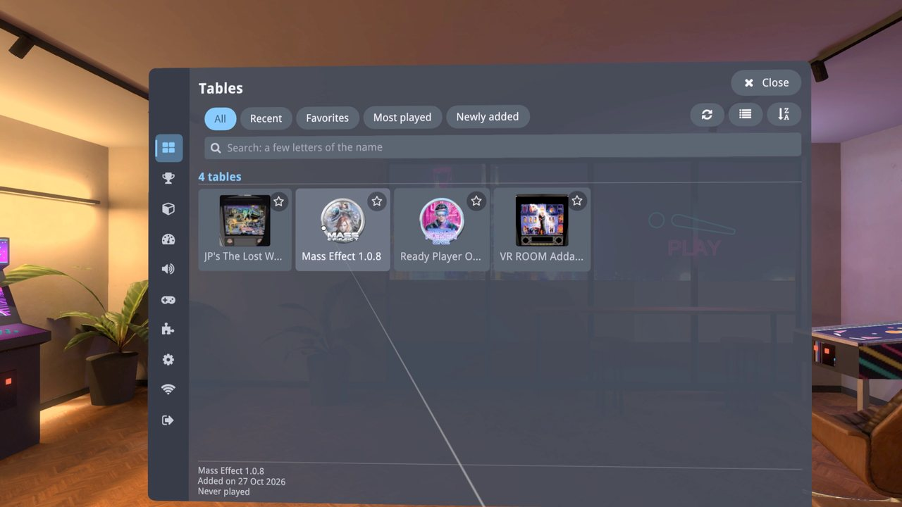

Names and images are changed from a browser: turn on **Wi-Fi upload** in the menu and open its address on a computer on the same network
(see [Adding tables and ROMs](Adding%20Tables%20and%20ROMs.md), step 1). The browser opens on the **Tables** page.

## 2. Give a table a shorter name

On the **Tables** page, open the **...** menu of a tile and choose **Display name**.

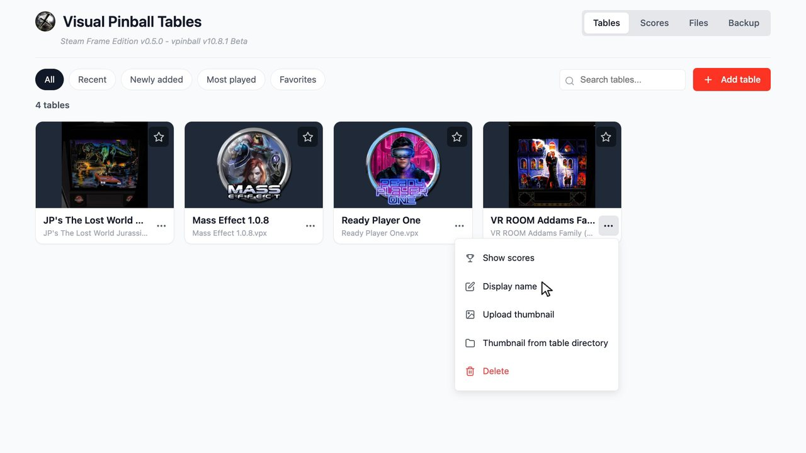

The dialog shows the current name, selected, and the name from the file below it: *The name shown for this table in the table picker. Its
files are not renamed.*

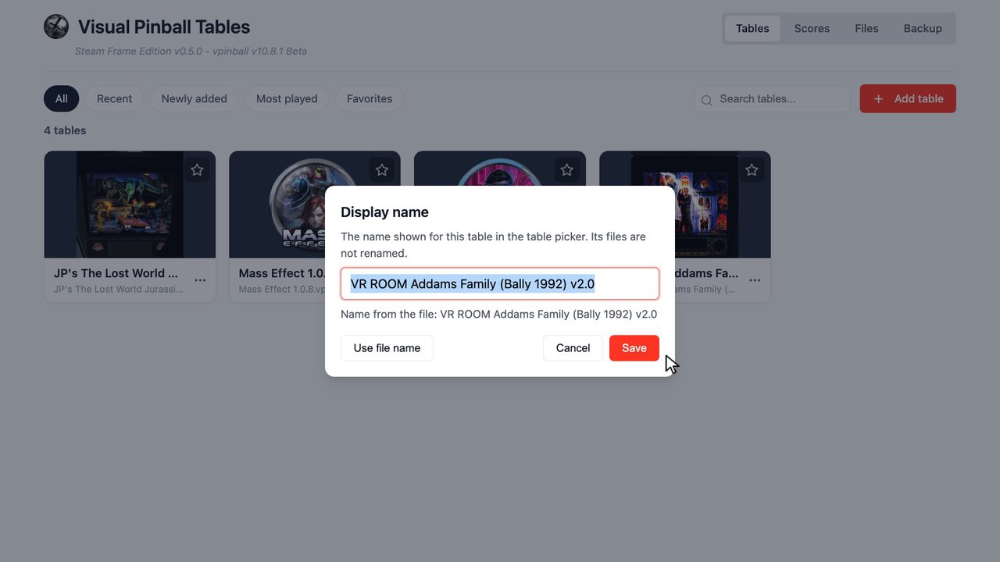

Type the new name, here *Addams Family*, and choose **Save**.

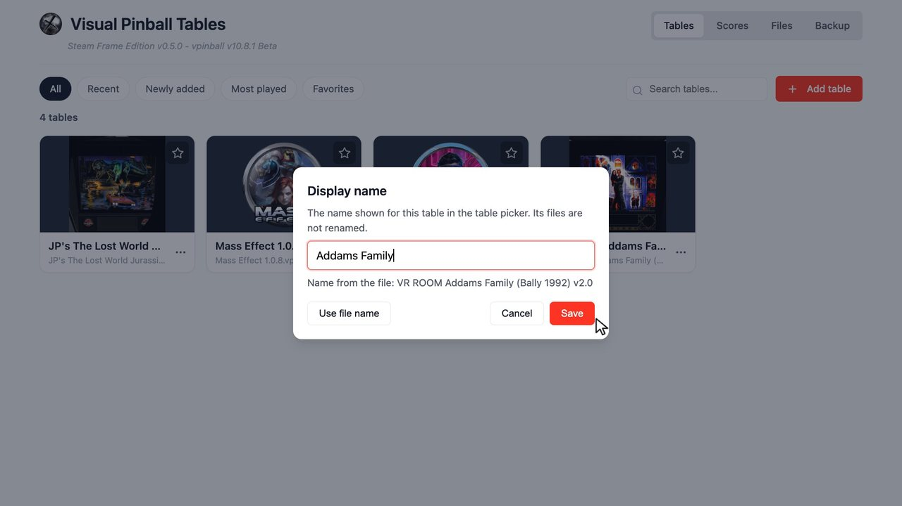

The tile shows the new name at once, with the name of the file below it. *JP's The Lost World Jurassic Park* becomes *The Lost World* the
same way.

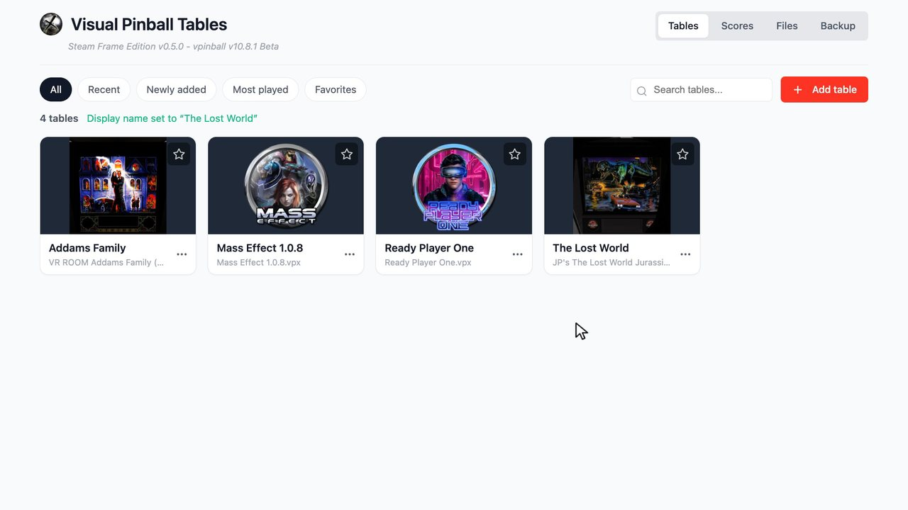

To go back to the name of the file, choose **Use file name** in the dialog, or save an empty name.

## 3. Give it one of its own images

Many tables come with images in their package: a wheel image (a round logo, made for table pickers), a backglass, a flyer. *Mass Effect*
has a folder of wheel images. In the **...** menu of its tile, choose **Thumbnail from table directory**.

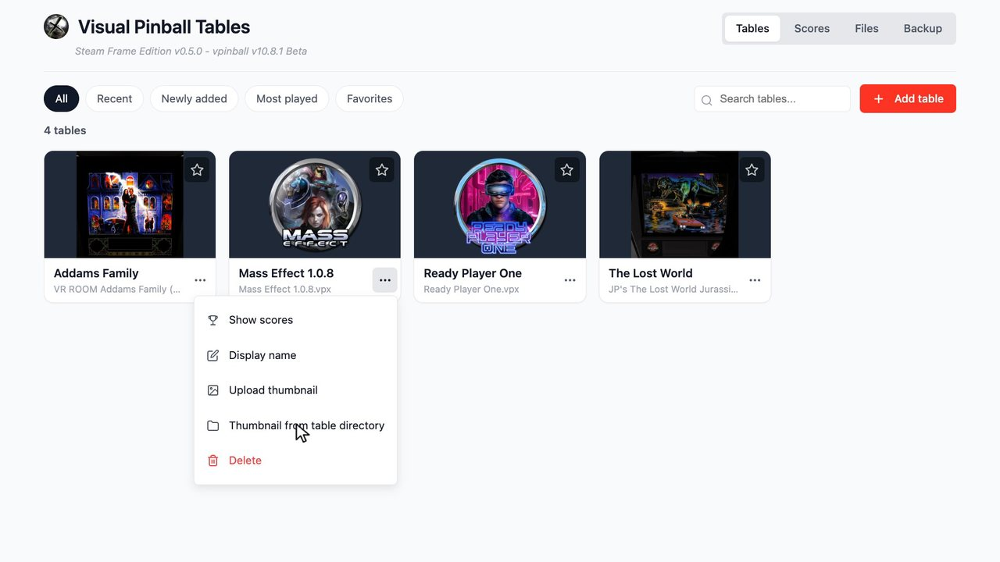

The dialog lists the folders and the images (PNG, JPEG, WebP, GIF, BMP, AVIF) of the table's folder on the device. Click a folder to open
it, and **Back** to return. It never goes above the folder of the table.

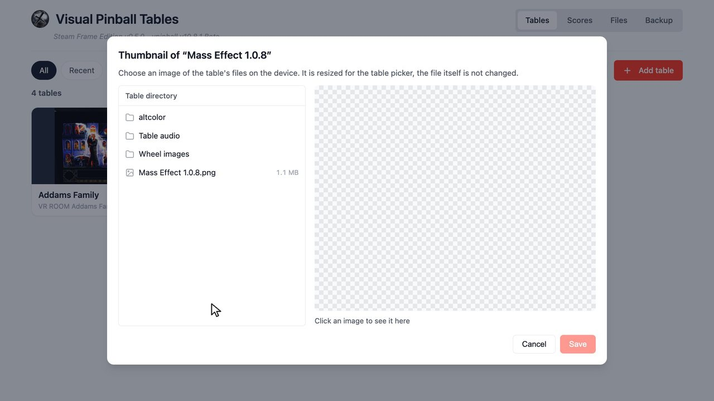

Here the wheel images are in **Wheel images**. Click an image to see it at full size, with its dimensions and size. A checkerboard shows
its transparent parts. Click another one to compare, then choose **Save**.

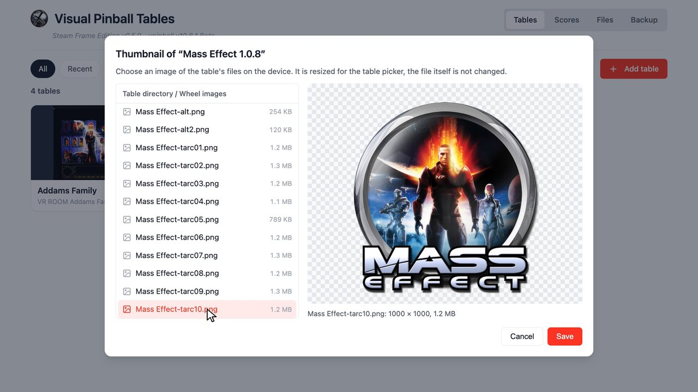

The page says *Thumbnail of Mass Effect 1.0.8 replaced* and the tile shows the new image.

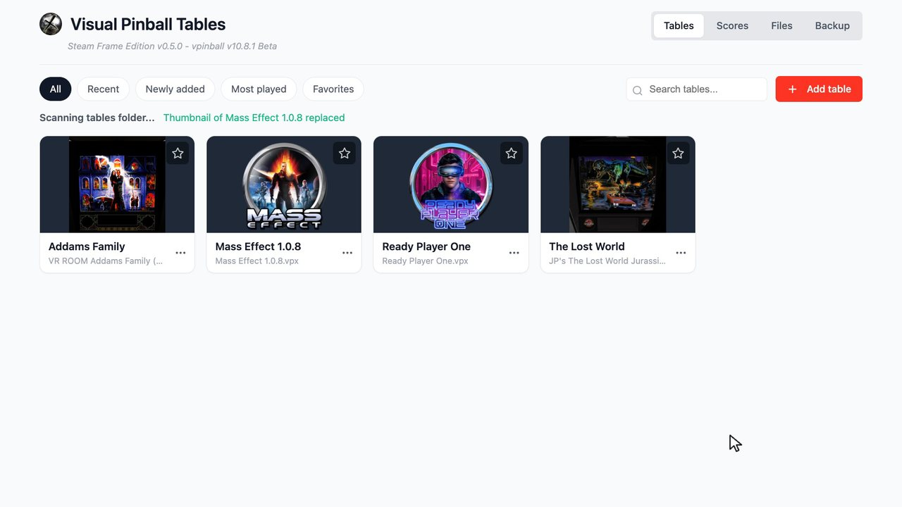

The chosen file is not changed or moved. The browser resizes a copy to at most 1024 x 1024 pixels and saves it as the table's image. A PNG
with transparent parts stays a PNG, like most wheels, and the others become JPEG.

**An image from your computer**: **Upload thumbnail**, in the same menu, picks any picture from your computer instead (a wheel downloaded
from the web, a photo of the machine, your own artwork). It is resized the same way.

## 4. In the headset

Open **Tables** in the headset again: the table picker shows the new names and the wheel of Mass Effect, without restarting the game.

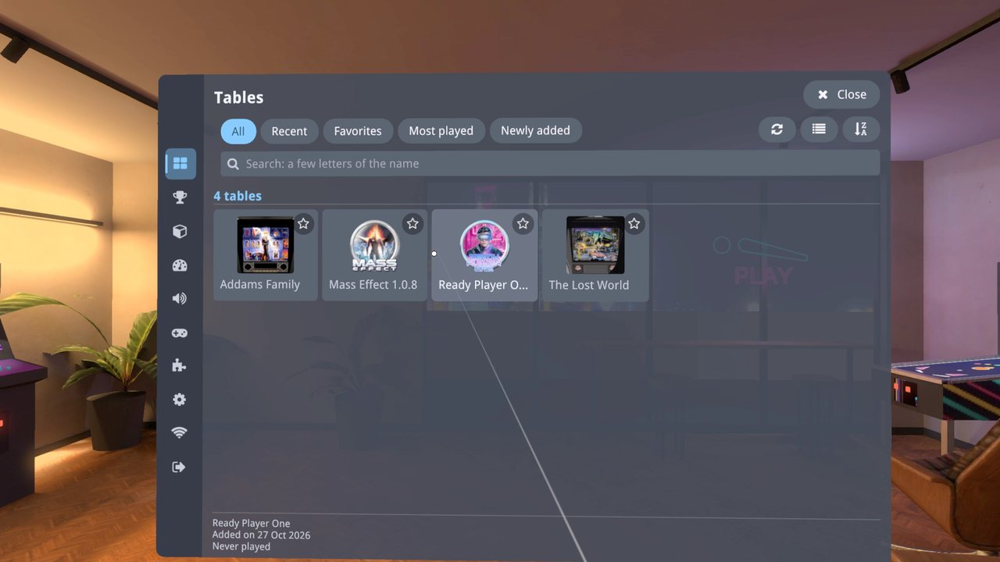

Display names are also used by the **Tables** and **Scores** pages of the browser.

## Good to know

- The image of a table is saved next to it, as `<table name>.jpg` or `<table name>.png`, and replaces the previous one. A table that has an
  image gets no screenshot when it is closed, so the image you chose is kept. To take a new screenshot instead, play the table and choose
  **Replace table image** in the **This table** page of the menu.
- The table's files are never renamed: other files that depend on the name of the table (its `.directb2s`, its `.vbs`, its settings) keep
  working.
- A [backup](Backup%20and%20Restore.md) keeps the display names (in **Library**) and the images of the tables (in **Table images**).
