# Players and scores

Visual Pinball records the score of every game played on a table of the library, for the player who played it, and keeps a leaderboard
for each table. This tutorial creates a player profile in the headset, plays a game for two players, gives the second player's score to
a new player from a browser, shows the leaderboards, chooses who plays next, and resets the scores of a table.

[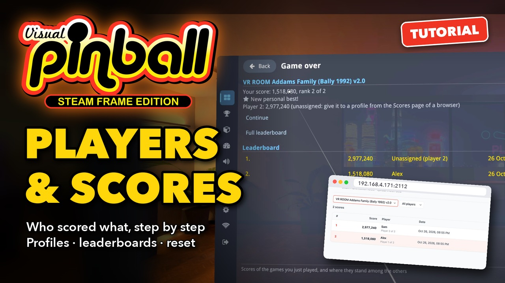](https://youtu.be/bmA_Hl-xeLc)

**▶ [Watch the video](https://youtu.be/bmA_Hl-xeLc)** (2:55): the same steps in the headset and in the browser. The text below follows it,
with more details.

The example uses *VR ROOM Addams Family (Bally 1992) v2.0*, a game for up to four players, with two players, Alex and Sam.

You need:

- A table in the library that starts and plays: see [Adding tables and ROMs](Adding%20Tables%20and%20ROMs.md).
- For the browser steps, Wi-Fi upload turned on in the headset, and a computer or phone on the same network (see the same tutorial,
  step 1).

## 1. Create your player profile

Open **Scores** in the menu (the trophy in the rail on the left). With no profile yet, it says *Player: nobody (choose who is playing)*.
Select that line.

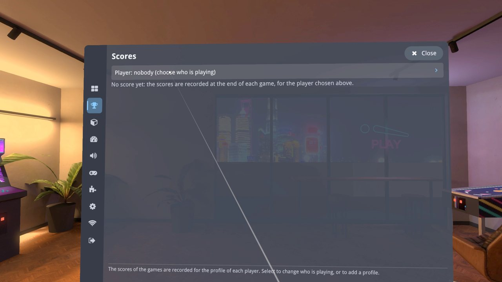

**Who is playing?** lists players 1 to 6 of the games, each with the profile that gets its scores, or *Unassigned*. Player 1 is the one
wearing the headset. Choose **New profile...**.

Type your name with the controller's pointer on the keyboard (**⇧ abc** makes the next letter a capital), then **Done**.

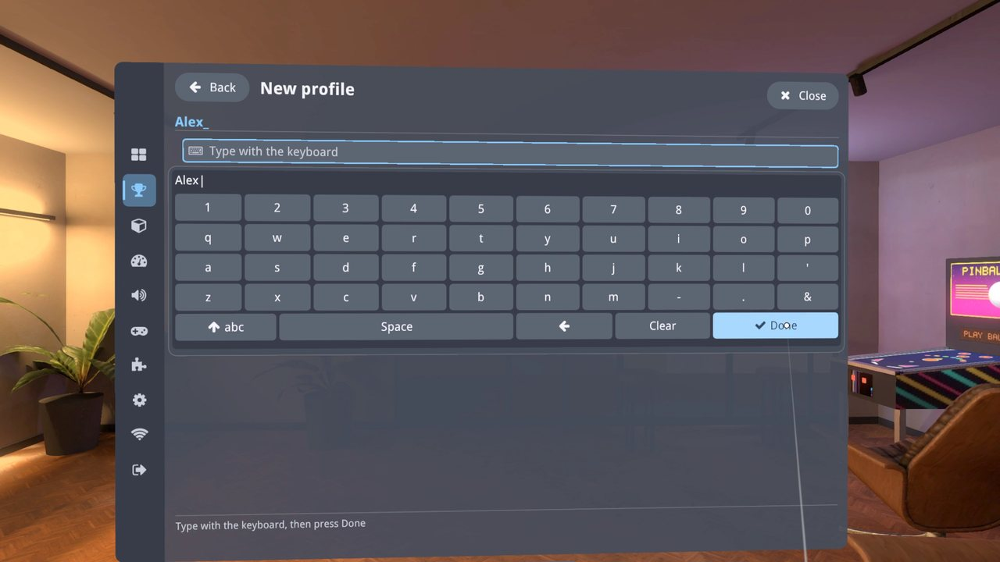

The new profile is given to player 1: *Player 1: Alex*. The same profile can be given to several players, and a player can be left
unassigned.

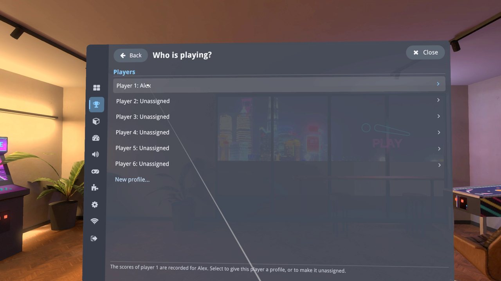

## 2. Play: the scores are saved

Play a table. Here, two players: Addams Family wants two coins per credit with its factory settings, so insert four coins, then press
**Start** twice. Nothing else is needed: the scores are read from the game while it runs and saved when the game ends. A game still
running when you leave the table is not saved.

Back in the lobby, **Game over** shows your score and its rank on the table, *New personal best!* or *New record of the table!*, the
scores of the other players, and the leaderboard around your score. Player 2 has no profile here: its score is kept as *Unassigned*.

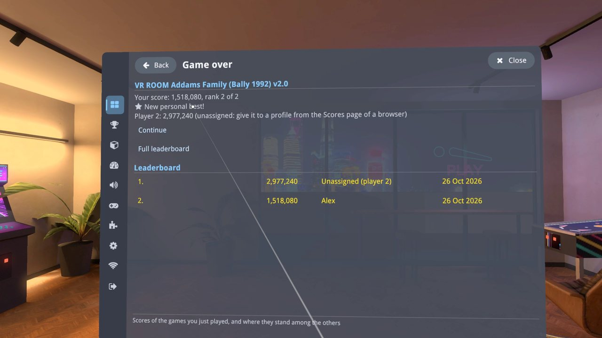

## 3. Give a score to a player

In a browser, open the address shown by Wi-Fi upload, then **Scores** at the top of the page. Every score is listed, with its rank, the
player and the table; unassigned scores are in italics.

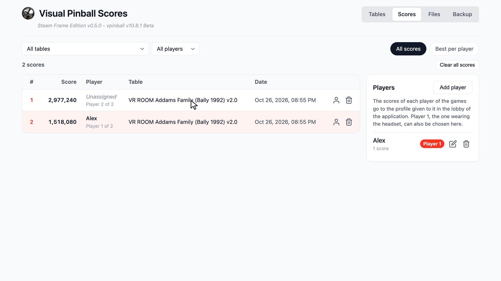

To add a player, choose **Add player**, type the name, then **Save**.

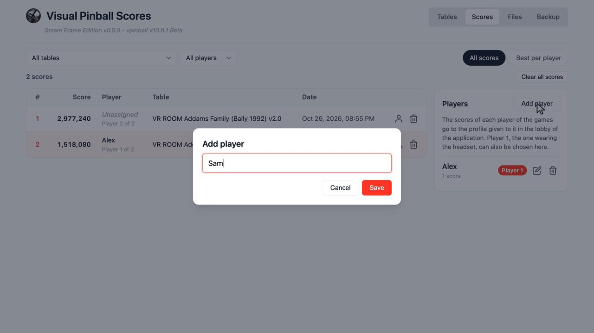

To give a score to a player, choose the person icon of its row, pick the player, then **Save**. The same dialog moves a score from one
player to another, or makes it unassigned (*Nobody*). The bin icon deletes one score.

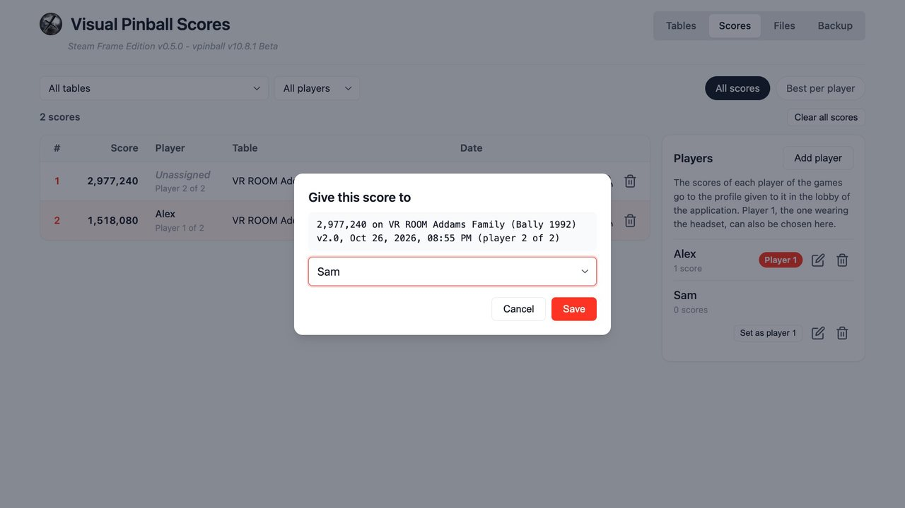

The **Players** panel also renames (pencil) and deletes (bin) a player. Deleting a player keeps its scores, which become unassigned.
**Set as player 1** chooses who wears the headset.

## 4. The leaderboard of a table

In the browser, choose a table in the first list: its leaderboard, best score first. **Best per player** keeps only the best score of
each player; **All scores** lists them all. The second list shows the scores of one player.

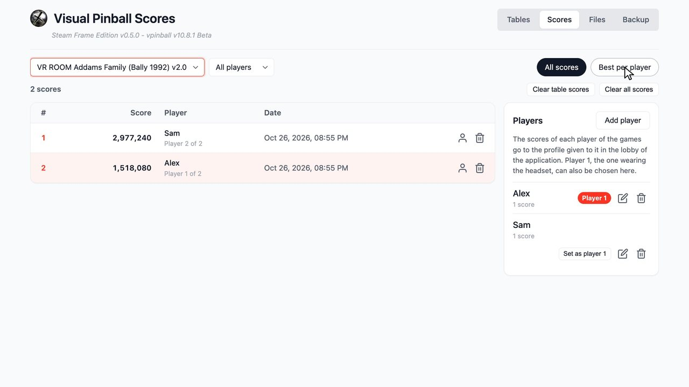

In the headset, **Scores** lists the tables that have scores, with their record and its holder. Select one for its leaderboard, with a
**Play** button and a switch between all the scores and the best of each player. The page of a table in **Tables** also shows its 10 best
scores.

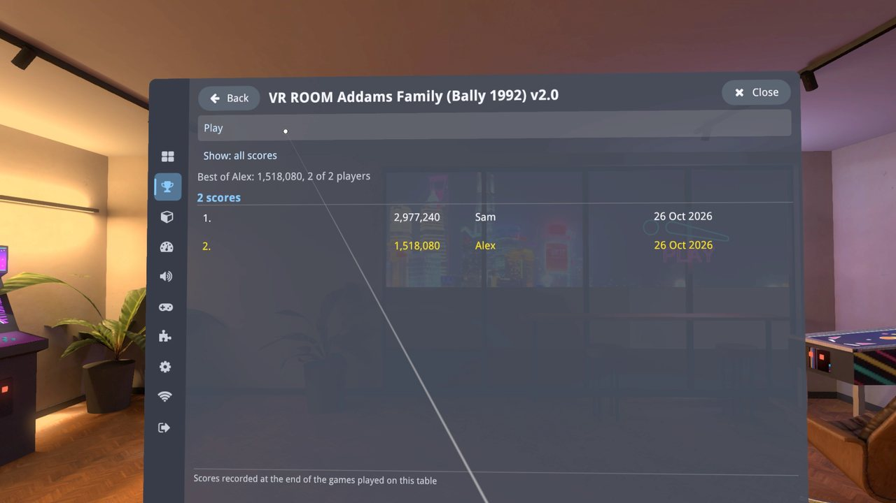

## 5. Choose who plays next

So that the scores of player 2 go to Sam in the next games: **Scores** › the player line at the top › **Who is playing?** ›
**Player 2** › **Sam**. Selecting the checked profile again makes the player unassigned, and **New profile...** on that page adds a
profile and gives it to this player. The browser shows *Player 2* next to Sam in the Players panel.

## 6. Reset the scores of a table

In the browser, choose the table, then **Clear table scores**. The dialog says how many scores go: all the scores of the table, of every
player, whatever the filters. The players are kept. This cannot be undone. Confirm with **Clear scores**.

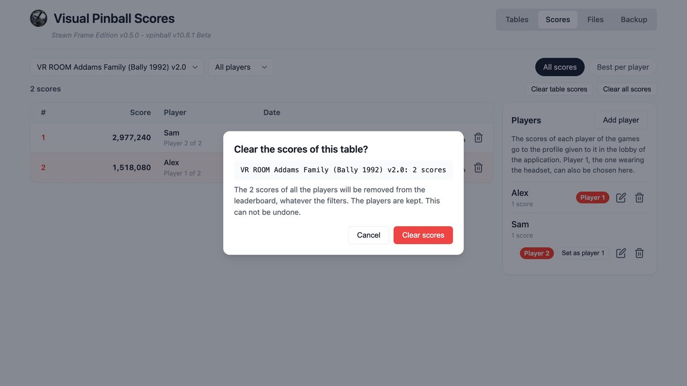

The leaderboard of the table is empty, in the browser and in the headset. **Clear all scores** does the same for every table: its dialog
asks you to type `DELETE` first.

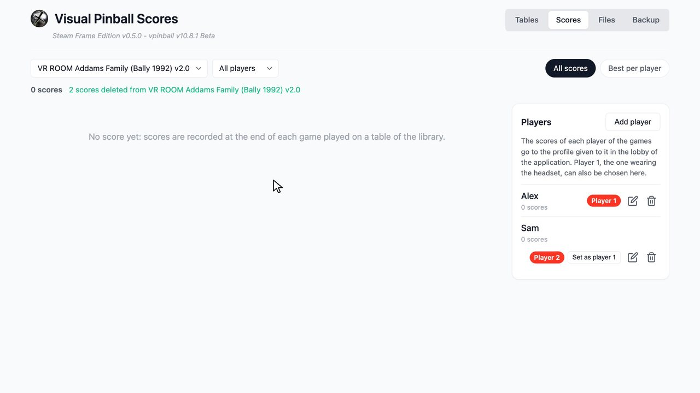

## If something goes wrong

- **A game was not saved:** only games that end are saved, not one left while it runs. Some tables keep their scores where Visual Pinball
  cannot read them yet; their games are not recorded. See [Table scores and leaderboards](../Table%20Scores%20and%20Leaderboards.md),
  section 12, to make such a table record its scores.
- **A score went to the wrong player:** give it to the right one from the browser (step 3).
- **The browser does not open the address:** check that Wi-Fi upload is on in the headset and that both devices are on the same network.
