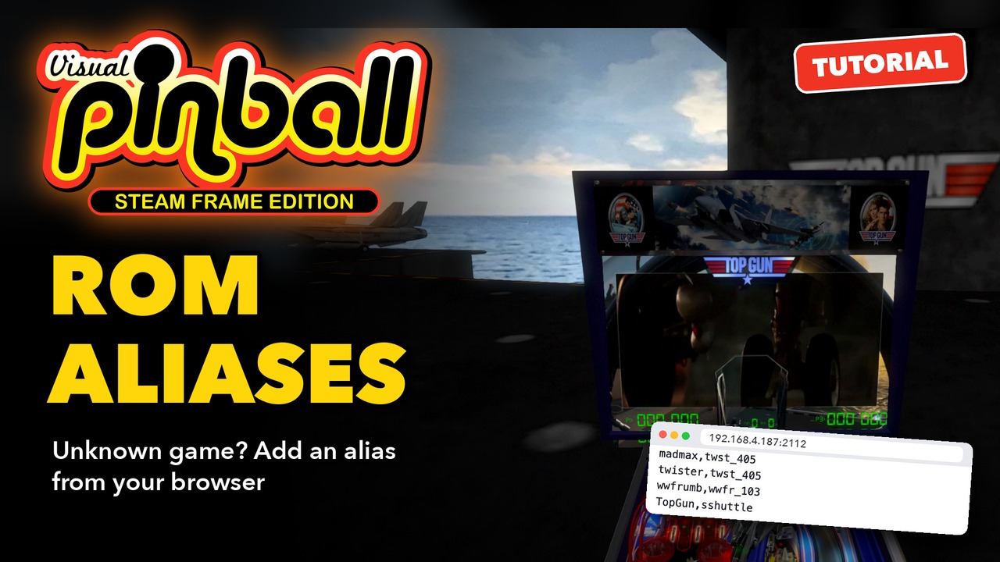
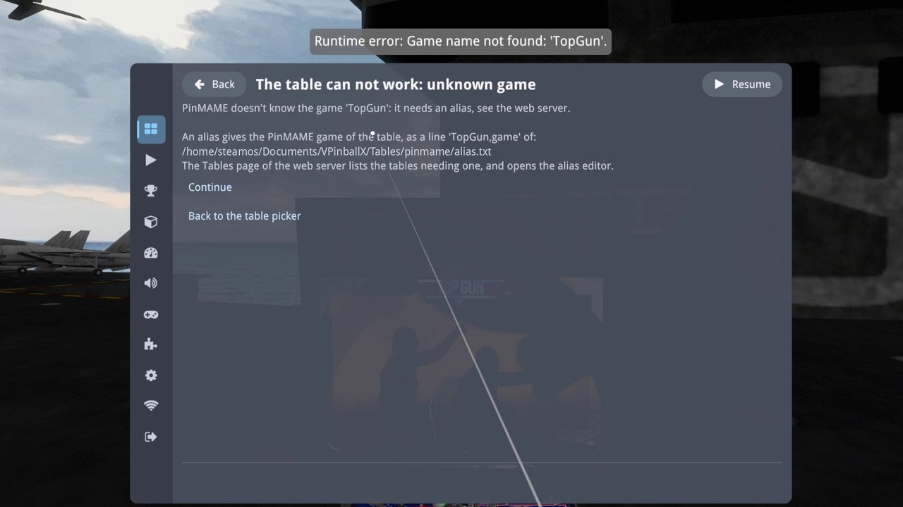
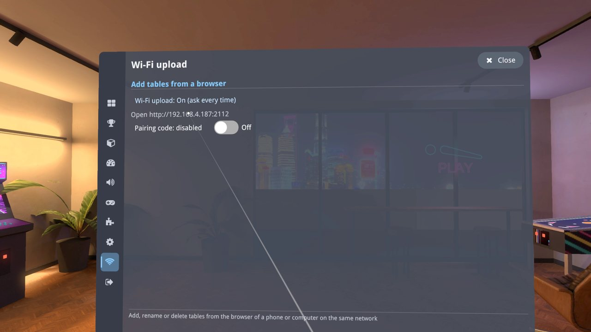
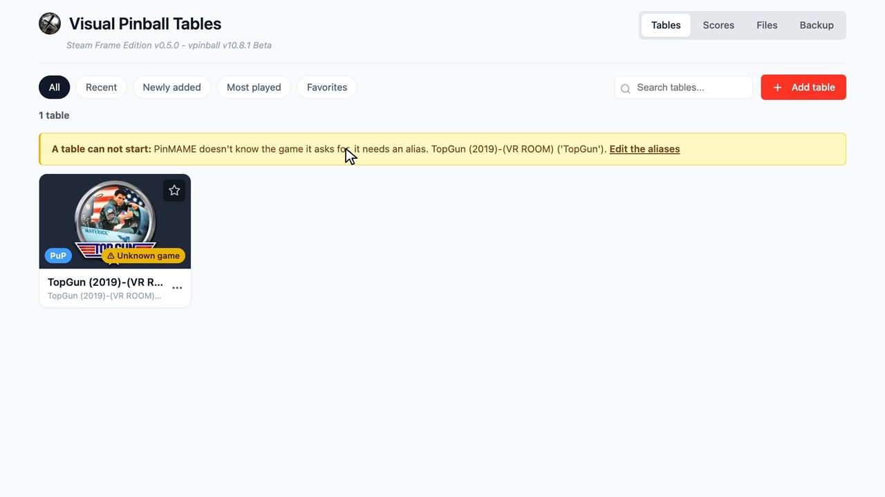
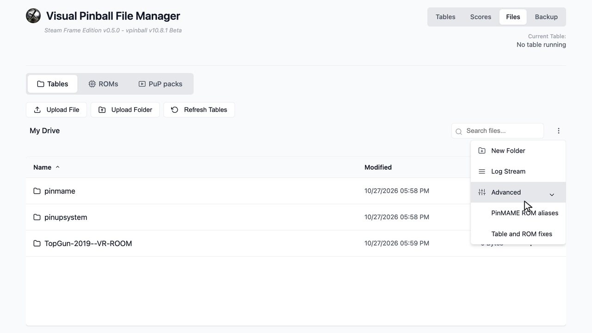
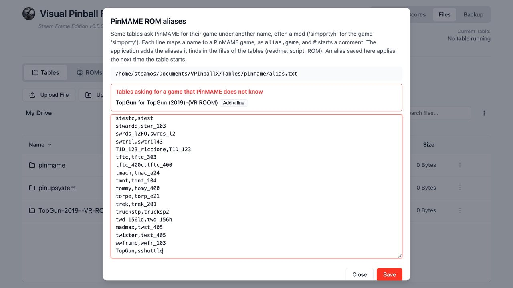
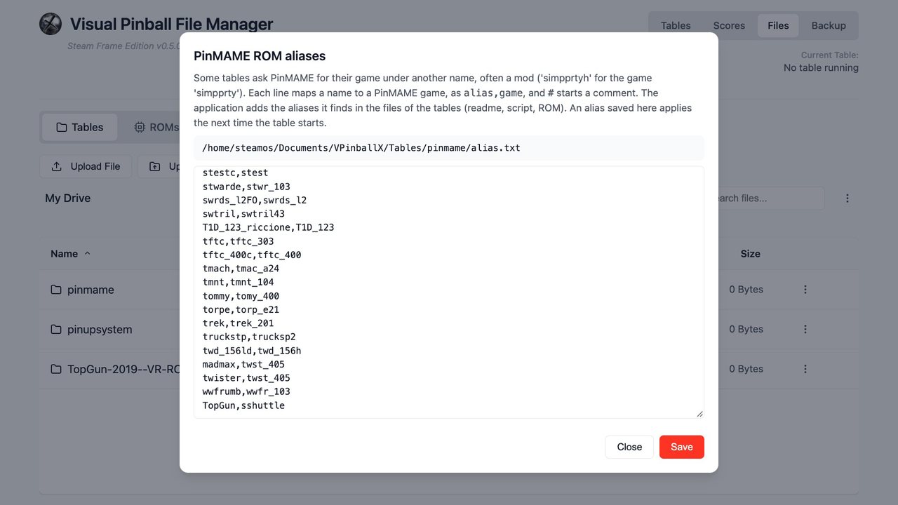
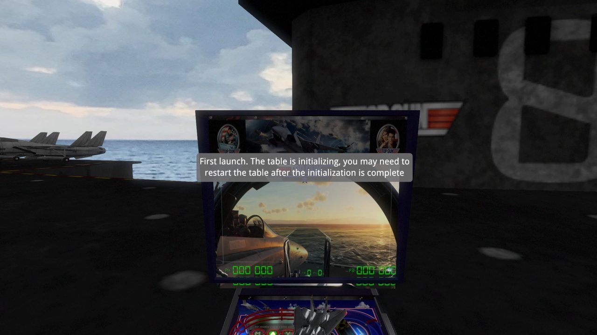
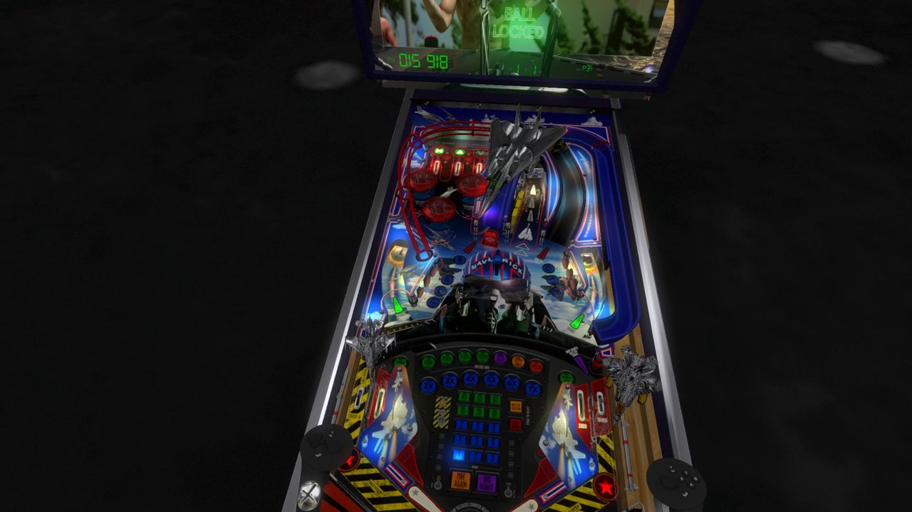

# ROM aliases

Some tables ask PinMAME for a game under a name it does not know, and stop at once with *The table can not work: unknown game*. They
need an alias: a line that tells PinMAME which of its games that name is. This tutorial shows the message in the headset, then adds the
alias from a browser and plays the table.

[](https://youtu.be/LTy3QAzT5rQ)

**▶ [Watch the video](https://youtu.be/LTy3QAzT5rQ)** (2:28): the same steps in the headset and in the browser. The text below follows
it, with more details.

The example uses *Top Gun (2019) (VR ROOM)*, a table that asks for the game `TopGun`. Its game in PinMAME is `sshuttle`, *Space
Shuttle* (Taito 1985).

You need:

- The table in the library, and the ROM of its game in the ROM folder (here `sshuttle.zip`): see
  [Adding tables and ROMs](Adding%20Tables%20and%20ROMs.md).
- Wi-Fi upload turned on in the headset, and a computer or phone on the same network (step 2).

## What an alias is

A table of a real machine runs the program of that machine in PinMAME, and asks for it by name: the name of its ROM, `sshuttle` for
Space Shuttle. Mods and new tables often ask for a name of their own instead, that PinMAME does not know. An alias is a line of the alias
file that gives the PinMAME game of that name:

```
TopGun,sshuttle
```

The name the table asks for, a comma, then the PinMAME game. The alias file is `pinmame/alias.txt` in the tables folder,
`/home/steamos/Documents/VPinballX/Tables/pinmame/alias.txt` on the Frame. When it is missing, Visual Pinball creates it with the
aliases built into VPinMAME.

Visual Pinball adds most aliases by itself: when a table starts, it looks for its game in the table's readme, script and ROM files,
and writes the alias. You only add one when it finds nothing, as with Top Gun.

## 1. The table says it needs an alias

In the lobby, open **Tables** in the rail, choose the table and **Play**. The table loads, then stops with a message:

- *The table can not work: unknown game*
- *PinMAME doesn't know the game 'TopGun': it needs an alias, see the web server.*
- The line to add, *'TopGun,game'*, and the path of the alias file.

A notice above it says *Runtime error: Game name not found: 'TopGun'*.



Choose **Back to the table picker**.

## 2. Turn on Wi-Fi upload

The alias is added from a browser. In the lobby, open **Wi-Fi upload** in the rail (the Wi-Fi icon). If it says *Off*, choose it to turn
it on (*On (ask every time)*). The page shows the address to open in a browser of a computer or phone on the same network, for example
`http://192.168.4.187:2112`.



The video turns the pairing code off to keep it short. With the code on, the browser asks for it the first time: see
[Adding tables and ROMs](Adding%20Tables%20and%20ROMs.md), step 1.

## 3. Add the alias from a browser

### The Tables page lists the tables needing one

Open the address. The **Tables** page shows a yellow banner: *A table can not start: PinMAME doesn't know the game it asks for, it needs
an alias*, with the table and the name it asks for, and a link **Edit the aliases**. The tile of the table has an **⚠ Unknown game**
badge, which opens the same editor.



### Open the alias editor

The link of the banner or of the badge opens the editor. It is also in the **Files** page: the menu button at the top right of the file
list, then **Advanced › PinMAME ROM aliases** (next to **Table and ROM fixes**).



### Add the line

The editor shows the path of the alias file, then a red box: *Tables asking for a game that PinMAME does not know*, here *TopGun for
TopGun (2019)-(VR ROOM)*, and the file itself. Lines starting with `#` are comments.


1. Choose **Add a line** next to the table: the line `TopGun,` is added at the end of the file, with the cursor after the comma.
2. Type the PinMAME game: `sshuttle`.

   

3. Choose **Save**. *Saved* appears, and the red box goes away: no table is waiting for an alias any more.



The alias applies the next time the table starts.

**Which game?** The readme of the table, or its page on the site where you downloaded it, usually gives it, as the name of the ROM to use
(`sshuttle.zip`: the game is `sshuttle`). The ROM of that game must be in the ROM folder, `pinmame/roms`.

## 4. Play the table again

Back in the headset, play the table again. PinMAME knows its game now. As with any new game, the first start sets the game up, with the
notice *First launch. The table is initializing, you may need to restart the table after the initialization is complete*.



Restart the table once: press the menu button of a controller, choose **Quit** in the rail, then **Return to Lobby**, and **Play** it
again. The game works: insert coins with B, start with A, and play.



## If something goes wrong

- **The same message after the alias:** check the line in the editor: the name before the comma must be the one of the message. If
  that name is already on an earlier line, PinMAME only uses the first one: change or remove it. After **Save**, the editor warns about
  both, and about a game PinMAME does not know.
- **A message that the ROM is missing:** the alias worked, the ROM of the game is not in the ROM folder. Upload it as in
  [Adding tables and ROMs](Adding%20Tables%20and%20ROMs.md), step 4.
- **Save refuses the file:** PinMAME would misread some lines, and the editor lists them. Each line holds the two names separated by a
  comma (letters, digits, `_` and `-`), optionally followed by a `#` comment, in 126 characters at most.
- **The game stays on its setup message after the restart:** play it once more (see
  [Adding tables and ROMs](Adding%20Tables%20and%20ROMs.md#if-something-goes-wrong)).

How the aliases work in the fork, and how it finds them for the mods: [PinMAME ROM aliases](../PinMAME%20ROM%20Aliases.md).
