# Table fixes

Some tables and games do not work on the Frame as they are: the table closes as soon as it starts, or the game takes coins but never gives
a credit. Often the cause is a bug in the table script that recent versions of Visual Pinball refuse, or a ROM that must be set up from
its service menu. For the ones found so far, the game ships a **fix**. This tutorial patches a table in the headset, shows the fixes in
the browser, and lets a ROM fix set up its game.

[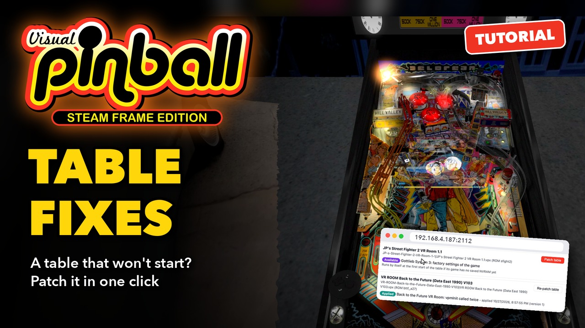](https://youtu.be/OcG5zoDzA2M)

**▶ [Watch the video](https://youtu.be/OcG5zoDzA2M)** (3:05): the same steps in the headset and in the browser. The text below follows it,
with more details.

The examples are *VR ROOM Back to the Future (Data East 1990) V103*, which was on the Frame before its fix was released, and *JP's Street
Fighter 2 VR Room*, whose game (Street Fighter II, Gottlieb System 3, ROM `sfight2`) was never played on the Frame.

## What a fix is

A fix is a recipe shipped with the game: which tables or ROMs it applies to, what it changes, and why. There are two kinds:

- **Script patch**: a fixed copy of the table's script, saved next to the table as a `.vbs`, which Visual Pinball loads instead of the
  script inside the table. The table file itself (`.vpx`) is never changed. A `.vbs` the table came with is kept as `.vbs.orig`.
- **ROM procedure**: the game goes through its own service menu by itself, as an operator would, then restarts.

The fixes shipped today:

| Table or ROM | Without the fix | What the fix does |
| --- | --- | --- |
| VR ROOM Back to the Future (Data East 1990) | The table closes as soon as it starts, back to the lobby, as if it crashed | Removes a second `vpmInit me` from its script, which made the table stop itself |
| Gottlieb System 3 games: Street Fighter II (`sfight2`), Stargate (`stargat5`), Super Mario Bros (`smb`), Super Mario Bros Mushroom World (`smbmush`) | Coins are accepted, but the display stays at CREDITS 0 | Loads the factory settings of the game from its service menu |

New fixes come with the updates of the game. The full record of each one (the cause, the exact change, how it was checked) is in
[Table and ROM Fixes](../Table%20and%20ROM%20Fixes.md).

**Tables you add** get the fixes they need by themselves, as soon as the game finds them: nothing to do. **The tables already on the Frame**
when a fix is released are not changed by themselves: you patch them, as below.

## 1. A table that closes at once

In the lobby, open **Tables**, choose *Back to the Future* and **Play**. The table loads, then closes at once and you are back in the lobby,
as if it had crashed. Its script initializes the game twice, and Visual Pinball stops a table that does.

## 2. Patch it in the headset

Open the table again in the table picker. Its page has **Patch table**, with a wrench. Point at it: the text at the bottom of the page lists
the fixes it applies and their state, here *Back to the Future VR Room: vpmInit called twice: available*.

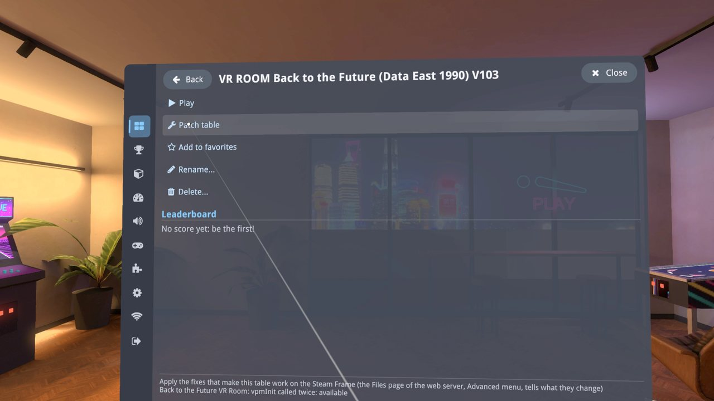

Choose **Patch table**. A notice says what was applied, *the script of the table is patched*, and the page now shows *Patched for
compatibility: ...* and **Re-patch table**.

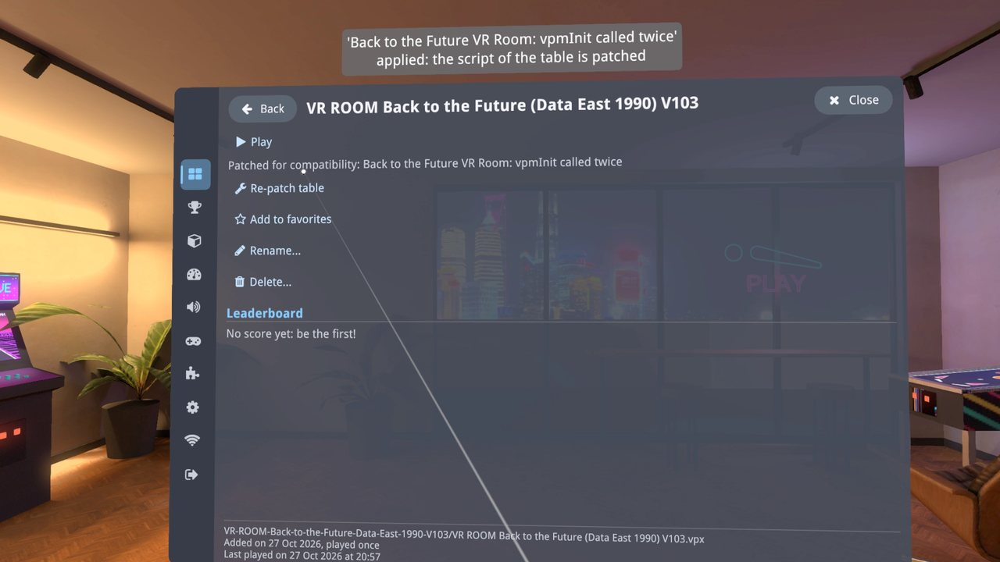

Choose **Play**: the table starts and stays. Insert coins, press Start, and play.

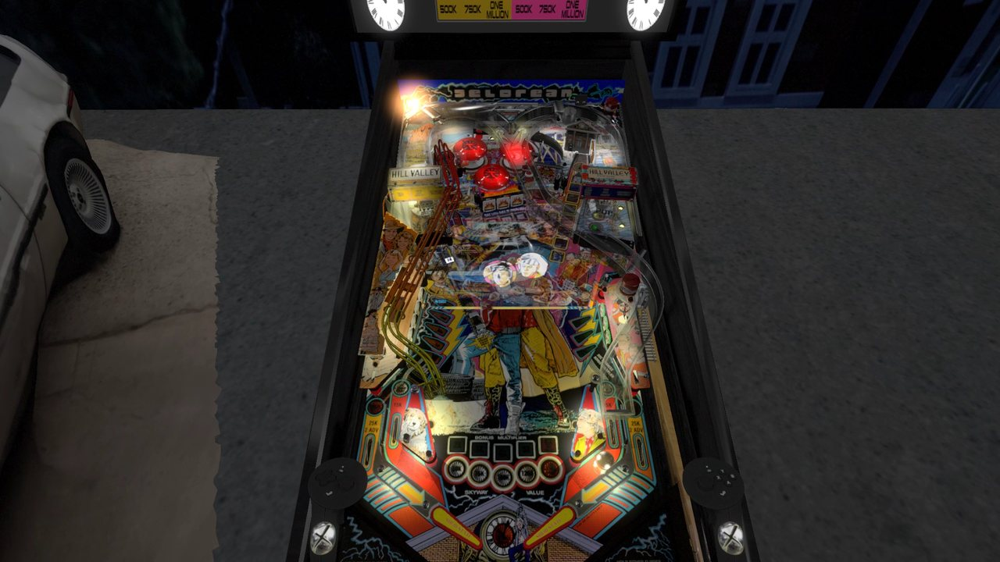

A fix applies when the table starts: if you patch a table while it is being played, restart it.

## 3. The fixes in the browser

With Wi-Fi upload on (see [Adding tables and ROMs](Adding%20Tables%20and%20ROMs.md), step 1), the **Tables** page of the browser shows the
fixes on the tiles: a green **Patched** badge on the tables that have their fix, a purple **Fix available** badge on the ones that have one
to apply.

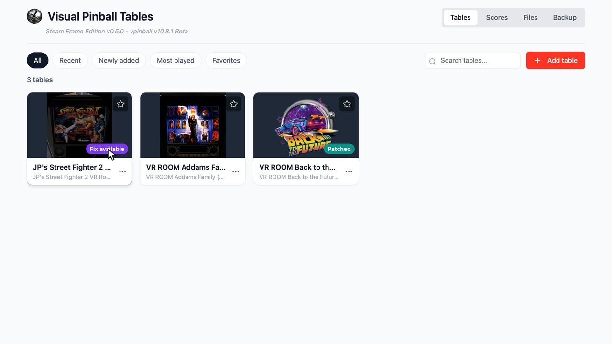

**Patch table** (or **Re-patch table**) is also in the **...** menu of a tile.

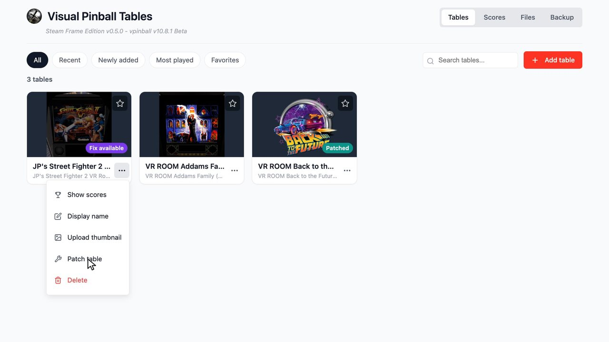

A badge opens **Table and ROM fixes**, also in the **Files** page: the menu at the top right, then **Advanced › Table and ROM fixes**. It lists:

- **Tables**: each table of the library that a fix applies to, with the state of each fix and a **Patch table** or **Re-patch table** button.

  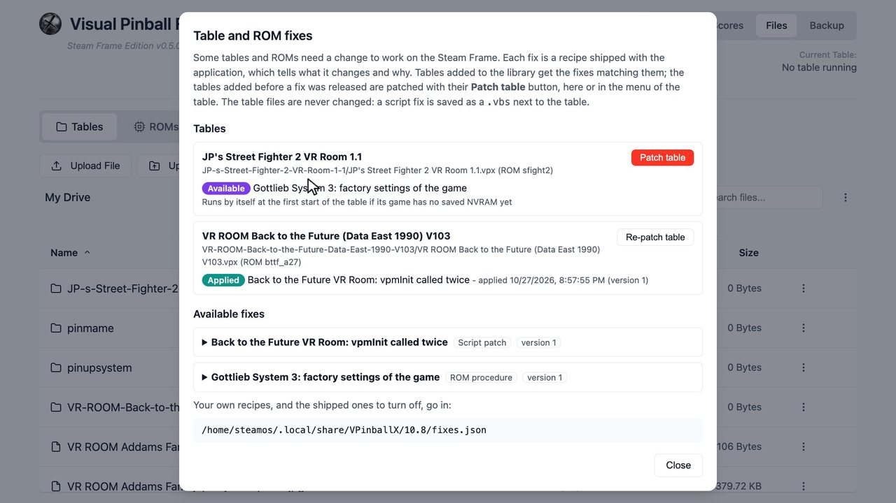

- **Available fixes**: every fix, with its symptom, its cause, what it changes, the tables or ROMs it applies to, and a link to its full
  record. Click a fix to open it.

  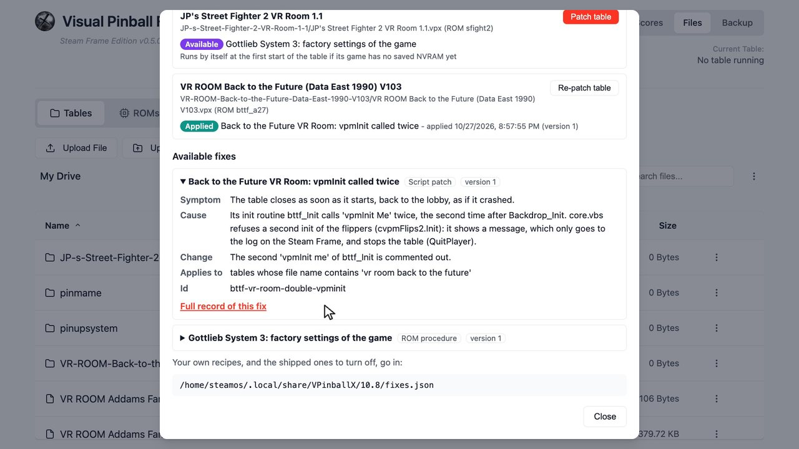

  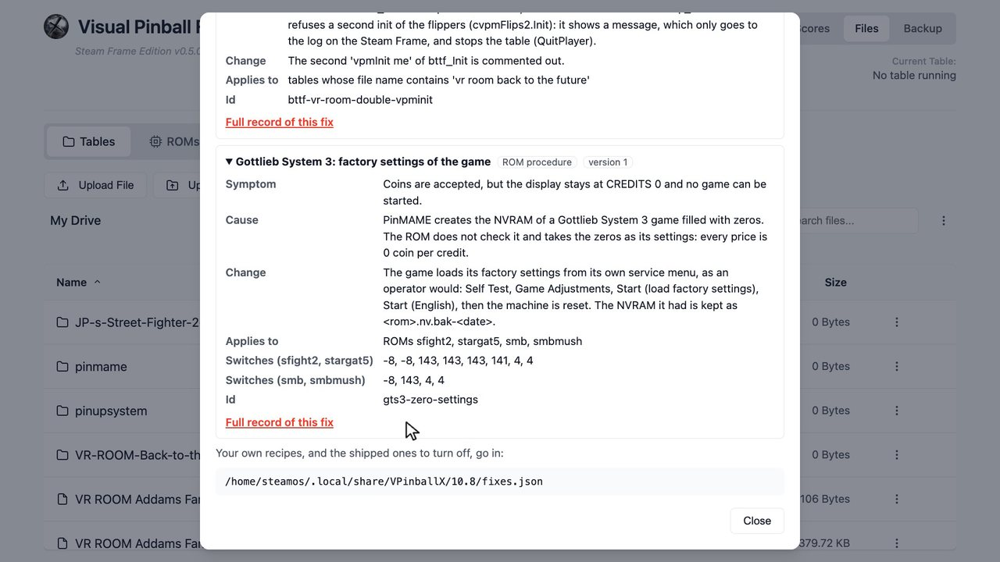

The state of a fix for a table:

| State | Meaning |
| --- | --- |
| Available | The fix applies to the table, and was not applied |
| Applied | Applied, with the current version of the fix |
| Update available | Applied with an older version of the fix: patch the table again |
| At the next start | ROM procedure requested: it runs when the table starts |
| Not needed | The table matches by name or ROM, but its script does not have the bug (a newer version of the table) |

## 4. A game set up by its fix

A ROM fix runs at the start of the table. It runs by itself the first time a game is played on the Frame (its ROM has no saved settings
yet); for a game already played, **Patch table** asks for it at the next start.

Street Fighter II was never played on this Frame: its page says the fix *runs by itself at the first start of the table*.

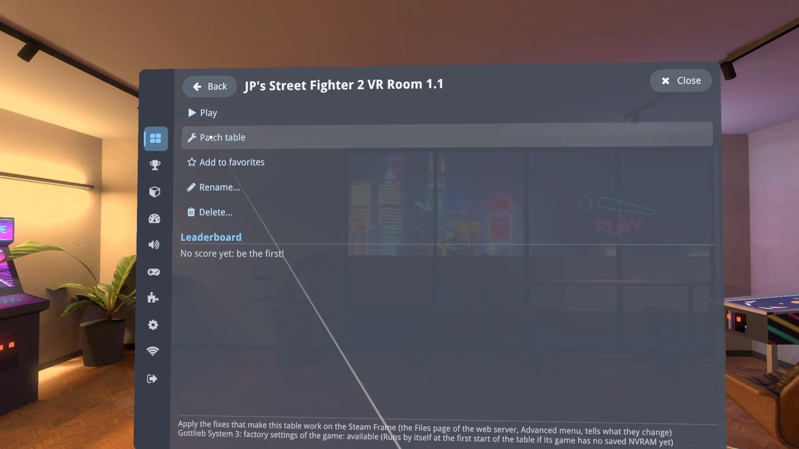

Choose **Play**. The table starts normally, then a notice says: *Patching this table for compatibility: its game loads its factory settings
(one time only, about 40 seconds). Please don't press any button until the game restarts.*

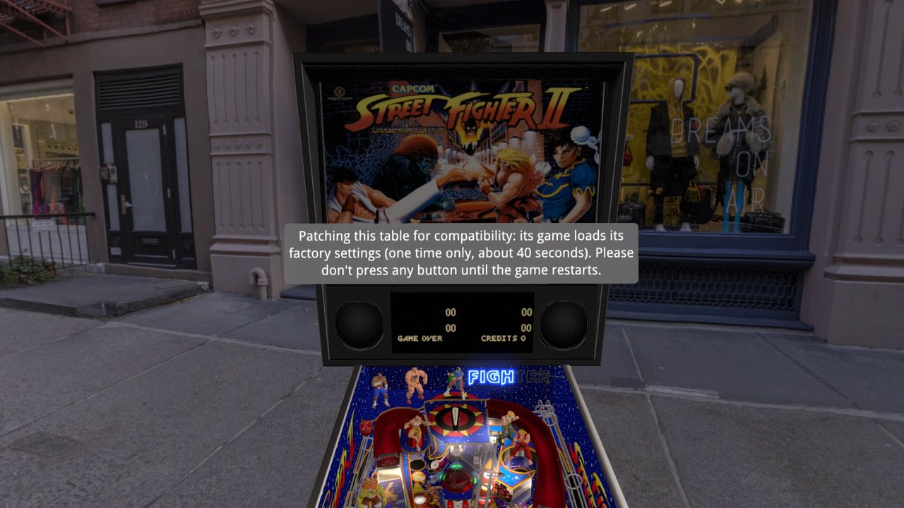

The game goes through its service menu by itself: the display shows its test and adjustment screens. Don't press anything meanwhile. The
flippers and Start are not passed to the game until the end, so a press by mistake does not change a setting.

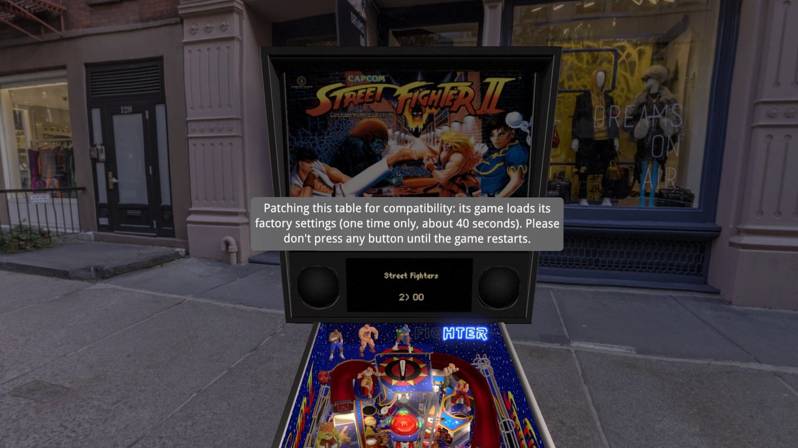

Then *Table patched for compatibility: the game restarts*, and the game boots again with its factory settings.

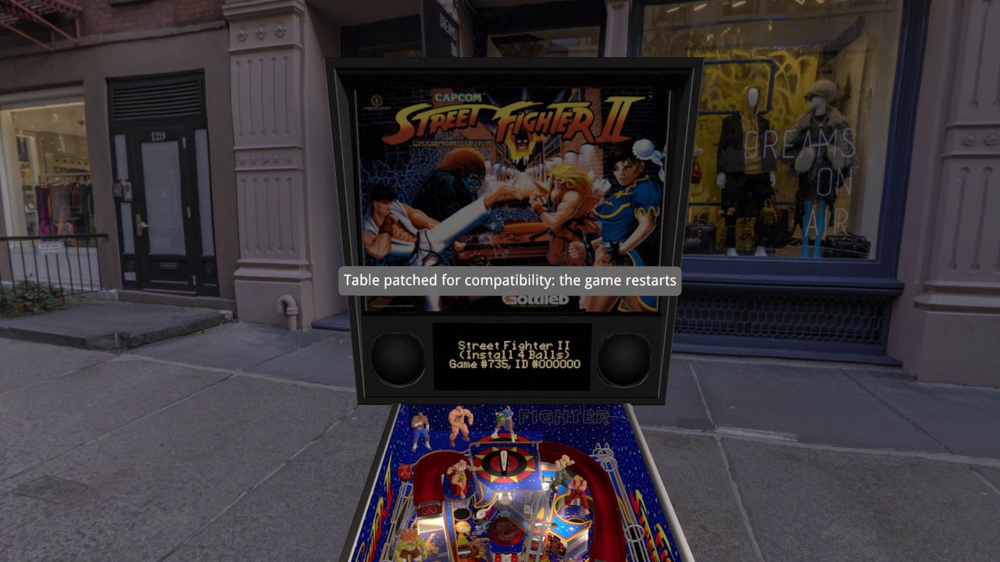

Insert coins: with its factory settings, Street Fighter II gives a credit for two coins. Press Start and play.

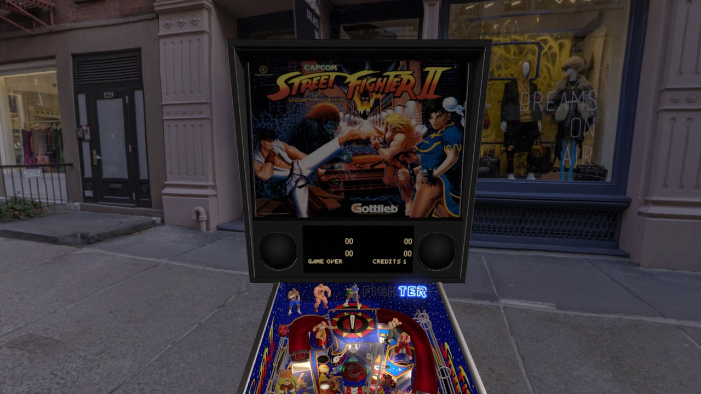

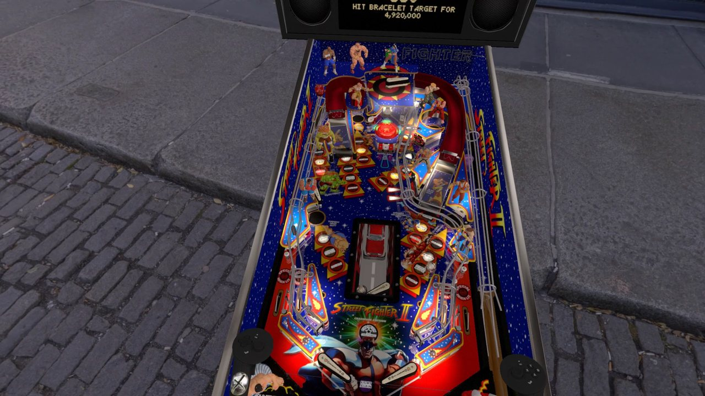

If the table is closed before the end, the fix runs again at its next start. A ROM fix keeps a copy of the game's previous save (high scores,
settings) as `<rom>.nv.bak-<date>` in the `pinmame/nvram` folder of the tables.

## Your own fixes

A `fixes.json` in the settings folder of the game (`/home/steamos/.local/share/VPinballX/10.8/` on the Frame, shown at the bottom of
**Table and ROM fixes**) adds your own recipes, in the format of the shipped ones, and turns shipped ones off: `"disable": ["gts3-zero-settings"]`.
The format is described in [Table and ROM Fixes](../Table%20and%20ROM%20Fixes.md#how-it-works).

## If something goes wrong

- **A table still closes at once after Patch table**: its fix may be for another version of the table. **Table and ROM fixes** then says
  *Not needed* for it: the bug is somewhere else. The log of the game (`vpinball.log` in the settings folder) tells what stopped it.
- **A ROM fix ends, but the game still gives no credit**: insert more coins, some games want two or more per credit. Otherwise choose
  **Re-patch table** and start the table again, pressing nothing until the game restarts.
- **The table was closed during a ROM fix**: start it again, the fix starts over.
